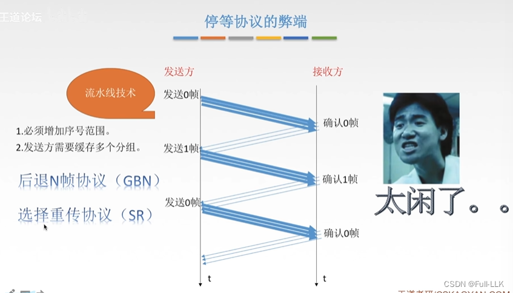
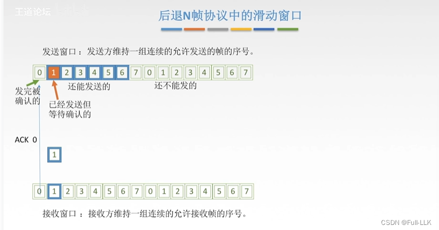
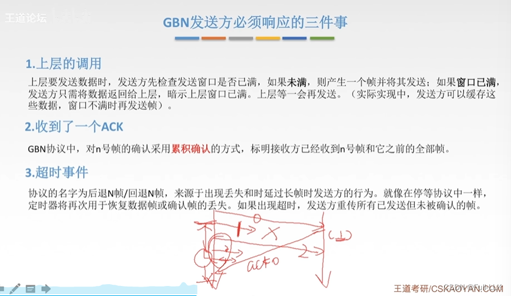
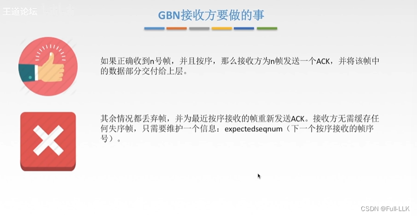
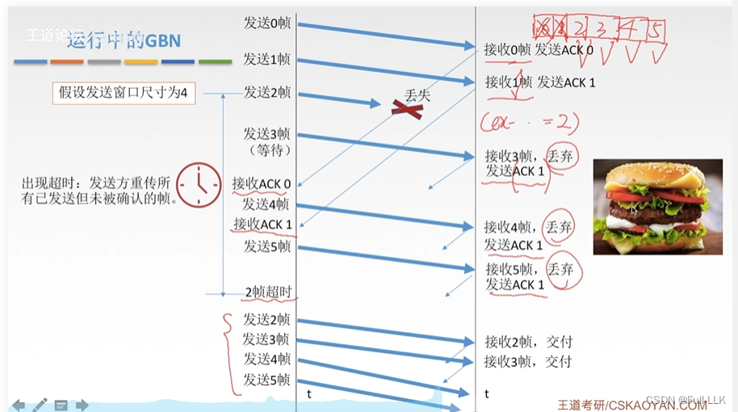
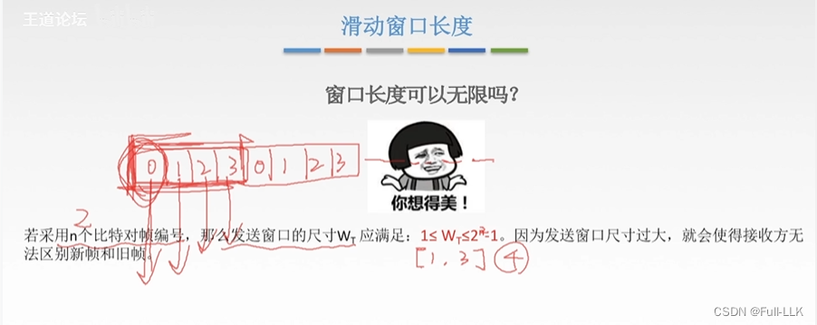
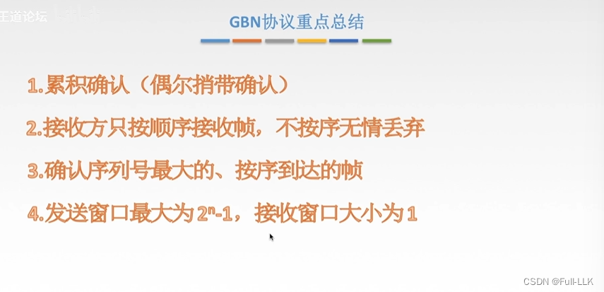
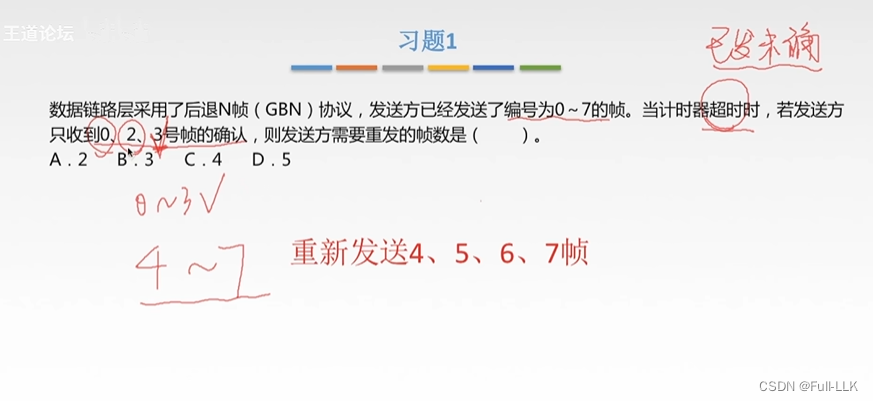
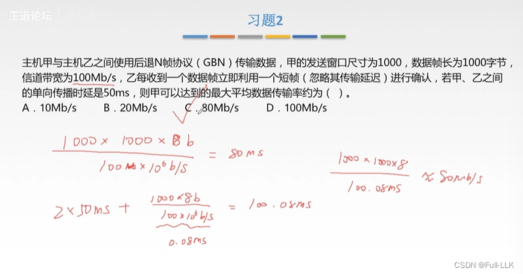
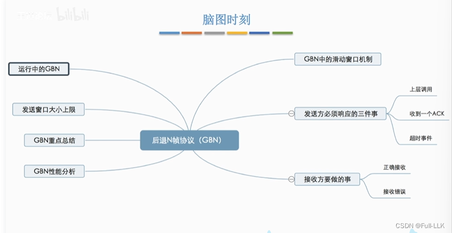


# 停止-等待协议的缺点
信道利用率低：在停止-等待协议中，发送方发送一帧之后，必须等待接收方的确认（ACK）才能发送下一帧。如果确认丢失或延迟，发送方会因超时而重传数据帧，信道在等待确认期间处于空闲状态，浪费了信道资源。（比较发完两帧所需的时间就能看出这一点。）

流水线传输：每个数据帧紧跟在前一个数据帧之后发送。

此时需要增大序号的范围（流水线传输会发送很多帧），并且可能还需要缓存多个数据帧（流水线传输是连续发送的）。

# 回退 N 帧协议中的滑动窗口
发送窗口是一组待发送（即逐个发送出去）的连续帧序号。

帧发送出去之后，发送方会保留一份副本。
接收方收到 0 号帧之后，窗口右移一个位置。
发送方收到 0 号帧的确认帧 ACK 0 之后，窗口右移一个位置。

接收方可以先收到多个帧，再发送最后一个帧的确认帧。这样仍然能保证之前的所有帧都已收到，因为接收方的接收窗口只有在收到帧时才会移动；所以只要能发出最后一个帧的确认，说明之前的所有帧都已经收到了。

# GBN 发送方必须响应的三件事
累积确认：GBN（回退 N 帧）协议中的累积确认是一种机制，用于告知发送方哪些数据已被接收方成功接收。

在 GBN 协议中，接收方使用累积确认来告知发送方数据的接收状态。这意味着接收方不会为每个成功接收的数据包都发送一条确认消息，而是发送一个确认号（ACK），它表示接收方期望收到的下一个数据包的序号。这样，发送方就能得知接收方已成功接收了序号在该确认号之前的所有数据包。

> 例如，如果接收方已收到序号为 1、2、3 的数据包，但序号为 4 的数据包出错或丢失，则接收方会发送确认号为 4 的 ACK，表示它已成功接收序号为 1、2、3 的数据包，正在等待序号为 4 的数据包。

GBN 对超时事件的处理与停止-等待协议不同

# GBN 接收方要做的事
并重发最近一个按序到达的帧的 ACK：发送未收到的那个序号的前一个序号的确认帧；发送方收到之后，就知道接收方已经收到的帧的序号，从而可以发送接收方尚未收到的帧。

# GBN 的运行
发送 1 号帧且接收方收到 1 号帧之后，如果发出的 2 号帧丢失，那么即使 3 号帧发出并被接收方收到，也会被丢弃，并发送 1 号确认帧。

发送方收到确认帧时，窗口按相应的数量右移。

当发送方等待 2 号确认帧超时后，会重传 2 号帧及其之后的所有帧。

可以把接收方想象成在吃汉堡：必须按规定一层一层地吃。

# 滑动窗口大小
回退 N 帧协议（Go-Back-N ARQ）中滑动窗口大小的上限，是为了保证接收方能够正确区分新帧和旧帧。

在回退 N 帧协议中，发送方和接收方分别维护一个发送窗口和一个接收窗口。这些窗口本质上是序号的集合，表示哪些帧可以被发送或接收。具体来说：

- 发送窗口：允许发送方发送一组连续编号的帧。
- 接收窗口：接收方只接受某一个指定序号的帧，即接收窗口大小通常为 1。

当使用 n 比特对帧编号时，可以产生 2^n 个不同的序号。为了保证接收方不会混淆新旧数据帧，发送窗口大小应满足条件 1 ≤ W_T ≤ 2^n - 1。如果发送窗口大小超过 (2^n - 1)，就可能出现已发送但尚未被确认的数据帧的序号在窗口中再次出现的情况，使接收方无法区分这是一次新的传输，还是先前已发送的旧帧的重传。

例如，如果使用 3 比特编号，理论上虽然可以有 8 个不同的序号，但如果把发送窗口大小设为 8，那么在 0 到 7 号帧都发送出去之后，若这些帧都已正确到达但尚未被确认，发送窗口就会被占满，发送暂停。此时如果发生错误需要重传，由于序号重复，接收方将无法区分这是一次新的传输还是旧帧的重传，从而可能造成混乱。

# GBN 协议要点总结
偶尔捎带确认：接收方偶尔会向发送方发送数据，并把确认帧捎带在其中。

对按序到达的最大序号的帧进行确认：也就是说，当收到序号为 1、2、4 的帧时，回送 2 作为确认帧。

发送窗口一旦确定，在运行过程中就不能轻易改变。

# 习题 1
收到 3 号帧的确认时，表示 3 号帧及其之前的所有帧都已收到，因此发送窗口右移 4 个位置。
 
 
# 习题 2
发送方收到第一个确认帧时已发送的字节数 / 发送方收到第一个确认帧的时刻

# GBN 协议性能分析

# 总结


