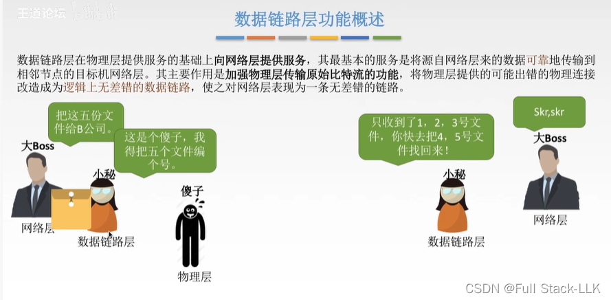
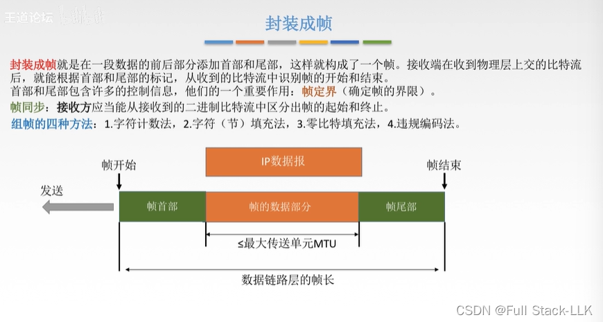
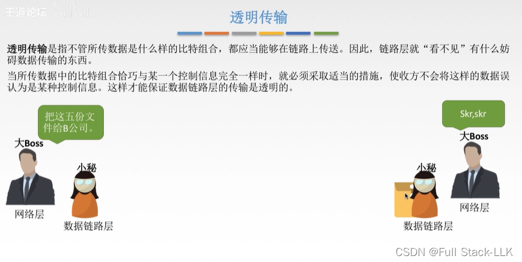
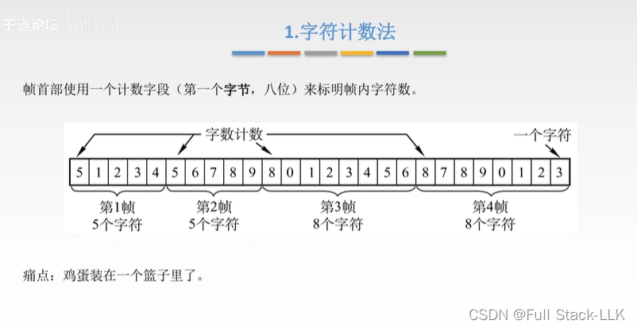
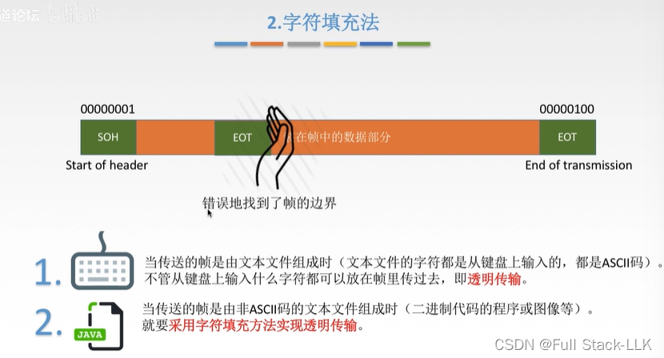
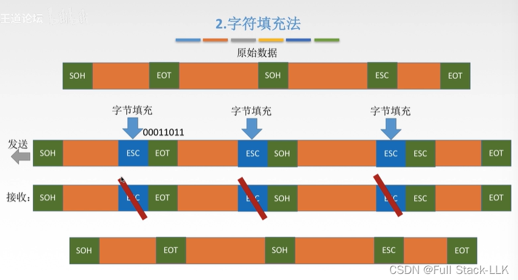
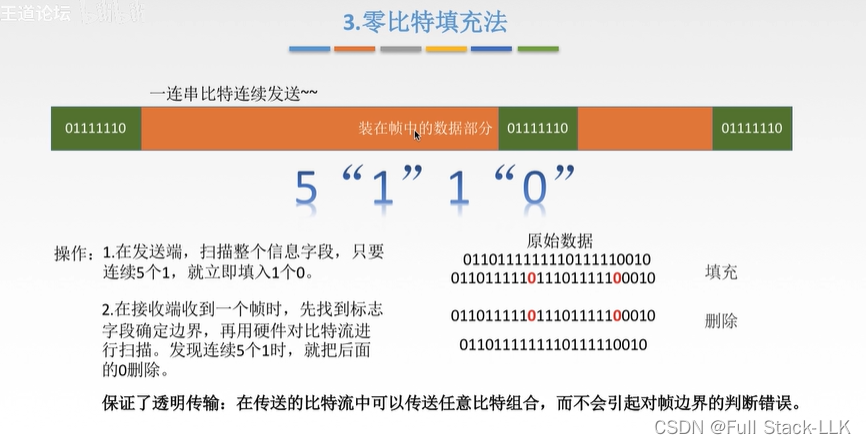
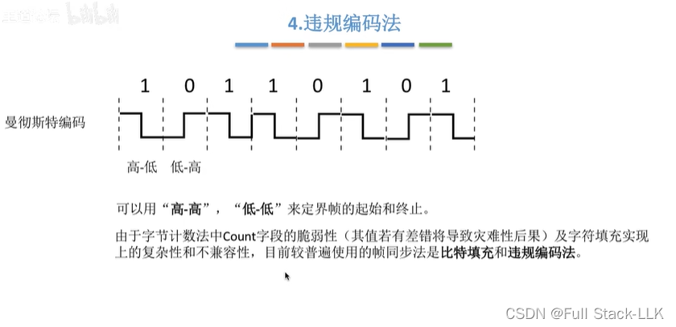


# 数据链路层的功能概述
就像老板让秘书把一份文件送到另一家公司；秘书告诉快递员如何把文件送到对方公司的秘书手里，然后对方公司的秘书再把文件交给她的老板。
'
# 封装成帧
MTU：与当前所用协议有关。
接收方通过帧头和帧尾的帧定界符来区分一帧的开始和结束。

# 透明传输
就像秘书在递送文件时并不关心文件的内容是什么。

# 成帧方法
## 字符计数法
某一帧的计数字段出错，会导致其后的帧也全部出错。

## 字符填充法
用开头和结尾各一个字节作为起始和结束标志。
ASCII 码与帧的起始字节和结束字节没有重叠。

但如果不是 ASCII 码，就可能出现识别错误。

字节填充法是一种防止数据中出现与帧定界符相同比特组合的技术。
字节填充（填入一个转义字符，告诉接收方无论后面是什么，都当作数据处理）。

接收时，删除所有收到的转义字符。

## 零比特填充法
在发送端，硬件扫描整个帧，一旦检测到连续五个 1 的比特序列，就自动在该序列之后插入一个 0。这样做的目的是防止数据中出现与帧定界符相同的比特组合（例如 HDLC 协议通常使用 01111110 作为帧定界符），从而避免接收端误识别帧边界。

## 违规编码法

# 为什么字符填充法复杂且不兼容
 - 实现机制复杂：如果数据中恰好包含与填充字符相同的序列，字符填充法需要一种机制来区分它是数据本身还是填充字符，这增加了实现的复杂度。
- 兼容性问题：由于字符填充法需要特定的处理逻辑，可能导致不同系统或协议之间出现兼容性问题。如果一个系统使用字符填充法，而另一个系统不具备相应的解码能力，数据传输就会出现问题。

