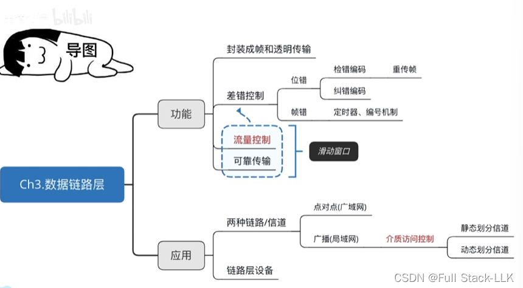
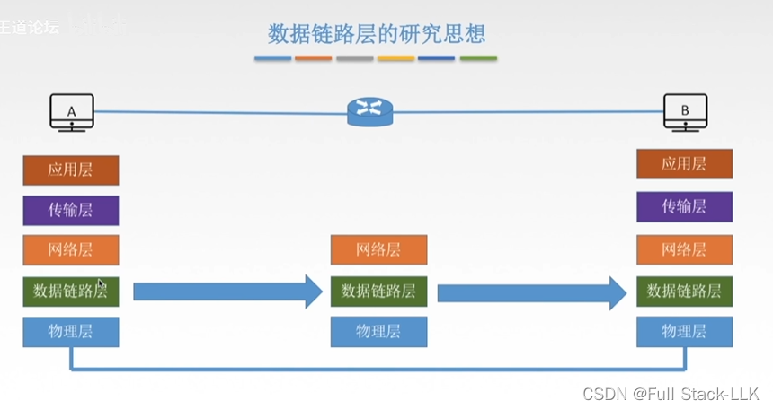
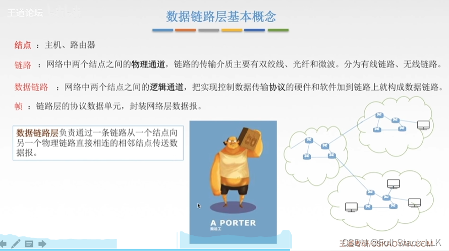
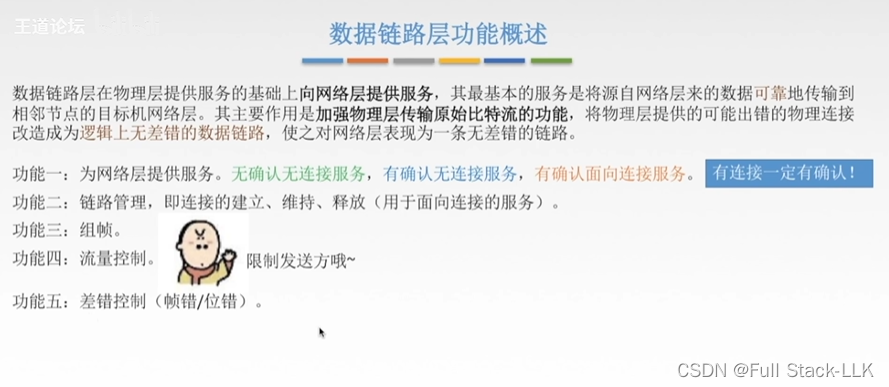


# 概述
- 封装成帧是指数据链路层在来自上层网络层的数据包（如 IP 数据报）前后加上自己的帧头和帧尾，构成一个完整的帧。这一过程包括对数据的封装，使其能够在物理介质上传输。封装成帧的目的是让接收端能够准确识别一个帧的开始和结束，提取出控制信息，并最终恢复出原始数据。帧头和帧尾中包含源和目的 MAC 地址、以太网类型字段以及循环冗余校验（CRC）等信息。

- 透明传输是指在数据传输过程中，数据链路层不对业务数据的内容做任何更改或处理，即数据直接通过互连功能方式，不经过任何纠错处理。透明传输可以保证数据的完整性和原始性，它允许上层交付的任何数据都能被传输，而不对数据本身施加限制或修改。这种传输方式的优点是能够保持数据的原貌，但同时也意味着如果传输过程中出现错误，这些错误不会被纠正，可能导致数据被错误接收。

- 数据链路层的比特差错通常指某个比特出错，而帧差错则涉及整个数据帧的错误，包括丢失、重复或失序。

# 数据链路层的研究思路
即接收端先解封装，再重新封装，然后把数据发送出去。
因此，不同结点在同一水平层上的数据内容是相同的。

# 数据链路层的基本概念
物理信道通过传输介质进行传输，可以是无线的，也可以是有线的。

数据链路则是在通过传输介质传输的基础上，还规定了一些规则。

# 数据链路层的功能概述
最基本的服务是让物理层传输得更准确，使到达网络层的内容没有差错。

无确认的无连接服务：通常用于实时通信或误码率较低的信道。
有确认的无连接服务：不建立连接，但收到后必须回复确认，否则数据会被重传。
有确认的面向连接服务：建立连接，收到后必须回复确认，否则数据会被重传。


