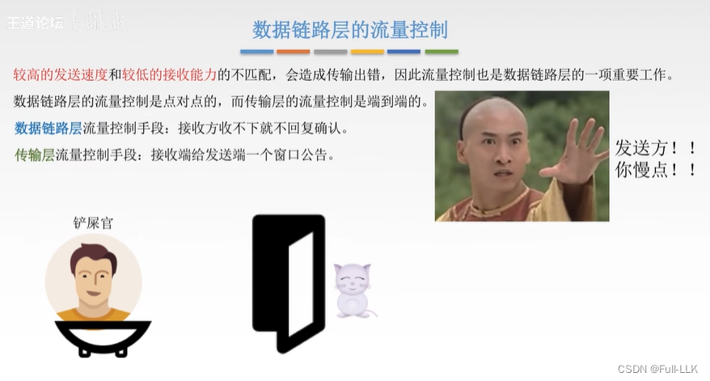
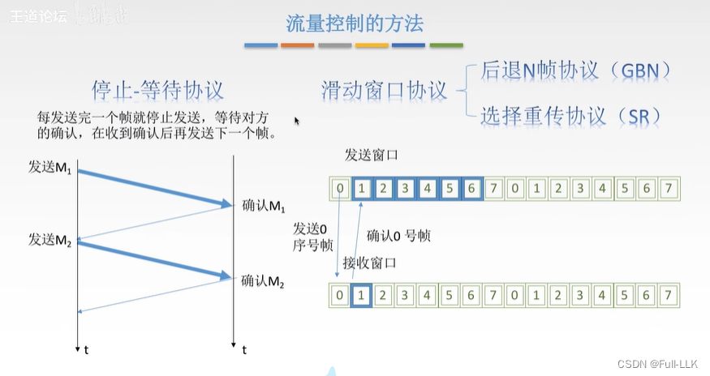
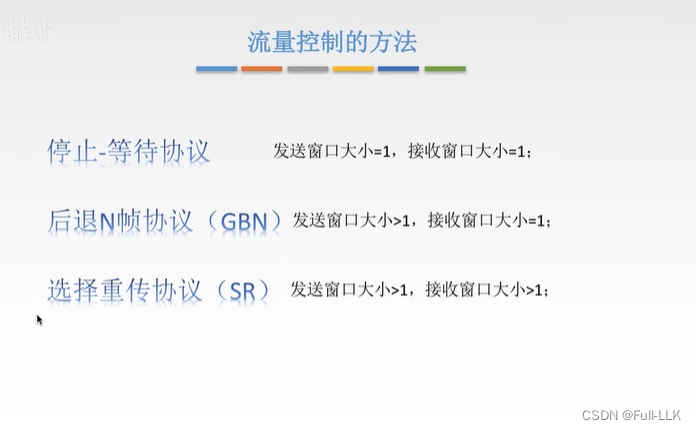
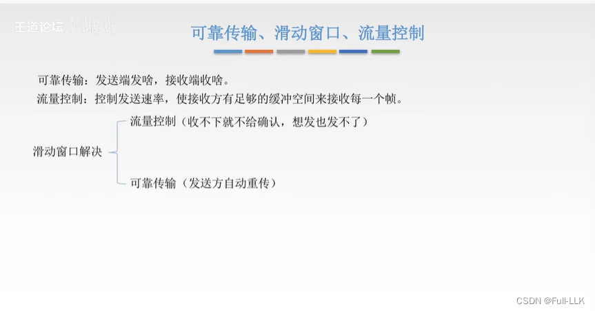
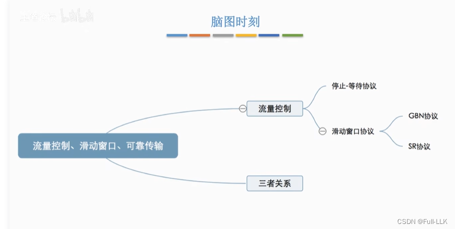


# 数据链路层的流量控制及其与传输层流量控制的区别

端到端：两台主机之间。
点对点：两个结点之间。

窗口公告：告诉对方自己这边的接收情况。

流量控制可以比作猫主人喂猫。

# 流量控制的方法
停止-等待协议：可以理解为发送窗口和接收窗口大小都为一。
滑动窗口协议：帧序号是循环使用的；收到一个确认帧后，发送窗口向前移动一格。

## 各方法对应的发送窗口和接收窗口大小
在数据链路层的流量控制中，三种协议的接收窗口和发送窗口大小都是固定值。

# 可靠传输、滑动窗口与流量控制的关系

# 小结


