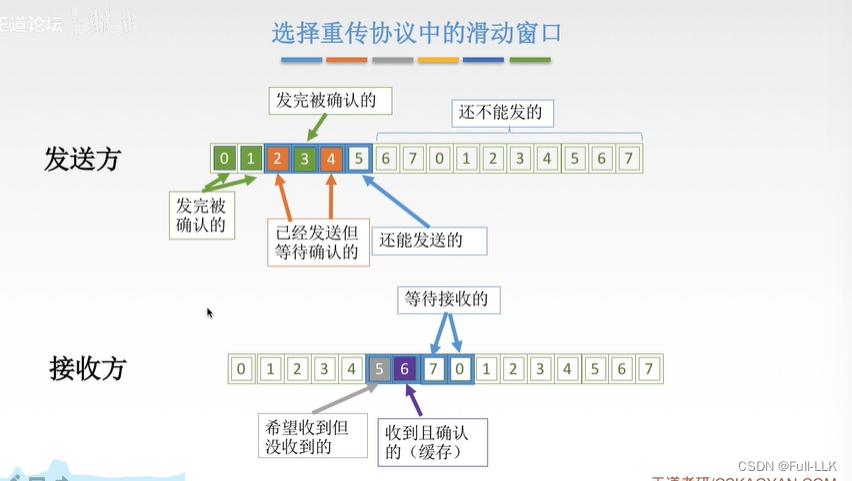
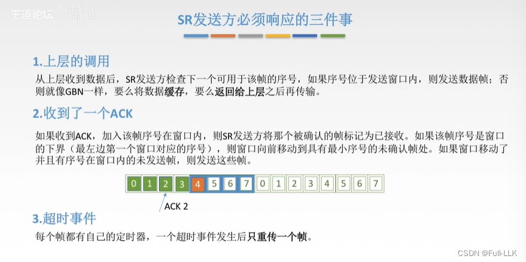
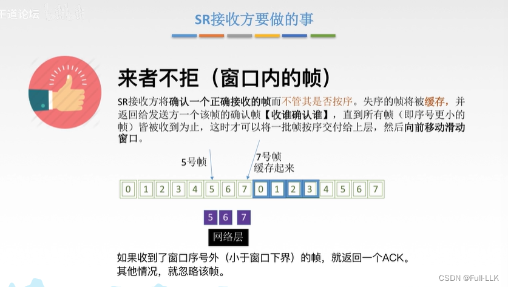
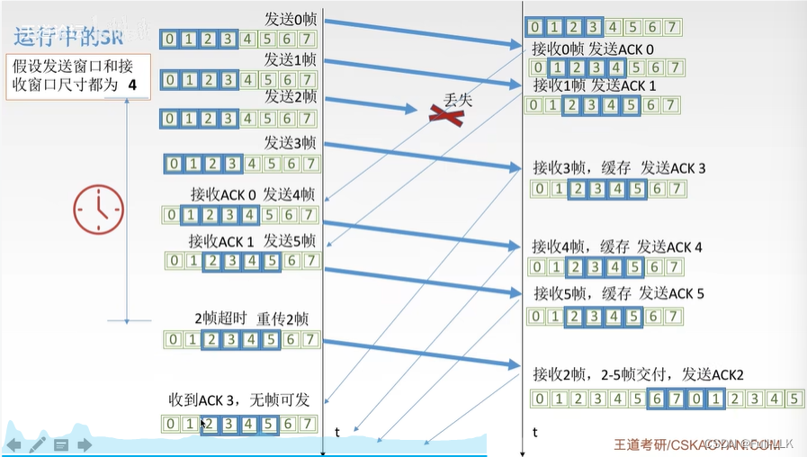
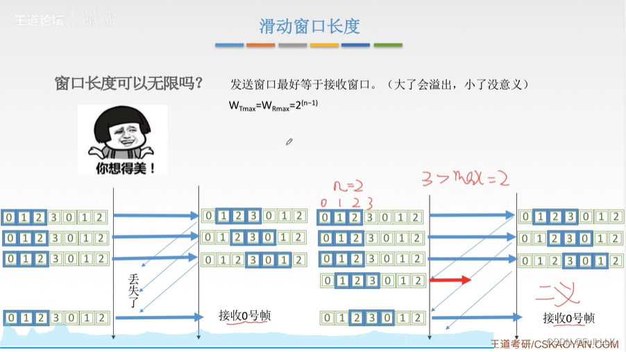
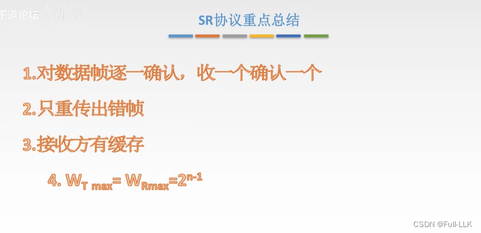
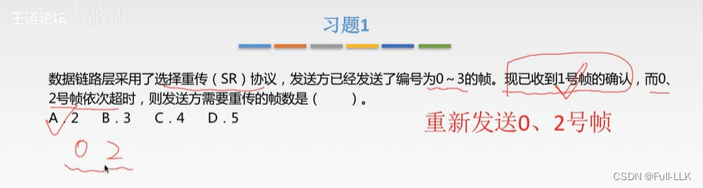
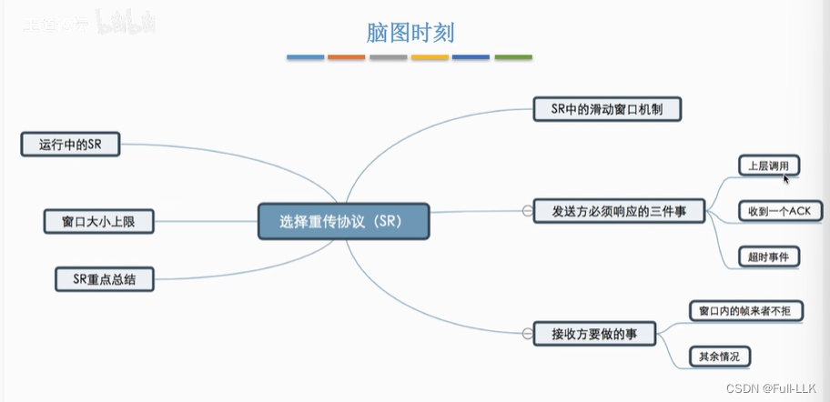


# GBN 协议的缺点
批量重传会连带把多余的帧也重传一遍。

设置独立确认后，就可以对帧逐个进行确认。

# 选择重传协议中的滑动窗口
发送方：如果窗口下界还没有收到确认，而窗口内其他部分已经收到确认，那么窗口不会移动，直到下界收到确认，此时窗口按相应的槽数向前移动。

接收方：下界还没有收到，但与它右侧相邻的帧已经收到；这时如果再收到下界，窗口会移动两个槽。

# SR 发送方必须响应的三件事
如果窗口已经移动，并且窗口内存在尚未发送的序号对应的帧，就发送这些帧：也就是说，窗口可能移动之后，如果窗口中现在有未发送的帧，就会把这些帧发出去。

# SR 接收方必须做的事

直到所有帧（即序号更小的帧）都已收到为止：也就是说，收到 6 和 7 之后，窗口不会移动；只有收到 5 时才会移动。

# SR 的运行过程
即使接收方收到了 3 和 4，但还没有收到 2，也不会把窗口向右移动。

# 滑动窗口长度
过大：发送窗口大于接收窗口，接收方来不及处理。
过小：多出来的接收窗口被浪费。

此时，左边的编号 0 是旧帧。
右边的编号 0 是新帧，但此时接收方无法区分它是新帧还是旧帧。

# SR 协议要点总结
每收到一个帧就对其逐个确认，且仅限于接收窗口范围内。

# 习题 1
没有累积确认：收到确认号 1 并不意味着 0 号也被确认了；在 SR 协议中，每个帧都需要单独确认。

# 总结


