
# 概述
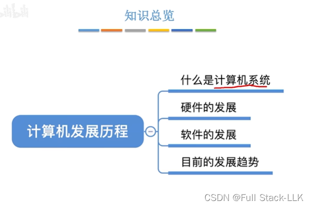
# 什么是计算机系统

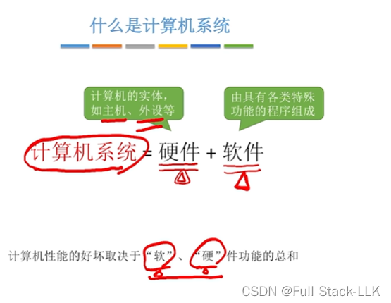
# 软件
语言处理程序就是编译器之类的程序
调试代码属于服务程序
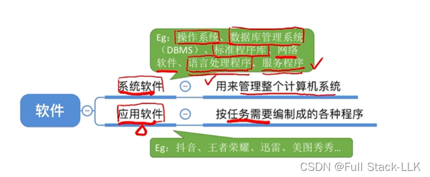
# 硬件的发展
## 第一代
逻辑元件：处理电信号的最小基本单元
电子管：体积大，功耗高
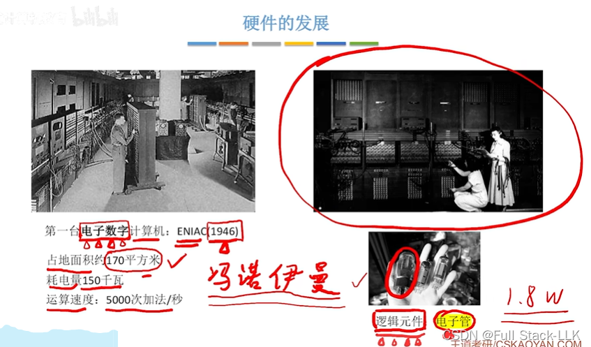
这一时期的程序员大多用机器语言编程。至于“bug”：曾经有一只小虫子钻进了一个孔里，导致机器语言的二进制信号被错误读取而产生错误——因此错误被称为 bug
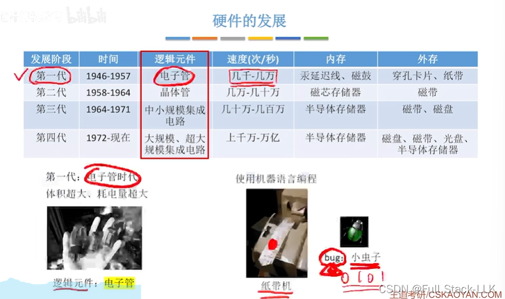
## 第二代
晶体管：比电子管体积小，功耗低
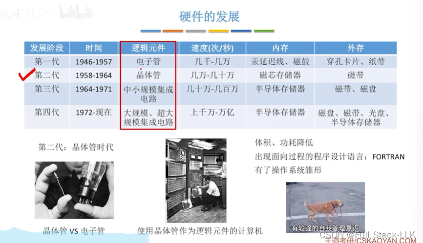
## 第三代
电子元件被高密度地集成在电路板上
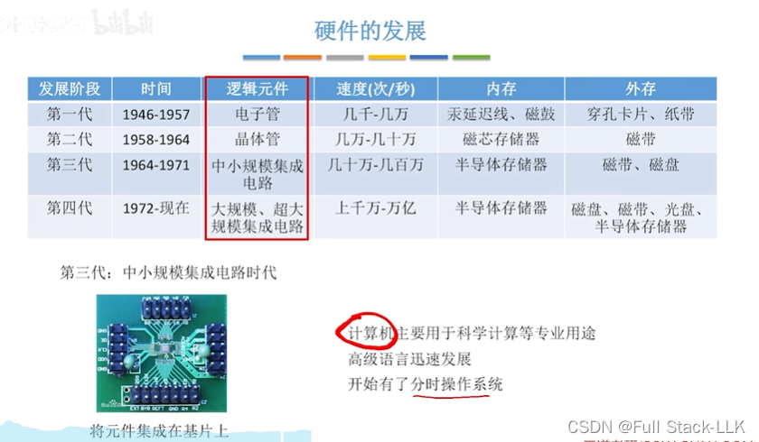
## 第四代
随着集成技术的进步，出现了更大规模的集成电路
微处理器：CPU
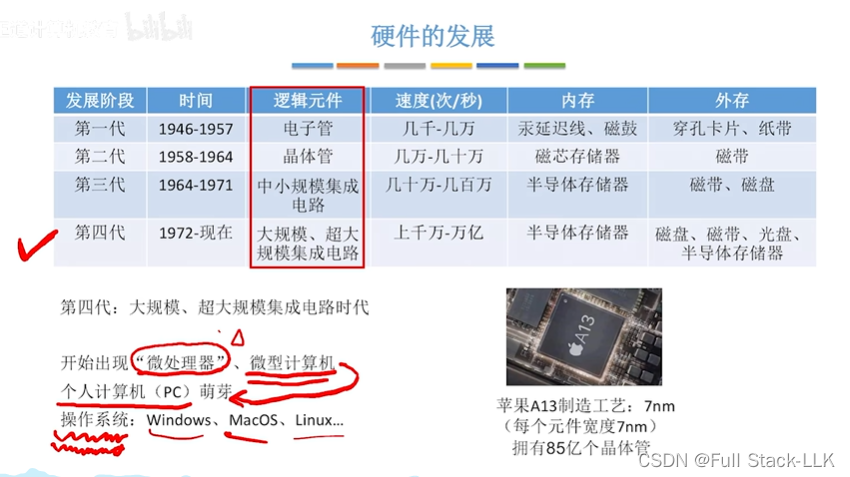
## 微处理器的发展
计算机随着微处理器的发展而发展
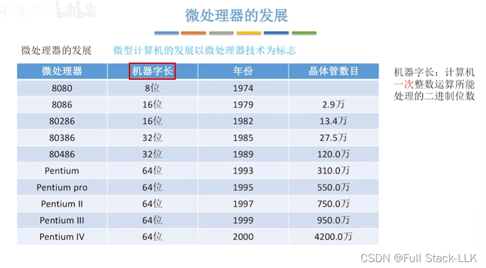
## 相关人物
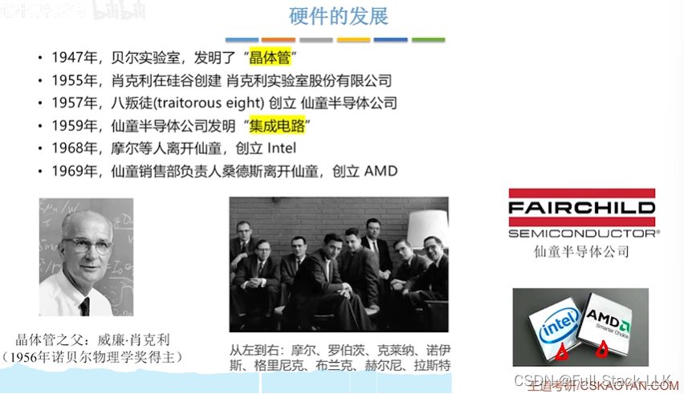
## 摩尔定律
  主存容量每两年可以翻一番
  晶体管数量也每 18 个月翻一番
  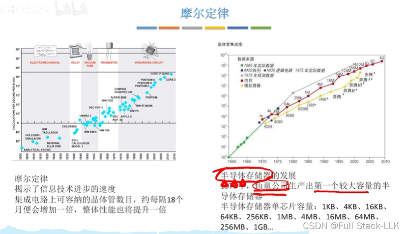
# 软件的发展
高级语言不再需要过多关注机器的具体特性，只需专注于要解决的问题。

DOS：磁盘操作系统（Disk Operating System），早期个人计算机上的一类操作系统。
从 1981 年的 MS-DOS 1.0 到 1995 年的 MS-DOS 6.22 这 15 年间，DOS 作为微软在个人计算机上使用的操作系统载体，发布了多个版本。DOS 在 IBM PC 兼容机市场中占有举足轻重的地位。它可以直接操纵和管理硬盘上的文件，以 DOS 的形式运行。
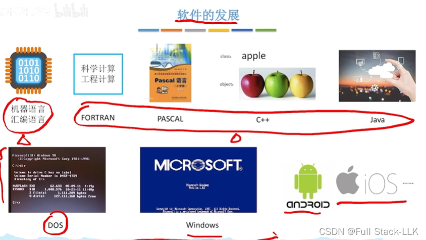
# 当前的发展趋势
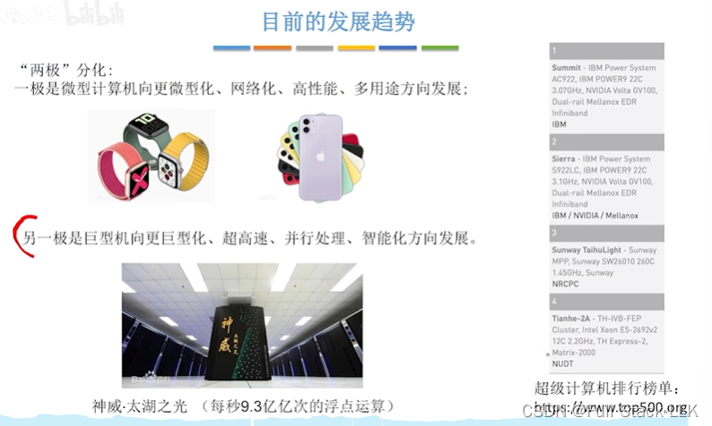
# 总结
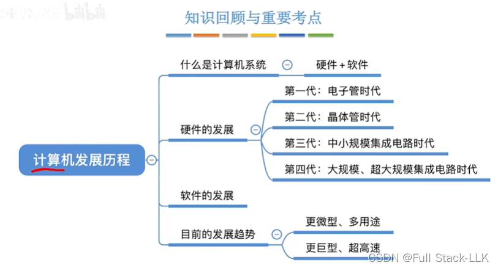

