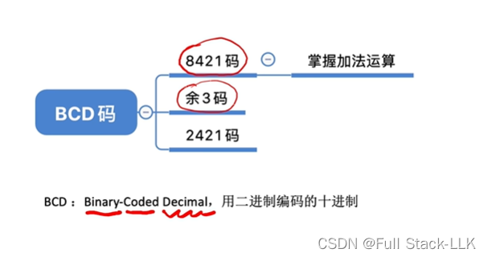
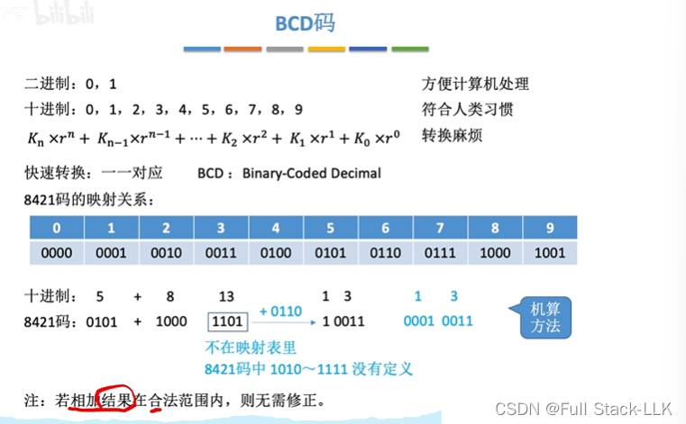
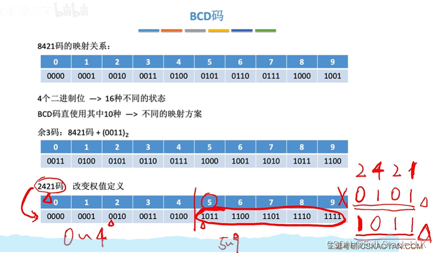
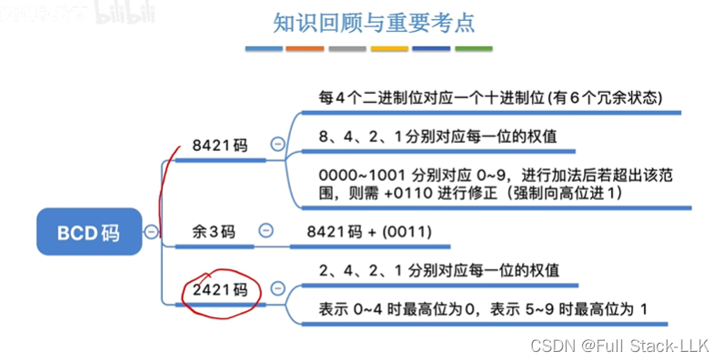
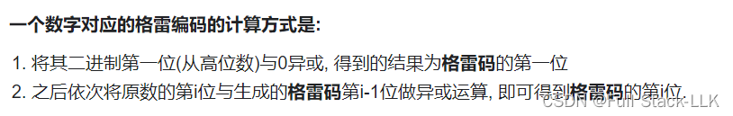
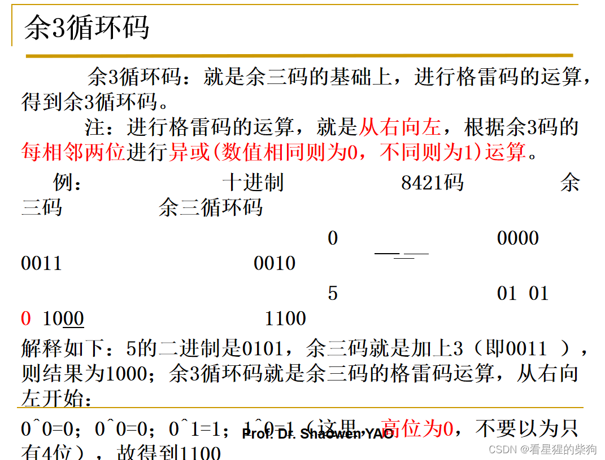
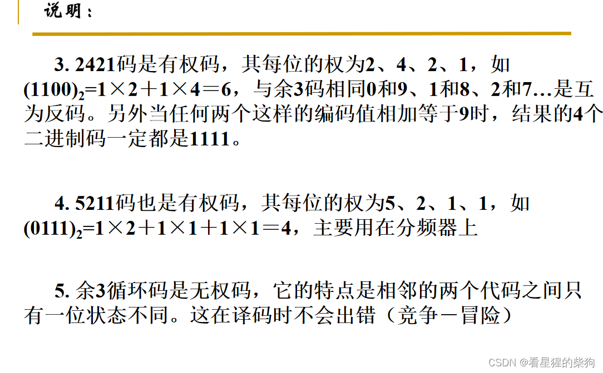
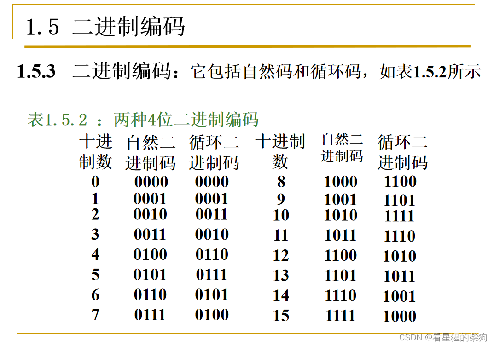
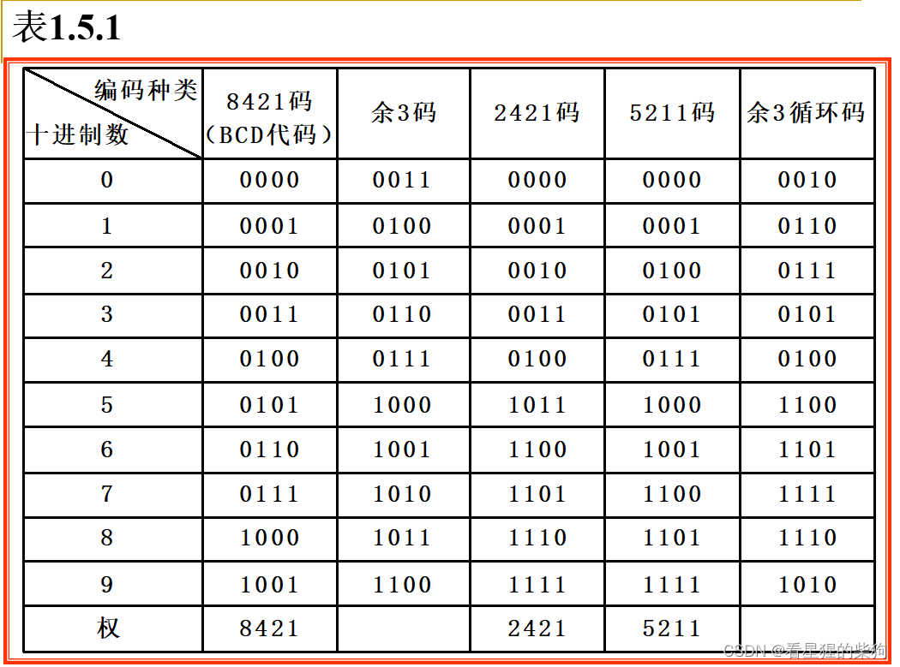


# 概述

# BCD 码
每一位的值乘以其位权
四位二进制可以表示一位十进制数，还剩下几种冗余情况
即四位二进制对应的值必须是 0~9
9+9 等于 18，二进制数也超出了范围，所以要加 6

如果相加结果落在 1010~10010，就要加 6

# 余 3 码和 2421 码
余 3 码是无权码

2421 码是有权码

5 的 2421 码可以是 0101 也可以是 1011，为了避免这种情况，规定大于等于 5 的数第一位总是 1

# 小结

# 补充
## 格雷码

## 余 3 循环码
余 3 循环码是对余 3 码进行格雷码的异或运算后得到的一系列变权码

## 自然码和循环码

## 小结


