
# 现代计算机的结构
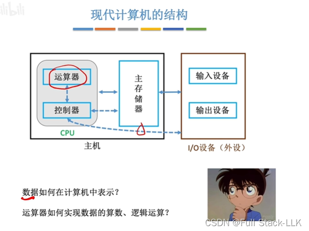
# 概述
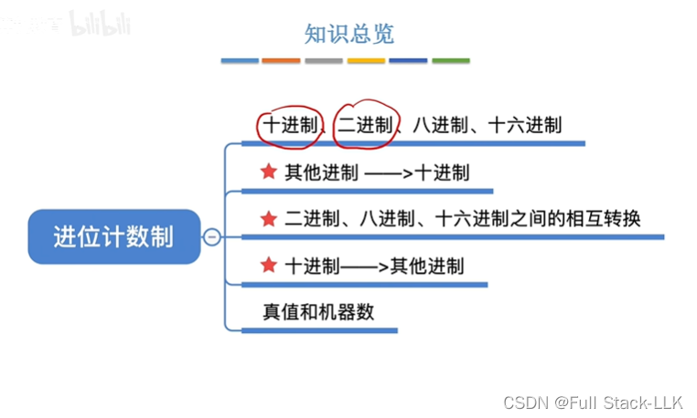
## 最古老的计数方法
一竖对应一个苹果，但数量多的时候，要画的竖线太多

后来用一条横线表示 5，这样就少画几笔

数越大，用符号表示就越麻烦
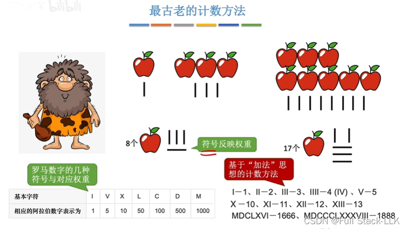
## 十进制计数法
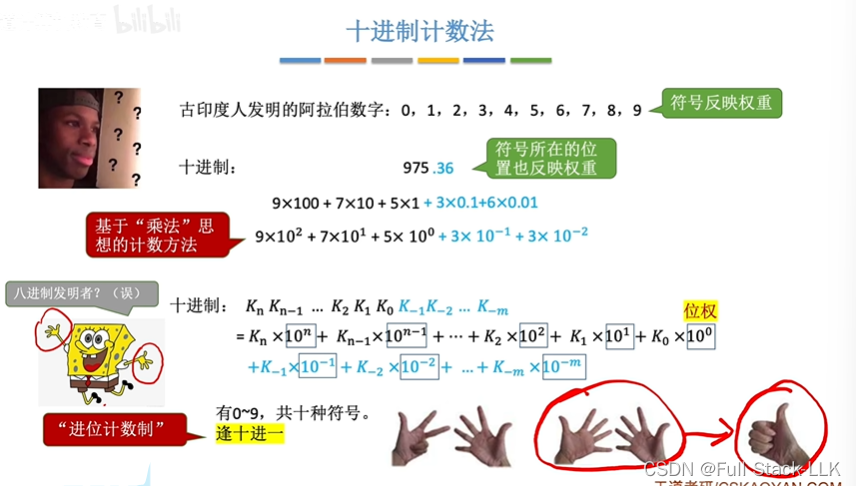
## 推广：r 进制计数法
“符号”指的是 0、1、2、3……这些
注意
二进制中，1.1+0.1=10.0
八进制中，5.4+0.4=6.0
十六进制中，5.8+0.8=6.0
对于 r 进制数，记住小数部分同样逢 r 进 1
注意基数是一个个数
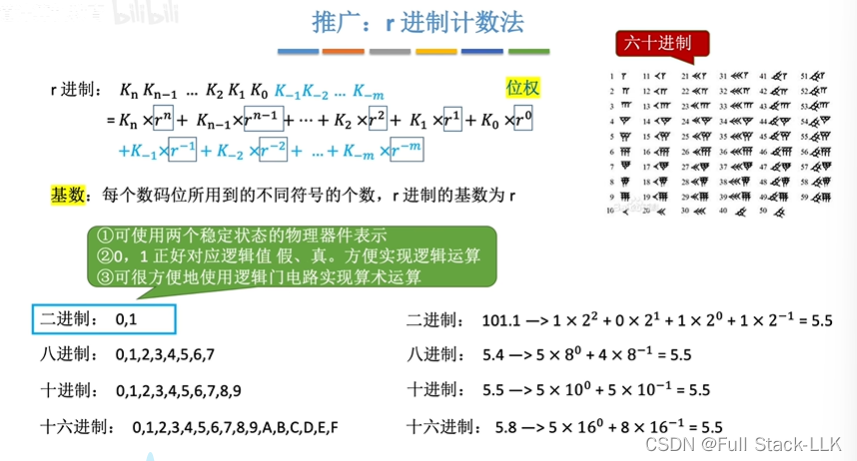
## 任意进制 -> 十进制
 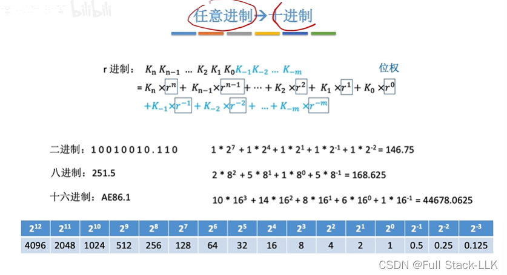
## 二进制 <---> 八进制、十六进制
****二进制转八进制和十六进制****
小数部分位数不够就在末尾补零，整数部分位数不够就在前面补零
补齐到够一组的位数；转换时仍然以分组后数位的右边为低位、左边为高位，再转换成对应进制的数值

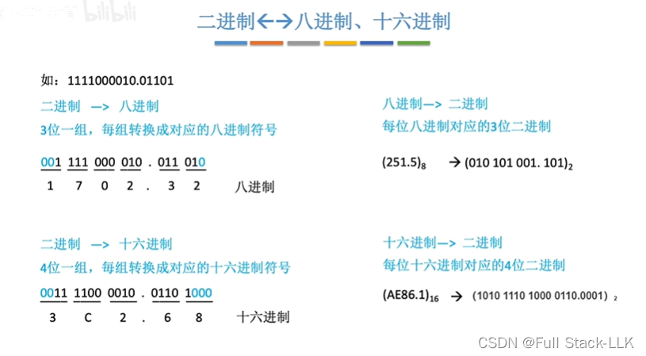
# 各种进制的常见书写方式
B：二进制
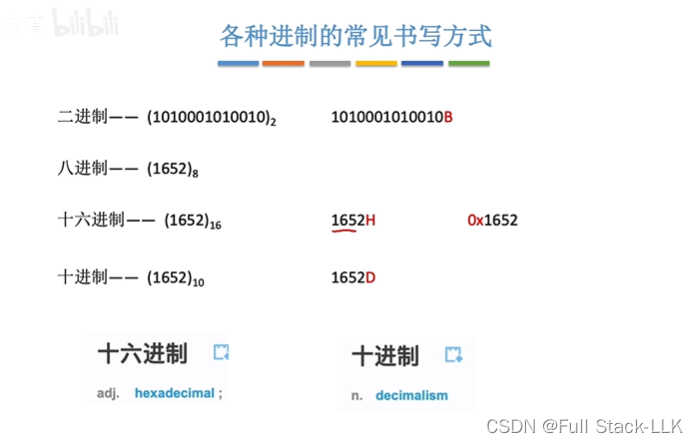
# 十进制 -> 任意进制
十进制的整数部分对应转换后进制的整数部分
十进制的小数部分对应转换后进制的小数部分
这样，用十进制和用转换后的进制计算出的数值保持一致
## 整数部分
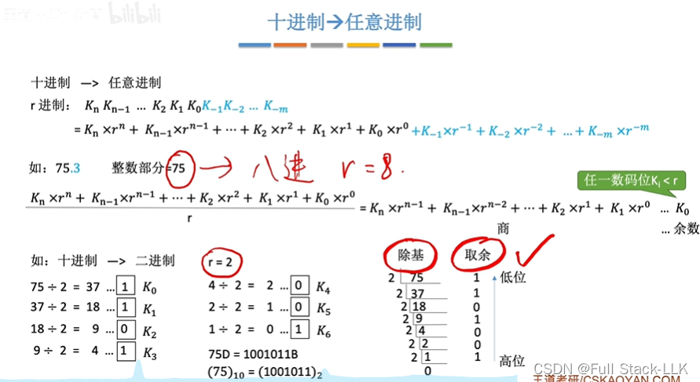
## 小数部分
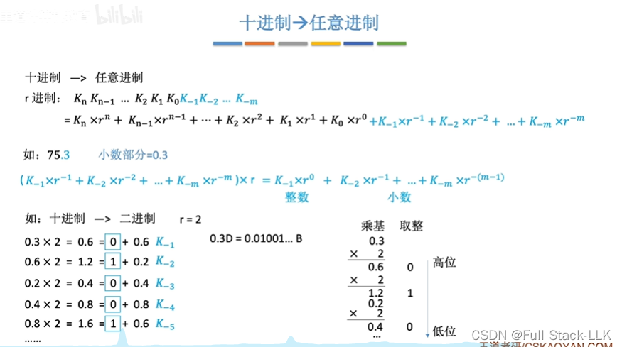
# 十进制 -> 二进制（拼凑法）
找出这个数等于哪些二进制位权之和（或 2 的幂之和）
转换成二进制之后，再转换成八进制和十六进制会更方便
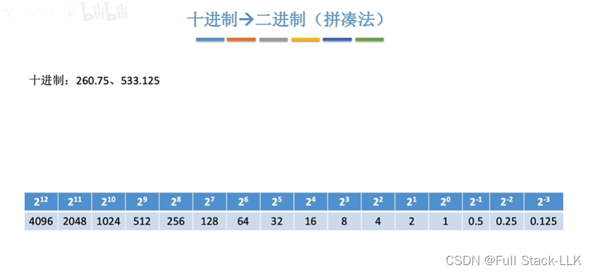
# 真值和机器数
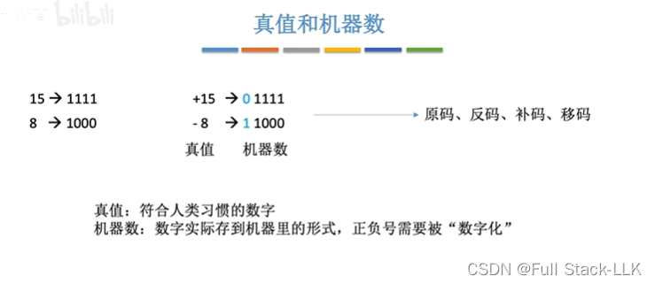
# 总结
注意补位，以及有些小数无法用其他进制精确表示
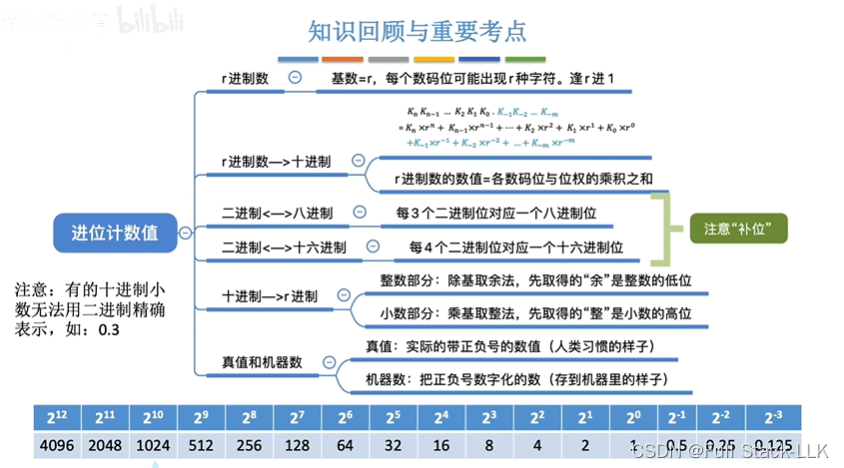
# 中国古代的二进制
太极图的分支对应 0 和 1
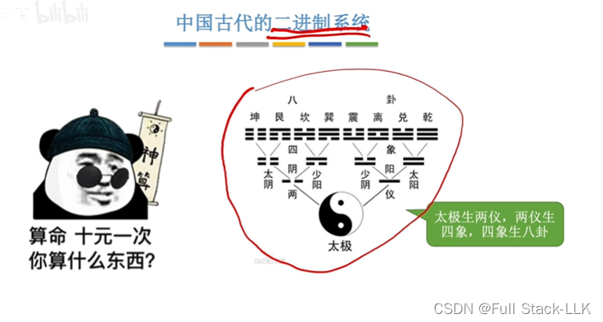

