# 计算机组成原理 - Cache 的基本概念与原理


## 存储系统存在的问题
增加一层 Cache，缓解 CPU 与主存之间工作速度不匹配的问题
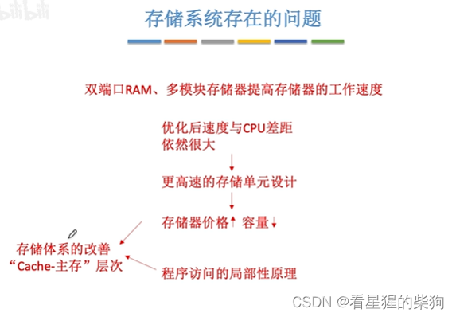
## Cache 的工作原理
程序启动后，其代码从外存取入内存，再从内存调入 Cache，这样 CPU 执行程序代码时可以直接从 Cache 中读取，速度更快
 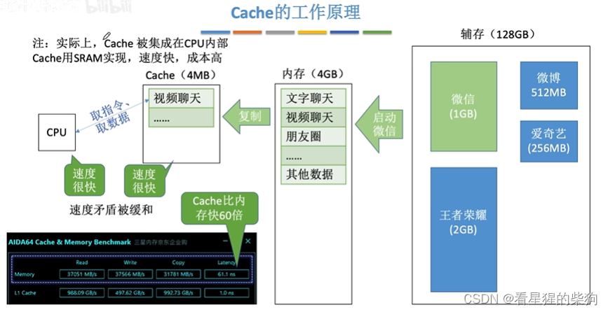

## 局部性原理
 空间局部性：将要使用的信息在存储空间上是相邻的
 时间局部性：将要使用的信息很可能是已经使用过的信息
（这里的信息指数据或指令）
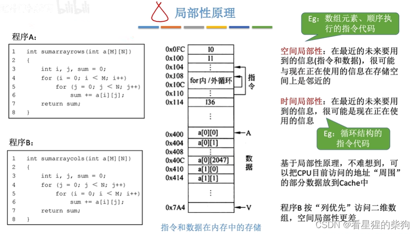
## 性能分析
两种访问方式

 - 第一种：
 先访问 Cache，不命中再访问内存。
 平均访问时间大于 Cache 访问时间，小于 Cache 访问时间与内存访问时间之和
 
 - 第二种
  同时访问 Cache 和内存
  平均访问时间大于 Cache 访问时间，小于内存访问时间

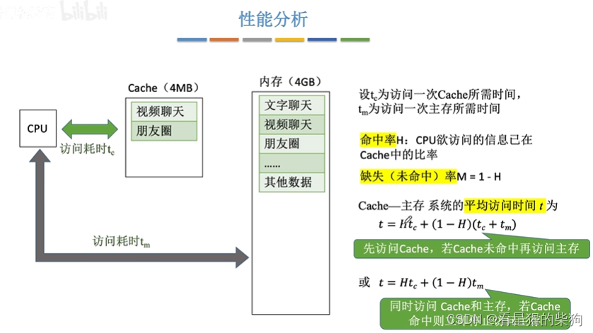
## 例题
访问方式不同，平均访问时间的计算方式也不同
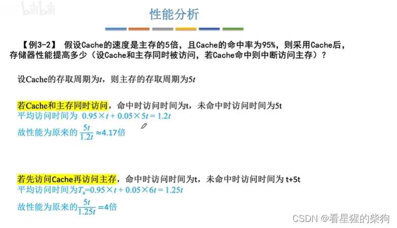
## 定义“局部”的含义
主存被划分为大小相等的块，当需要把主存中的某些数据放入 Cache 时，包含这些数据的块被视为局部，并整体放入某个 Cache 块中（是复制，不是剪切）

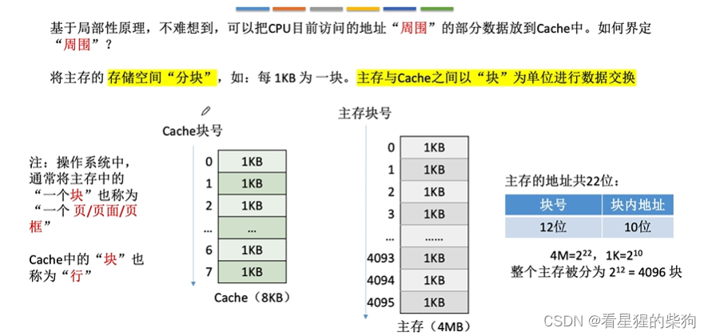
## 一些问题
对应关系指的是复制到哪一个 Cache 块
数据副本就是复制出来的那份拷贝
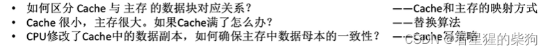
## 总结
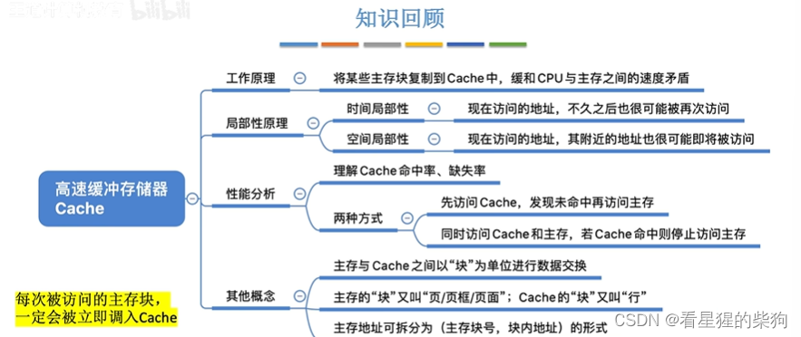


# 计算机组成原理 - Cache 替换算法


## 概述
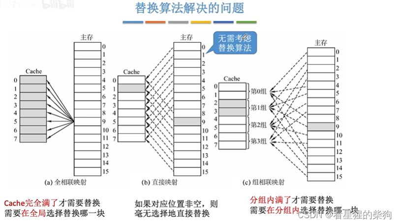
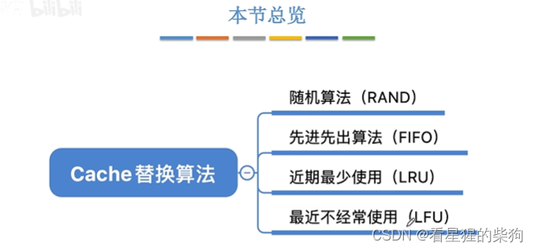
## 随机算法（RAND）
它不会有选择地考虑替换哪个 Cache 块，换句话说没有考虑局部性原理（可能被用到的 Cache 块），所以下一次要访问的 Cache 块可能被替换掉，导致频繁替换

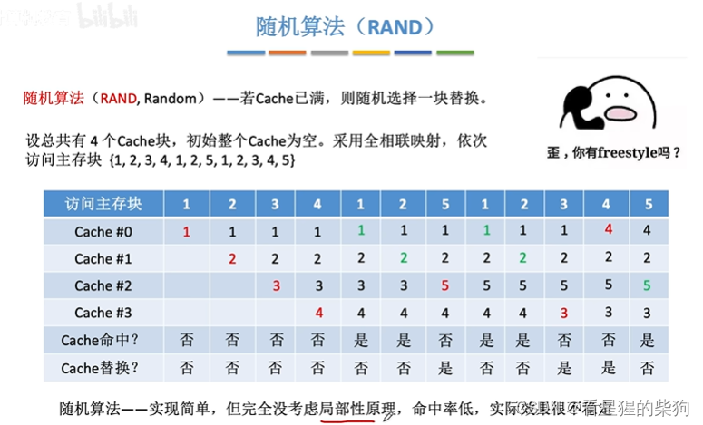
  
## 先进先出算法（FIFO）
最先进入的 Cache 块最先被替换
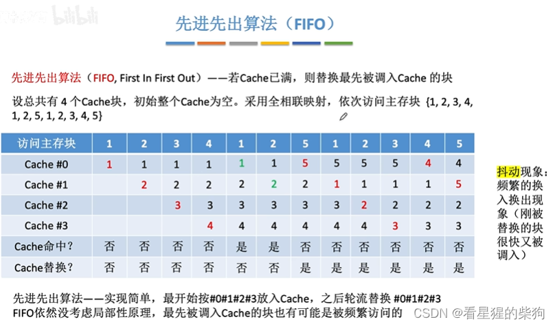

## 近期最少使用算法（LRU）
人工判断替换哪个 Cache 块：从当前访问的主存块开始向后看，与 Cache 块逐一比较，直到只剩一个 Cache 块没有对应的主存块，就替换它  
当 Cache 块总数为 2^n 时，计数器只需要 n 位。
装满之后只有替换和命中两种情况；替换时替换计数器值最大的那一个；命中时，由于比命中块计数值小的计数器都加 1，最大的计数器位数仍不会超过 n 位
并且 Cache 装满之后，所有计数器的值保证互不相同。
仍然可能发生抖动
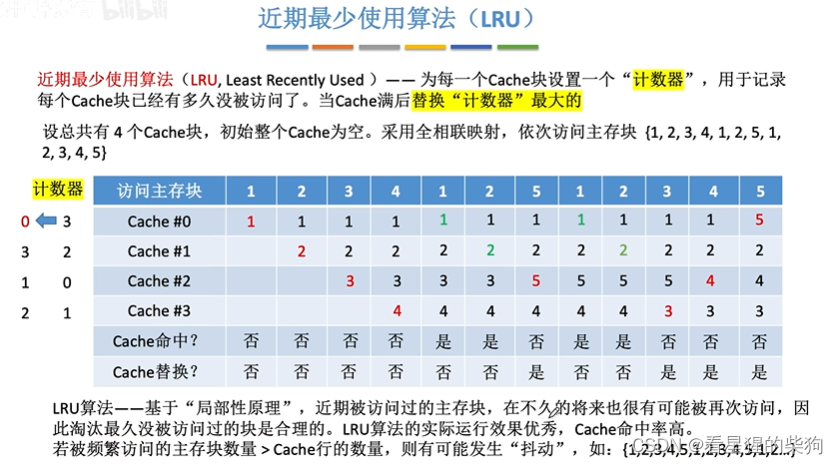
## 最不经常使用算法（LFU）
如果有多行的计数器都是最小值（多行并列最小），可以按行号递增，或者按 FIFO（先进先出）策略来选择要替换的那一行
新装入的块计数器置为 0，之后每被访问一次就加 1。需要替换时，选择计数器最小的那一行  
计数器的位数更多，因为此时对计数器的值没有限制
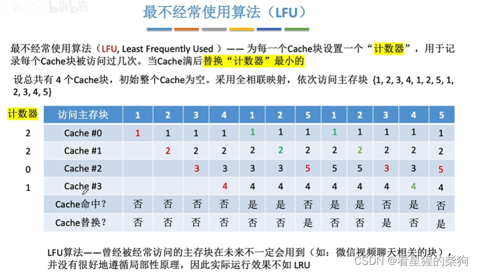
## 总结
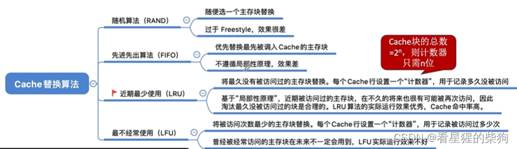


# 计算机组成原理 - Cache 写策略


## 概述
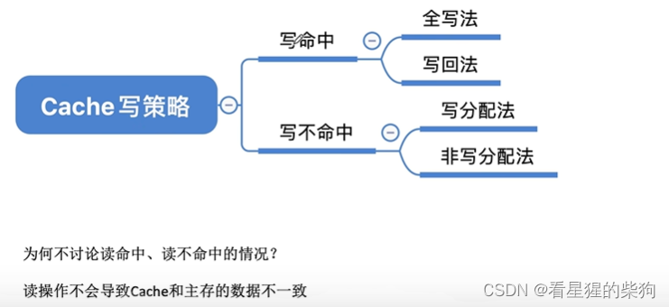
##  写命中
### 写回法
数据不一致是指 Cache 中的数据与主存中的数据不一致
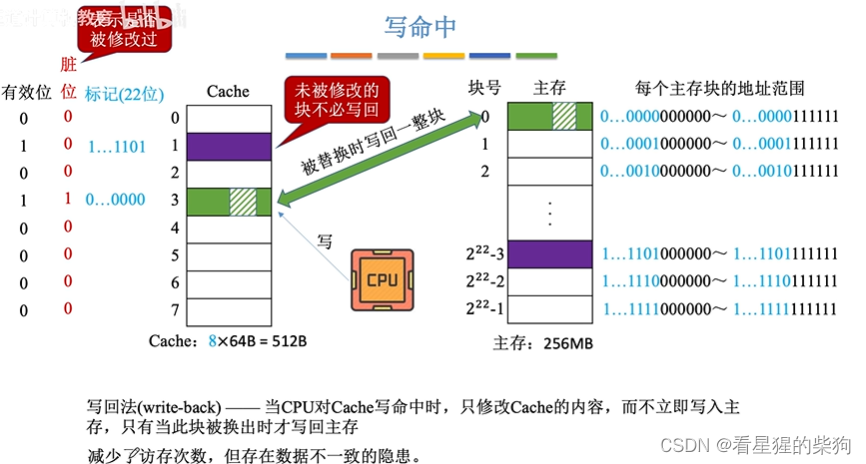
### 全写法
 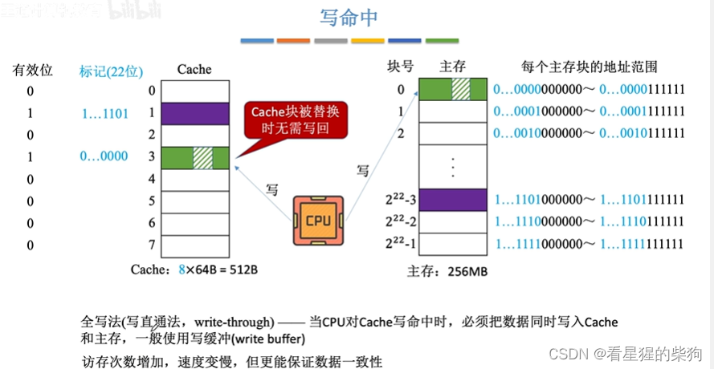
 
写缓冲
使用写缓冲时，写入 Cache 的数据同时写入写缓冲；之后在 CPU 做其他事情时，由专门的控制电路将其逐一写回对应的主存块
写缓冲的容量有限，写操作过多会导致写缓冲被填满，此时就需要等待。
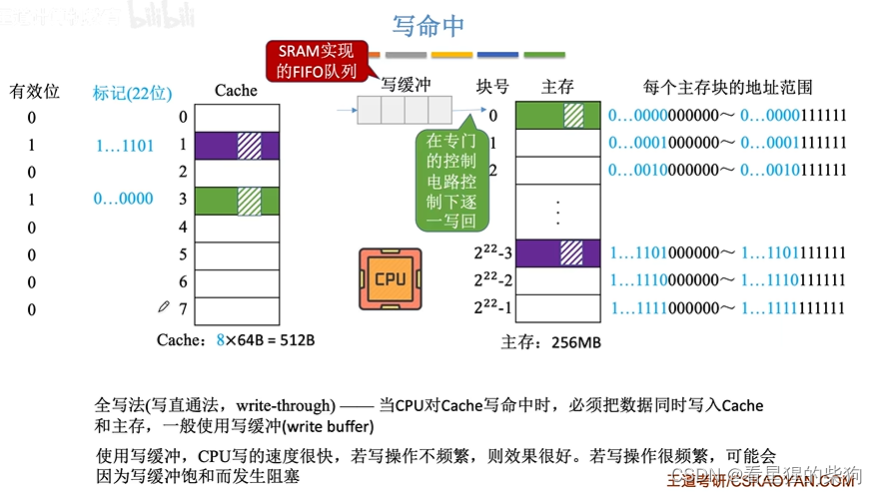
## 写不命中
### 写分配法
即先把主存块调入 Cache，再按写回法处理
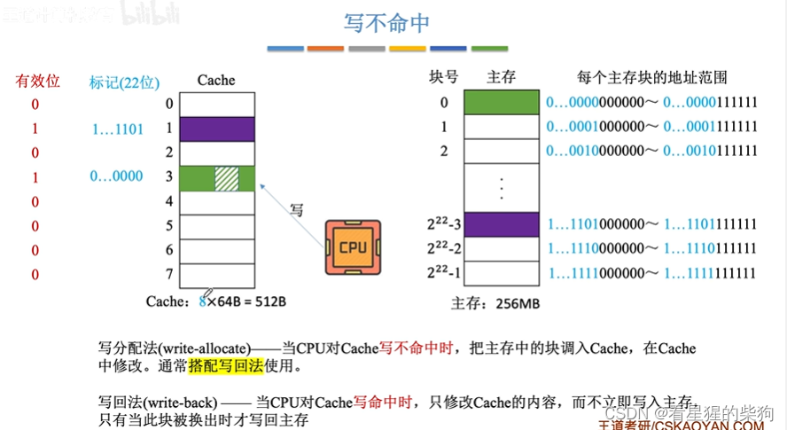
### 非写分配法
即写不命中时只写主存，写命中时采用全写法。这种情况下只有读不命中才会调入 Cache
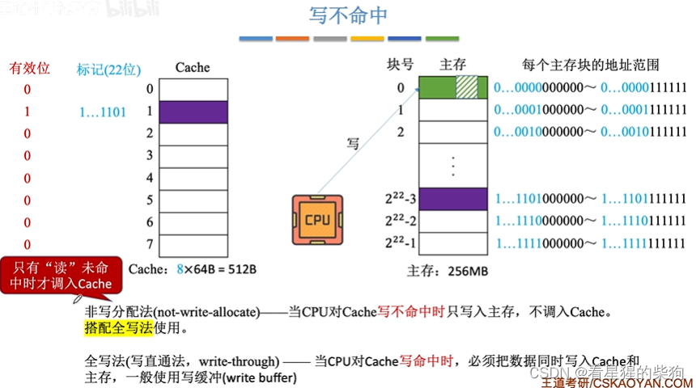
## 多级 Cache
高一级的 Cache 保存着其低一级 Cache 中部分块的副本
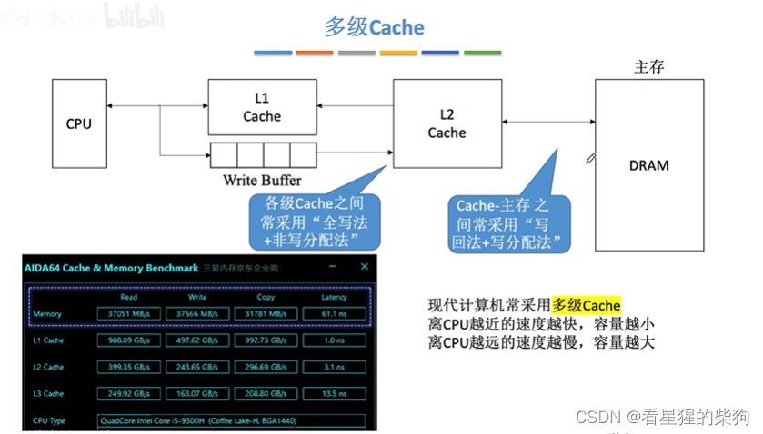
## 总结
本质上，各级 Cache 之间的关系与主存和 Cache 之间的关系是一样的——都是为了提高 CPU 的读写速度
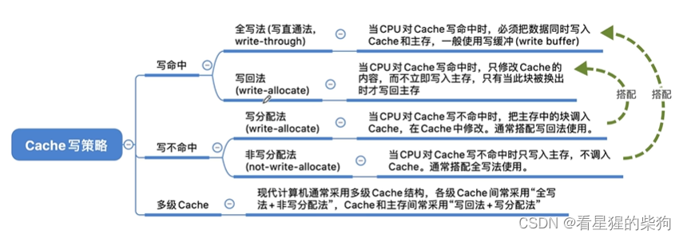


# 计算机组成原理 - Cache 与主存之间的映射方式


## 概述
 在组相联映射中，找到对应的 Cache 组之后，主存内容放在该组中任意有空位的位置
 标记（tag）用来标识它对应主存中的哪一块，即块号
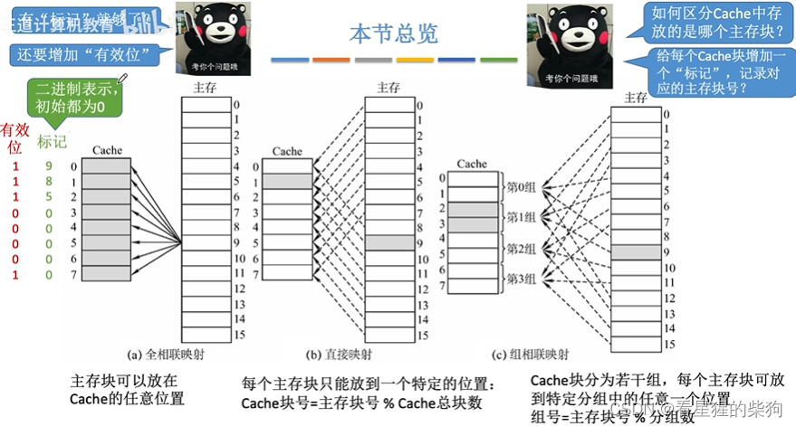
## 全相联映射（可放在任意位置）
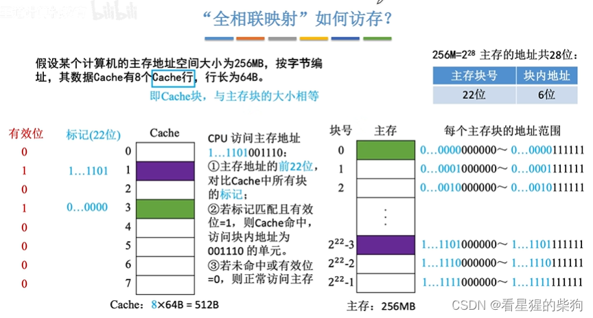
## 直接映射（只能放在固定位置）
当两个主存块映射到同一位置时，先前映射的内容会被覆盖。
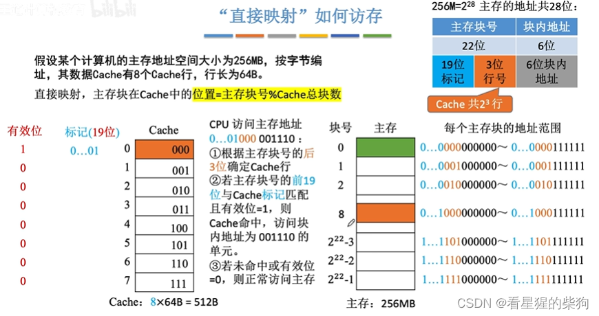
## 组相联映射（可放在特定的某一组内）

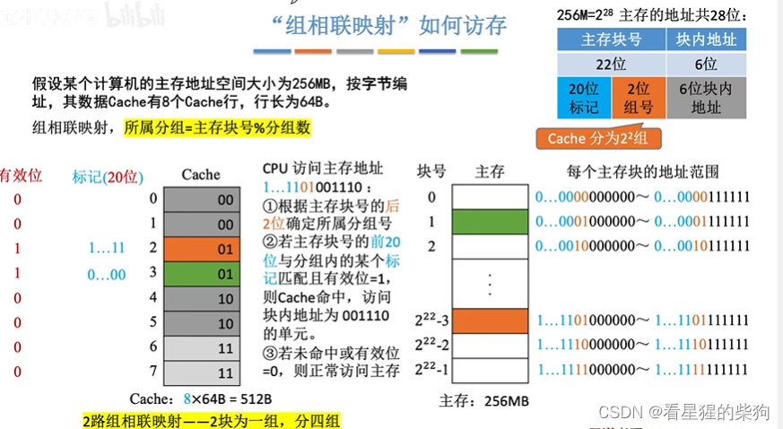
## 总结
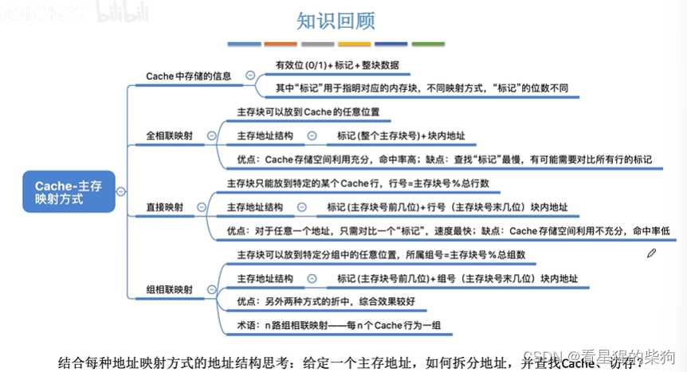

