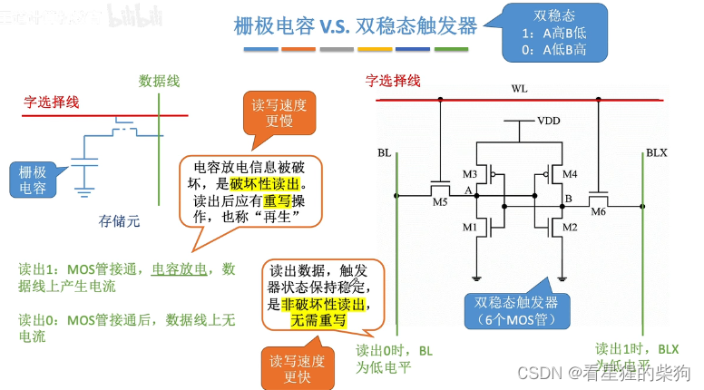
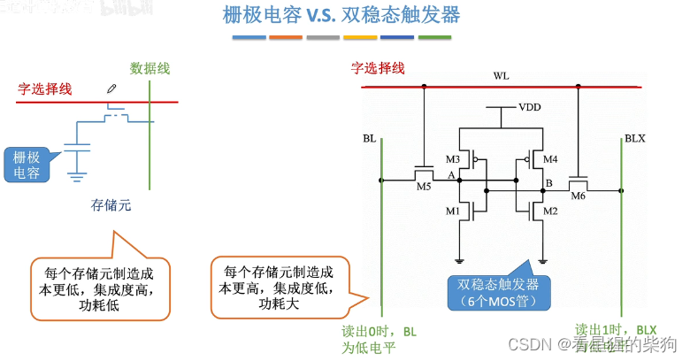
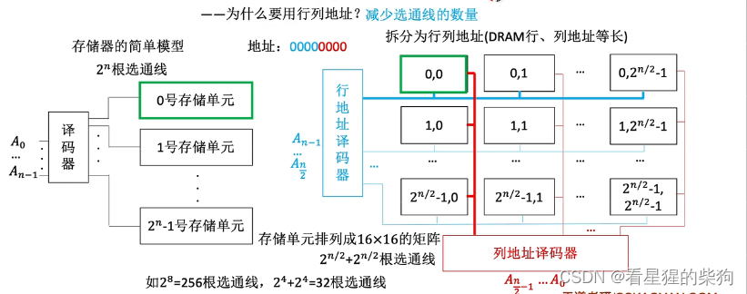
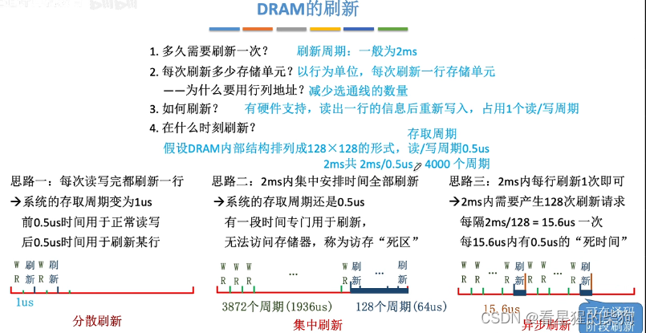
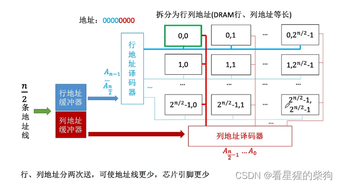
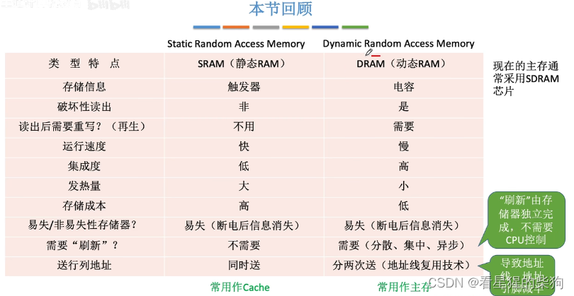


  
# DRAM：动态随机存取存储器 Dynamic Random Access Merrory（主存）
#  SRAM：静态随机存取存储器 Static Random Access Memory（Cache）
# 两者的区别 
   
   
# 行地址和列地址
  地址的前半部分送入行地址译码器
  地址的后半部分送入列地址译码器
  这样可以减少连线数量

# 刷新

破坏性读出：DRAM 存储元被读取时，信号会变为 0，原信号被破坏。SRAM 没有这个问题
易失性：DRAM 需要刷新（刷新周期为 2ms，以行为单位，每次刷新一行存储单元，与读写周期相同），因为电容会漏电。SRAM 不需要，因为只要供电，数据就不会改变

DRAM 的刷新由存储器独立完成，不需要 CPU 参与  

# DRAM 地址线复用
SRAM：行地址和列地址同时送出（集成度低）
DRAM：分两次送出（地址线和地址引脚数减半）

# 总结
DRAM 已被淘汰，现在的主存主要使用 SDRAM


