

# 知识总览
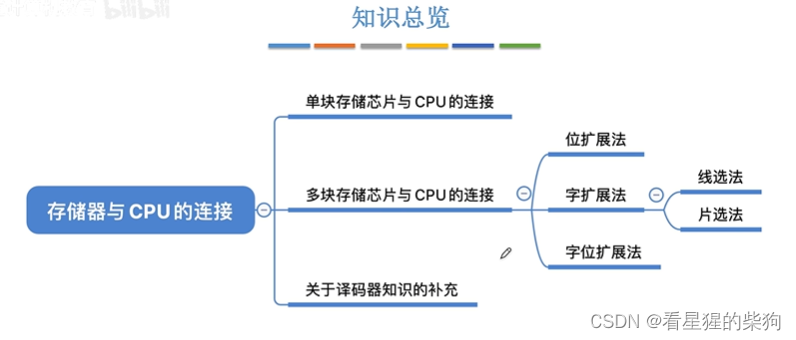
# 单块存储芯片与 CPU 的连接
数据总线、地址总线、片选线、读控制线和写控制线与 CPU 相连
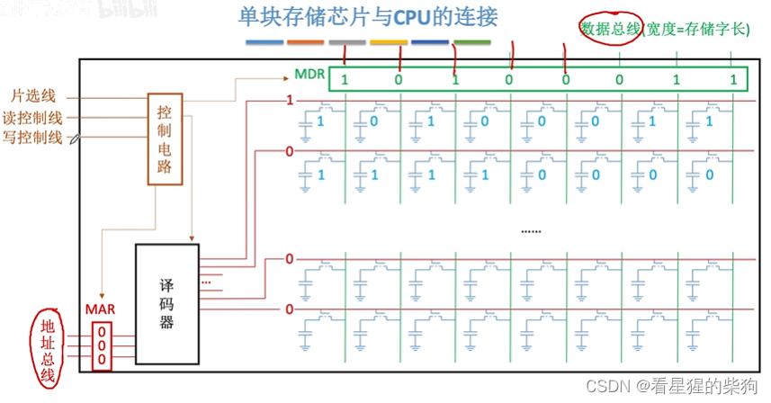

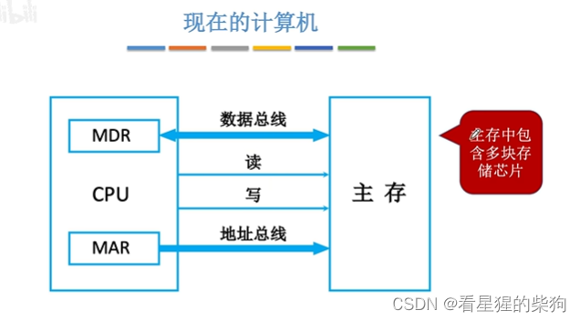

注意低电平有效和高电平有效，下图等价于一块存储芯片
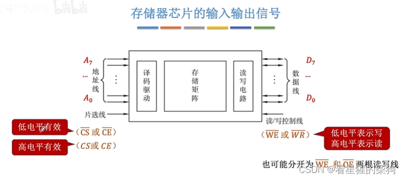

# 位扩展（存储字的位数）

简单来说，就是从不同芯片的相同位置读出一个存储单元，分别传送到 CPU 的不同数据总线上，相当于扩展了存储芯片的字长
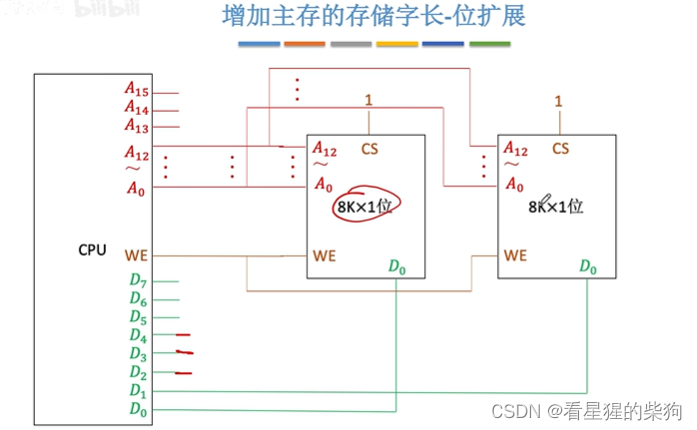 

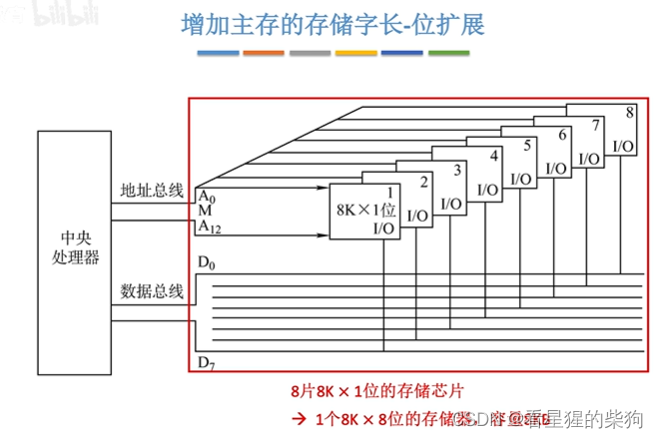
# 字扩展（存储字的数量）
也就是说，如果一块存储芯片有 2 个存储字，那么两块这样的芯片就有 4 个存储字，只是加了一个片选器来进行选择
这种方法的缺点是会浪费一些地址，00 和 11 开头的都是无效的
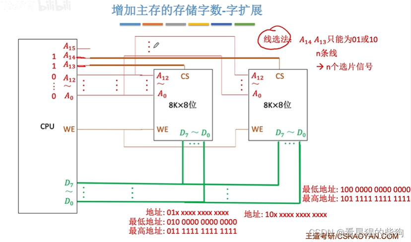
使用译码器进行优化
 这样地址是连续的，不会浪费

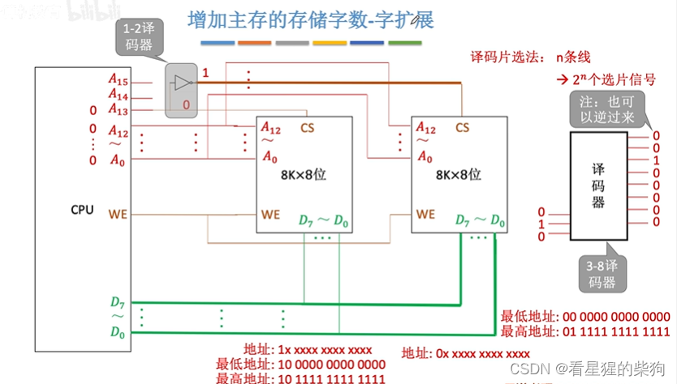

考试中可能会有某根线没有连接，这时该地址线上的信号是 0 还是 1 都没有影响  

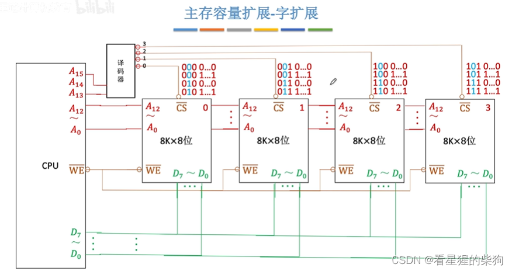
2-4 译码器
注意小圆圈都表示取反
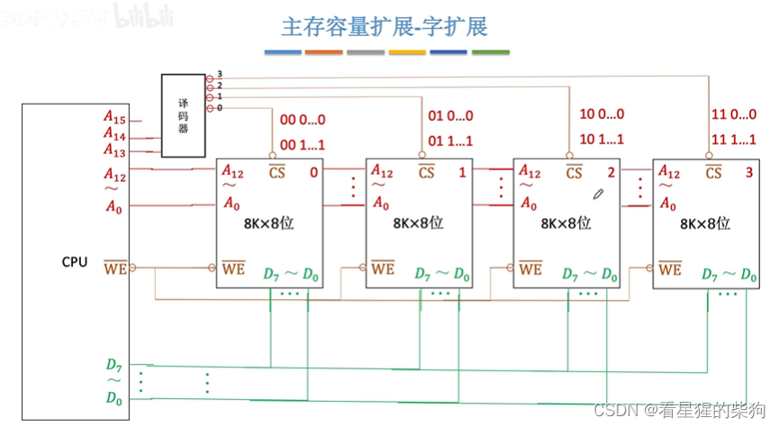
# 关于线选法和片选法
实际应用中大多采用片选法
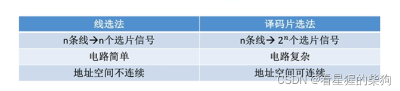
# 字位同时扩展
怎么说呢 emmmm
字扩展是加一个译码器把多块存储芯片纳入进来，增加容量
位扩展是把一个地址的位拆成两部分放在两块芯片中，但地址是相同的
   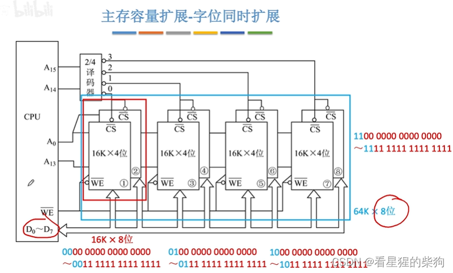
# 总结
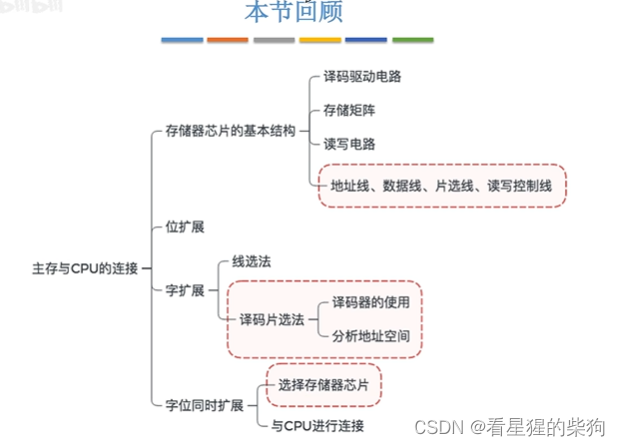

# 补充：译码器
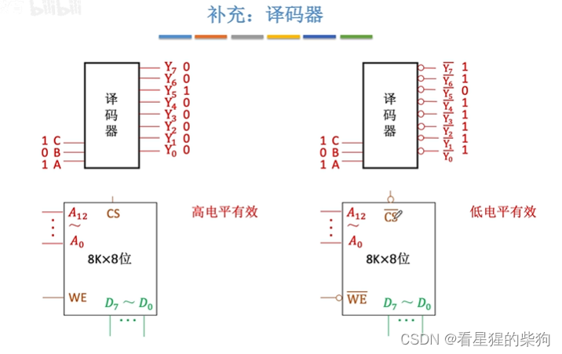

  

使能端为 100 时译码器工作，否则输出全为 1
关于 RAM 读周期的时序图
首先 CPU 送出地址信号，由于有高位和低位，地址时序图有上下两条线，
送出地址信号一段时间后，CPU 送出访存请求信号，此时译码器开始工作，对应的 cs 变为 1，地址有效
再过一段时间片选信号失效，存储单元中的数据通过数据总线传送出去
传送完成后，CPU 的访存请求信号失效
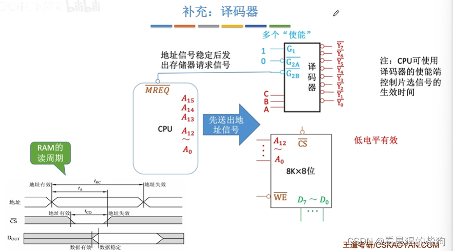

