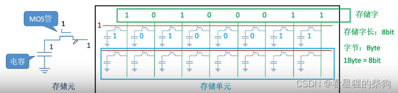
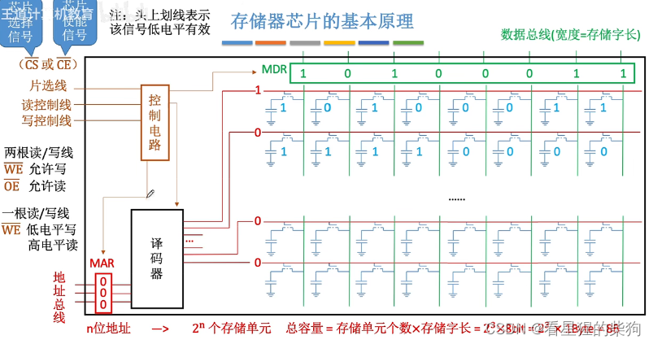
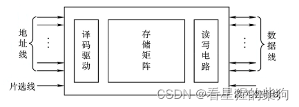
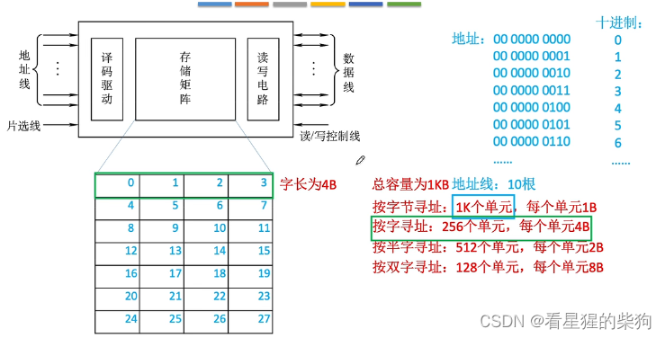
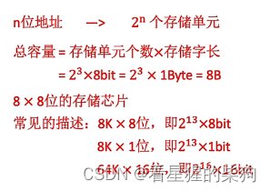
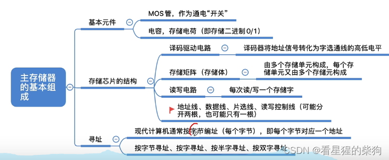



# 存储芯片的原理
 存储元：存储一个二进制位的物理器件（存储器的基本单元电路）
 MOS 管：可以理解为一种电控开关，输入电压达到某个阈值时 MOS 管就会接通（一种半导体元件）
 在存储元电路中，电容两端有电压差表示 1，否则表示 0；MOS 管控制读还是写
 MOS 管为高电压时电路接通，电容中的数据被读出到最右端，或者最右端的信号被写入电容
 MOS 管为低电压时电路断开，从而保存电容中的信号

 
 简化图
 
 寻址

字地址左移两位得到字节地址，因为存储单位相差 4 倍

一根内存条可能包含多块存储芯片
 金属引脚：导线的接口（一根导线对应一个金属引脚；通常还有供电引脚和接地引脚）
   

# 总结


