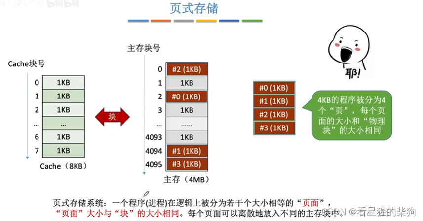
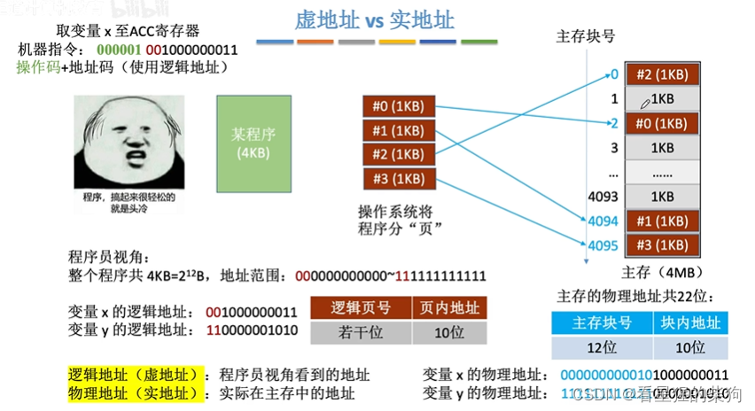
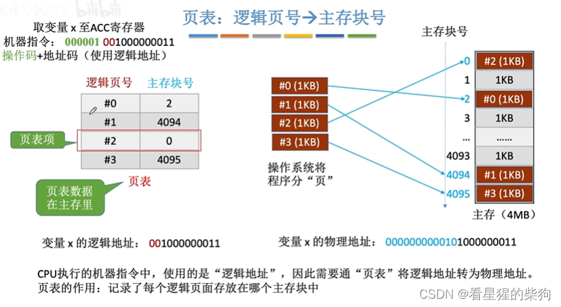
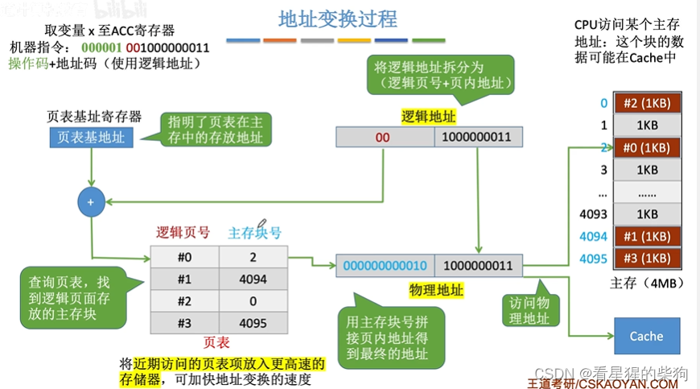
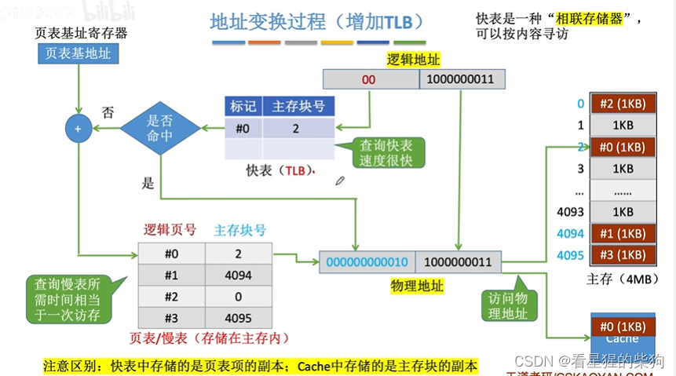
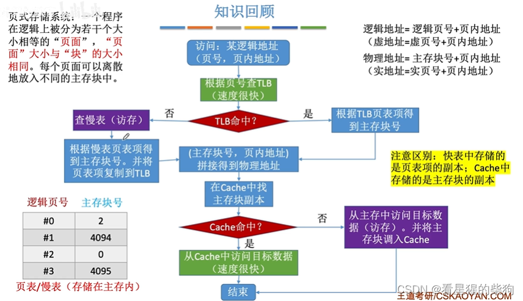


# 分页存储
把程序分散地放在主存的不同块中

# 虚拟地址 vs 物理地址
操作系统将逻辑地址映射到主存块中的物理地址，对应物理地址的块内偏移就是逻辑地址的页内偏移，块号则由逻辑页号通过页表转换得到。

# 页表：逻辑页 -> 主存块号
 
# 地址转换过程
首先根据逻辑地址的页号，以及从页表基址寄存器中得到的页表在内存中的基地址，取得对应的页表项，进而得到主存块号，再与逻辑地址的页内偏移组合得到物理地址。
读写主存中的某个地址时，先查找 Cache
访问页表时，可以根据局部性原理把页表项放入 TLB（类似 Cache），从而提高地址转换的速度

# 地址转换过程（加入 TLB）
Cache 和 TLB 很类似：都是 SRAM，比 DRAM（主存）更快。并且满了之后都有替换策略
Cache 和 TLB 的主要作用都是减少访存次数，只是存放内容的大小和单位不同。

# 总结


