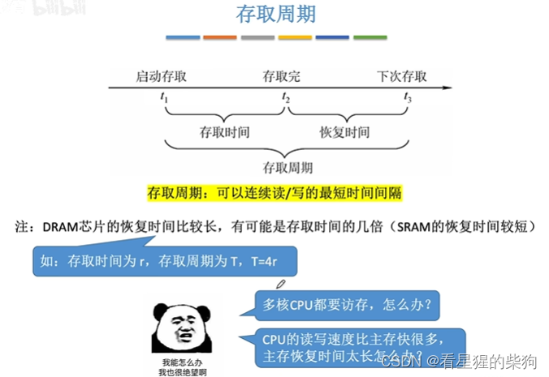
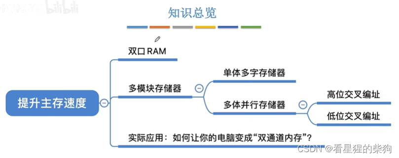
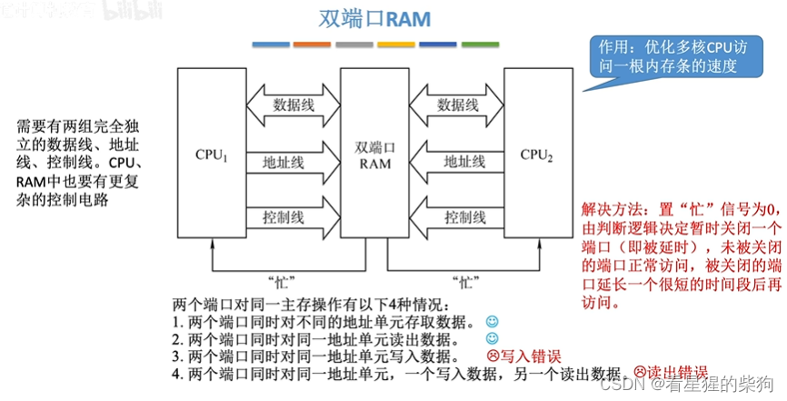
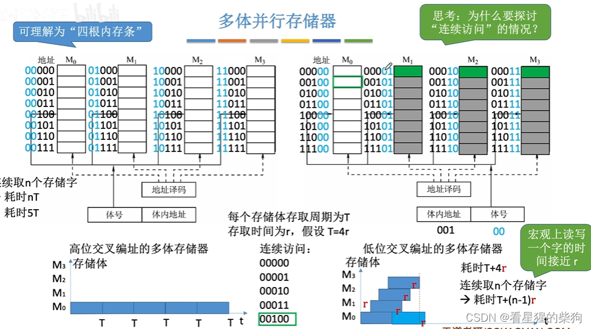
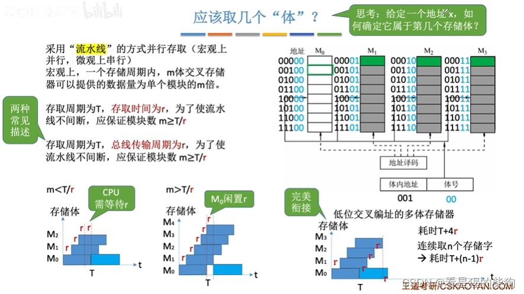
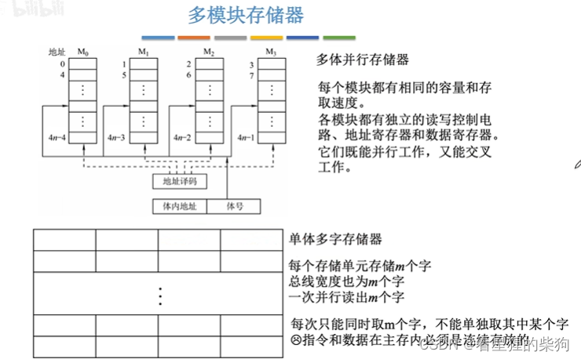
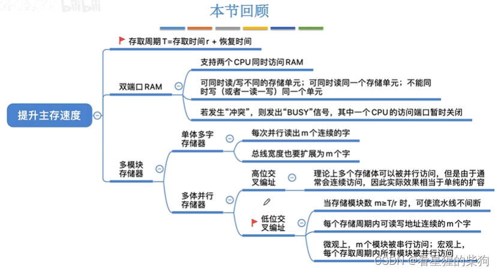
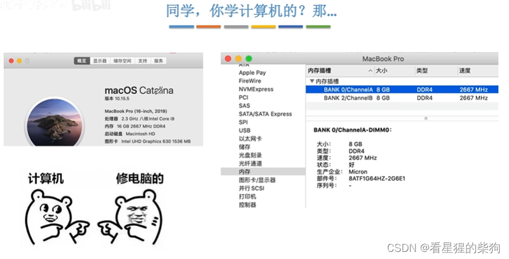



# 存取周期

 
# 概述

# 双端口 RAM
RAM：用于主存或 Cache，断电后数据丢失

# 多体并行存储器
读一个存储芯片时，一个存取周期内只能访问一个单元的数据；但如果是不同的存储芯片，就可以在访问当前存储芯片某个单元的同时，开始访问下一个存储芯片的某个单元

根据地址译码方式的不同，同一个存储芯片上的地址可能是不相邻的
对于低位交叉编址，连续取 n 个存储字耗时：nr+T-r

# 低位交叉编址的存储体数多少合适（体号）
 低位交叉编址的访问可以理解为流水线：宏观上看是同时进行的，即并行，但微观上实际是按顺序进行的，即串行

宏观上，一个 m 体交叉存储器在一个存取周期内可以取出 m 个存储字

为了兼顾效率和成本，取 m=T/r 作为存储体的个数

给定地址 x，判断它属于哪个存储体

 - 可以通过体号判断
 - 可以通过对 m 取模判断
# 多模块存储器（多体存储器）
单体多字存储器：一次可以读 m 个字，每次访问可读的存储单元数是固定的
 
# 小结
高位交叉编址：相当于扩充容量（更多的存储单元）
 

# 实际场景
橙色和绿色在同一个卡槽中表示高位交叉编址
橙色在不同卡槽中表示低位交叉编址

时钟频率相同意味着存取周期相同；容量相同才能都构成多体存储
如果频率不同，CPU 会降频到较低的频率；如果容量不同，部分区域会变成单体存储

16GB 拆分成两根内存条，构成低位交叉编址


