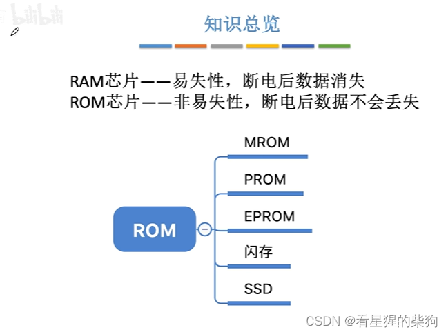
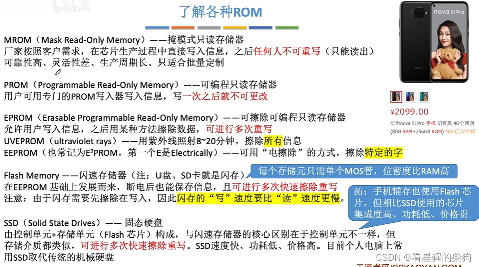
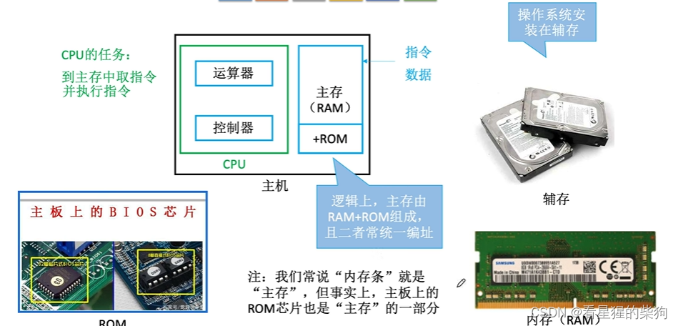
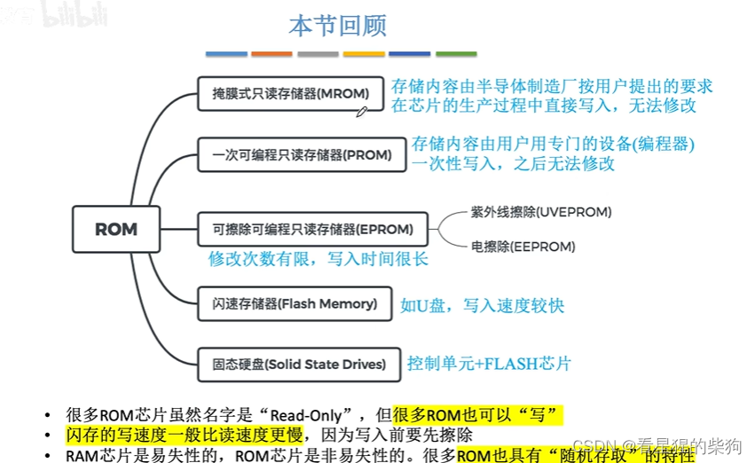


# 背景

# 各类 ROM 介绍
位密度：单位尺寸内存储的二进制位数
MROM：信息由厂家写入，写入后无法更改
PROM：信息由个人写入，写入后无法更改

# 重要的 ROM
我们知道 CPU 是从内存中按顺序逐条读取指令并执行的。但刚开机时，内存中的数据是清空的，而操作系统等指令又必须运行机器才能正常启动，这些操作系统指令却存放在外存上，怎么办？
这时就需要 BIOS 芯片。虽然它是位于主板上的一块芯片，但从逻辑上我们把它归为内存，因为 CPU 会按顺序逐条执行这块芯片上的指令，就像从内存中逐条读取指令并执行一样，所以我们把它归为内存。
内存也会统一给 BIOS 分配地址：BIOS 是内存的起始部分，其余的内存部分从 BIOS 末尾的地址开始

# 总结
随机存取：给定一个访问地址，无论地址如何变化，只要在范围内，访问时间都相同


