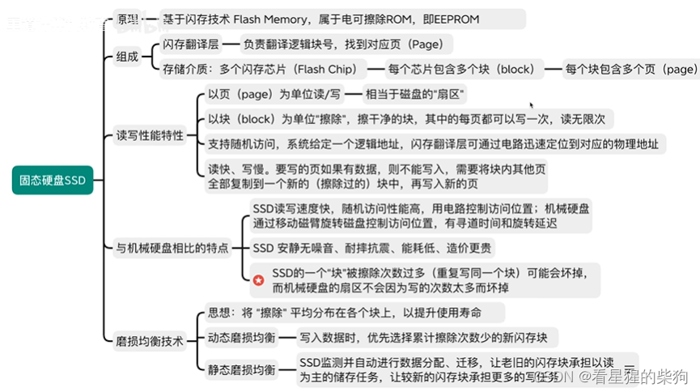
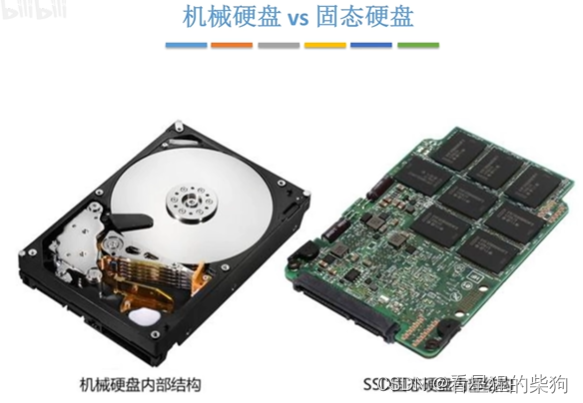
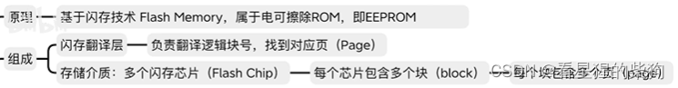
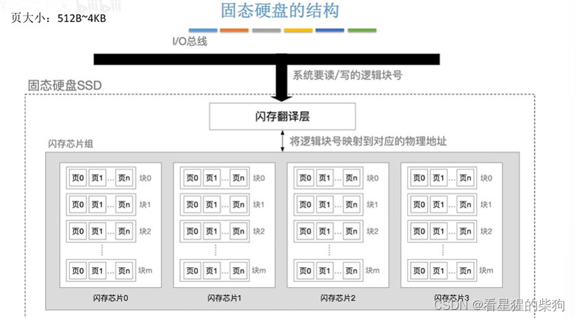
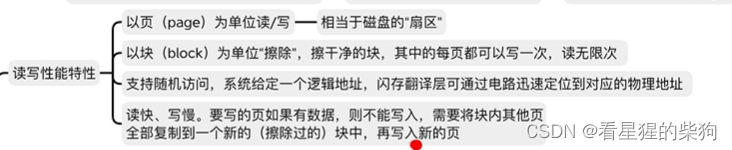
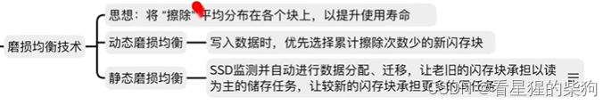
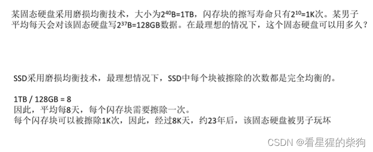



# 概述

#  机械硬盘与固态硬盘
固态硬盘采用闪存技术，属于电可擦除 ROM
下图右侧的黑色方块就是一个个闪存芯片

# SSD 的结构
块大小 16KB~512KB
页大小 512B~4KB
SSD 以页为单位进行读写

以页为单位读写
以块为单位擦除；每个页只能写入一次，但可以无限次读取
如果某个页已经写入了数据，想要修改该页的数据，需要先把该页所在块中的其他页复制到另一个闪存芯片，然后在另一个闪存芯片的对应页上写入，再把该块复制回原块的位置。因为每个页只能写入一次，如果想要第二次写入，就必须擦除整个块

# SSD 相比机械硬盘的特点
SSD 通过电路定位物理地址，属于随机存取，也就是访问任意地址的时间都相等。
机械硬盘通过磁臂定位物理地址，访问不同地址的时间不同，因为磁臂可能需要移动到不同的位置，所需的时间也可能不同

# 磨损均衡
为了应对 SSD 因擦除次数过多而磨损的问题，即反复写入同一个块中的某个页会导致整个块被擦除，引入了磨损均衡技术（保证每个块被擦除的次数大致相同）
也就是说，闪存转换层把逻辑地址映射到不同的物理地址；当发现某个块被擦除次数过多时，就把该逻辑地址映射到的物理地址改为擦除次数较少的块，这样擦除次数少的块就会被擦除

# 例题


