
# 概述

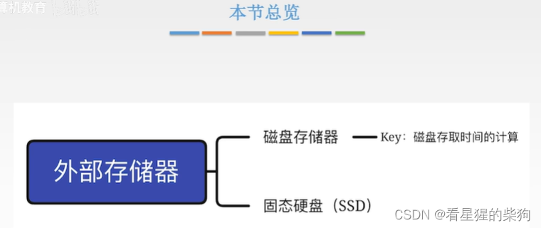
# 外部存储器
机械硬盘，即磁盘
## 磁盘存储器
  写入时利用电流产生磁场写入磁盘
  读取时利用磁性载体运动时产生的电场获取数据
  磁性材料容易受到外部磁场的干扰
  下图中，磁性载体上 N 和 S 的先后顺序代表对应存储的二进制位
  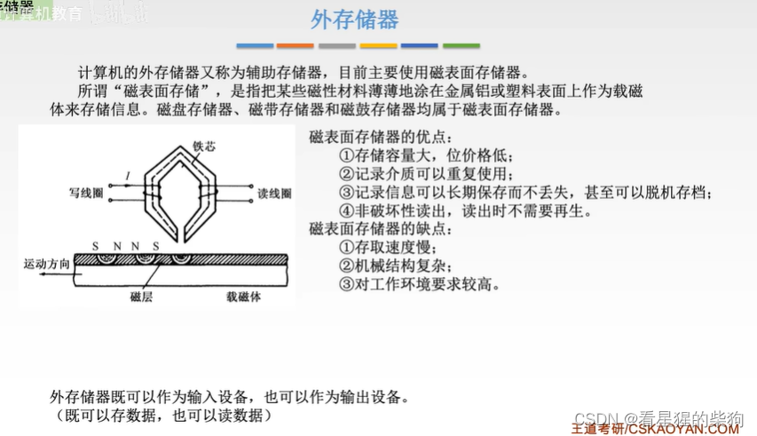

 磁性材料一圈一圈地涂覆在主轴盘片上
 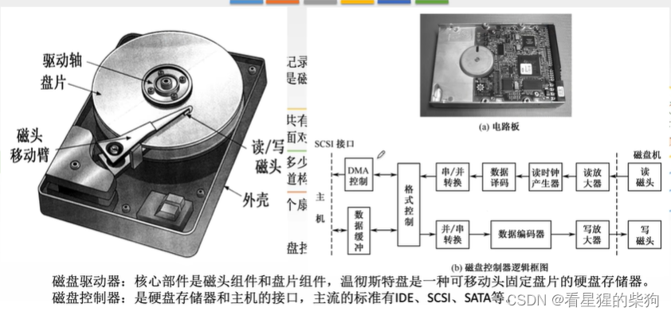
 柱面是各记录面上的磁道所构成的圆柱面
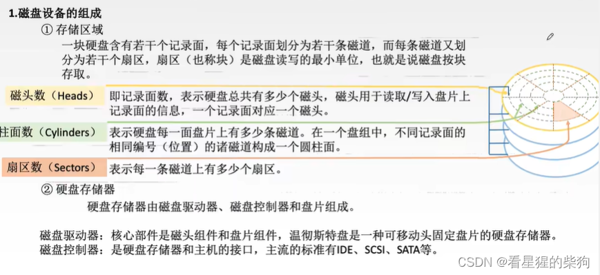

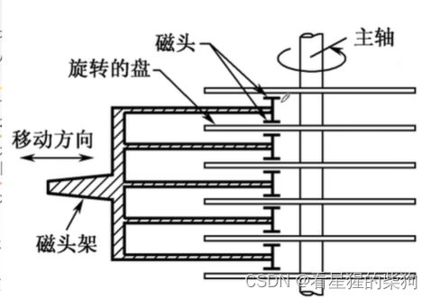
## 磁盘性能指标

格式化容量一般小于非格式化容量，因为在格式化容量中，部分扇区需要作为其他扇区的备份 

每条磁道记录的信息量相同，但由于最内圈磁道的位密度最高，其制造工艺也最先进
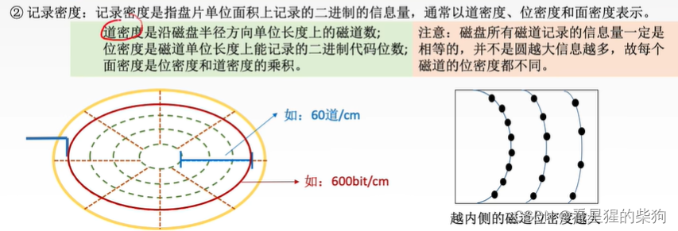
磁盘控制器时间是从发出信号到磁盘控制器开始响应所需的时间
传输是指旋转记录面，读出对应扇区的数据

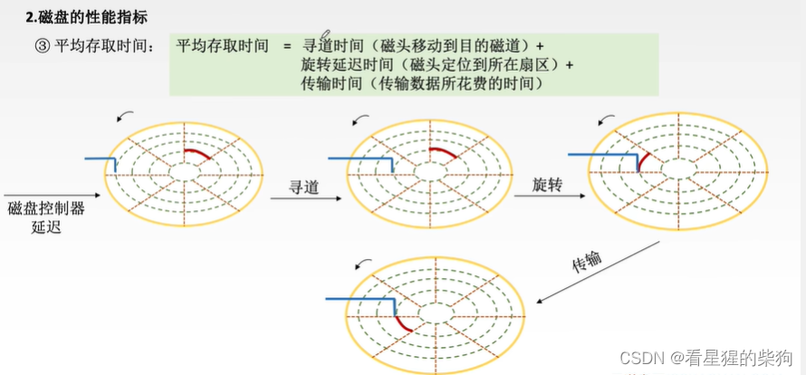
 
## 磁盘地址

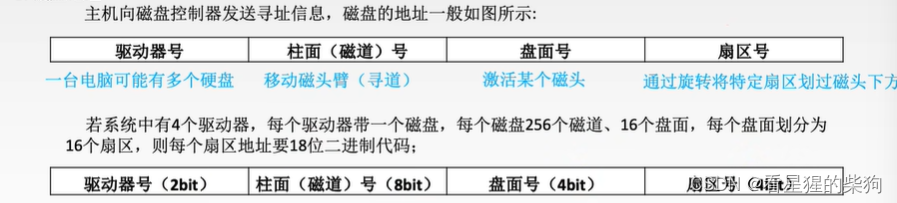
## 磁盘的工作原理
 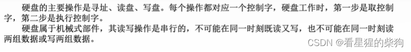
并行：多个位同时传输
串行：逐位传输
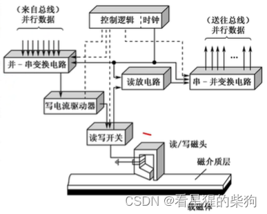
## 磁盘阵列
磁盘阵列可以理解为把一整份数据的不同部分存放到不同的磁盘上
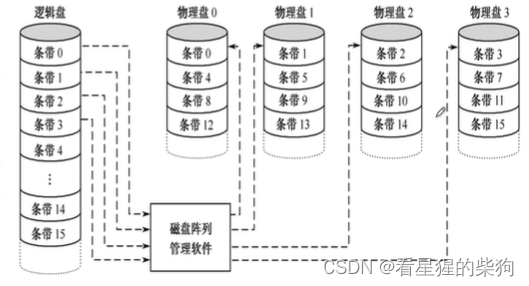
 
冗余是指是否有备份；校验是指检验数据是否发生了变化
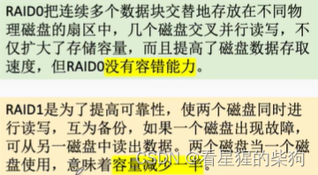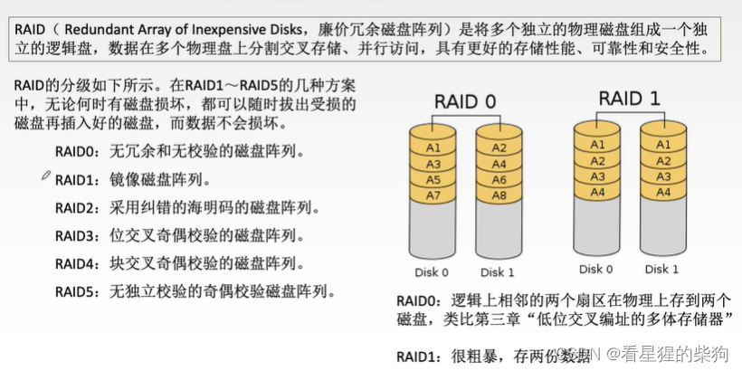
RAID2 采用海明码校验方式，因此与 RAID1 相比，用于校验和冗余的磁盘更少
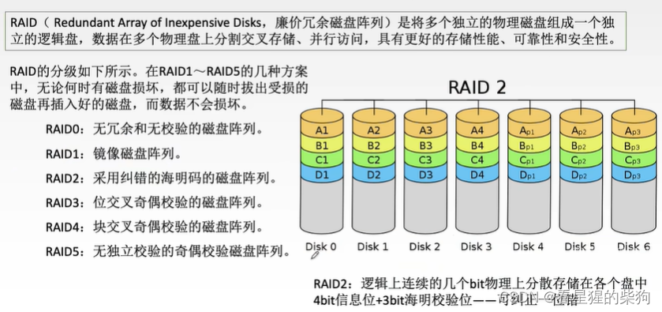
RAID 级别的数字越高，安全性和可靠性越高
# 总结
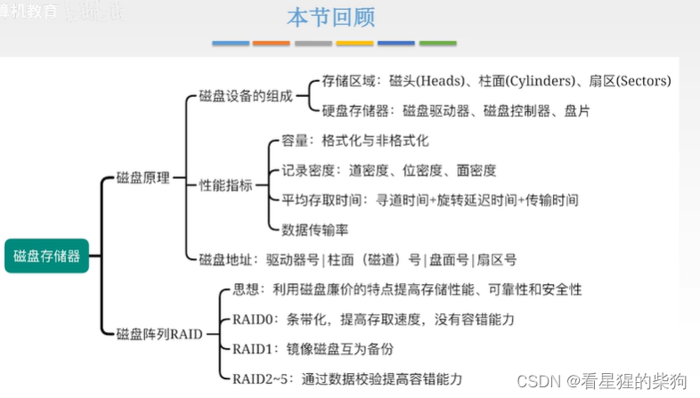

