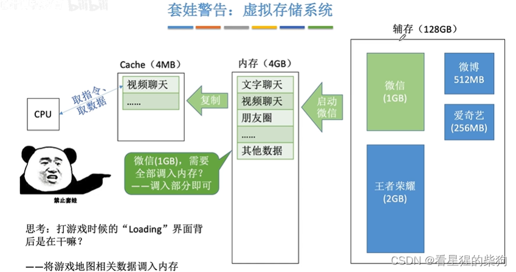
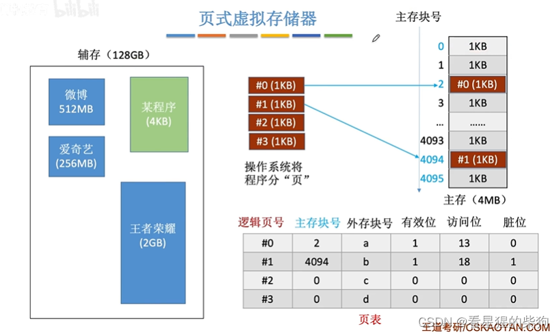
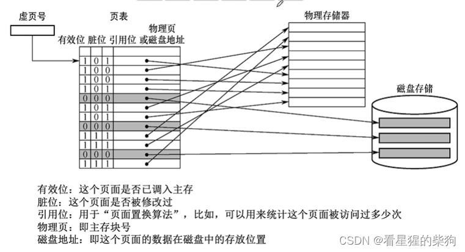
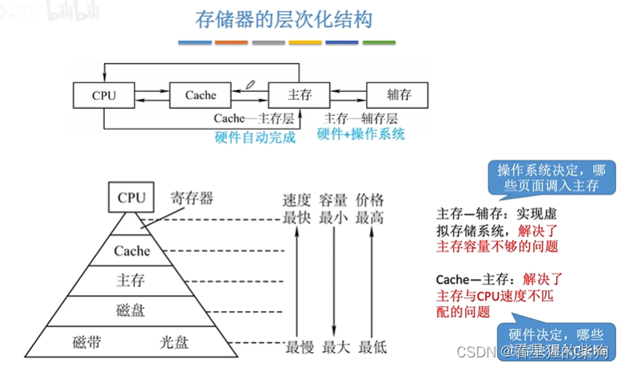
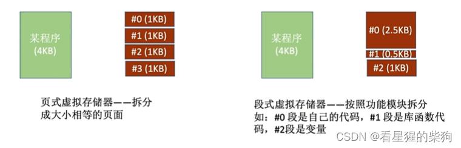
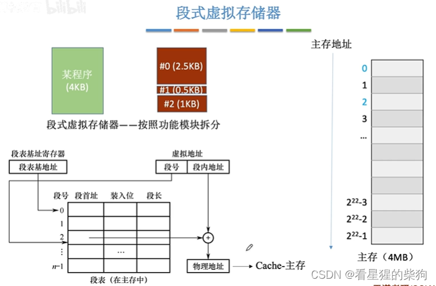
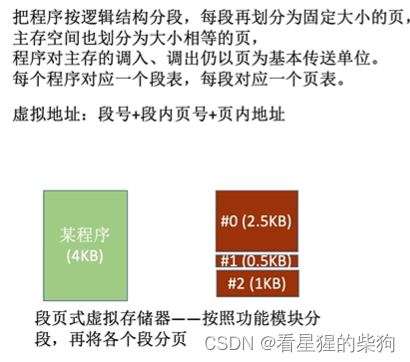


# 虚拟存储系统
把程序的一部分从辅存调入内存，程序的其他部分在需要时再调入内存

# 页式虚拟存储器
把辅存中的程序划分成页，将程序当前需要的页调入主存。
 外存块号：外存被划分为块，每个块都有对应的块号
 有效位：辅存中程序的这一页是否已经调入主存
 访问位：主存中这一页被访问的次数，访问次数少的会被替换
 脏位：主存中的这一页是否被修改过；如果被修改过，则该页被替换时，需要把修改后的内容写回辅存
 
 虚拟页号就是逻辑地址的页号

# 存储器的层次结构
硬件可以认为是 CPU

# 段式虚拟存储器
即把辅存中的程序按不同功能划分为段

段式虚拟存储器中，主存不再划分为块，每个单元为一个字节。就是正常的……方式。也就是说，可以放在主存的任意位置，不像前面的页式存储那样必须以页为单位存放

#  段页式虚拟存储器
即分段之后，再把每个段分页，并以页为单位调入主存。
此时，每个程序对应一张段表。


