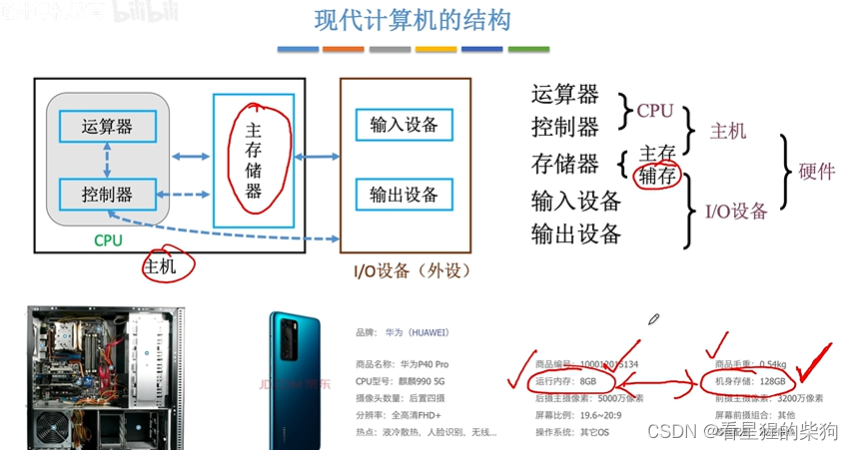
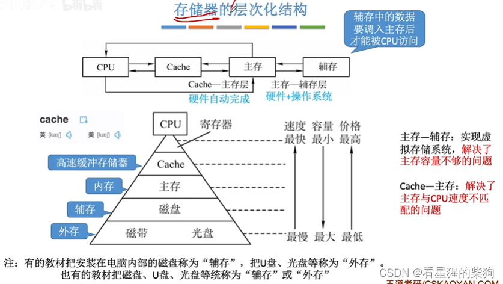
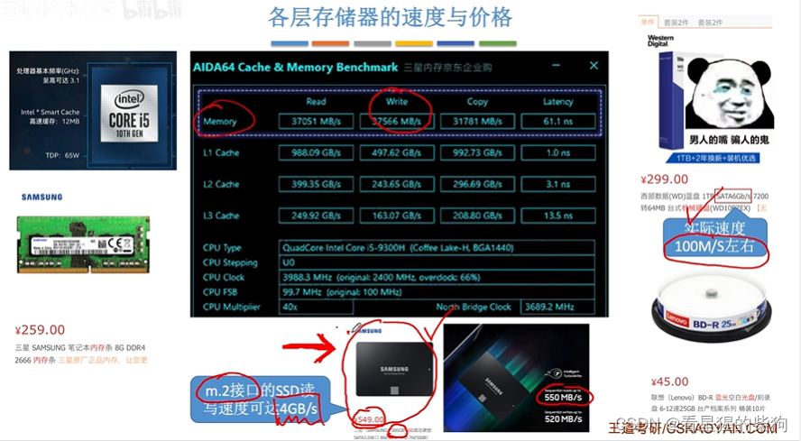
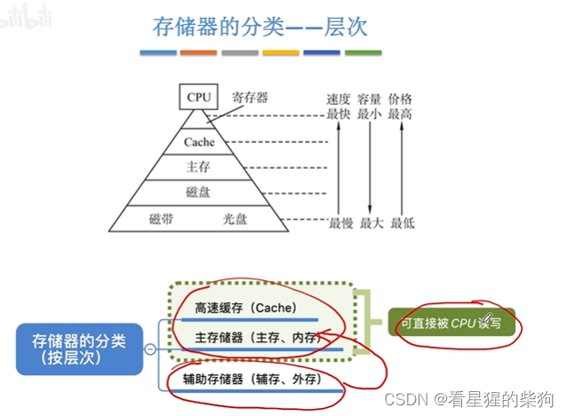
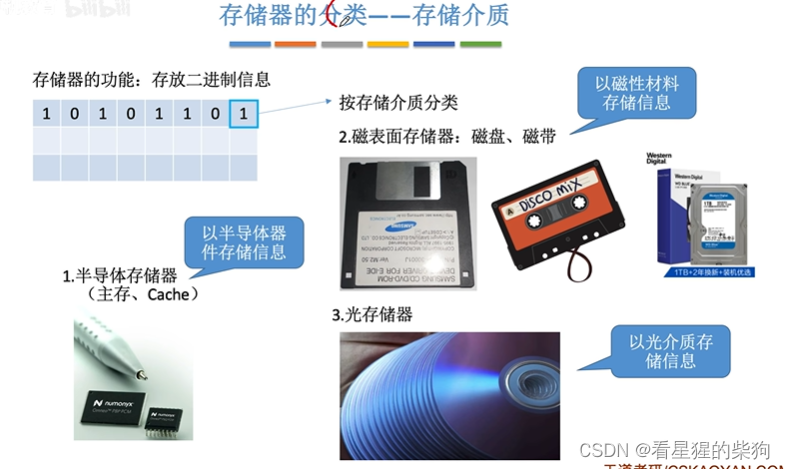
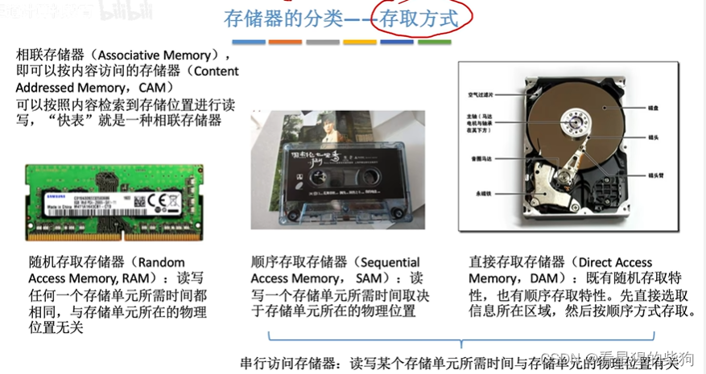
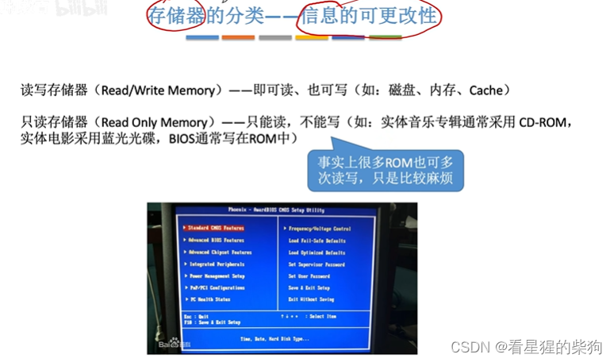
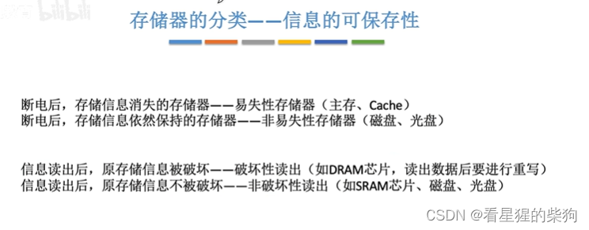
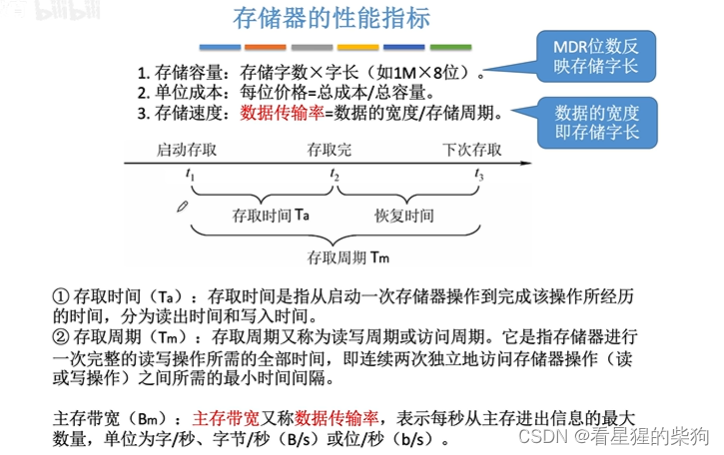
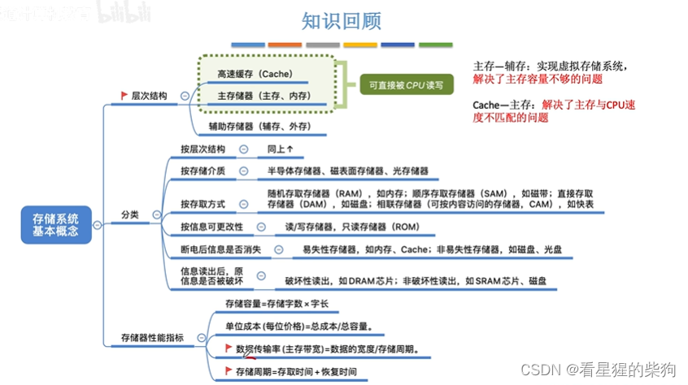


# 现代计算机的结构

# 概述

# 存储器的层次结构
打开一个程序时，程序代码被调入主存，然后 CPU 开始读取并运行主存中的代码。
虚拟存储系统：看到的比实际大小大得多

# 各种存储器的速度与价格
Cache 也是分层的
Cache 和主存都可以被 CPU 直接访问
辅存以前是机械硬盘，现在多用固态硬盘
开机时需要把辅存中的数据读入主存，辅存读取速度越快，开机也就越快

# 存储器的分类（按层次）

# 存储器的分类（按存储介质）
光存储器：CD、DVD 之类

# 存储器的分类（按存取方式）
磁带：需要转动磁带，通过磁头的对应位置来读取
随机存取存储器：主存、Cache
直接存取存储器：机械硬盘——即既有存取时间相同的位置，也有存取时间不同的位置

# 存储器的分类（按信息的可更改性）
 
# 存储器的分类（按信息的可保存性）

# 存储器的性能指标
存储速度：可以理解为存储一个存储字的一位所需的时间
主存带宽（数据传输率）：每秒进出主存的最大信息量，单位可以是字/秒、字节/秒等
 
# 总结


