# 计算机组成原理 - 数据寻址（相对寻址、基址寻址、变址寻址）


## 指令寻址与数据寻址
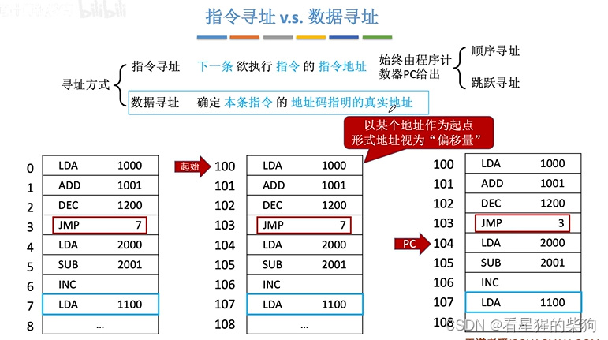
## 概述
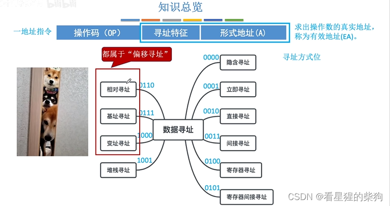
## 偏移寻址
变址寄存器：IX
基址寄存器：BR
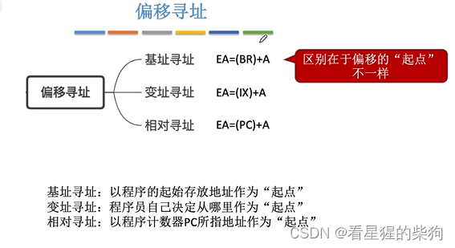
### 基址寻址
没有基址寄存器时，有时会用通用寄存器代替，此时指令中必须指明该寄存器
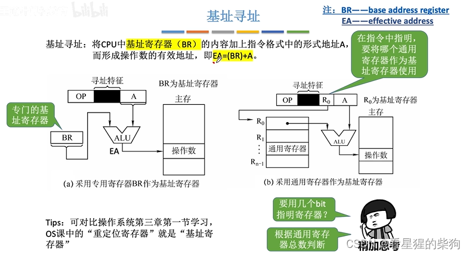

### 基址寻址的作用
当起始地址为内存地址 0 时，可以使用直接寻址
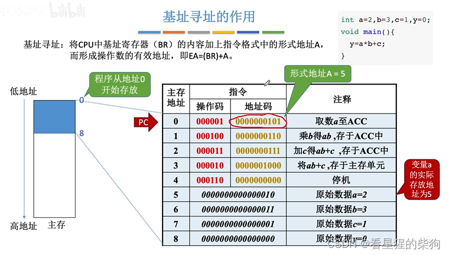
当起始地址不是内存地址 0 时，可以通过 BR + 操作数来寻址
BR 指向当前正在执行的程序的起始地址
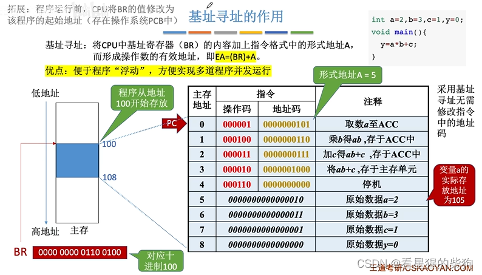
程序放在内存的什么位置由操作系统管理
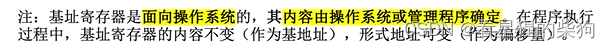
如果指定某个通用寄存器作为基址寄存器，我们就不能再修改该通用寄存器；它由操作系统管理
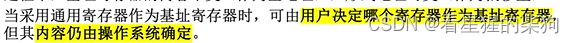
它可以扩大寻址范围

### 变址寻址
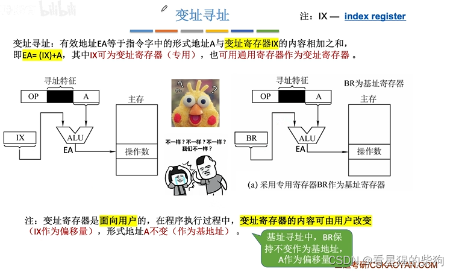
### 变址寻址的作用
对于循环，变址寻址所用的指令更少
例如，下图需要的加法指令条数与循环次数相同
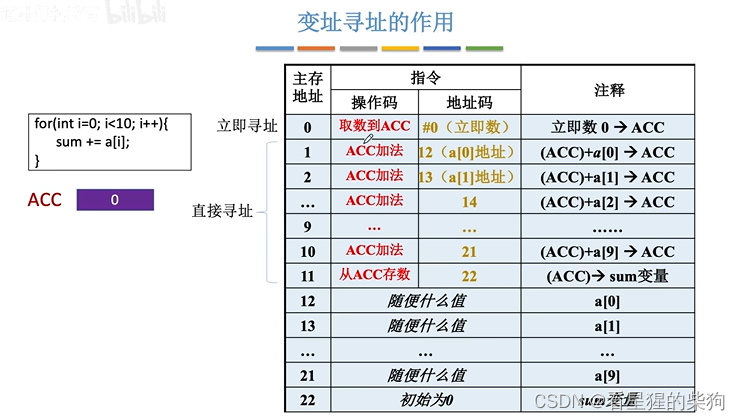
而下一张图则不需要那么多指令
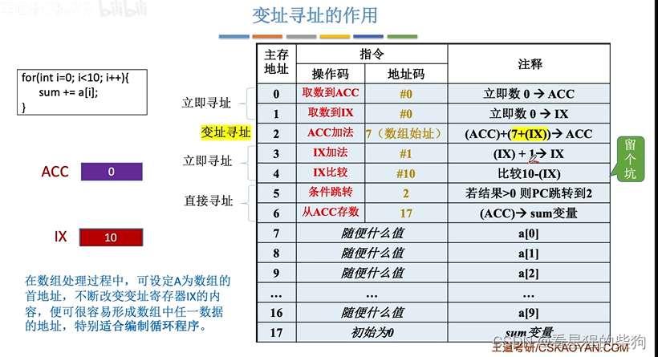

### 基址加变址组合寻址
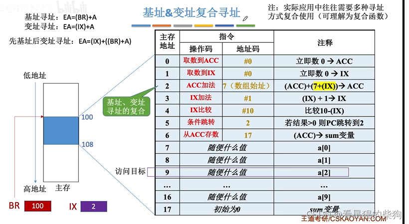
### 相对寻址
A 应当是相对于当前指令的下一条指令的偏移量
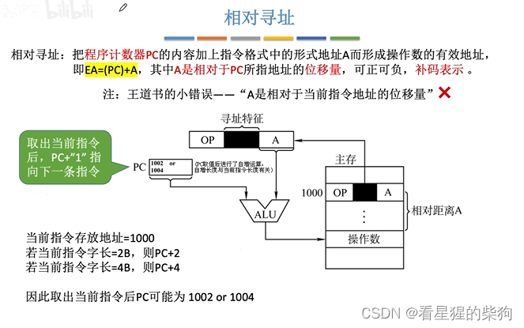
### 相对寻址的作用
分段解决了程序被移动时数据元素的寻址问题。这样，每次移动程序代码时，形式地址都不需要改变。在下图中，也就是说 7 不需要改变
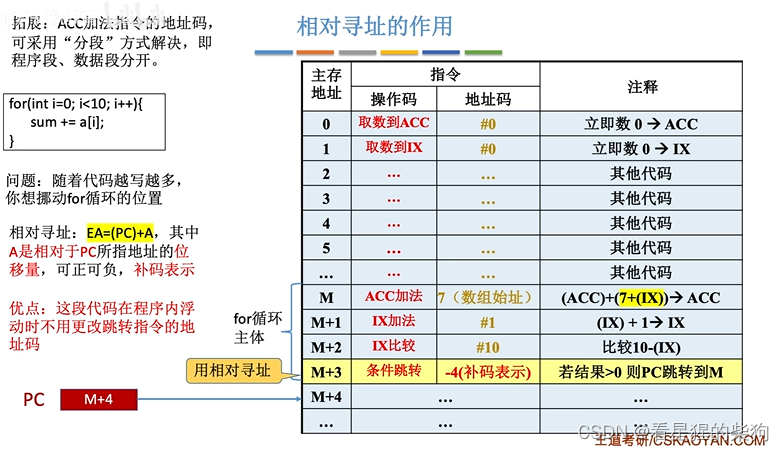
基址寻址对应整个程序在内存中的移动
相对寻址对应程序内一段代码的移动

## 总结
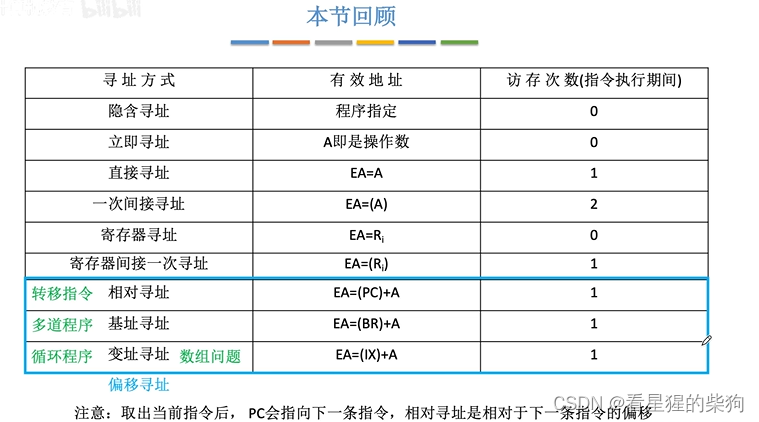

## 硬件如何比较数字
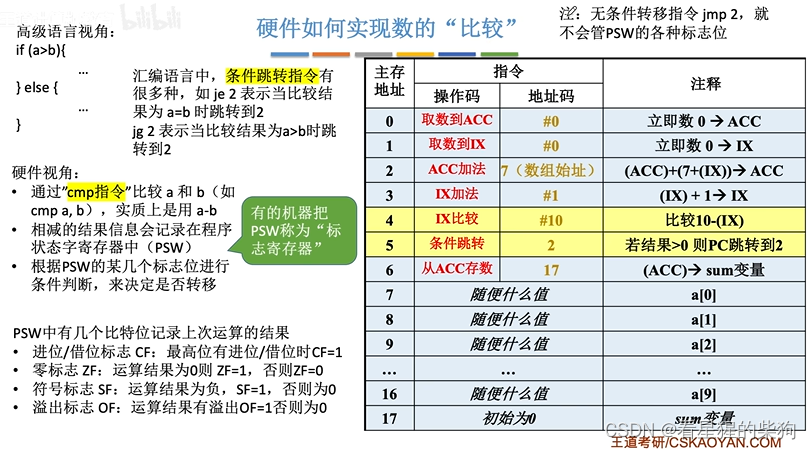


# 计算机组成原理 - 数据寻址（直接寻址、间接寻址、寄存器寻址、寄存器间接寻址、隐含寻址、立即寻址）


## 指令寻址 vs 数据寻址
左图：直接跳转
中图：基于起始地址（因为程序的起始地址不同，被放在内存中的不同位置，直接 JMP 可能会跳到错误的位置）
右图：基于 PC
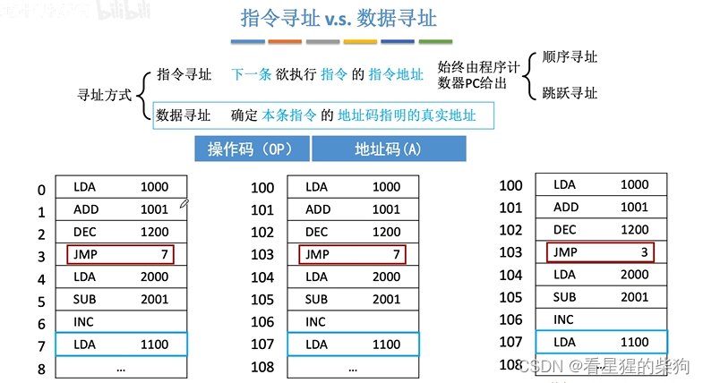
## 总览
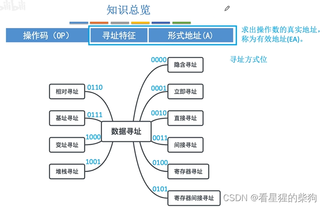
## 数据寻址
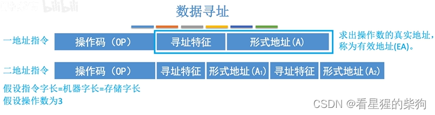
操作数 3 可以简单理解为需要在内存中找到 3
### 直接寻址
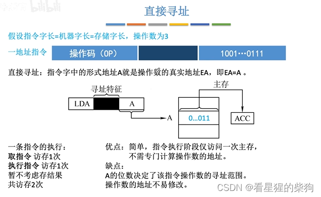
### 间接寻址
(A)：地址 A 中存放的内容
两次间接寻址通过判断取出的地址内容的最高位是 1 还是 0 来决定是否需要继续间接寻址
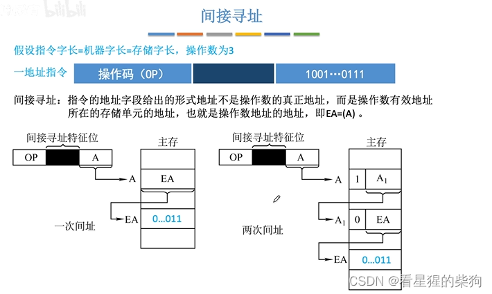
间接寻址的地址范围就是操作数对应地址中的内容所能表示的范围（即一个存储字所能表示的范围）
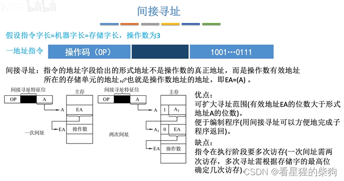
### 寄存器寻址
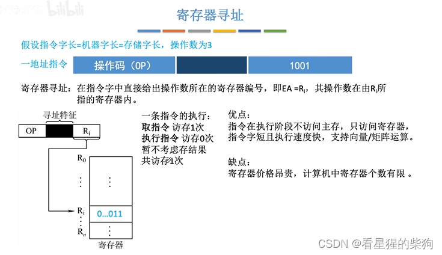
### 寄存器间接寻址
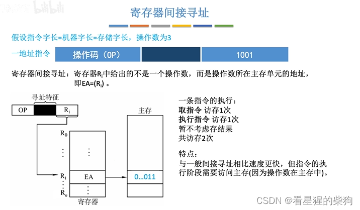
### 隐含寻址
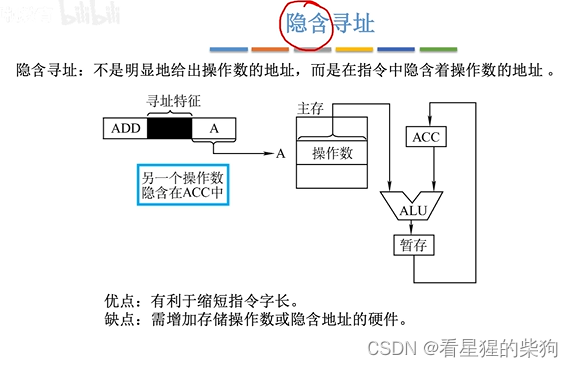
### 立即寻址
操作数就在指令中
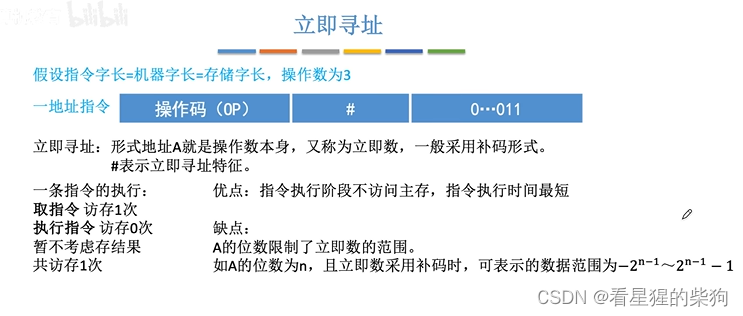
## 总结
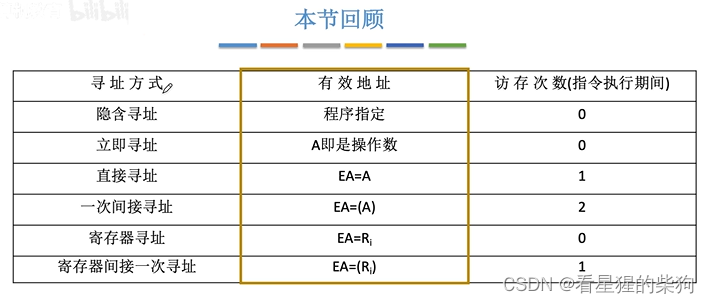

