
# 现代计算机的结构
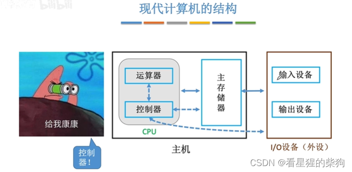
# 回顾：计算机的工作过程
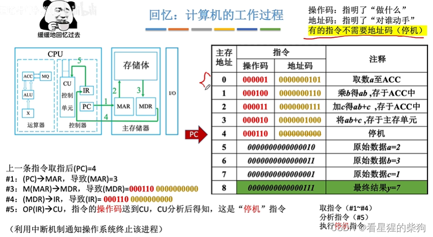
# 概述
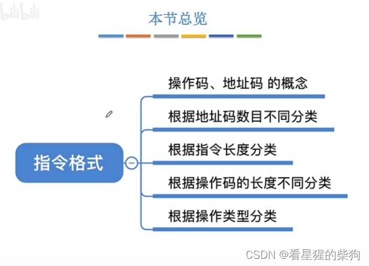
# 指令的定义
不同的硬件架构支持不同的指令集
手机：ARM 架构 
电脑：x86 架构
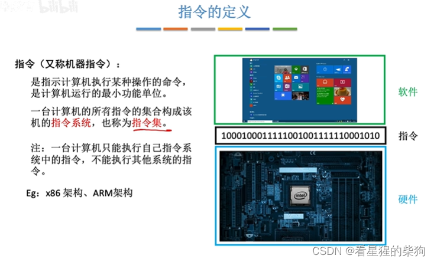
# 指令格式
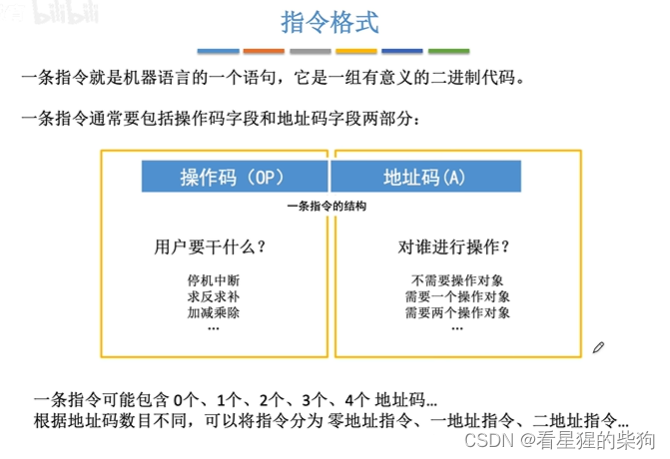
## 零地址指令
可以结合后缀表达式来理解：两个操作数隐含存放在栈顶和次栈顶
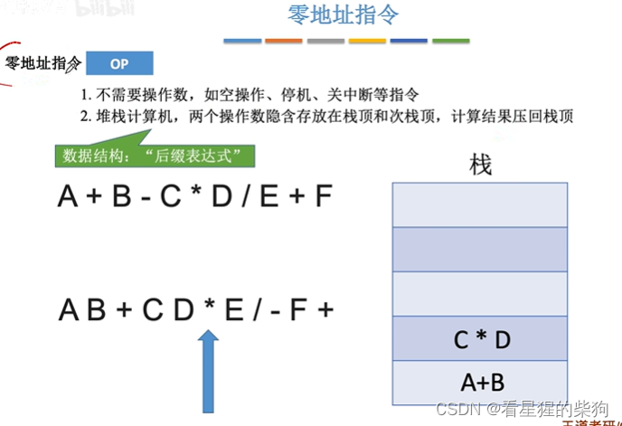
## 一地址指令
取指令需要访存一次；从主存中读取某个地址的内容也需要访存一次
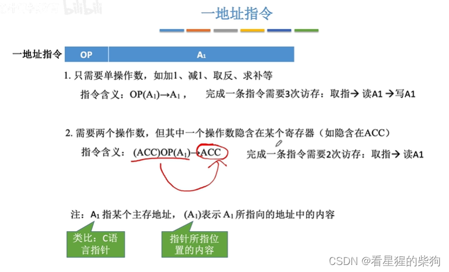
## 二地址、三地址指令
即三地址指令会指明结果存放在哪里
二地址指令不指明结果存放位置，使用默认位置
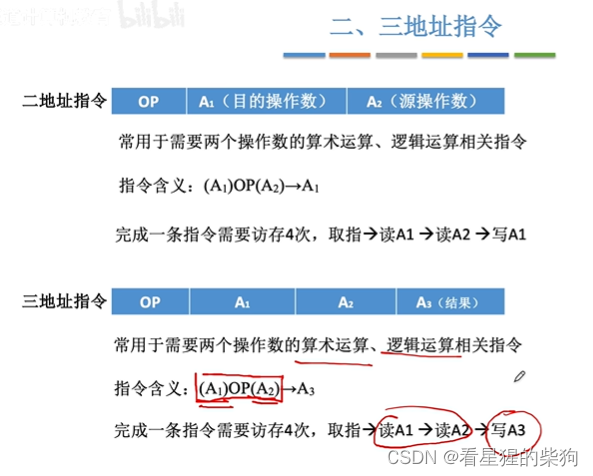
- 二地址指令可以分为（按访问的对象）：
1. 存储器-存储器（SS）型指令（只访问内存）
2. 寄存器-寄存器（RR）型指令（只访问寄存器）
3. 寄存器-存储器（RS）型指令（既访问内存又访问寄存器；一般指令中既有表示寄存器的位，也有形式地址的位）
## 四地址指令
修改 PC 不是简单地顺序加 1
指令总长度对应的地址范围是有限的。如果指令总长度不变，地址码越多，可寻址范围相对于总地址范围就越小
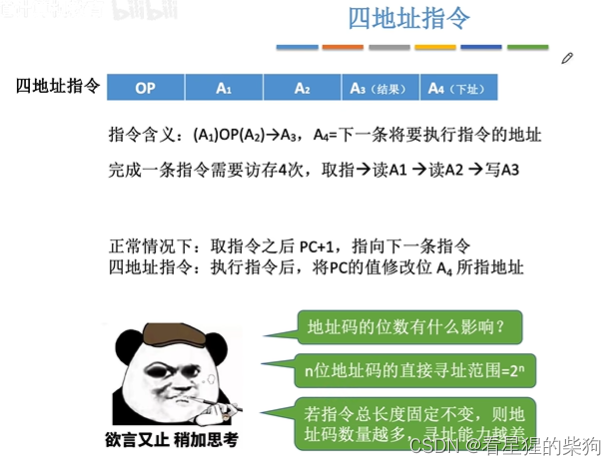
## 小结
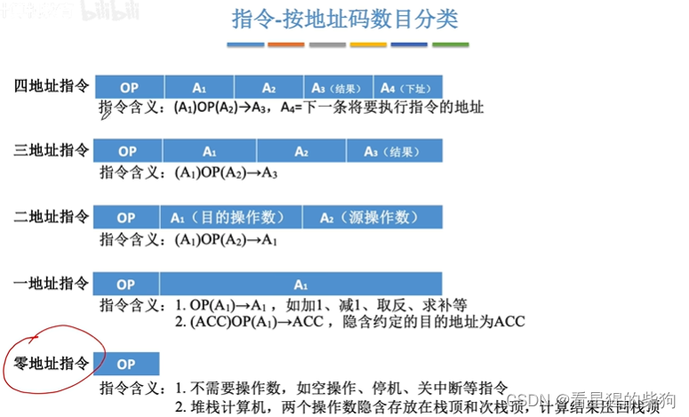
## 指令 - 按指令长度分类
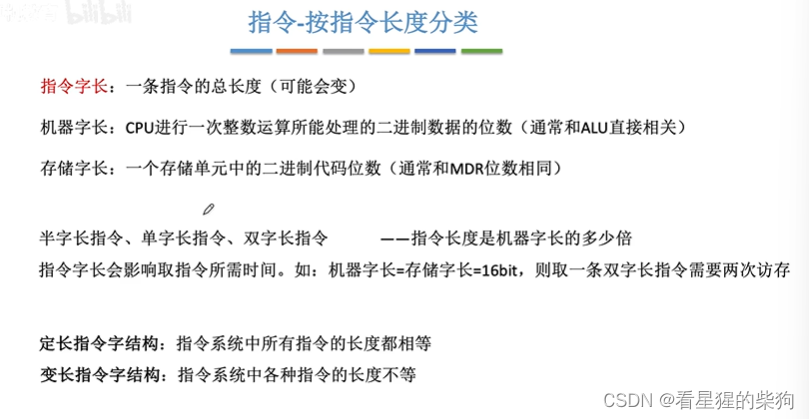
## 指令 - 按操作码长度分类
定长指令字结构 + 可变长操作码 = 扩展操作码指令格式

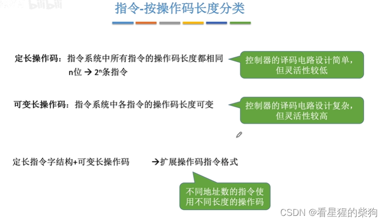
## 指令 - 按操作类型分类
转移操作：即改变指令执行流程，PC 的值会改变
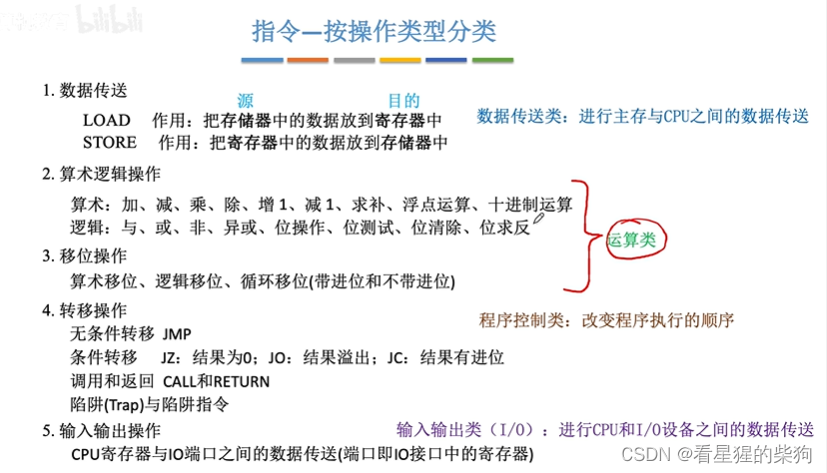
##  小结
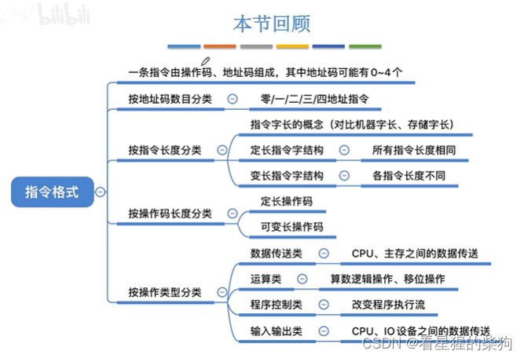
# 扩展操作码
## 概述
指令字：一条指令
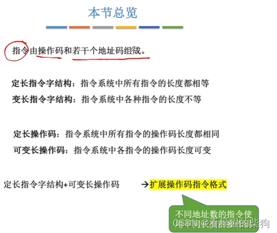
## 扩展操作码示例 1
注意零地址指令可以全为 1，不需要再扩展操作码
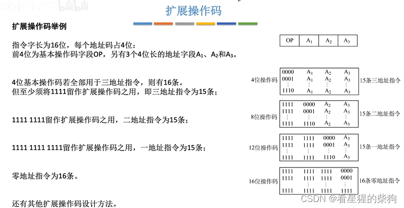
短码不能是长码的前缀，否则无法准确识别。

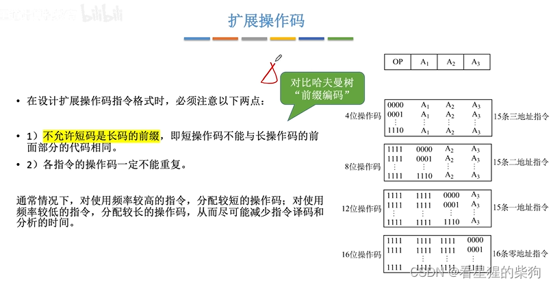
## 扩展操作码示例 2

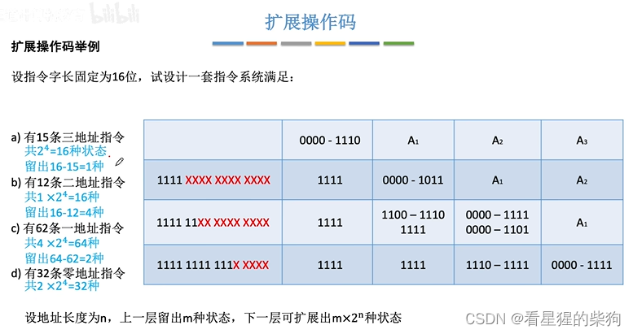
## 小结
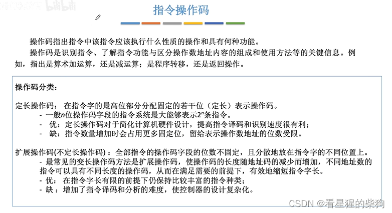

