
# 选择语句
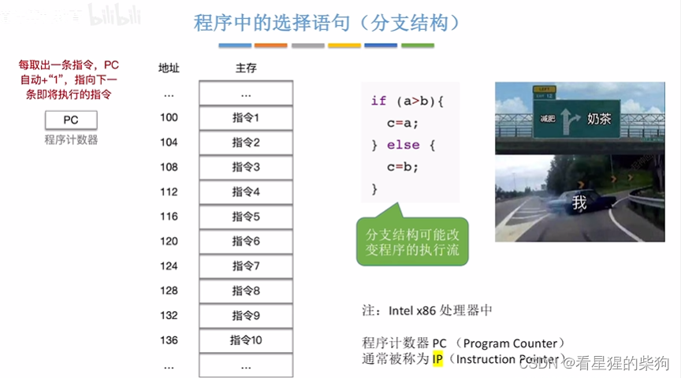
你不一定知道指令的位置，所以 jmp 很难直接跳转到指令所在的位置
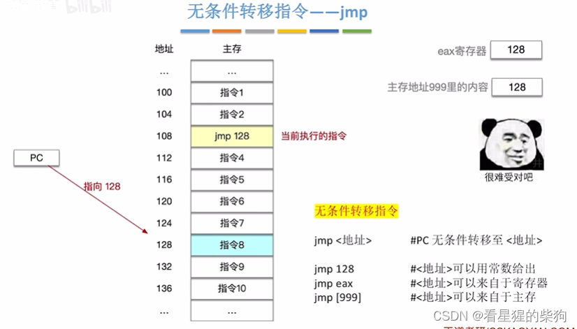
## jmp
标号对应一个位置，可以自己命名
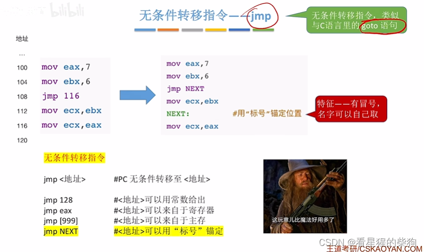
## jxx
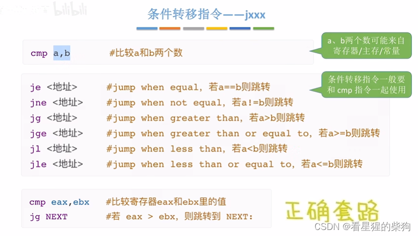
## 示例：选择语句的机器级表示
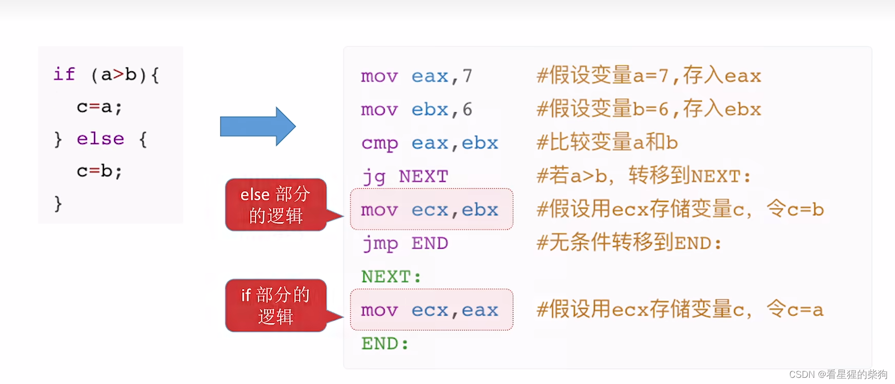
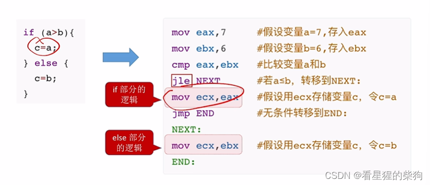
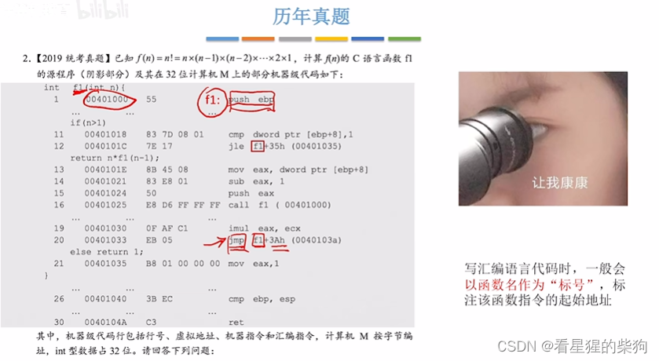
## 扩展：cmp 指令的底层原理
每次运算产生的标志位会覆盖上一次运算产生的标志位

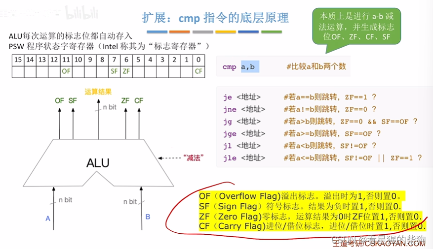
# 循环语句
## 用条件转移指令实现循环
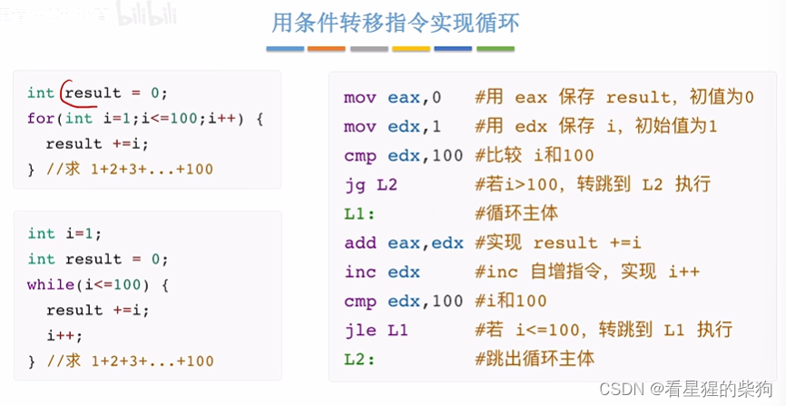
逐步拆解
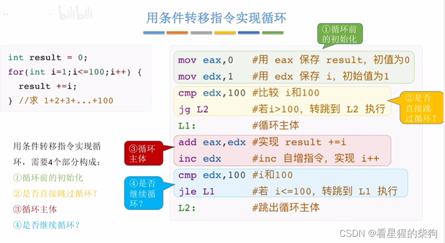
##  用 loop 指令实现循环
ecx 的特殊之处在于它可以用作循环计数器
loop 指令默认对 ecx 做减一操作
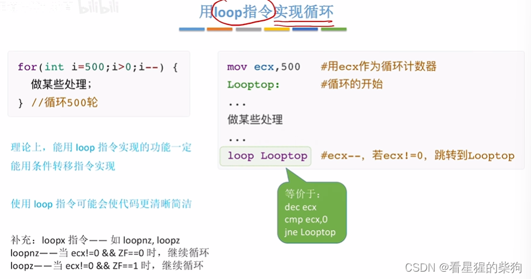

