
#   高级语言与机器级代码的对应关系
## 概述
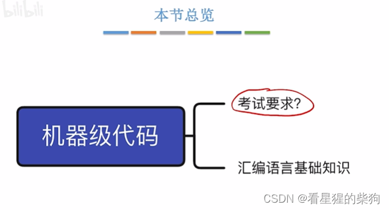
## 高级语言 > 汇编语言 > 机器语言
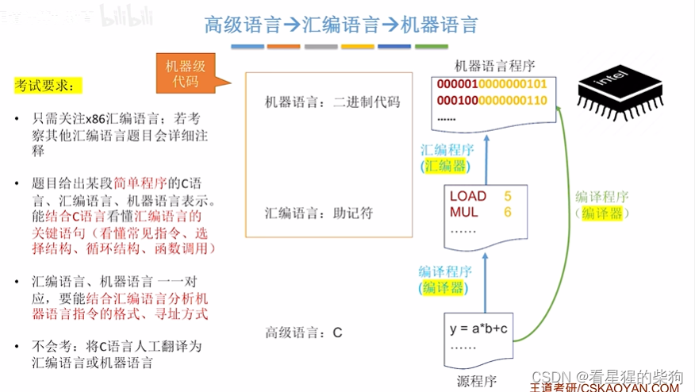

## x86 汇编语言指令基础
x86 汇编是某一系列 CPU 所支持的一套汇编指令
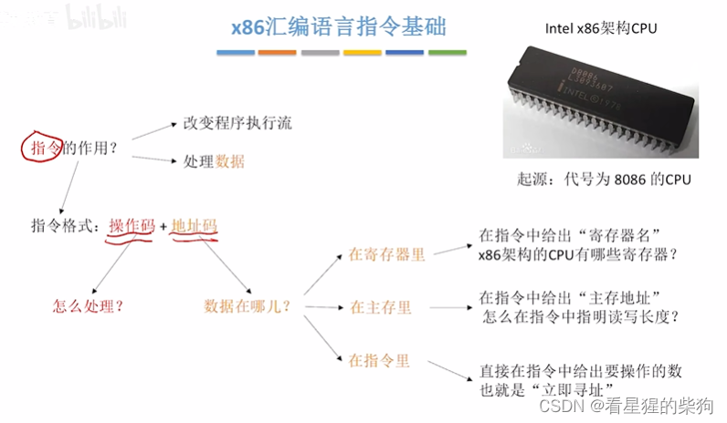
## 以 mov 指令为例
注意源操作数和目的操作数
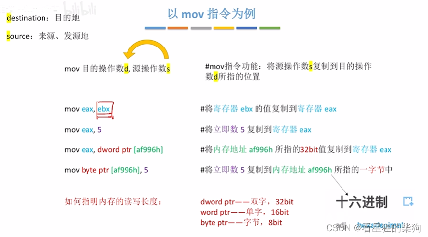
## x86 架构 CPU 的寄存器
通用寄存器可以存放任何内容，以 X 结尾
变址寄存器以 I 结尾
指针寄存器以 P 结尾
E 前缀表示 32 位
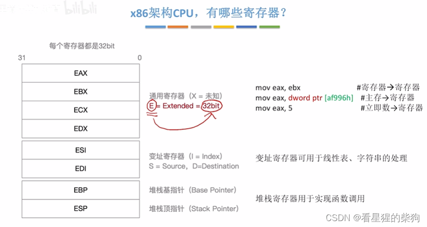
通用寄存器也可以指定只用 16 位
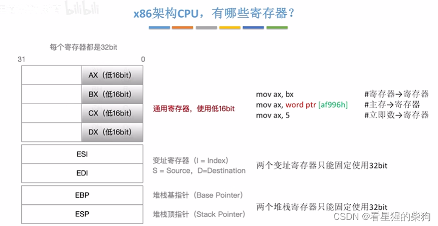
通用寄存器也可以指定只用 8 位

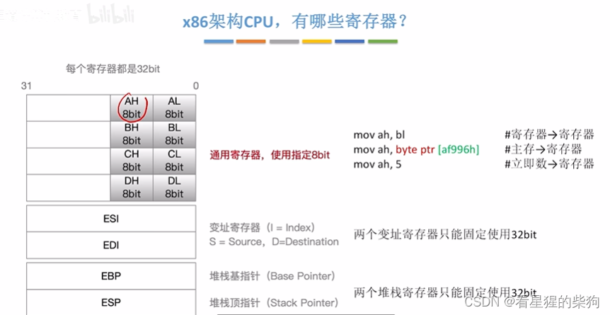
## 更多示例
注意未指定长度时默认是 32 位
还要注意 h 后缀表示十六进制
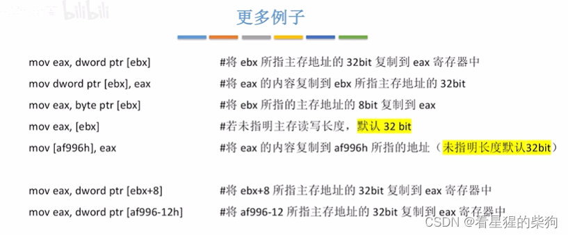
## 总结
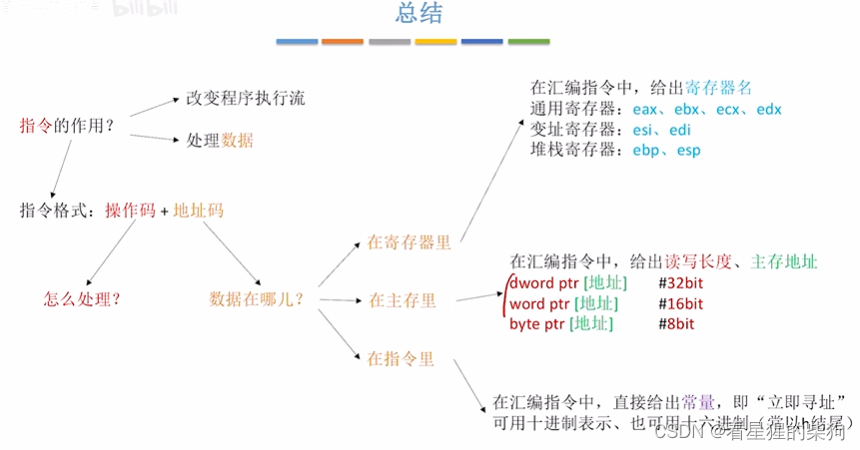
# 常用的 x86 汇编指令
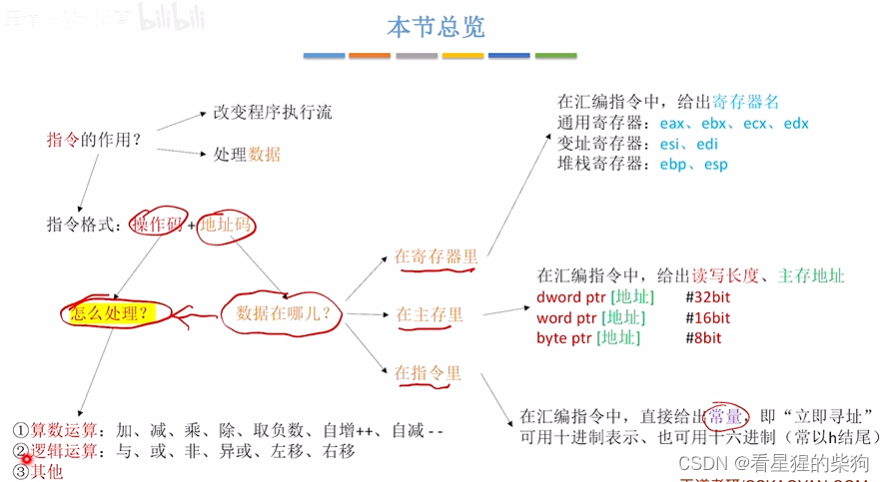
## 常用的算术运算指令

运算结果放在目的操作数中，因此目的操作数不能是常量，只能是寄存器或内存
除法中，被除数放在 edx 和 eax 中；被除数扩展为 64 位，高位存放在 edx，低位存放在 eax
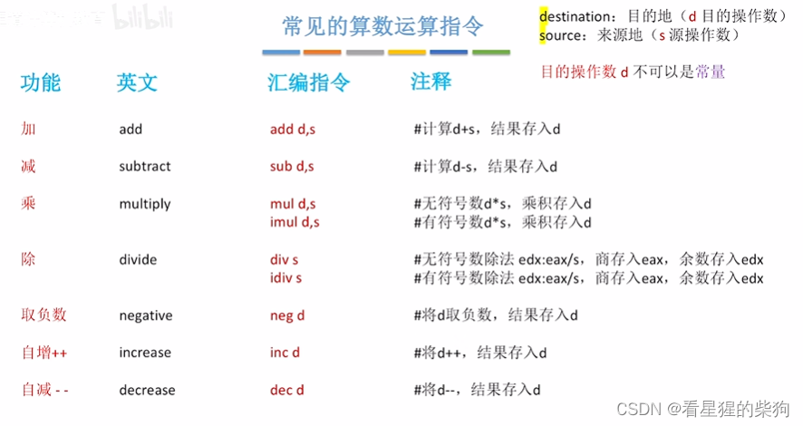
## 关于王道书上的解释
x86 不允许两个操作数都来自主存，这样可以保证每条指令访问主存的次数不会太多，因为访存次数越多，执行越慢
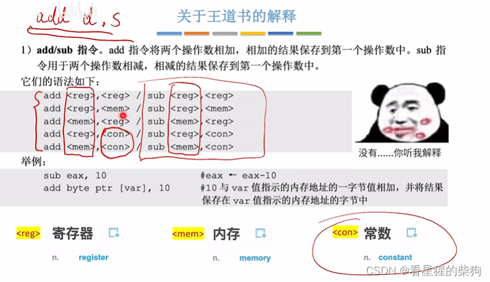
## 常用的逻辑运算指令
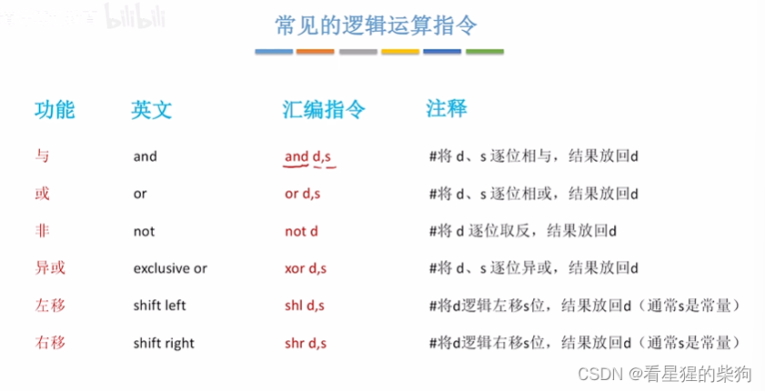
## 其他指令
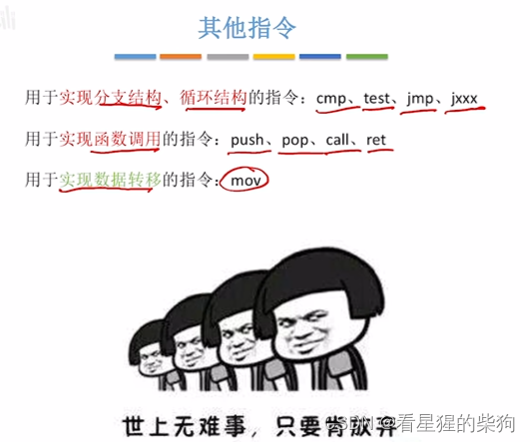

