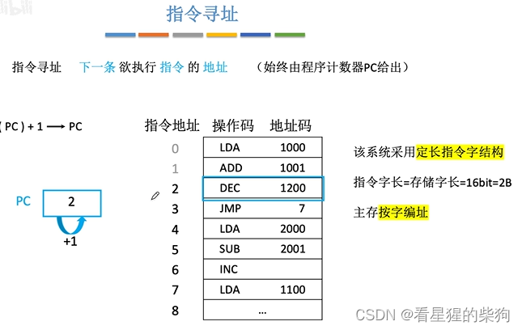
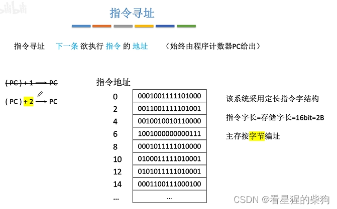
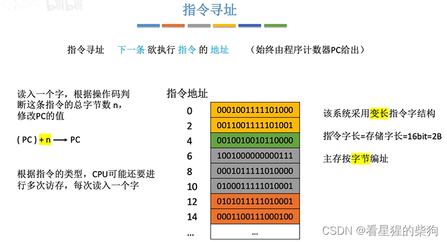
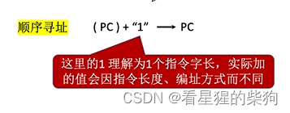
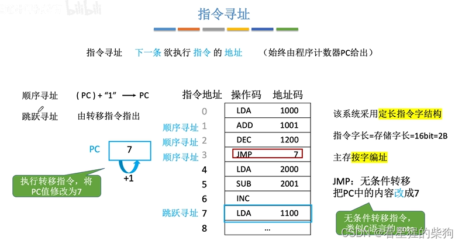
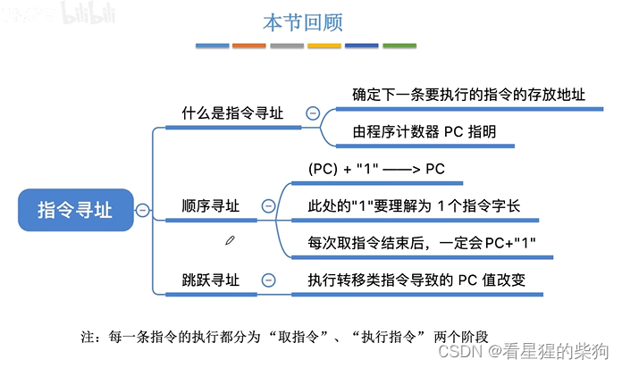


# 概述

# 指令寻址
当主存按字编址时
字：指一个存储字长的单位（对应下图中的两个字节）
## 顺序寻址

当主存不按字编址而按字节编址时，图中对应的 PC 寻址方式也会改变

多次访存发生在确定指令的总字节数之后，用来看是否还需要读入指令的其他部分。因为为了确定指令的总字节数，可能只取出了指令的一部分

这里的 1 是刚取出的指令的字长]

## 跳跃寻址
PC：下一条要执行的指令（取指令时 PC 会改变）
跳跃寻址：由指令修改 PC 的值

# 总结 


