
# 数据通路
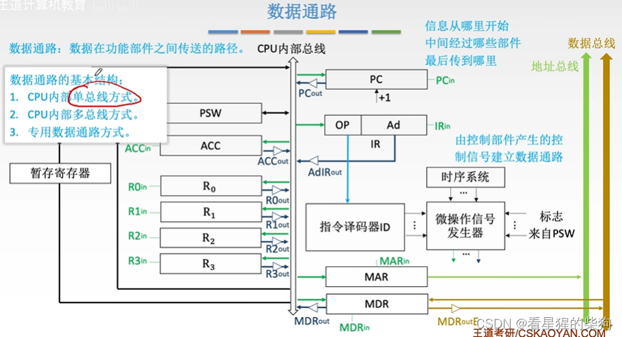

## CPU 内部单总线方式
 同一时刻，一条总线只能支持一对部件之间的数据交换
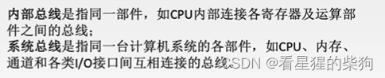

连接 CPU 与各寄存器的 in 和 out 线，用来控制其是输入还是输出
Y 与 ALU 之间有专用数据通路

每个时钟周期，CU 发出一组控制信号来实现一个微操作
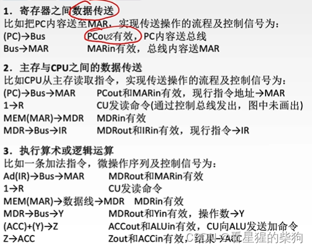
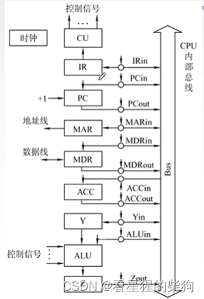
### 例题
（）括号表示取括号内所指位置中存放的内容
指令译码可以理解为把 IR 的内容送入 CU
(PC)+1—>PC 也可以加在 (MDR)—IR 之后
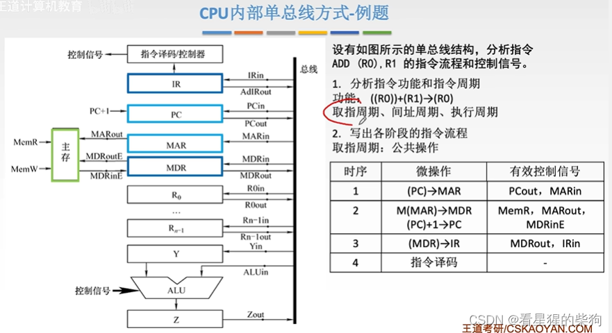
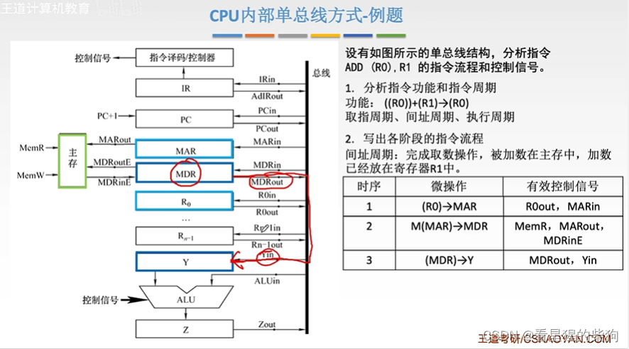
这里 MAR 中仍然是 (R0)
 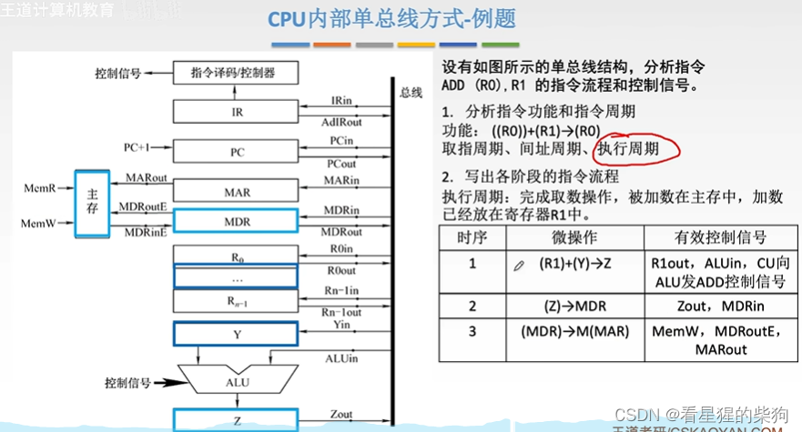
### 小结
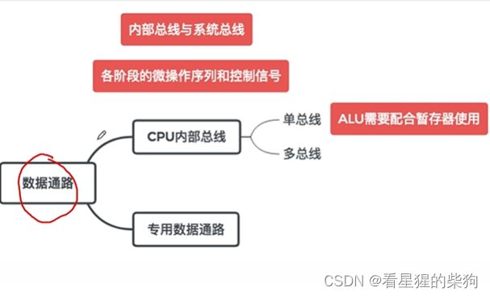
## 专用数据通路方式
像 C1 这样的接口连接到 CU，由 CU 发出控制信号使其有效或无效（能否通过）
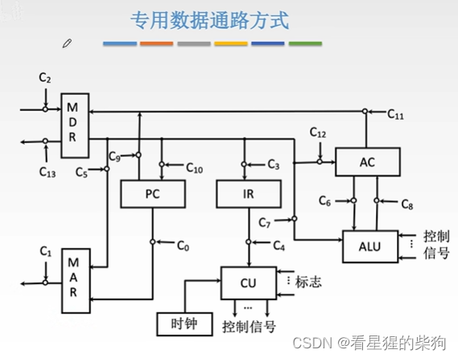
### 专用数据通路方式 - 取指周期
Op 取指令的操作码部分
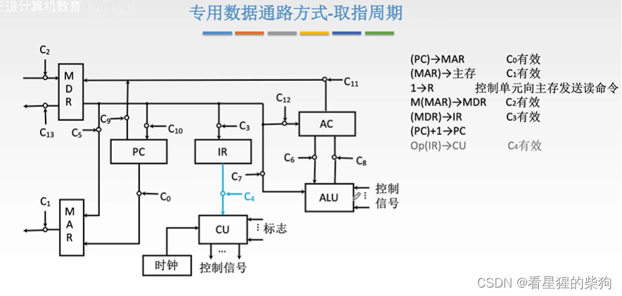
### 专用数据通路方式 - 例题
  MDR 与主存之间是双向的（既能读也能写）
  MAR 与主存之间是单向的（只传送给主存）
  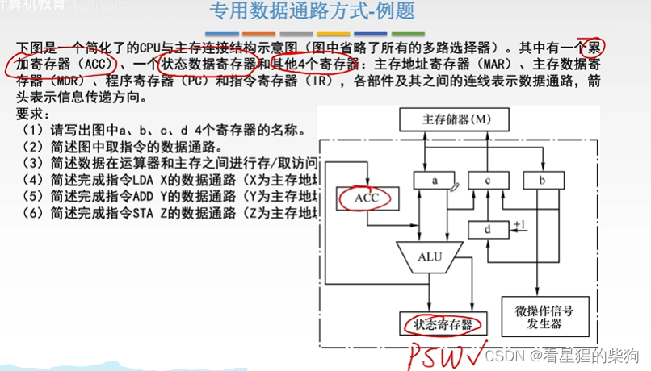
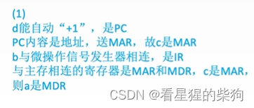
第二问可以加上 (PC)+1—>PC，然后 Op(IR)—>微操作信号发生器
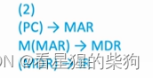
ALU 也可以什么都不做，让信号原样通过（可以理解为给数加零，结果不变）
默认主存地址已经在 MAR 中
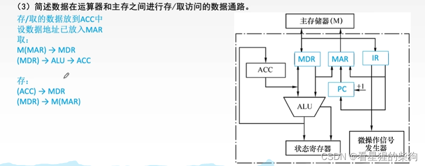
默认指令已经在 IR 中
把 IR 中的形式地址送到 MAR
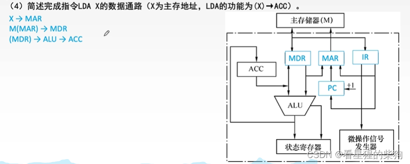
默认指令已经在 IR 中
把 IR 中的形式地址送到 MAR
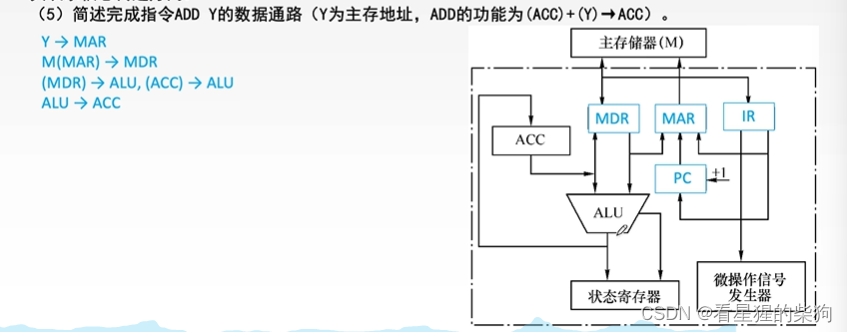
默认指令已经在 IR 中
把 IR 中的形式地址送到 MAR
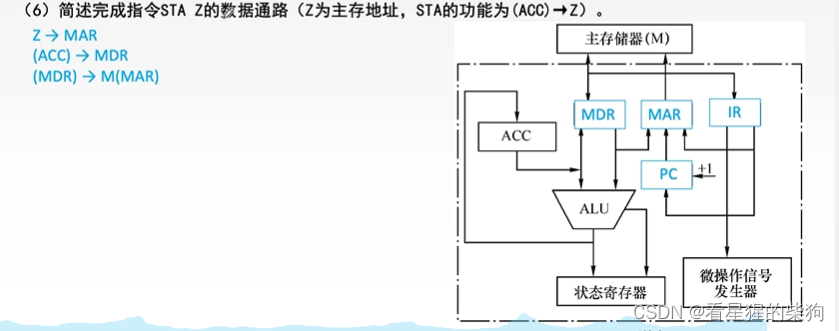
### 小结
专用数据通路有多个输入，哪个输入信号生效可以通过多路选择器控制，或者在每个输入上加一个三态门来控制
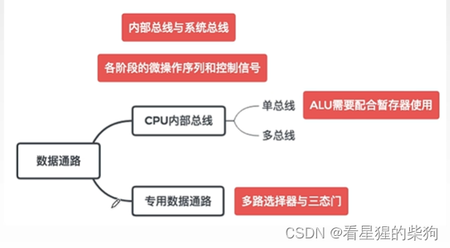

