
# CPU 的功能
  时序控制即提供每条指令对应的各个操作信号的先后顺序

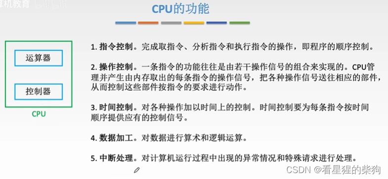
# 运算器和控制器的功能
中断处理可能处理 I/O 中断，也可能处理由异常引起的中断 
在这里插入图片描述
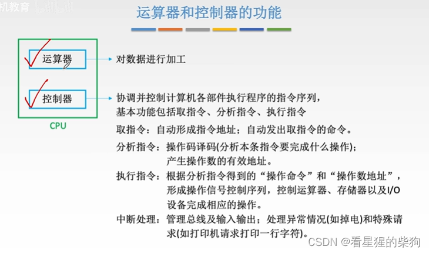
# 运算器的基本结构
要运算的数据放在寄存器中
H 为高位，L 为低位
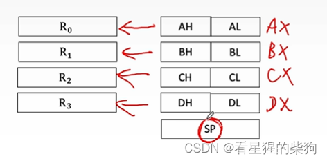
## 专用数据通路方式
这里所有寄存器同时向左右两边发送数据，所以需要进行选择
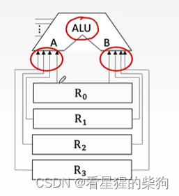
MUX 根据某些输入决定输出哪一路
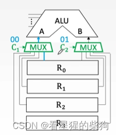
三态门
Rout 输入决定这一路能否输出
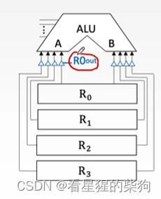
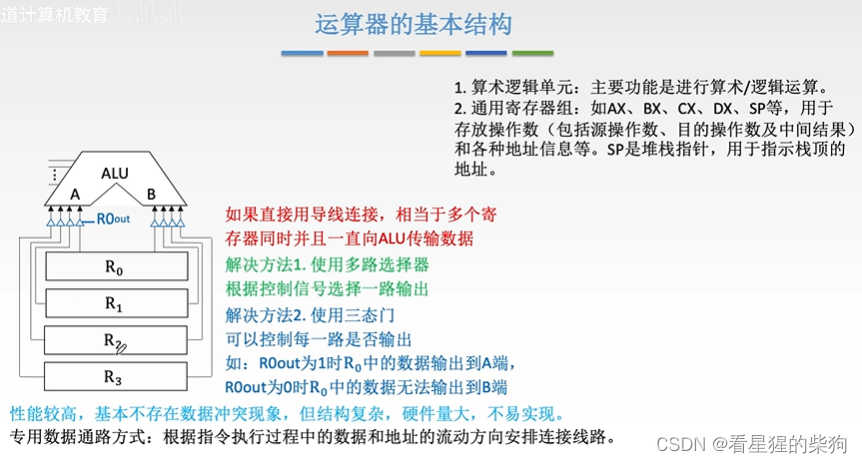
## CPU 内部单总线方式
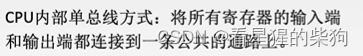

暂存寄存器可以暂存从主存或某些寄存器读出的数据

ALU 上方的寄存器存放 ALU 的运算结果；等结果稳定后（或者说 B 的信号稳定后），再打开结果与 CPU 内部总线之间的连接，最终通过 CPU 内部总线把结果送到指定的寄存器

绿色的 in 信号同样根据某些输入决定数据能否写入寄存器

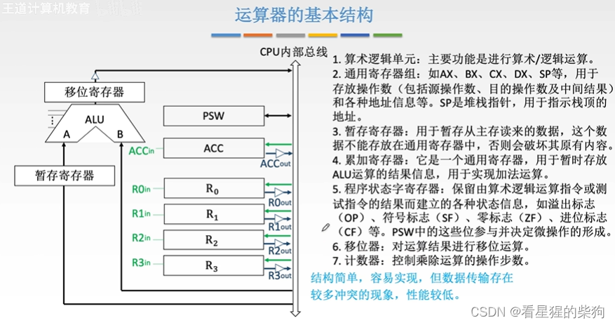
# 控制器的基本结构
CPU 内部总线
指令中的地址码信息需要输出到 CPU 内部总线上
 指令译码器选中某一根输出线，微操作信号发生器根据该信号产生微操作序列
微操作信号发生器每收到一次时序系统的信号，就发出该微操作的信号，执行一个微操作

MAR：主存中某个内容的存储地址
CPU 内部总线：CPU 内部各部件传送数据的公共通路
地址总线和数据总线：CPU 与其他部件之间传送数据的公共通路
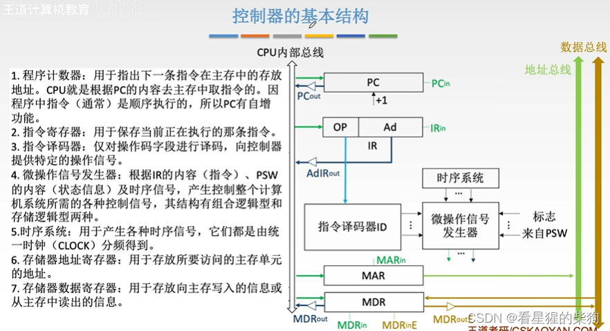
# CPU 的基本结构
可编程：可以通过汇编语言改变寄存器的值
PC：跳转指令
PSW：产生标志位，跳转指令也需要读取
ACC：一些运算会改变 ACC 的值
R0 R1 R2 R3：可以通过汇编修改

红色表示可见，灰色表示不可见
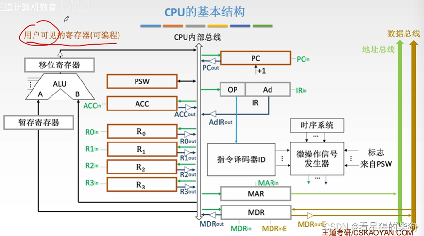
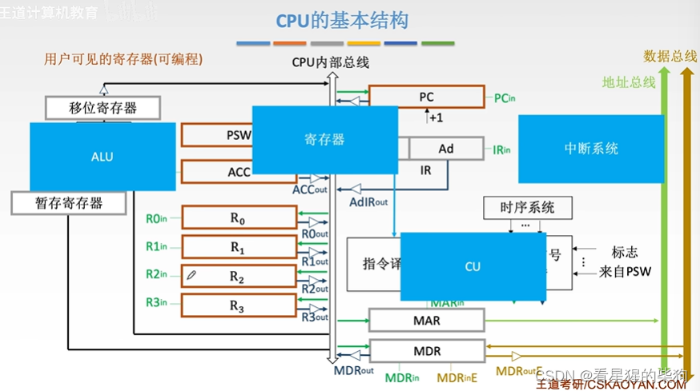
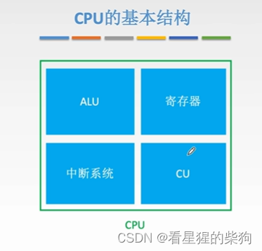

# 小结
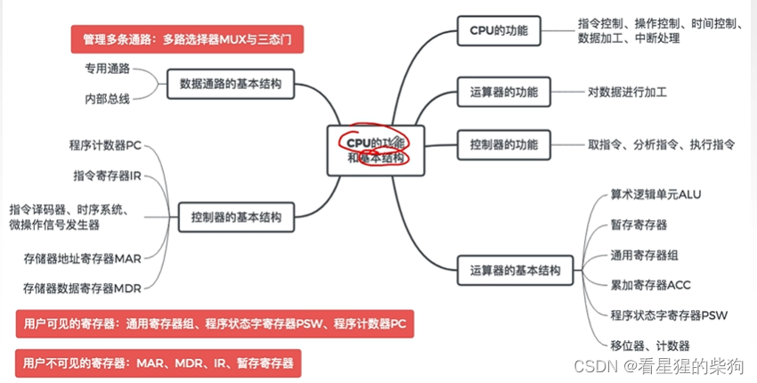

