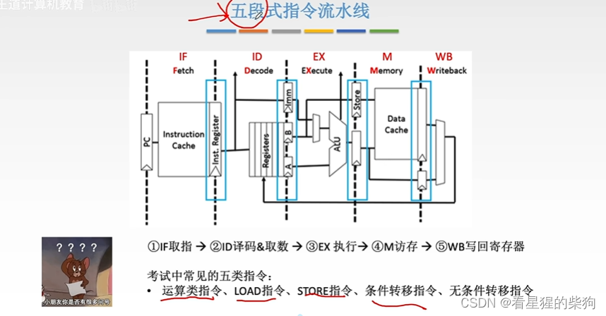
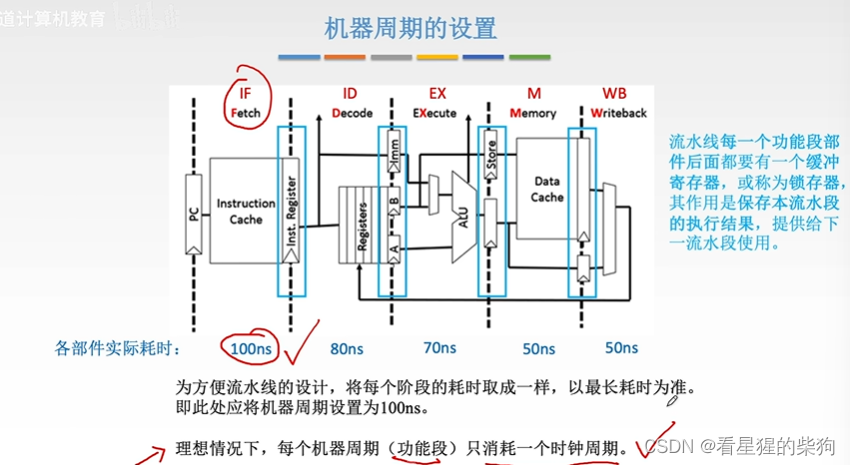
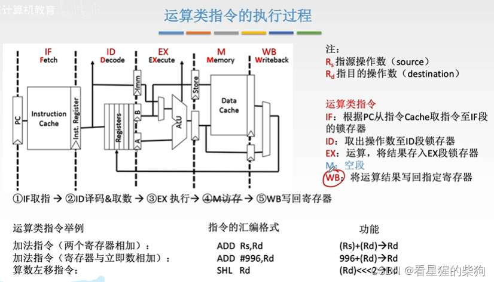
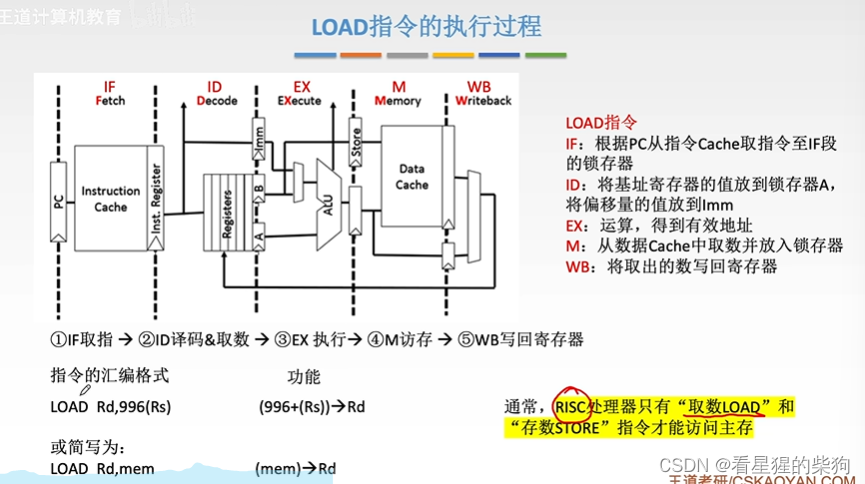
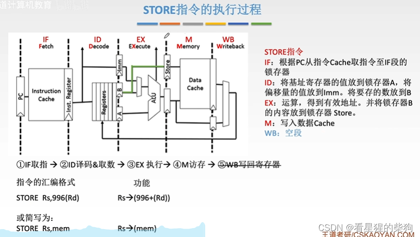
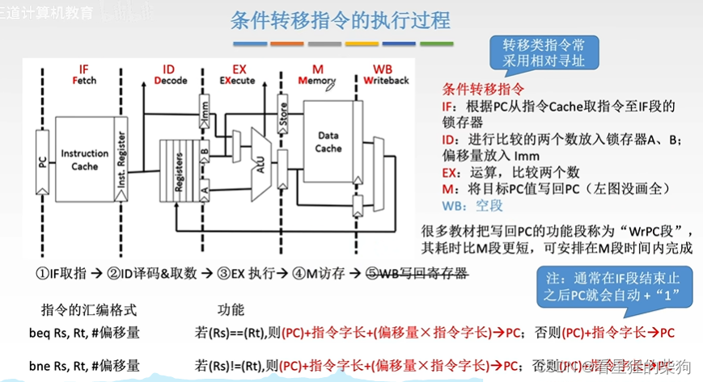
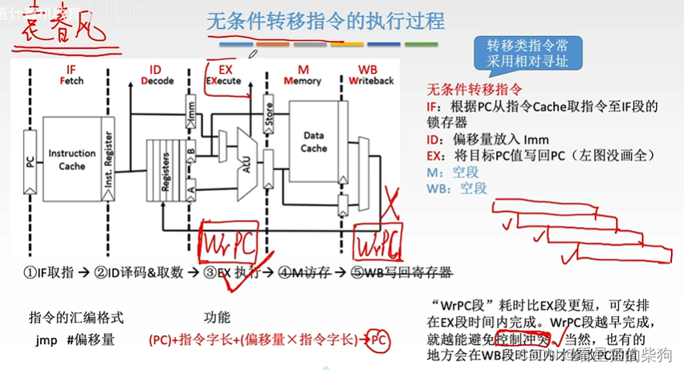
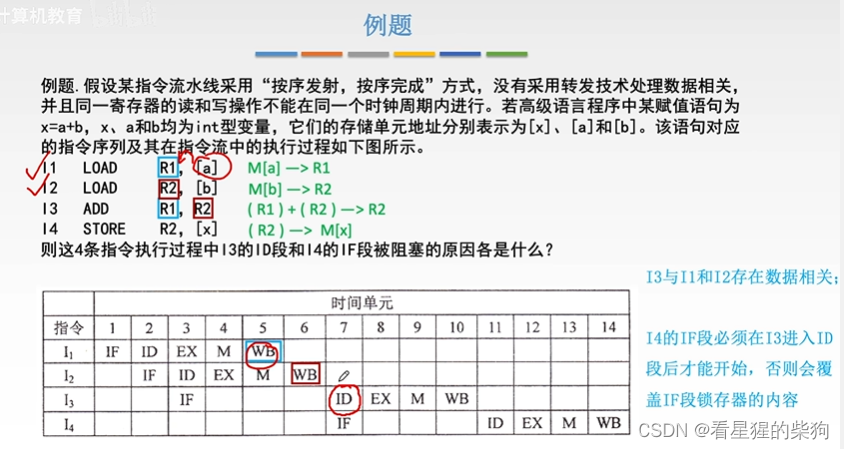


下面都是以 RISC 为背景的
# 五段式指令流水线 

# 机器周期的设置
所有阶段都设置为最长的那个机器周期的长度

# 运算类指令的执行过程
RISC 中运算结果不写回主存，而是写回寄存器。此时访存阶段什么也不做，但仍然要占用这段时间
不同指令的操作数不同，因此涉及的寄存器也不同

# LOAD 指令的执行过程
下图中 996 是偏移量，Rs 是基址寄存器，访存采用的是基址寻址
先计算地址，再访存，最后写回寄存器

# STORE 指令的执行过程
store 是要存入内存的数据
ALU 计算的是要存入的地址

# 条件转移指令
(PC) + 指令字长是下一条指令的地址
写回 PC 不是在 WB 阶段完成的，写回阶段写的是通用寄存器，而 PC 不是通用寄存器。ALU 算出比较结果后，在 M 阶段根据比较结果决定是否写回 PC
计算新 PC 值的那个阶段大概不是由 ALU 完成的

# 无条件转移指令
同上。可以看出新的 PC 不经过 ALU：第二阶段把偏移量取到 IMM 之后，进入第三阶段就直接写回 PC
越早修改 PC，就能越早避免后续指令继续执行

# 例题
只有当一条指令进入 ID 阶段之后，它在 IF 阶段存入锁存器的结果才不再需要。否则，如果此时另一条指令正在进行 IF 阶段，存放取出指令的锁存器就会被改变，前一条指令接着执行 ID 阶段时，译码的就会是下一条指令


