
# 概述
## 先看这个
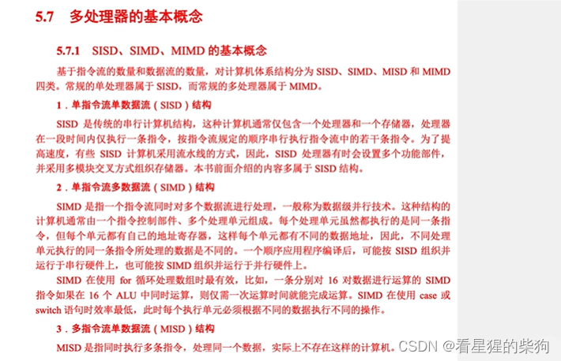

## 再看下面
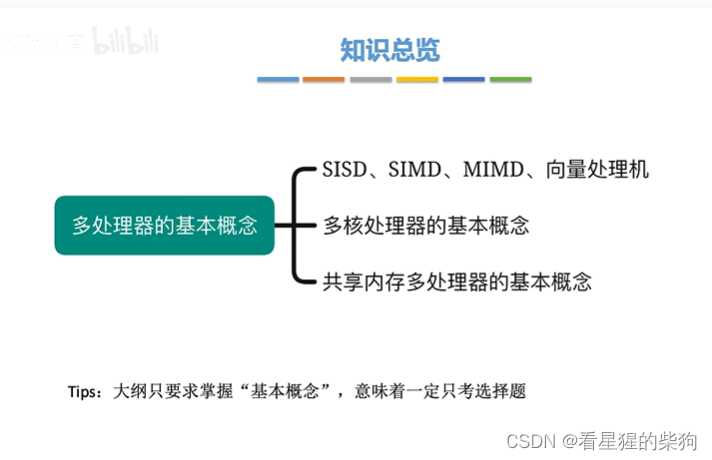
# SISD
并发是指：执行一段时间某个指令序列，再执行一段时间另一个指令序列
并行是指：两个指令序列同时运行
在某一时间段内只能处理一个进程或一个线程的指令序列，多个进程或线程的指令序列只能并发、不能并行
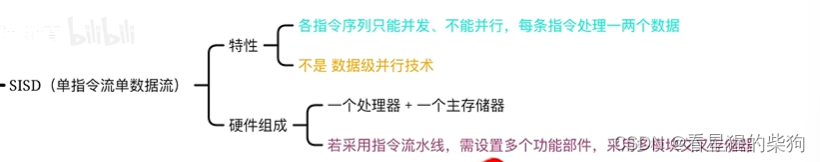

单指令流是指同一时间段内只能处理一个指令序列
单数据流是指每条指令只能处理一两个数据 
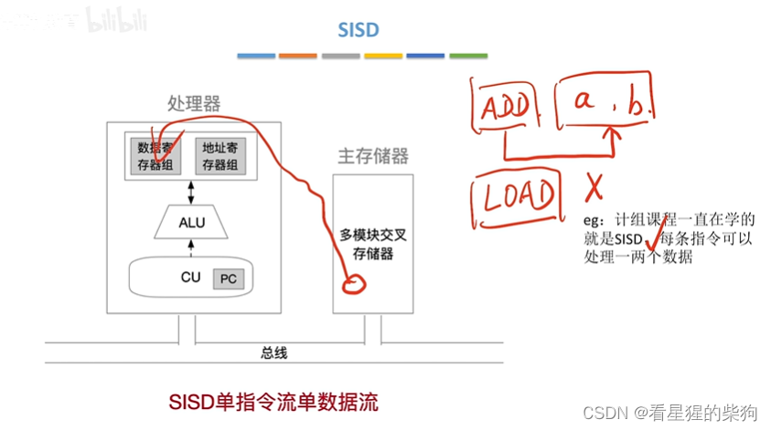
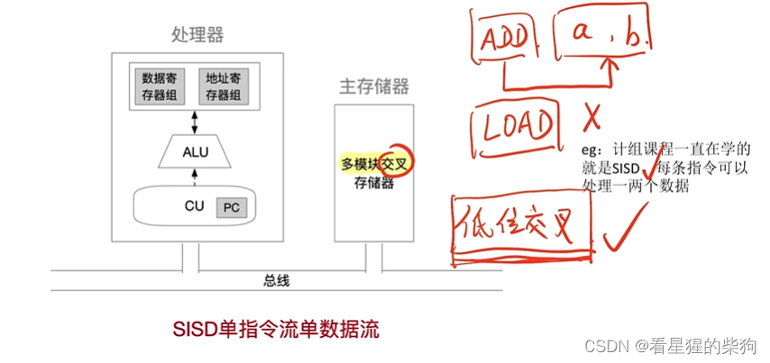
# SIMD
由于此时各个 ALU 处理的地址不同，所以地址寄存器也不同
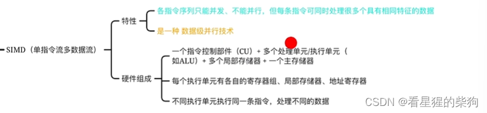
相当于一条指令交给多个 ALU 同时执行——相当于把这条指令执行了多次，或者说控制信号发给多个 ALU，多个 ALU 执行相同的操作
每个 ALU 都有自己的局部存储器，这些局部存储器合起来构成被控制的整个存储区域
此时一条指令可以并行处理多个数据（同时处理多个数据）

对应的例子是像素处理，每个 ALU 处理一部分像素
或者对所有数组元素执行相同的操作：每个 ALU 的局部存储器对应数组的某个元素，于是每个 ALU 处理数组的一个元素
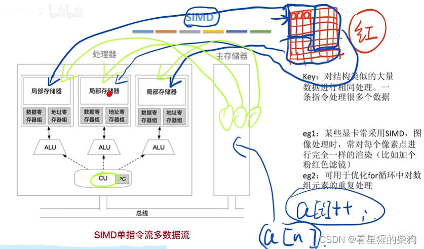

# MISD
现实中并不存在，因为这是一种比较蠢的做法：多条指令对数据的作用效果都是一样的。多条指令不可能对数据做不同的处理——或者说，如果它们是一个指令序列，由于存在依赖关系就根本谈不上并行。比如某条指令可能需要上一条指令的结果。但这里是对原始数据同时处理，这显然不合理。
因此，既然多条指令并行处理一个数据的效果都一样，为什么不直接用一条指令呢？
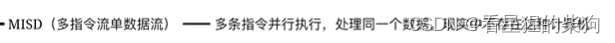
# MIMD
有多个处理器，可以执行多个不同的指令序列，也可以执行同一指令序列的多个副本（即并行处理多个数据流）
 
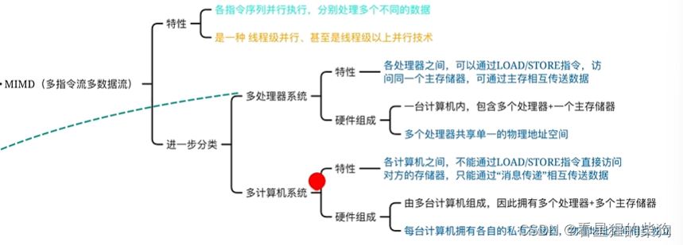
多处理器系统
多个处理器共享 LLC，每个处理器还有供自己使用的更高级 Cache
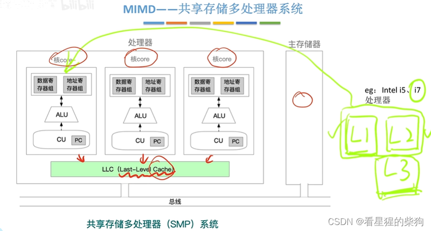
多计算机系统
消息传递可以理解为网络传输
同时执行不同的指令流，每台机器处理的数据流也不同，因为要处理的数据可以交给不同的存储器——给的数据可以不一样
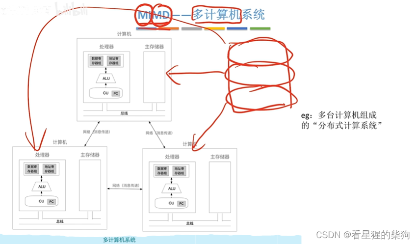
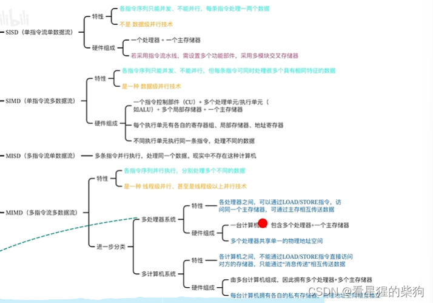
# 向量处理器

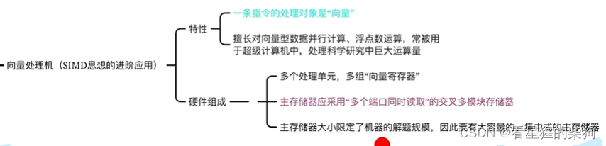
这里一个向量寄存器存放一个 n 维向量
两个 n 维向量相加时，向量处理器只需一条加法指令，因为向量寄存器存放的是向量，所以其加法的单位就是一个 n 维向量
而普通处理器需要 n 条加法指令，因为每次加法操作的是单个数据
所以向量寄存器可以看作数据并行，或者说一条指令同时处理多个数据
多端口，支持同时读取
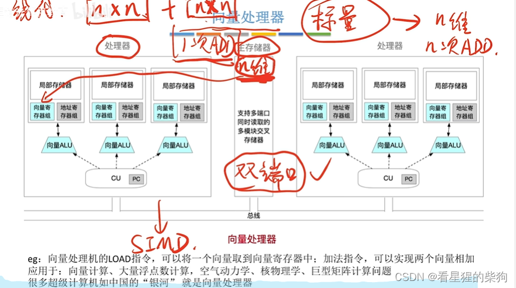

# 共享内存多处理器与多核处理器
一个核就是一个处理器
共享内存多处理器和多核处理器是一回事
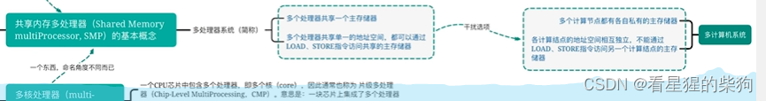

