
# 微指令设计
## 微指令格式
水平型微指令的操作控制部分对应一系列微命令的控制信号
垂直型微指令中，一个微操作码对应一条微命令，因此一条水平型微指令可能对应多条垂直型微指令
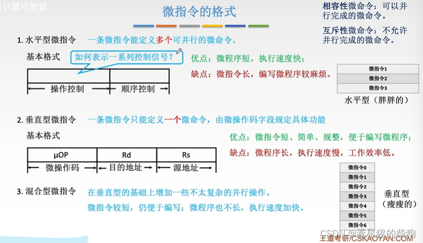
## 微指令编码方式
### 水平型微指令操作控制部分的编码方式
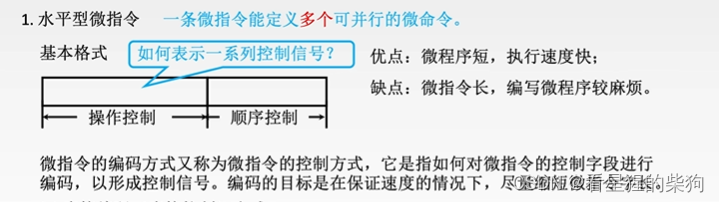
#### 直接编码
一位对应一个微命令控制信号
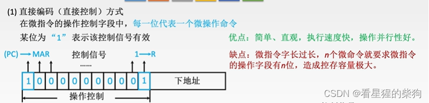
#### 字段直接编码
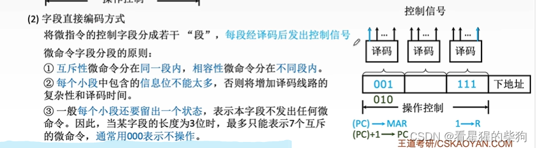
使用译码器后，同样的长度可以对应更多的微命令

#### 例题
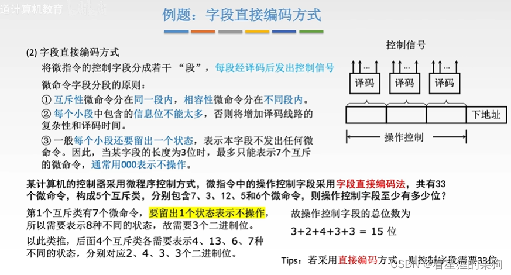
#### 字段间接编码
有些需要二次译码
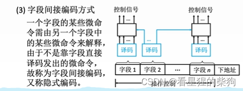

## 微指令地址的形成方式
任何一条指令的第一条微指令地址都是零地址，可由专用硬件产生
中断周期的第一条微指令地址对所有指令都相同，可由硬件提供

测试网络示意图
微指令地址由 CMDR 某些位上的信息与一些测试源共同得到
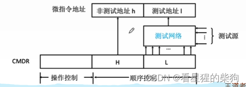

## 例题
最少只需要取指和执行
这里每条指令对应的微程序指的是执行周期的微指令
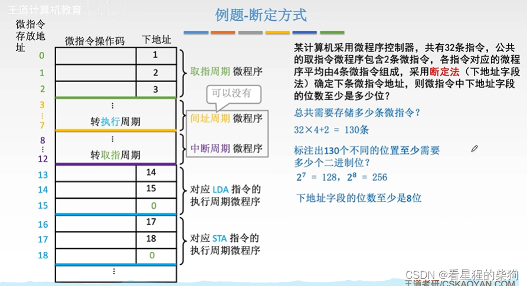
## 总结
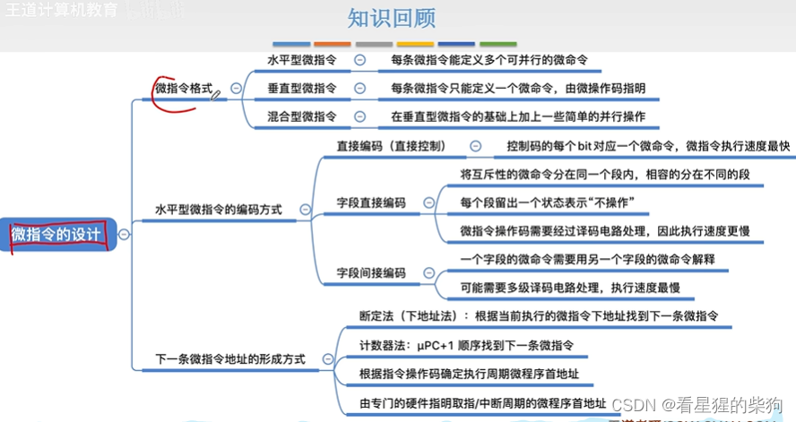
# 微程序控制单元的设计
1. 各阶段的微命令
2. 一条机器指令执行周期的微命令和节拍
3. 补充相关的微命令

4. 根据微命令的数量确定微指令格式
5. 确定微指令操作控制字段与各微命令的对应方式

ID 是指令译码器
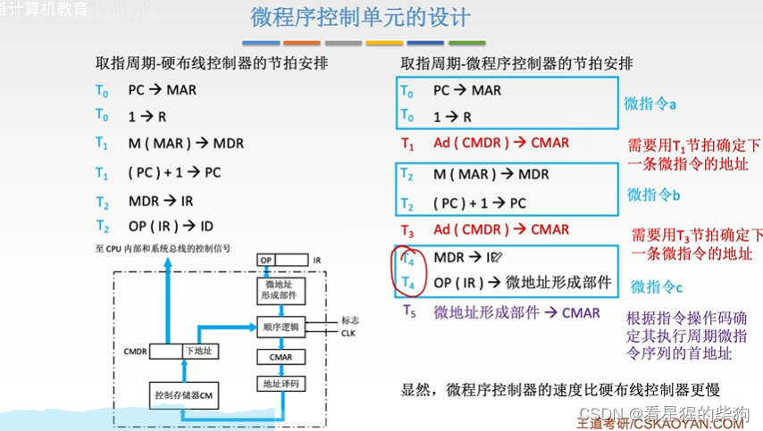
## 微程序设计的分类
动态微程序设计可以优化和扩展机器指令
EPROM 是可修改的
纳（Nano）指的是对微指令作进一步细分
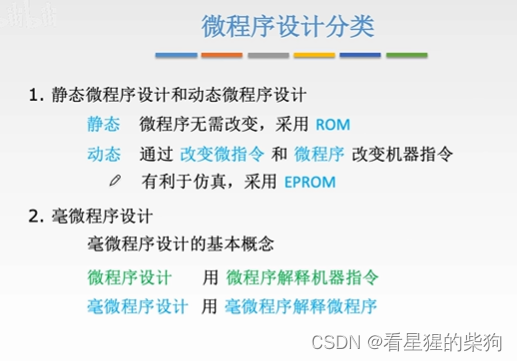
## 硬布线控制与微程序控制的比较
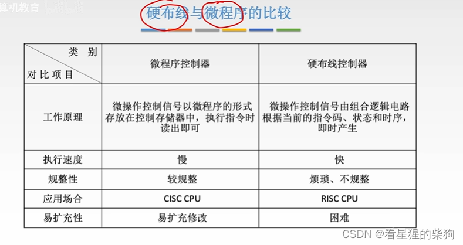

