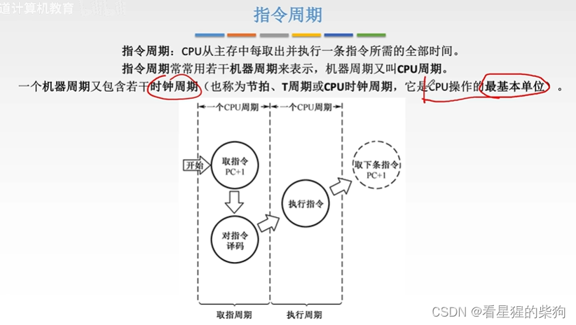
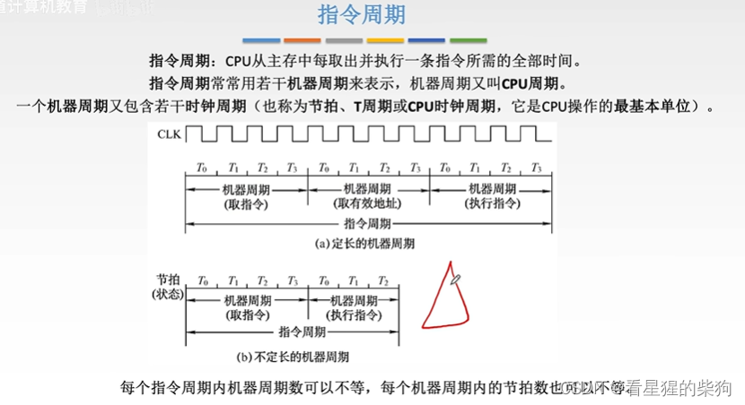
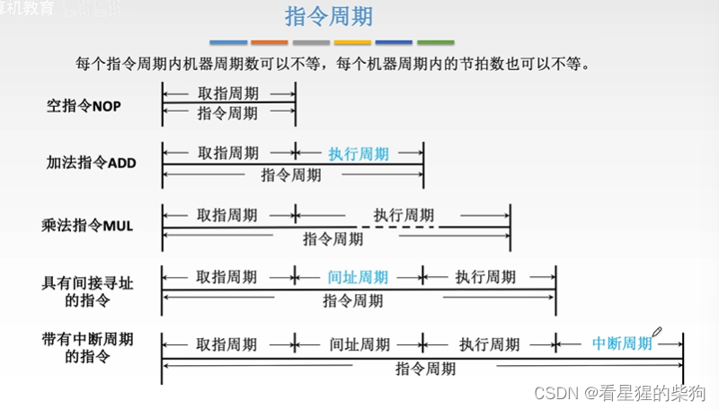
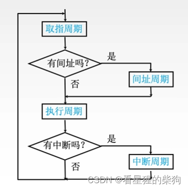
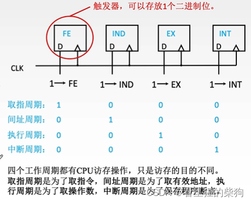
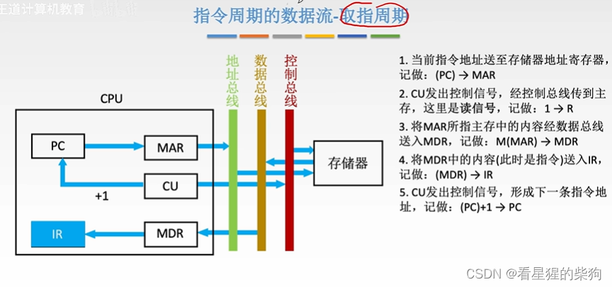
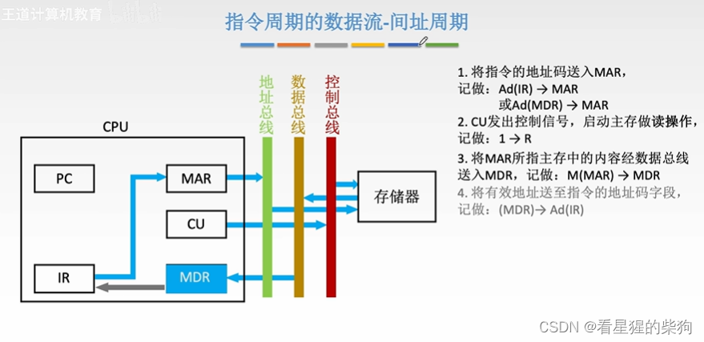
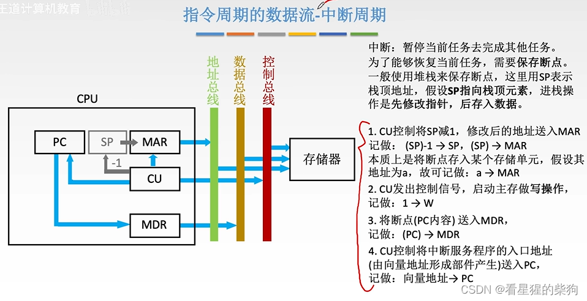
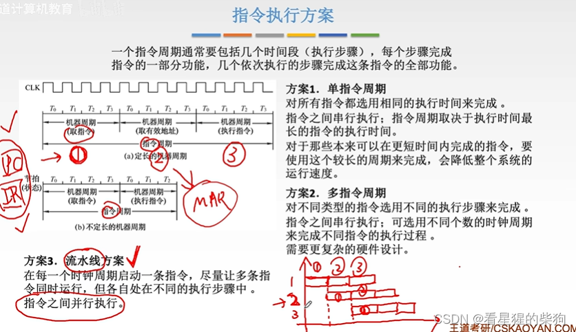
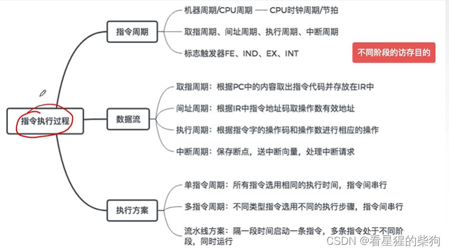


# 概览

# 指令周期

取指令需要访问存储器，而指令译码由 CPU 完成，所需时间很短。

时钟周期组成机器周期，机器周期组成指令周期

间址周期：由形式地址获取有效地址所花费的时间（一个地址中的内容是真正需要访问的内容的地址）
# 指令周期流程

## 指令周期的数据流 - 取指周期

## 指令周期的数据流 - 间址周期
间址周期获取的是指令操作数的有效地址，以便在执行周期访问真正的操作数
MDR 在取指周期保存的是指令
有些机器会用获得的有效地址覆盖 IR 中的形式地址

## 指令周期的数据流 - 执行周期

## 指令周期的数据流 - 中断周期

## 指令执行方案
一条指令的不同阶段使用不同的资源。所以当一条指令处于第二阶段时，它第一阶段所使用的资源可以被另一条指令的第一阶段使用，从而实现并行

# 总结
时钟频率反映了 CPU 每秒发出多少个时钟节拍


