
# 概述
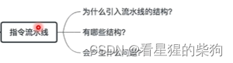
# 指令流水线的定义
取指阶段可能从 Cache 中取指令
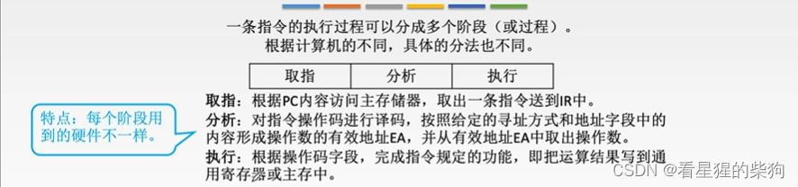
## 指令执行方式
假设每条指令分为三个阶段，每个阶段耗时相同
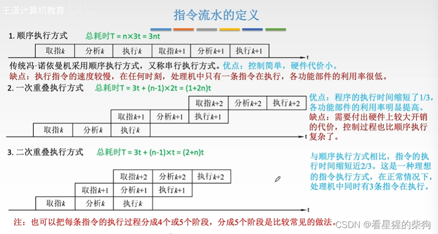
# 流水线的表示方法
时空图和指令执行过程图的区别在于纵轴
时空图的纵轴是不同阶段的指令处理过程
指令执行过程图的纵轴是各条指令
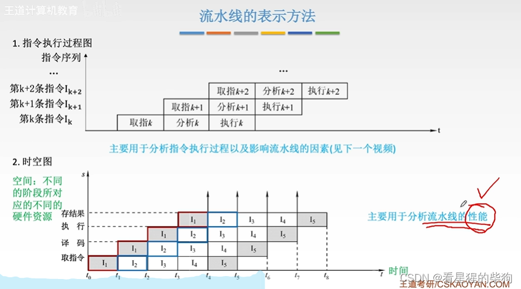
# 流水线的性能指标
k 是一条指令的 k 个阶段
## 吞吐率
单位时间内完成的指令数

装入时间：直到所有硬件部件陆续开始工作所经过的时间
排出时间：直到所有硬件部件陆续停止工作所经过的时间
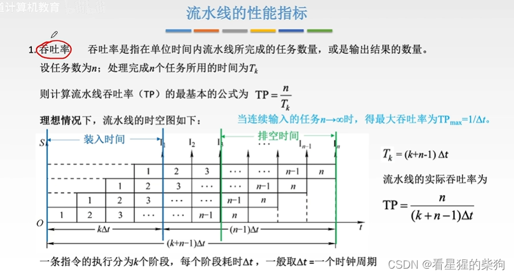
## 加速比

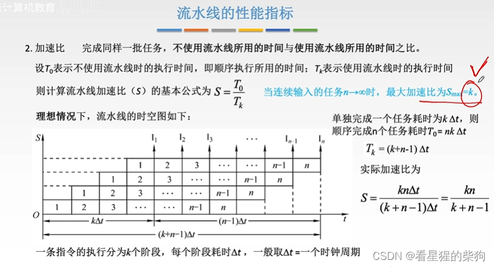
## 效率
空闲时间不会随着任务数的增加而增加
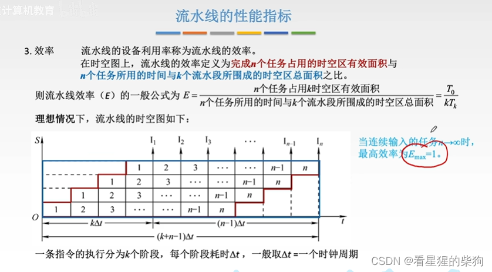
## 总结
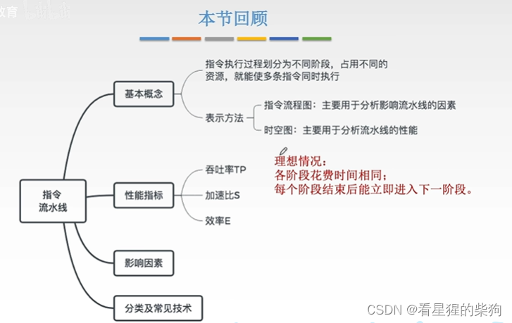
# 影响指令流水线的因素
## 设置机器周期
在 RISC 中，操作数直接来自通用寄存器

M：访存阶段
WB：写回通用寄存器组的阶段
五级指令流水线
大多数情况下指令可以从 Cache 中取出
大多数情况下主存访问也可以由 Cache 来完成
指令和数据可以分别存放在两个独立的 Cache 中
ID：从通用寄存器中取操作数
Imm：存放指令中的立即数
ALU 计算出的结果既可以写回主存，也可以直接写回通用寄存器
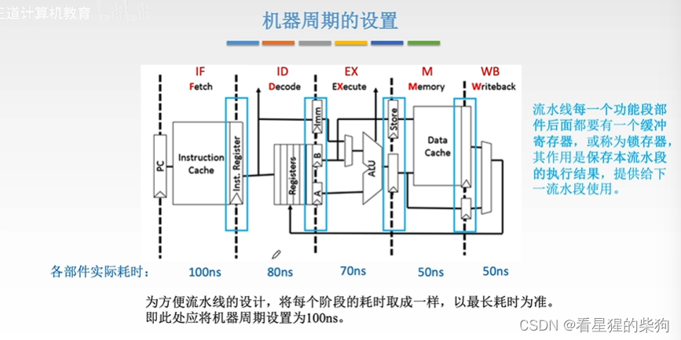
## 影响流水线的因素
### 结构相关（资源冲突）
资源重复是指把原本在一处访问的资源拆分成两处，这样就不再产生冲突

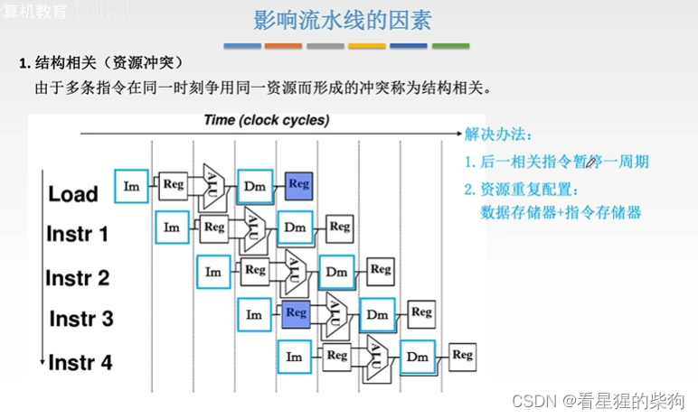
### 数据相关（数据冲突）
这是因为后面的指令在计算时依赖于前面指令产生的结果；如果按理想化的顺序执行，后面指令所用的 r1 数据此时还没有被第一条指令修改
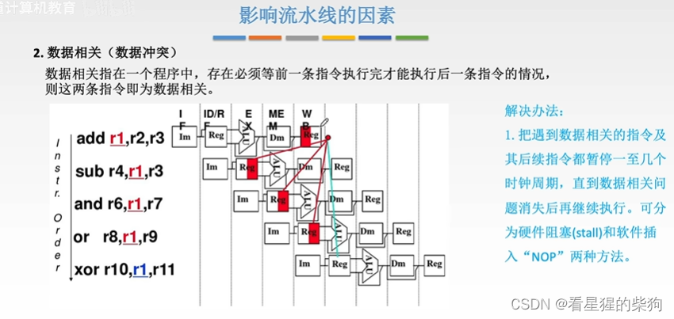
气泡可以理解为什么都不做，相当于让一些时间流逝之后再开始第二条指令
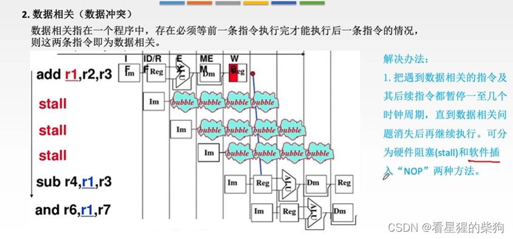
用 nop 来等待
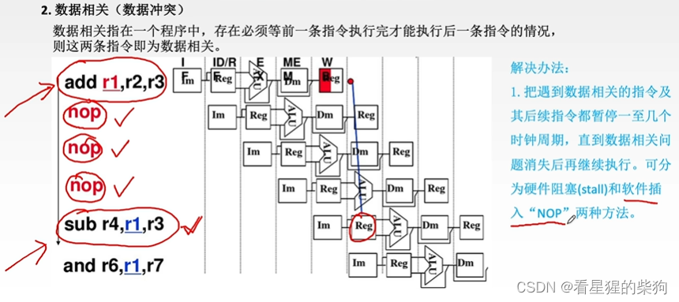
数据旁路是把 ALU 结果的数据线接回到 ALU 的某个输入端，这样就不需要等待写回操作
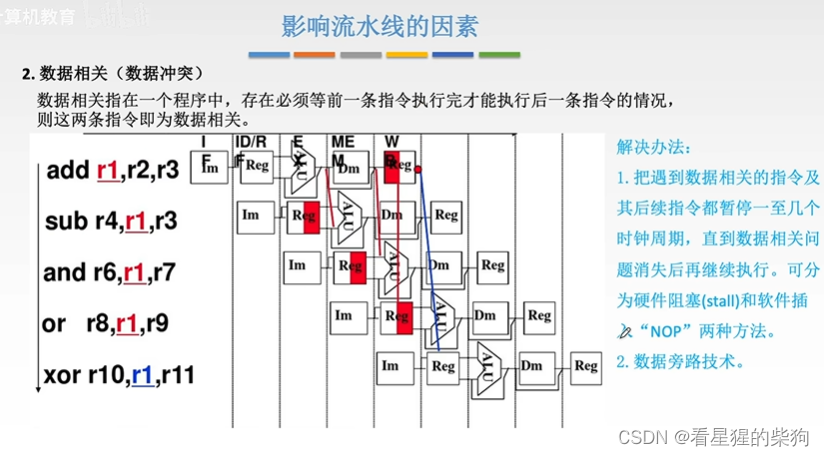
编译器优化
也就是通过调整指令顺序，把不依赖前面指令结果的指令移到更靠前的位置执行
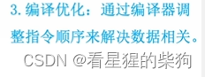
### 控制相关（控制冲突）
在流水线执行方式下，等到 PC 被修改时，后面的指令已经部分开始执行了，但接下来应该运行的指令并不是已经部分执行的那一条——于是产生了冲突
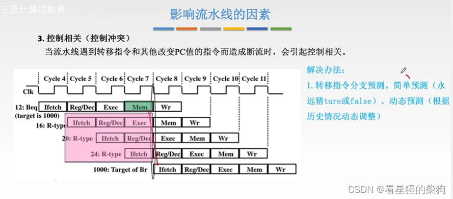
简单预测是直接把某种情况对应的指令放到跳转指令之后立即进入流水线
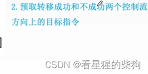
预取时，两种结果对应的指令流水线都存在，但仍需要在执行方式上做出选择
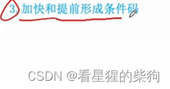
也就是提前做出决定，以便后续的指令流水线能相应地安排
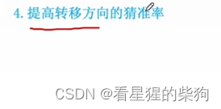
只是提高猜测正确的概率

### 总结
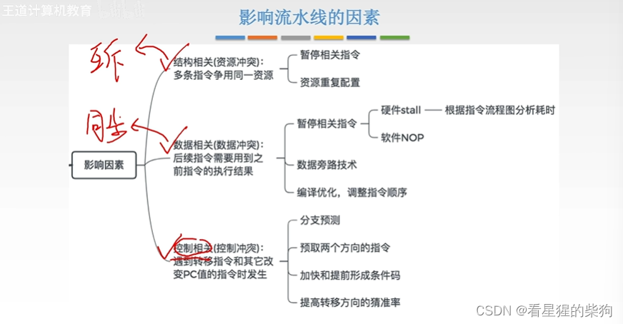
# 指令流水线的分类
部件功能级流水线是指一个很小的操作可以再分为若干部分，而多个操作又可以再组成流水线
就像俄罗斯套娃一样
处理器间：每个处理器处于流水线上（第一行的处理器依次排列，第二行同样如此，以此类推）
处理器级：处理器内部的功能部件处于流水线上
部件功能级：某个部件内部的子功能部件处于流水线上
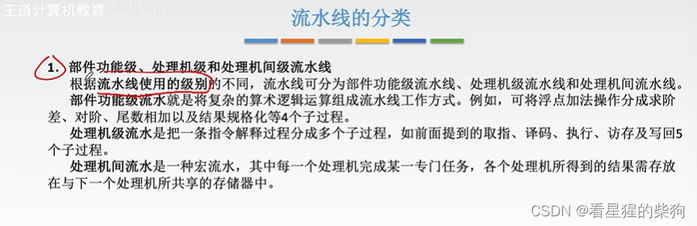
单功能流水线是指其各部分均为完成单一功能而构建的流水线
多功能流水线通过各部分之间多种组合方式的连接，实现一条可以完成多种功能的流水线
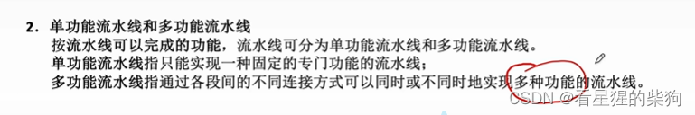
静态流水线的连接方式是固定的
动态流水线的连接方式是可变的，能够实现复杂的功能
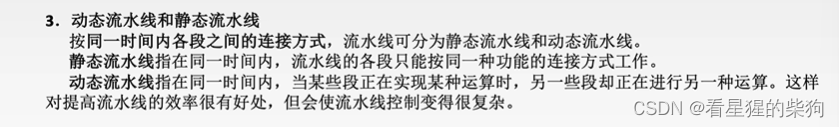

线性流水线是指没有反馈回路的流水线
非线性流水线则与之相反
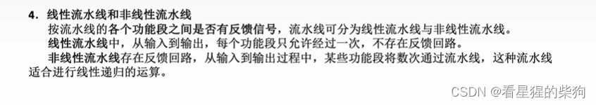
# 流水线的多发技术
无法调整的指令执行顺序，受到指令之间相互依赖关系的约束

## 超标量技术
这里是多个具有多个指令寄存器的 CPU 并发执行多条指令
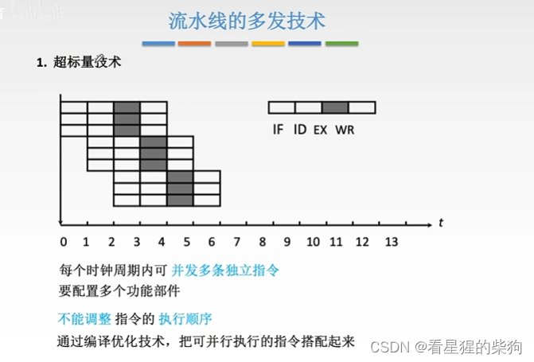
## 超(流水)线技术
也就是充分利用一个机器周期内部的时间，当后一条指令能在一个机器周期内启动，或某些部件空闲下来时，就进一步细分，使指令的某些部分能够开始运行——类似于部件功能级流水线
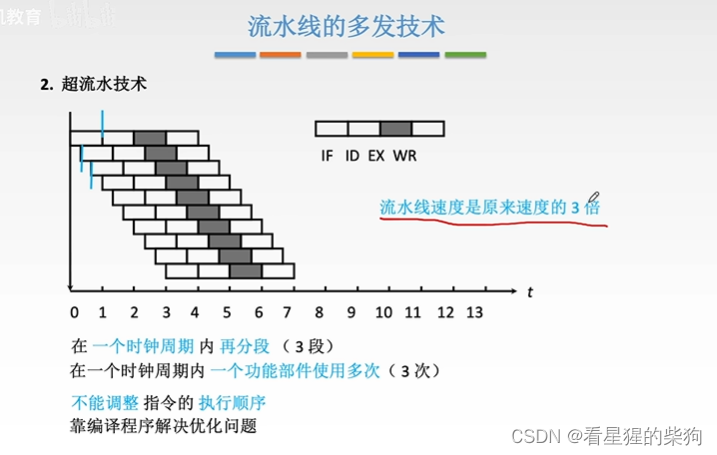
## 超长指令字
由于一个 CPU 只能执行一个操作码对应的功能，这里要把它们组合起来，就需要多个 CPU 分别执行各个操作码
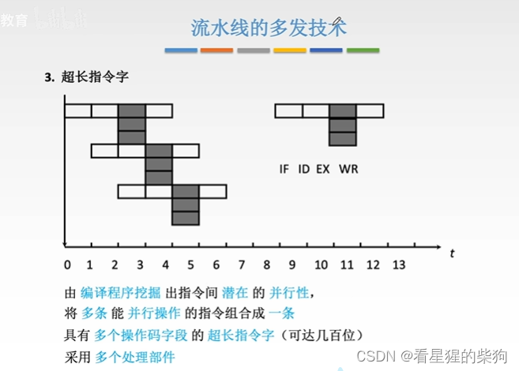
## 总结
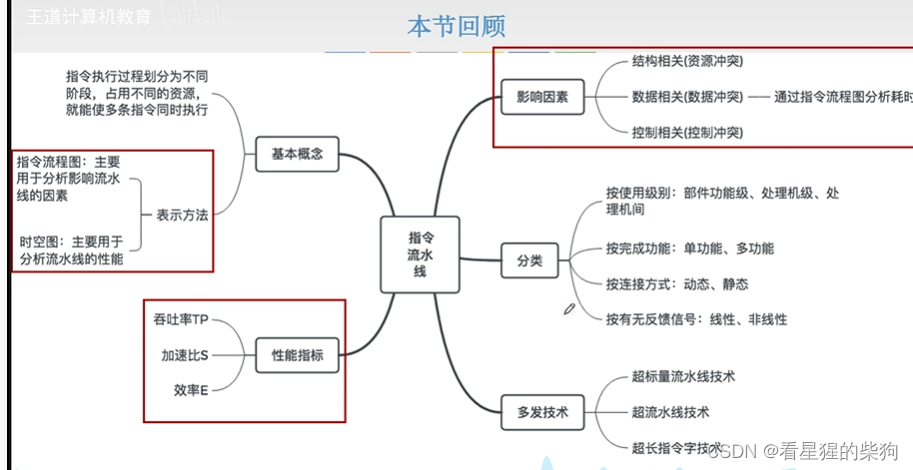

