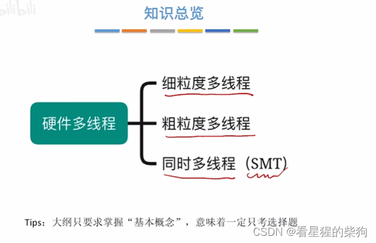
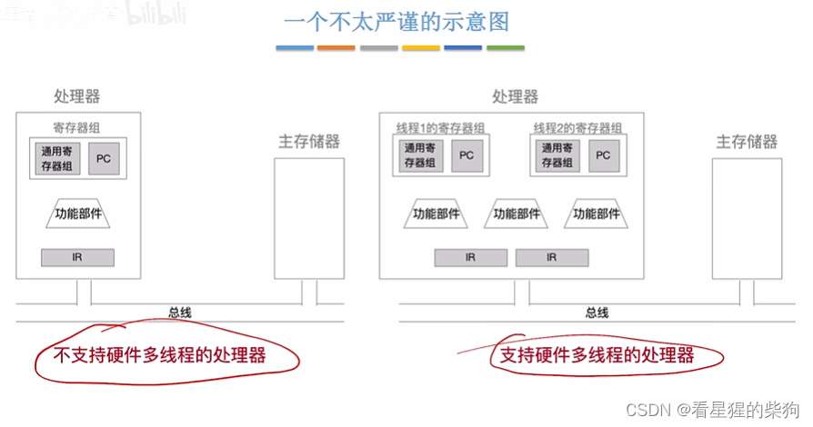
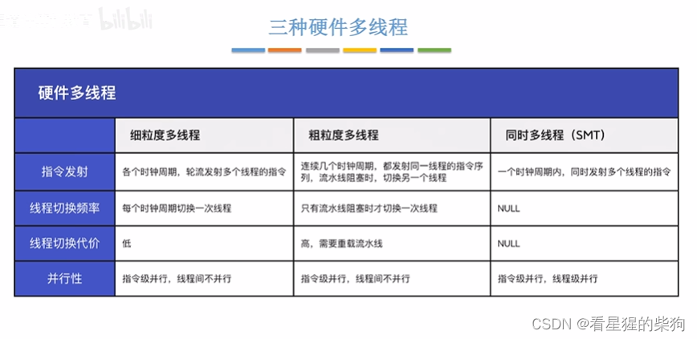
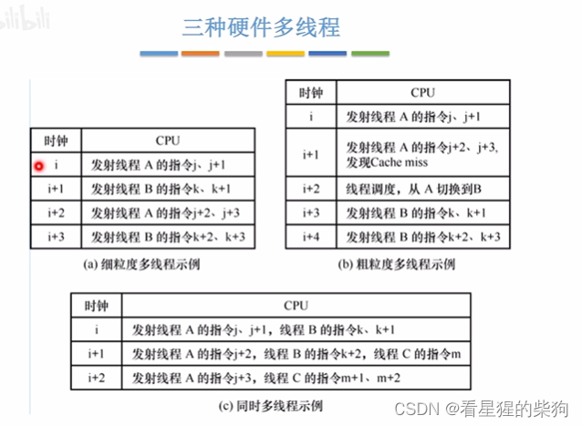


# 概述

# 支持与不支持硬件多线程

在不支持硬件多线程的处理器中，处理器只能处理一个指令流水线（一个程序或线程）。要切换到另一个指令流水线（另一个程序或线程），必须把当前指令流水线的环境（寄存器信息）保存到主存中，切换回来时再从主存中取出之前保存的寄存器信息，恢复寄存器的值
支持硬件多线程相当于有多个 CPU，不同的 CPU 可以处理不同的指令序列（程序或线程）

# 三种硬件多线程

细粒度多线程每个时钟周期从一个线程中取两条指令，取出的两条指令之间没有依赖关系，因此可以发射到两个 CPU 上同时运行，但每个时钟周期都会切换线程

粗粒度多线程连续多个时钟周期运行同一个线程的指令序列。每次指令仍然可以并行运行，只有在流水线阻塞时才会切换线程
流水线阻塞：Cache 缺失，即下一条指令不在 Cache 中，必须从主存中取。这时就要为取到的指令重新建立流水线环境（寄存器等）

同时多线程
每个时钟周期运行两个线程，一个 CPU 处理一个线程。
这里指令是并行的——多条指令同时运行——线程也是并行的——多个线程同时运行


