
# 内容回顾
以访存所需的节拍数为基准，因为它最大
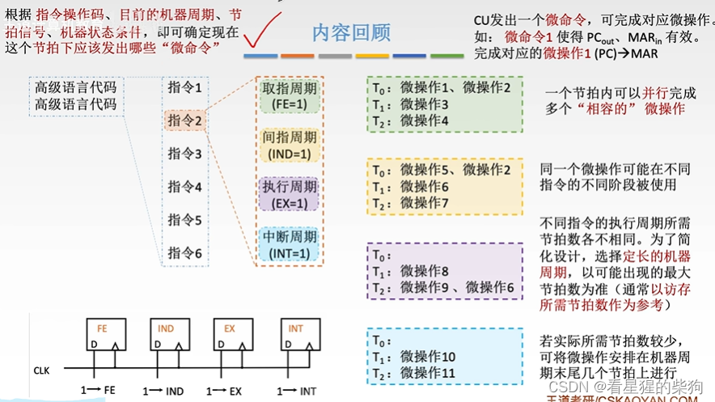

# 概述
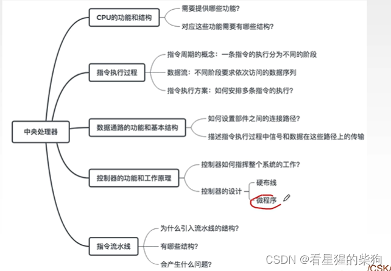
# 硬布线控制器
微操作 (PC)—>MAR 在指令周期中用得相对较少，通常只出现在最开始，触发其控制信号的电路也比较简单
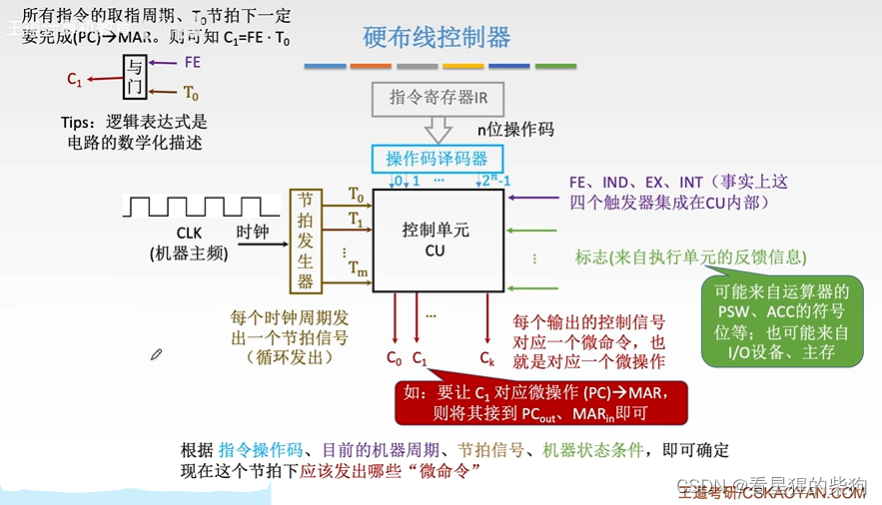
而微操作 M（MAR）—>MDR 在指令周期中用得相当多，触发其控制信号的电路也比较复杂
LDA 是把主存中的某些内容读入 ACC

指令线是译码器输入到 CU 的线路，每条指令对应其中的某一根线
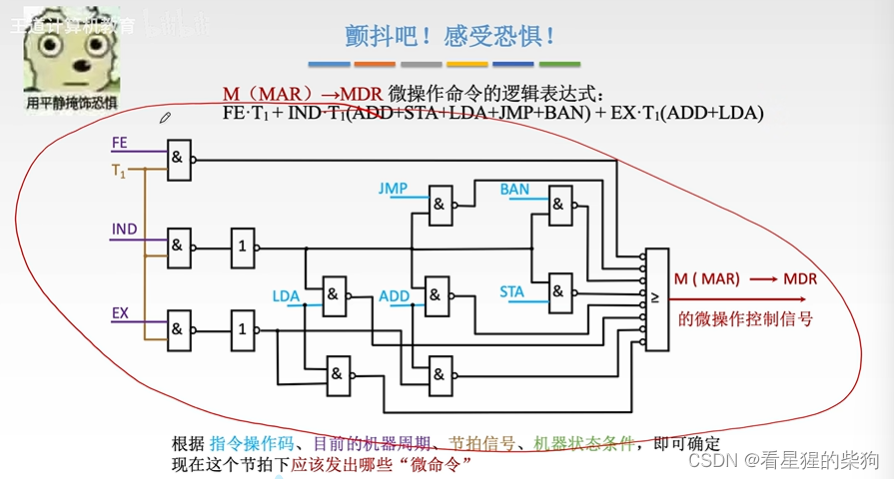
## 设计硬布线控制器
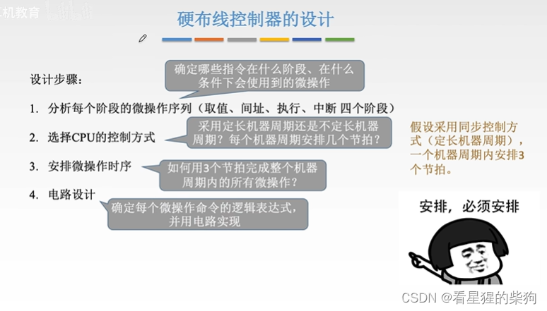
## 分析各阶段的微操作序列
找出各个微操作在哪些情况下会用到
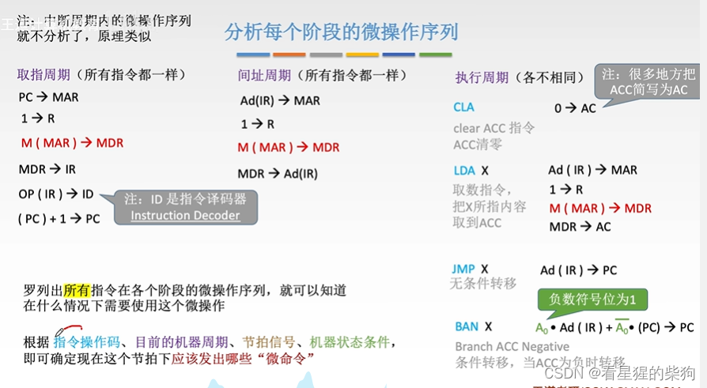
## 安排微操作时序的原则
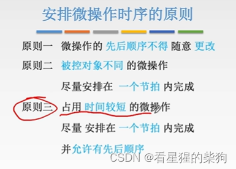
##  安排微操作时序 - 取指周期
第 4、5 步耗时很短，可以在一个节拍内完成，不像访存操作那样耗时较长。但二者之间仍有先后顺序

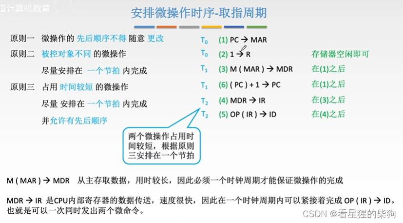
##  安排微操作时序 - 间址周期
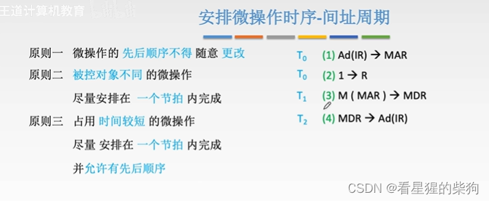
##  安排微操作时序 - 执行周期
当实际所需的节拍数较少（少于一个机器周期的节拍数）时，把该微操作放在机器周期的最后一个节拍
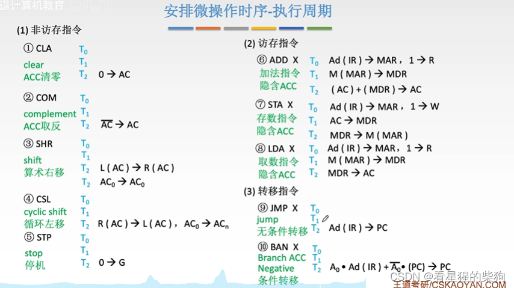
## 组合逻辑设计
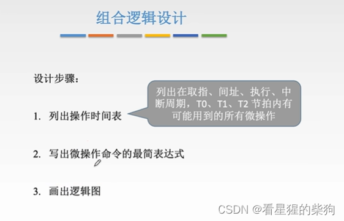
访存指令可能需要间接寻址，也可能不需要
下一个机器周期由指令的间址标志位决定
  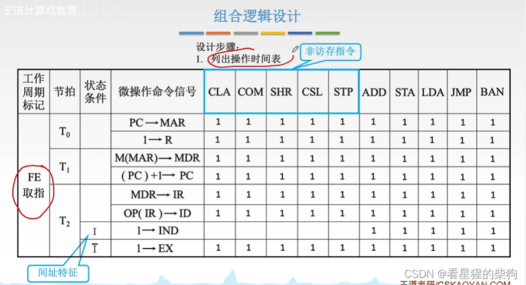
  用间址周期标志来判断是否还需要再进行一次间址周期
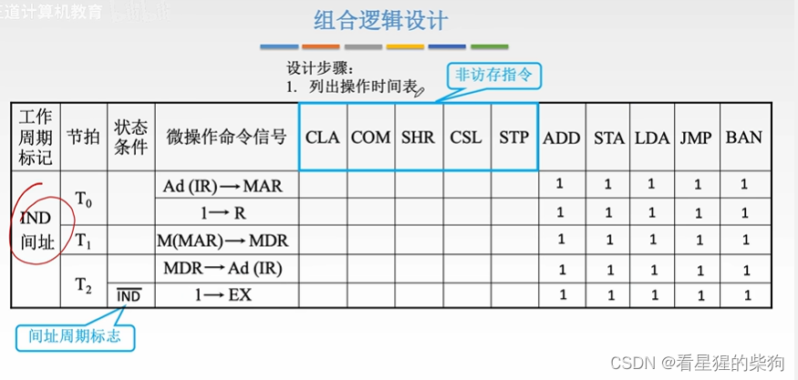
这一步只是把每个节拍中用到的所有微操作列在一起
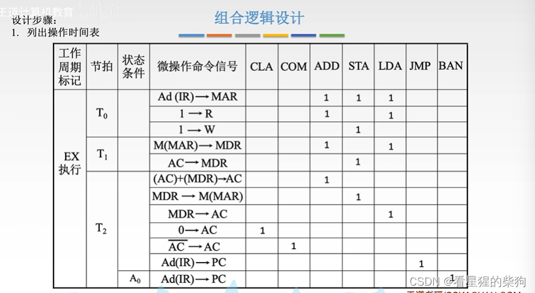
最后把每个微操作对应的所有位置组合起来
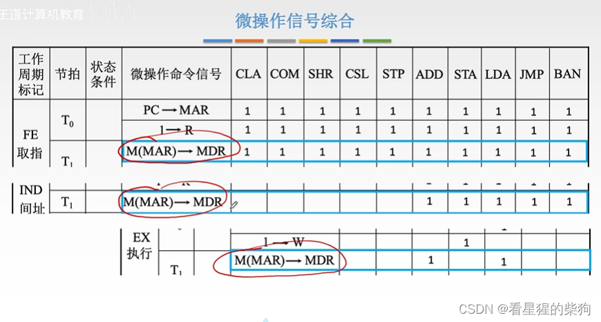
得到每个微命令对应的逻辑表达式

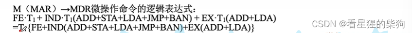
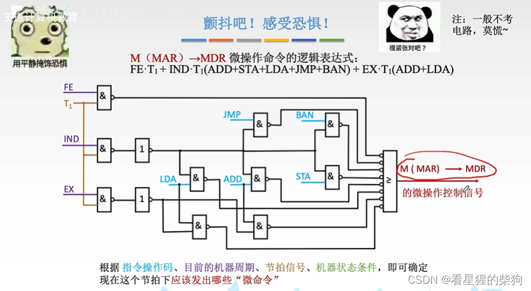
## 总结
CPU 控制方式：定长机器周期，每个周期内的节拍数固定
微操作时序：T0 时发生哪些微操作，T1 时发生哪些微操作，依此类推
列出操作时间表：列出 T0、T1 等每个节拍对应的微操作

扩充指令集时，必须修改新指令每个微操作所对应的电路
硬布线控制器：纯硬件实现
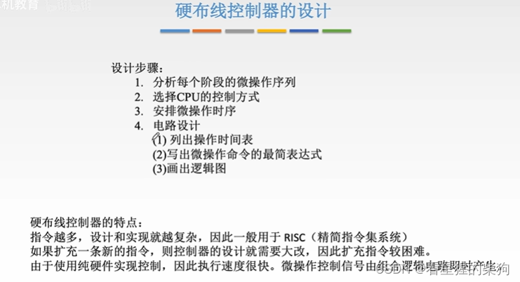
# 微程序控制器
## 微程序控制器的设计思想
  这里一条微指令对应一系列微操作，而前面的硬布线控制器是一个节拍对应一系列微操作
  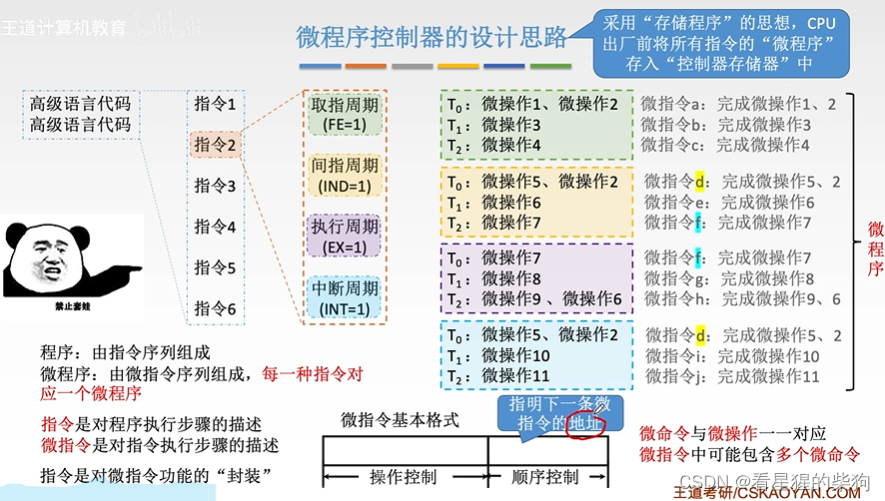
## 微程序控制器的基本结构
CPU 取出指令后，把指令的操作码送入微地址形成部件。微地址形成部件生成初始微地址，然后把该初始微地址对应的微指令读入 CMDR，由微指令的操作控制部分发出多个控制信号（一条微指令对应多个微命令，一个微命令对应一根输出线）。下地址字段随后送入顺序逻辑，由顺序逻辑根据标志位决定下一条微指令的地址
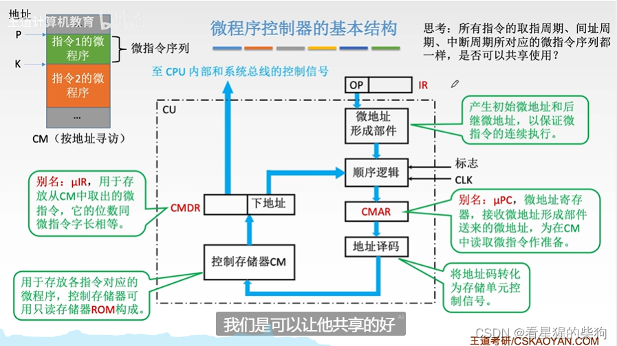
## 微程序控制器的工作原理

先执行取指周期的微程序，把指令取入 IR（下一条指令由上一次执行周期微程序最后一条微指令的下地址字段得到）
顺序逻辑根据 IR 中地址码的寻址方式位，判断是否跳过间址周期
然后 IR 中的操作码经过微地址形成部件，得到初始微地址
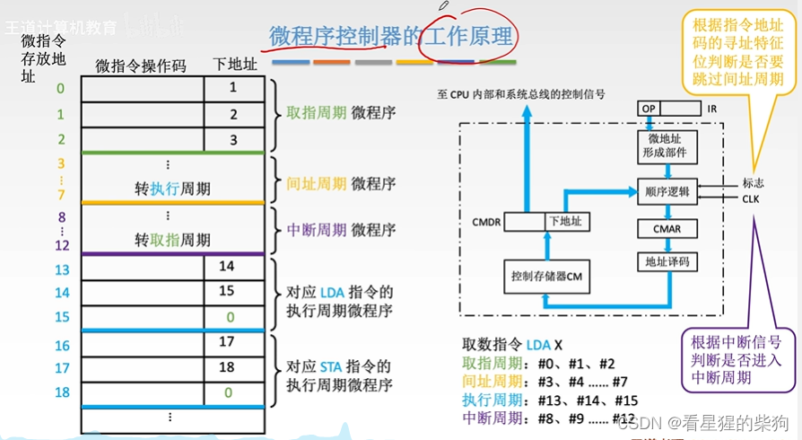
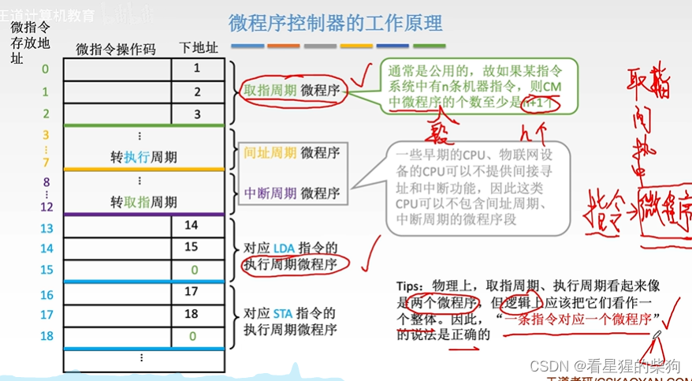

## 总结  
一条微命令等于一个微操作；一条微指令对应多个微操作；一段微程序对应多条微指令；一段微程序对应一条机器指令
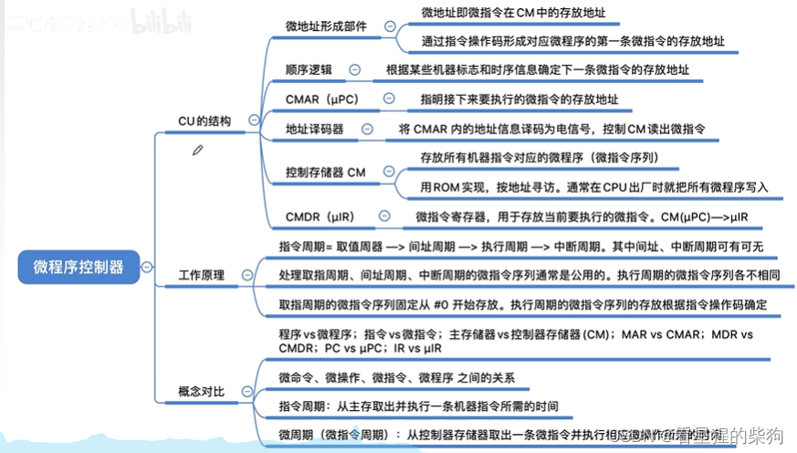

