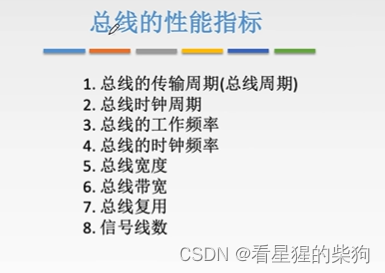
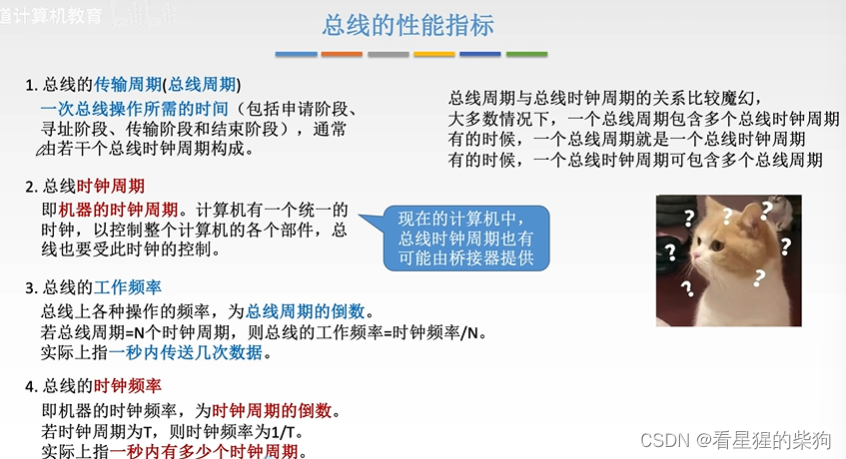
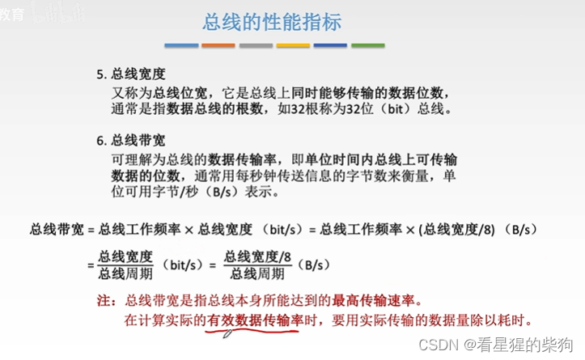
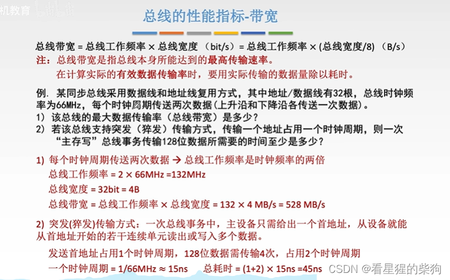
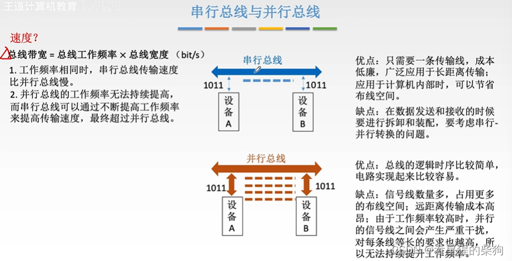
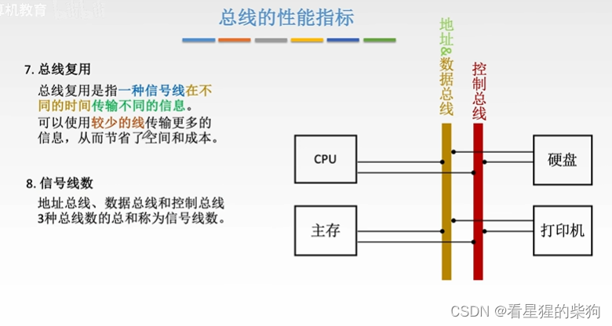
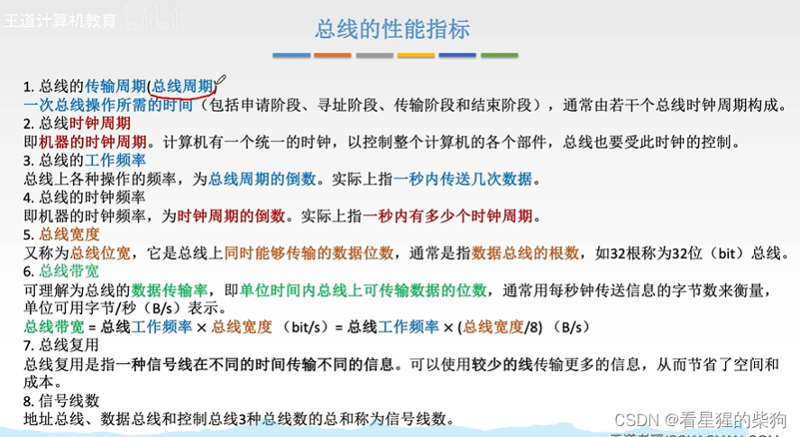


# 概述

# 总线周期、总线时钟周期、总线工作频率、总线时钟频率
总线周期是通过总线传输一组数据所需的时间
申请阶段：总线仲裁，决定由哪个设备使用总线
寻址阶段：地址通过地址总线传送
传输阶段：内容通过数据总线传送
结束阶段：释放总线使用权，供其他设备使用

总线时钟周期即 CPU 的时钟周期
某些情况下，总线传输会在时钟周期的上升沿和下降沿各发生一次，此时一个总线时钟周期包含多个总线周期

# 总线宽度、总线带宽
总线宽度通常指数据总线的宽度

# 例题

# 串行总线与并行总线的速度（带宽）比较
串行总线的工作频率可以不断提高，尽管其总线宽度小于并行总线

# 总线复用、信号线数量
总线复用是指一组总线同时充当两种总线
信号线是只能传输一位的线路

# 总结


