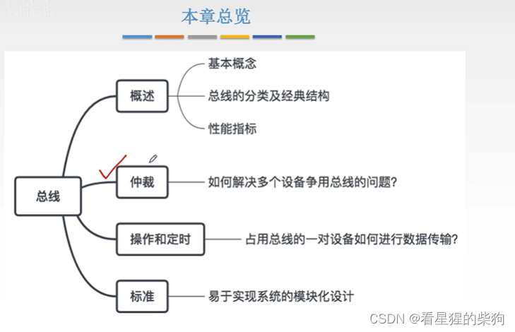
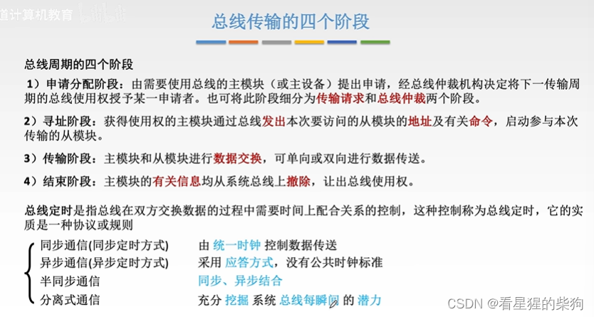
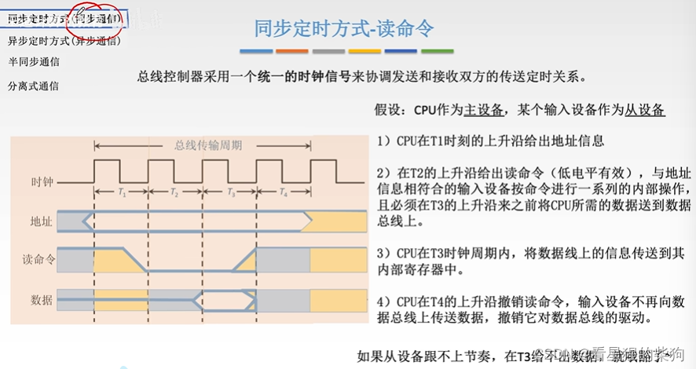
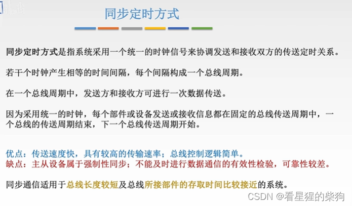
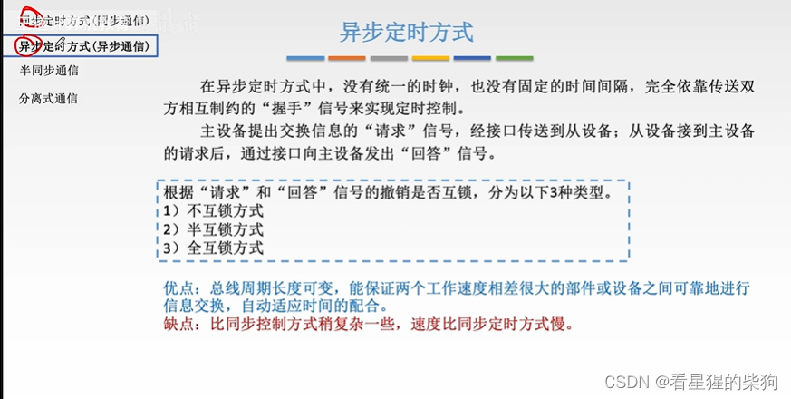
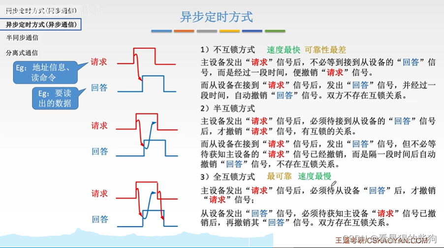
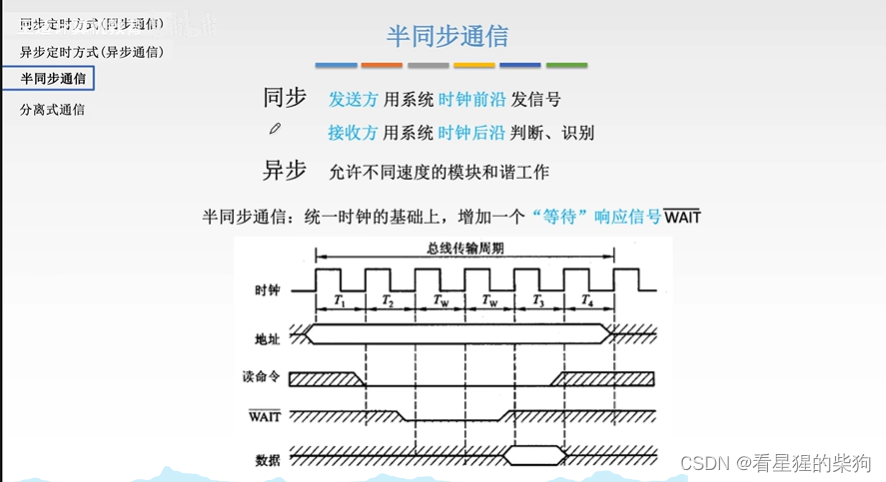
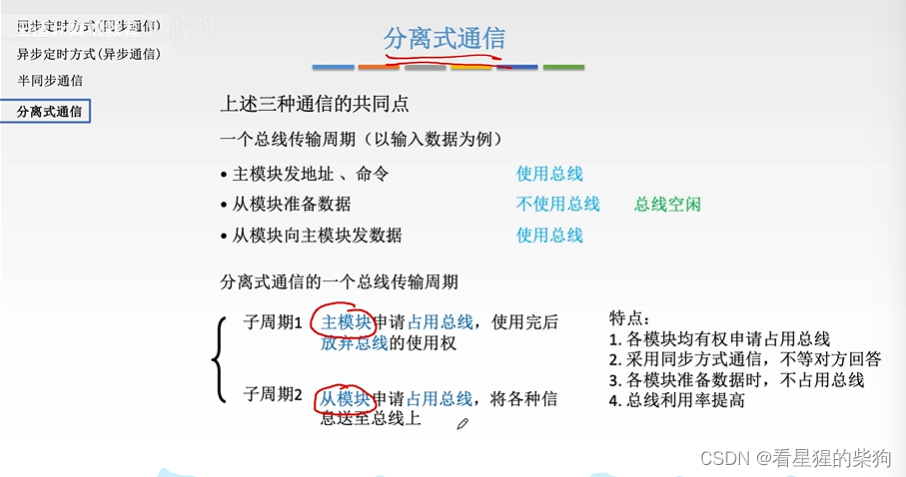
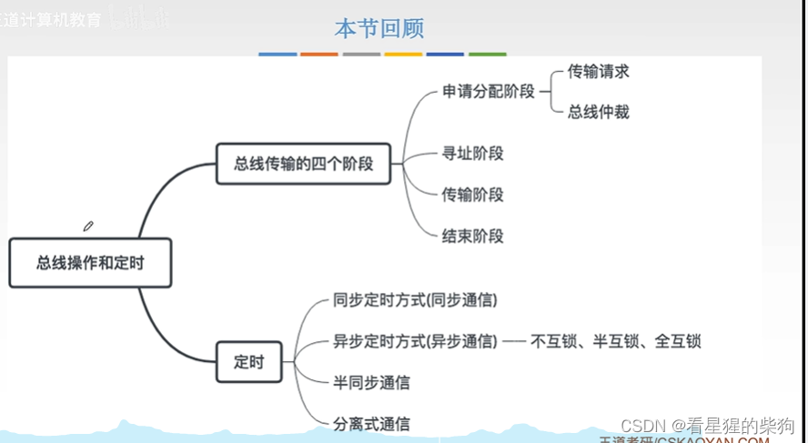


# 概述

# 总线传输的四个阶段

# 同步定时
## 读命令
一次总线传输被划分为多个时钟周期
首先 CPU 在 T1 阶段送出地址信息，此时地址线上的信号发生变化
CPU 在 T2 阶段发出读命令，读命令线变为低电平，对应地址的设备收到命令后开始做准备
在 T3 阶段，CPU 接收从设备放到数据线上的数据
在 T4 阶段，CPU 已经收到数据，撤销读命令和地址信号

## 小结
若干个时间段构成一个总线周期，下图有一处错误
一切都按一个个时钟周期进行，因此控制逻辑实现简单——只需要安排好每个时钟即可
但比较死板：遇到意外情况时没有多余的时间去做别的事情
总线较短时，比长线路更不容易出问题

# 异步定时
规则更灵活多样，实现上不死板，因此实现更复杂

主设备获得总线控制权后，通过地址总线发送地址信息，通过控制总线发送读命令。这就是请求信息；回答信息则是从设备放到数据线上传给主设备的数据

# 半同步通信
增加了一个反馈信号 WAT
同样以读命令为例
在 T2 结束时，从设备本应已经准备好要放到数据线上的数据，但由于设备之间存在差异，它可能需要更多的准备时间。这时它会向总线控制器发送反馈信号 WAT，总线控制器随即多延长几个时钟节拍来等待从设备。准备好之后，再按照之前的同步方式继续通信

下图中的“同步”是指在一个时钟周期内，主设备在时钟前沿发送，从设备在时钟后沿接收并处理——也就是说，主从设备在每个时钟周期内完成一次信息传输

# 分离式通信
这里从模块也可以申请占用总线
总线传输周期被分成两个独立的子周期
主设备先申请总线使用权并发送请求信号，然后释放总线使用权；从设备等到自己准备好后再申请总线使用权，并把数据传送到总线上。
这样就充分利用了从设备的准备时间，在此期间总线可以空出来做别的事情

这里的同步通信是指在规定的节拍内发出请求，并在规定的节拍内释放总线使用权

# 总结


