
# 概述
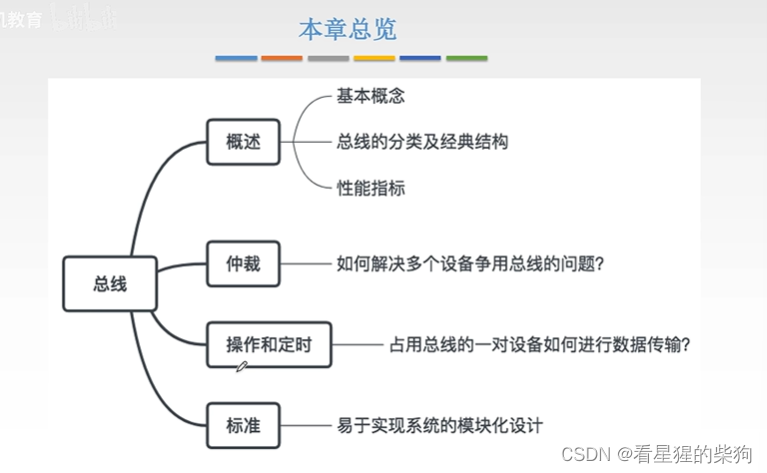

# 示例

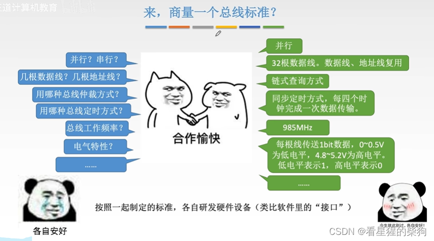
# 总线标准的基本概念
北桥芯片比南桥芯片更快
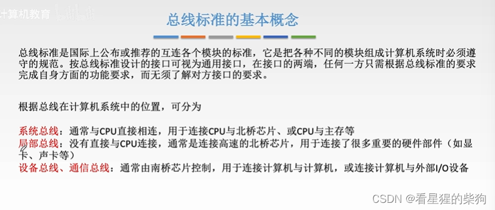
# 系统总线标准
ISA 和 EISA 都是并行总线
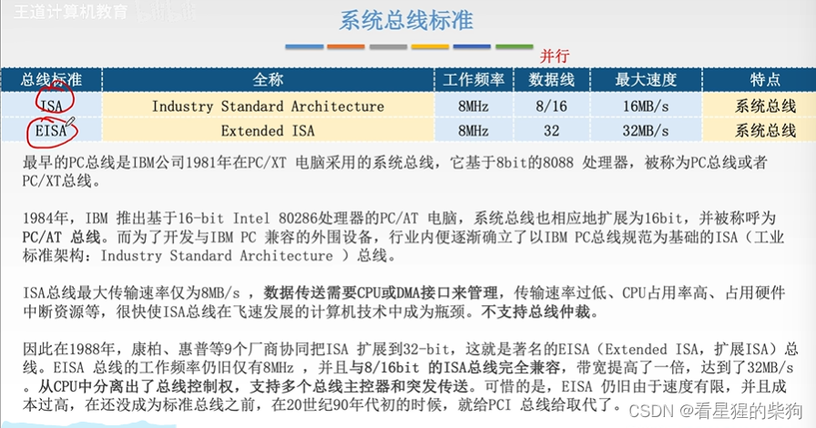
Intel 提出了 FSB 总线标准，比 EISA 和 ISA 更快，后来又提出了 QPI 总线标准，比 FSB 还要快
# 局部总线标准
传输图像数据需要更大的带宽
VESA 也是并行总线。由于 VESA 的工作频率有固定上限（并行总线的频率不能太高），而局部总线由 CPU 控制，随着 CPU 工作频率越来越高，VESA 已经跟不上了
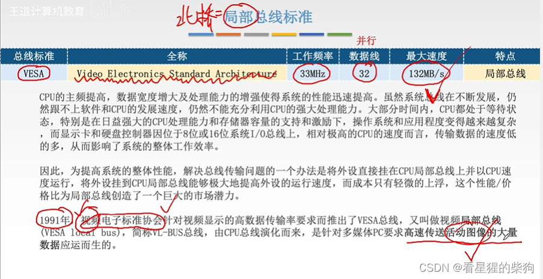
Intel 提出了 PCI，它比 VESA 快得多。它由北桥芯片控制，不挂在 CPU 上，也不受 CPU 控制，因此更能适应 CPU 的发展
PCI 也曾被用作系统总线，所以把它称为系统总线也可以
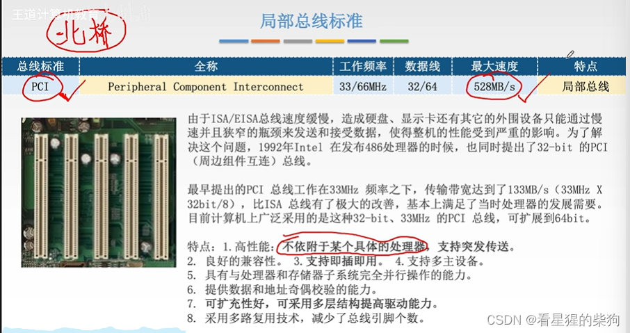
Intel 提出了 AGP，同样是为了适应图像传输；它分为 X1 和 X8 等级
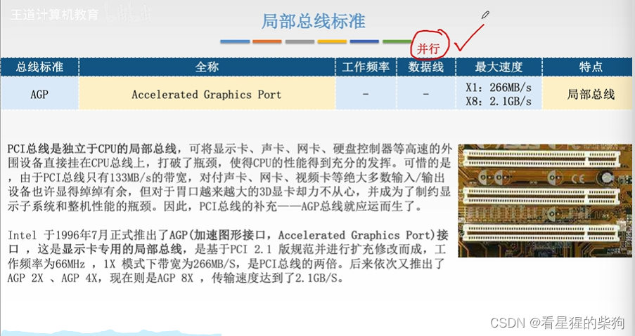
Intel 提出了 PCI-E，这是一种串行总线，工作频率高，因此带宽大
单条 PCI-E 通道就可以充当一条总线；与之前的并行总线不同，它不需要很多根线，节省空间。既然一条 PCI-E 通道就能当作一条总线，那么给每个设备提供各自独立的总线来传输数据，也不会占用太多空间

全双工：双方可以同时向对方发送数据

可热插拔：只要遵循标准，就可以直接插到端口上使用
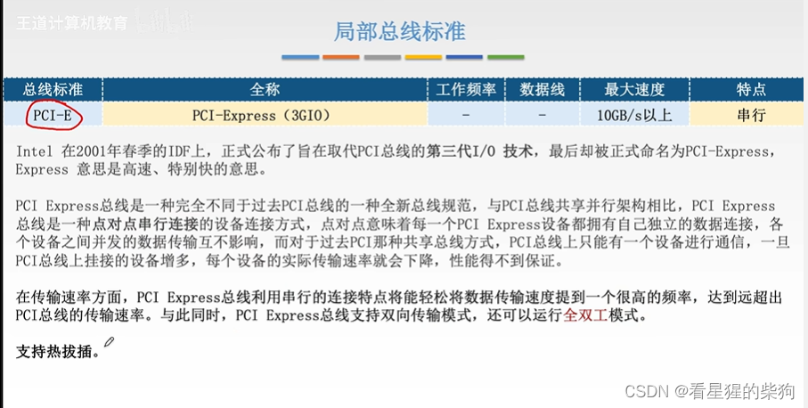
# 设备总线标准
这里连接的设备是针式打印机，它对速度的要求比较低
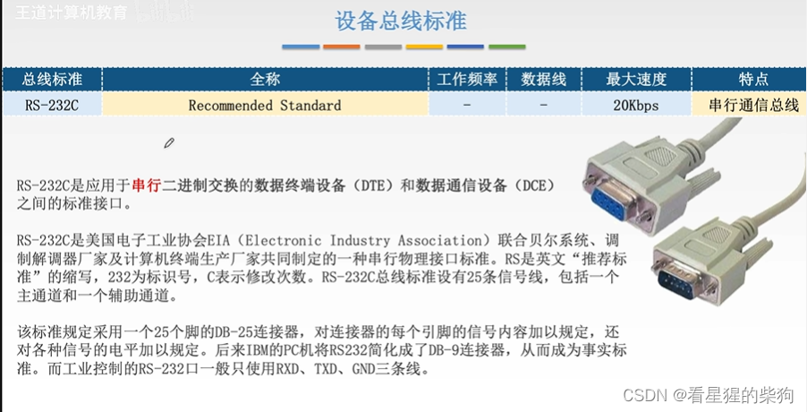
速度更高的 IO 设备需要非常高速的设备总线
SCSI 是并行总线
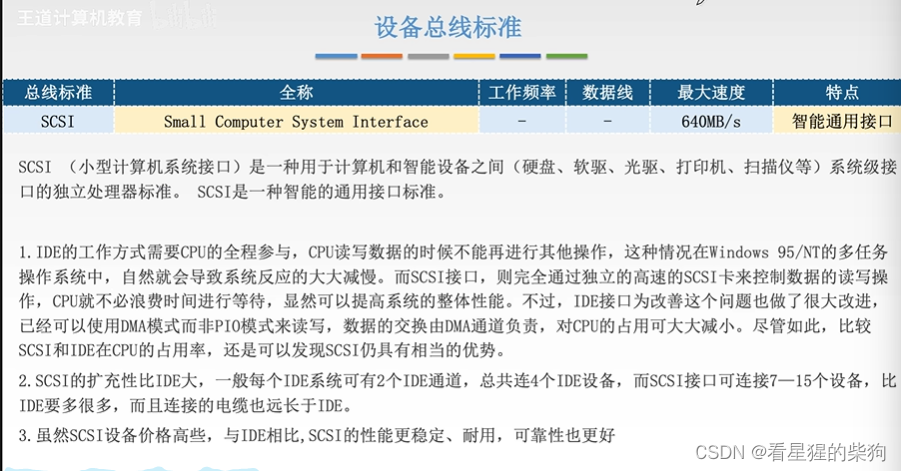
PCMCIA（并行总线）用于与计算机内部的存储芯片传输数据，并且可以拿到另一台计算机上使用。类似于 U 盘。即插即用
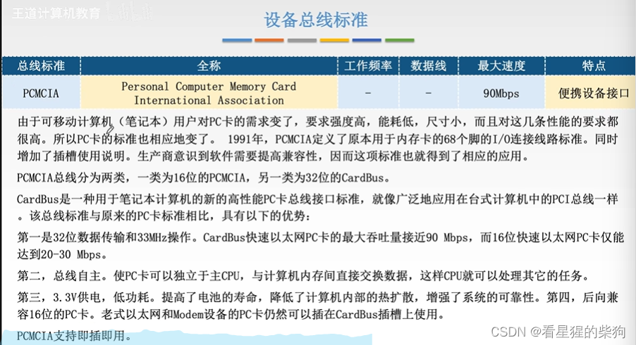USB 串行总线
菊花链指的是扩展坞那样的连接形式
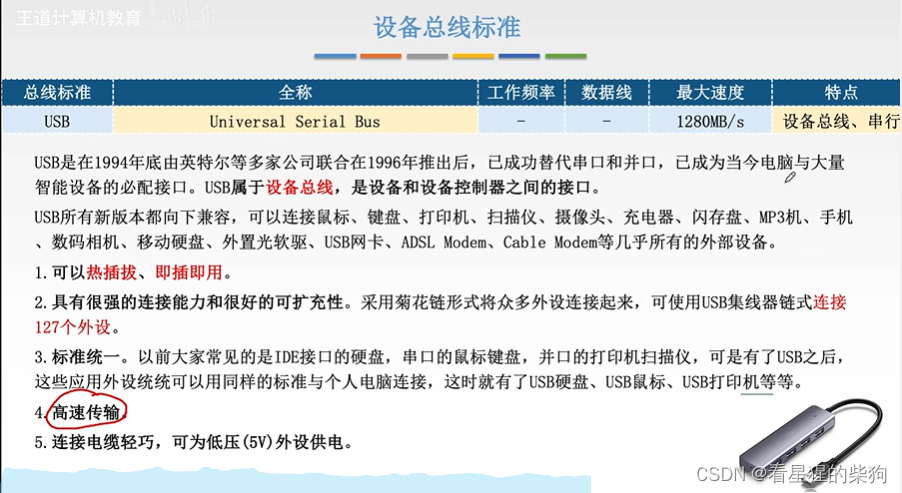
USB 包含很多种类型；现在的 type c 也是 USB，也叫 USB-C
差分信号是指：如果线 2 为高电平、线 3 为低电平，就传输 1；线 2 为低电平、线 3 为高电平，就传输 0；它的抗干扰能力很强。即使电平发生变化，它们的差值也不一定改变。两根线绞在一起（双绞线）
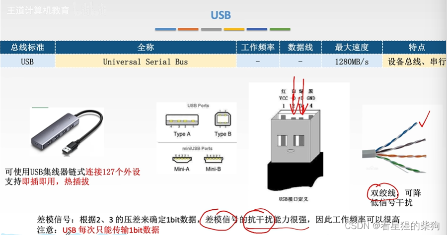
IDE 是并行总线，也叫 PATA
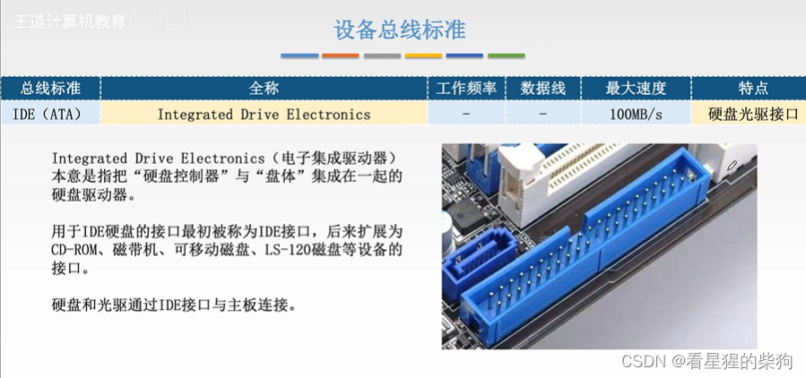
SATA 是串行的
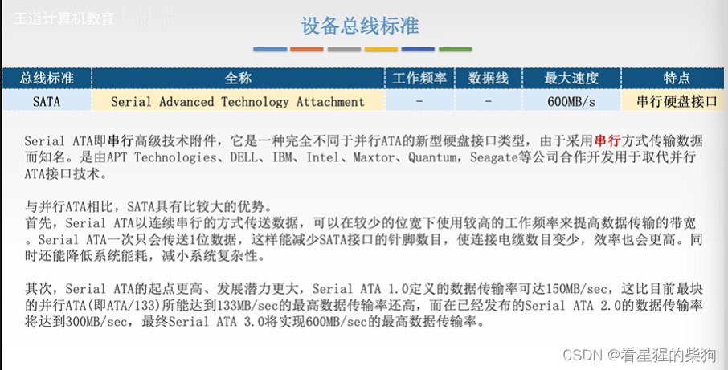
# 对比
只要能分辨出每种总线标准属于哪一类——串行还是并行——就可以了
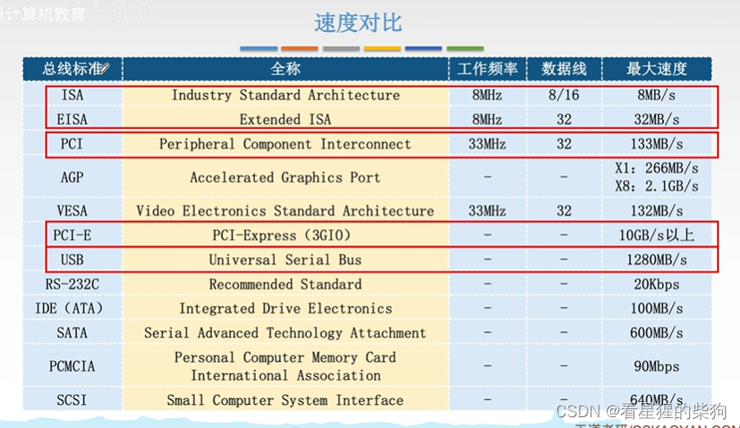
# 总结
串行取代并行
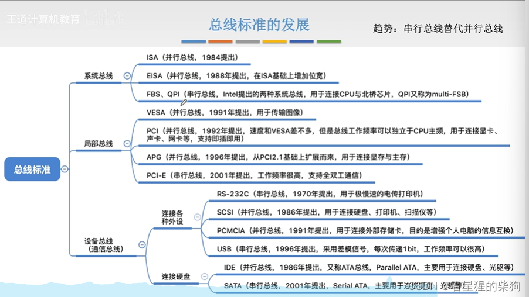
# 为什么串行总线取代了并行总线
因为并行总线通常采用同步时序，如果各根线之间存在长度差异，信号就不会同时到达；而同步时序要求数据必须在规定的时钟周期内被接收，所以本该接收为 1 的位，可能因为没有及时到达而被读成 0

串行总线在一根线上传输的那一组数据，对应并行总线在所有线上同时传输的那一组数据
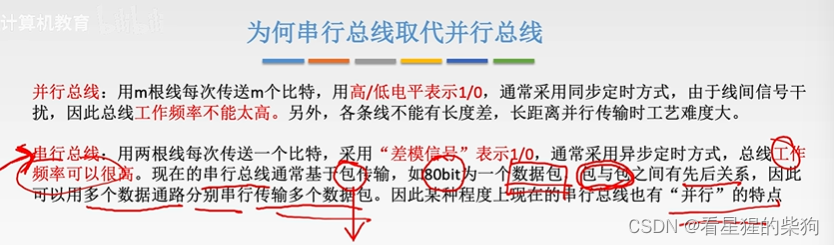

