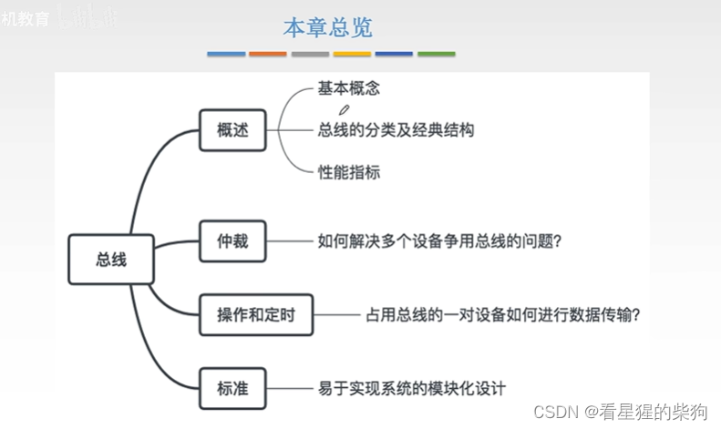
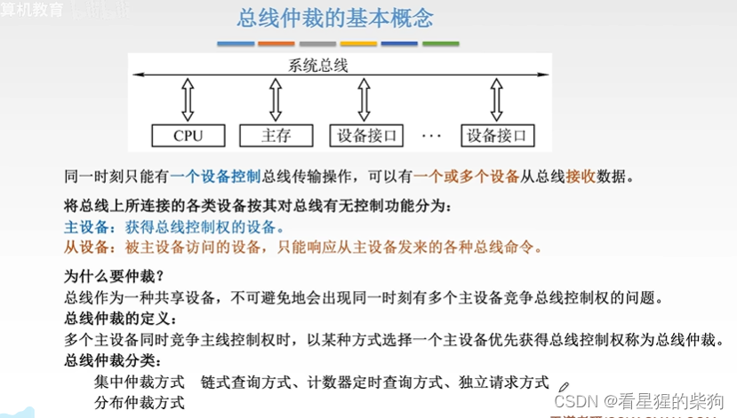
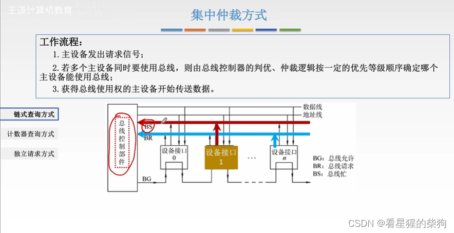
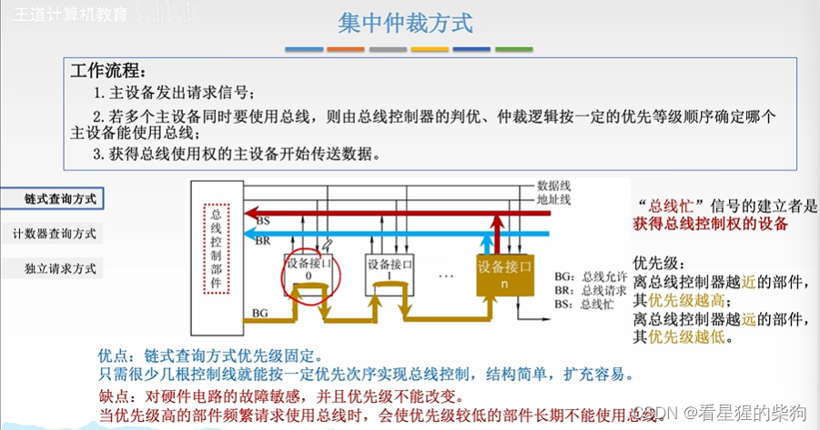
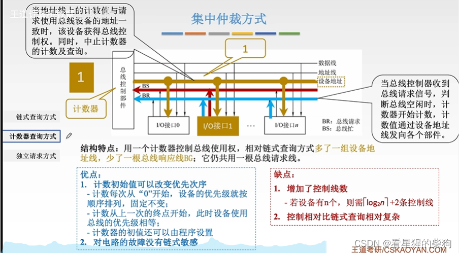
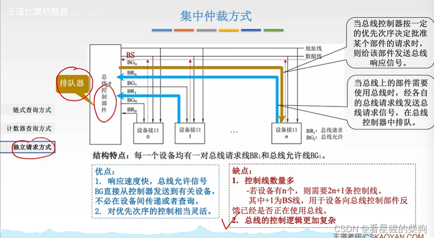
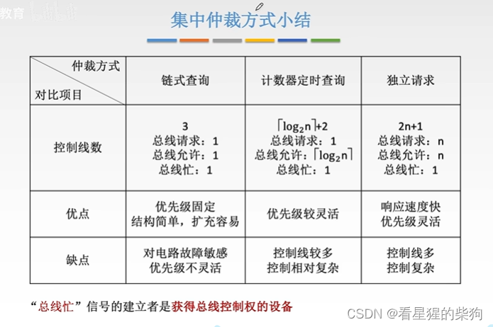
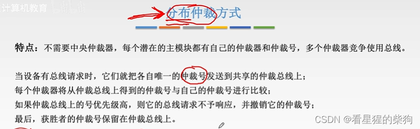
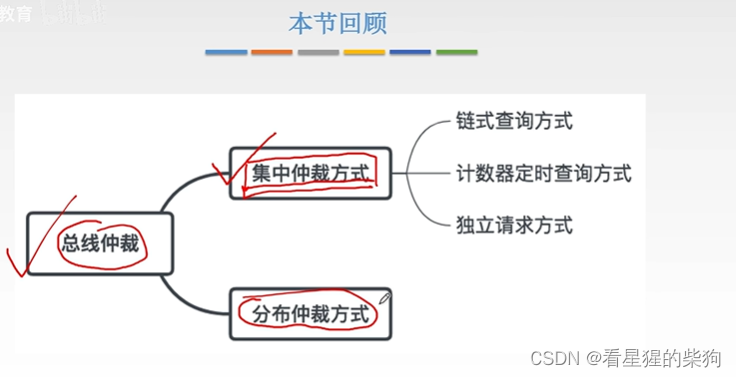


# 概述

# 总线仲裁的基本概念
系统总线包括数据总线、地址总线和控制总线
设备先通过控制总线获得总线使用权，然后才能使用数据总线和地址总线进行传输。至于和哪个设备传输数据，则由当前持有总线使用权的设备决定
集中仲裁：由一个主体决定谁先
分布仲裁：由一群主体决定谁先

# 集中仲裁方式
总线控制器可能集成在 CPU 或桥中
总线控制器发出总线时钟信号
BG、BR 和 BS 都是控制总线上的线
## 链式查询
设备 1 和设备 n 同时通过 BR 向总线控制部件发送信号后，总线控制部件通过 BG 向设备发送信号。信号先经过设备 0，由于设备 0 没有请求，就让信号通过。然后到达设备 1，设备 1 需要使用总线，于是截获该信号并获得总线使用权，此时 BS 处于使用状态。总线控制器检测到 BS 信号时，就不会把总线授予设备 n，尽管设备 n 仍在通过 BR 请求总线——设备 1 的优先级高于设备 n

之后，当设备 1 用完总线时，撤销 BS 信号。由于设备 n 仍在通过 BR 发送信号，而总线控制器不再检测到 BS 信号，于是发出 BG，BG 到达设备 n，设备 n 开始使用总线

缺点中的“对故障敏感”是指：如果优先级较高的设备在接收 BG 信号时出现故障，导致其后面的所有设备都收不到 BG 信号，那么后面的这些设备将永远无法获得总线控制权
## 计数器定时查询
设备地址线是一组用来表示设备地址（即是哪个设备）的线
当设备 1 和设备 n 通过 BR 向总线控制部件发送信号时，总线控制部件的计数器从 0 开始递增。每递增一次，就通过设备地址线查询计数值对应的设备是否需要总线。为 0 时，地址总线到达设备 0，发现它不需要总线。然后计数器加 1，地址总线到达设备 1，它确实需要总线
（查询设备实际上是把计数值信号送到设备地址线上，设备地址线把它送给所有设备；每个设备检查该信号是否与自己的设备号相同，如果相同就作出响应）

当设备 1 用完总线后，撤销 BS。由于总线控制器仍然检测到 BR 信号，它会继续改变计数值，寻找下一个想要使用总线的设备

“对链路故障不敏感”是指高优先级设备上的线路断了也不会影响其后面的设备
控制线数量增加是因为设备地址线很多
另外，由于每个设备都需要识别设备地址线上的信号，而且计数值需要转换成设备地址线上的信号，所以实现相对复杂
## 独立请求方式
每个设备都有各自连到总线控制器的 BR 线和 BG 线，并且都连接到同一根 BS 上。当设备 1 和设备 n 同时发送 BR 信号时，总线控制器内部的仲裁器对 BR 信号进行处理，最终通过 BG 向其中一个设备发送总线允许信号。相应设备收到总线允许信号后，在 BS 上发出信号。总线控制器收到 BS 时，说明该设备已经获得了总线使用权，总线允许信号随之撤销。当该设备用完总线后，由仲裁器决定下一个要发送总线允许信号的设备

仲裁器的实现相当灵活，所以对优先级顺序的控制也相当灵活
## 集中仲裁方式小结

# 分布仲裁方式
仲裁号体现了优先级

# 总结


