
# 总线示意图
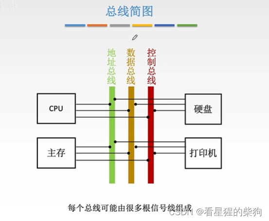
# 总线的物理实现
如果这是数据总线，那么当 CPU 分别在四根线上发出高低电平信号时，信号沿着导线传到其他部件，从而实现数据传送
但如果同时向总线的所有导线发送数据，就可能产生冲突，比如一个是 0 而另一个是 1
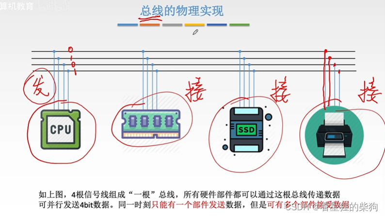
# 概述
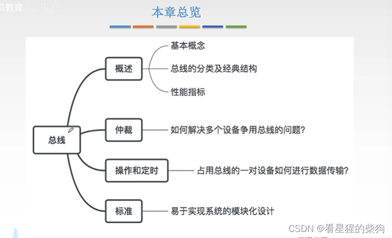
# 总线的定义
最初，各部件是按功能相互连接的。采用这种分散连接方式，增加或移除外部设备时重新布线会非常麻烦
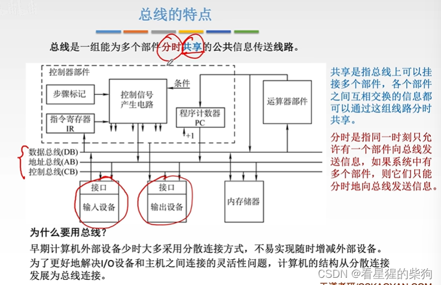
# 总线的特性
传输方向指总线上的数字信号朝哪个方向传送
有效电平范围是指只有当电平落在某个范围内时，信号才有效，即为 1
传输线的功能指它传输的是地址、数据还是控制信号
时间特性：各种信号何时发出的时序安排
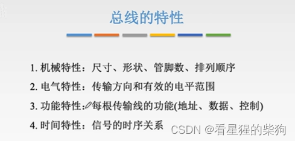
# 总线的分类
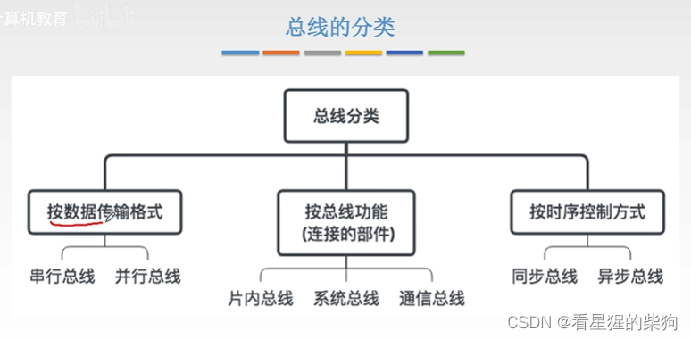
## 按数据传输格式分类

### 串行总线
一次只能传输一位
抗干扰能力强——大概是因为只有一路电信号，没有其他电信号对它产生干扰。我觉得可以参考物理中电生磁、磁生电、电干扰电的概念
拆卸与装配：由于大多数数据都不止 1 位，当需要一位一位地传输数据时，必须把多位数据拆成单独的位；接收时，还要把这些单独的位重新装配成原来的多位数据
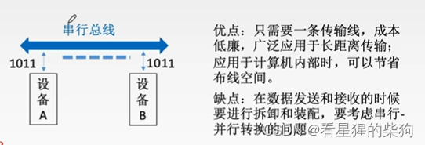

### 并行总线
一次可以传输多位
频率越高，对其他线路数字信号的干扰就越强
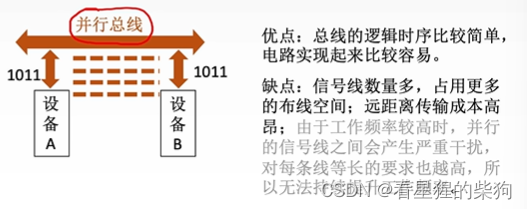
## 按总线功能分类
片内总线、系统总线和通信总线——层次逐级升高
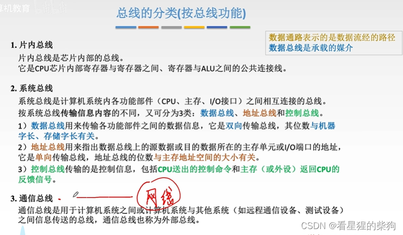
### 注意系统总线的进一步分类
数据总线：当线数等于机器字长时，读出内容的长度正好是 CPU 一次能处理的最大长度；如果等于存储字长，则一次读取就能取出对应的内容。它是双向的，因为数据需要在两个方向上传输

地址总线：采用统一编址时，必须考虑设备的数量。例如，主存是 0~n，那么一个设备的地址是 n+1，另一个设备的地址是 n+2。此时地址总线宽度所能表示的最大二进制数必须能达到 n+2。它是单向的，因为传输方向只能是从 CPU 到主存，所以必然是单向的

控制总线：不同的控制线对应不同的控制信号。有些控制线用于向其他部件发出信号，另一些则用于接收其他部件发给 CPU 的信号
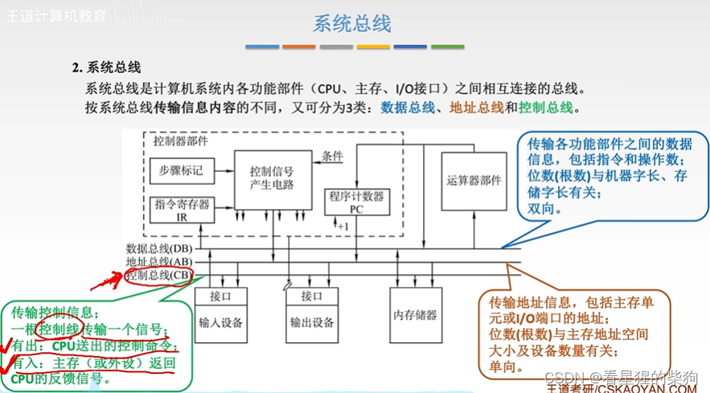

# 总线结构
## 单总线结构
由于不同设备同时向总线发送的信号可能发生冲突，因此不支持并发传输
带宽低意味着传输慢，因为传输不一定能立即进行——必须等其他部件释放总线，否则就会冲突
由于只有一条总线，需要考虑的问题没那么复杂，所以连接设备比较容易。
此外，由于系统总线传输速度快，而总线上 I/O 设备的数据速度慢，总线的一部分性能可能被浪费
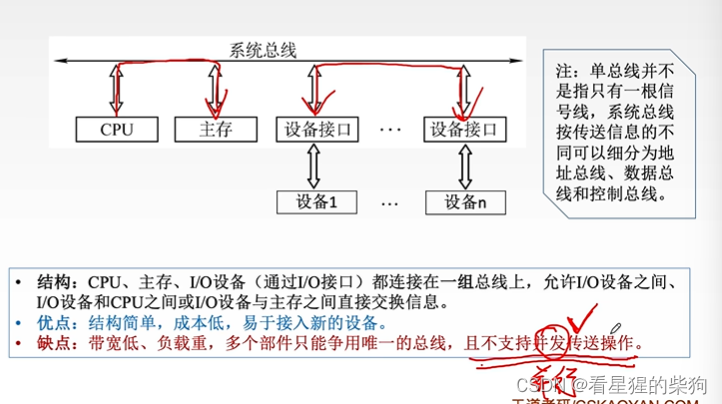
## 双总线结构
突发传送：你发出所需的一个数据的地址，但得到的是该数据以及与之相邻连续存放的数据
CPU 与通道之间通过主存总线传输，速度没有浪费；I/O 设备与通道之间通过 I/O 总线传输，速度同样没有浪费。
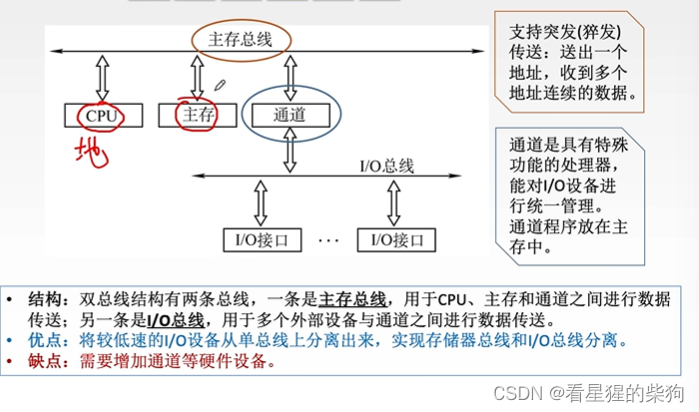
## 三总线结构
DMA 总线速度快，用于连接高速外设；I/O 总线速度慢，用于连接低速外设
CPU 通过 I/O 总线访问低速外设，充分利用了 I/O 总线
如果需要访问磁盘，可以先通过 DMA 把磁盘内容传送到主存，再传给 CPU
效率较低，因为三条总线同一时刻只能有一条工作
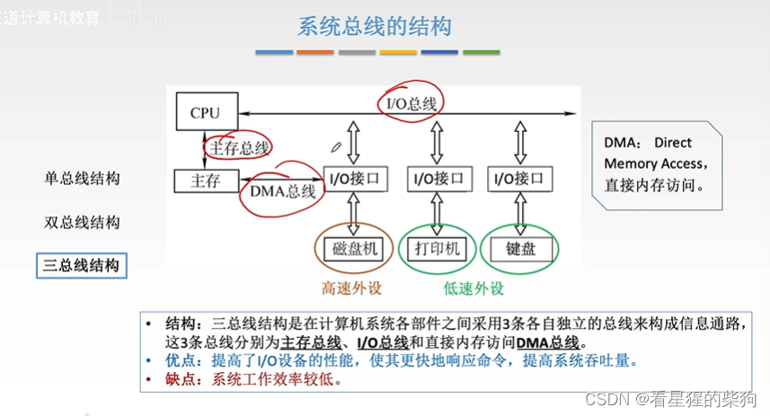

## 四总线结构
不同的总线速度不同，用桥接器在它们之间进行转换
数据缓冲与转换：桥接器可以把接收到的串行数据转换成并行数据再发送出去
控制：决定哪个设备获得总线使用权
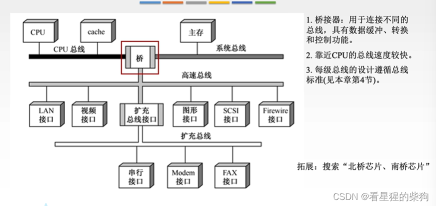

# 总结
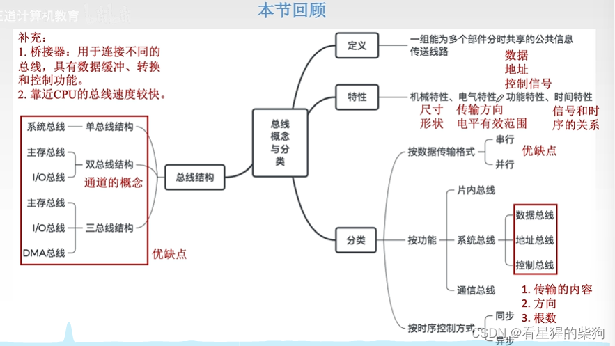

