
# 概述
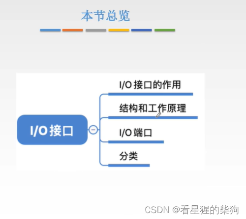
# 主机如何与 IO 设备交互
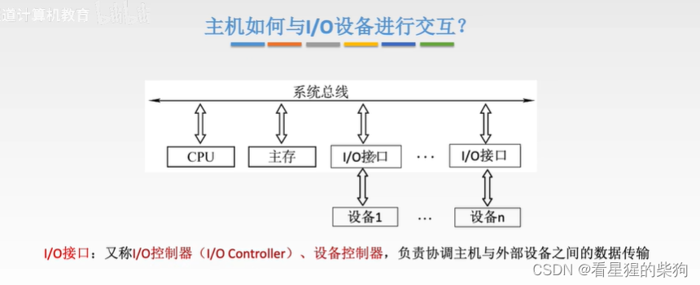
# IO 接口的功能
数据缓冲：CPU 与外设之间的速度差距非常大。有了数据缓冲寄存器，例如外设可以慢慢地向数据缓冲寄存器写入，写满之后，CPU 再快速把数据取走

错误或状态监测：IO 接口需要向 CPU 报告外设的状态。IO 接口检测与其相连的外设状态，一旦外设状态发生变化，就修改状态寄存器；CPU 通过读取 IO 接口的状态寄存器就能得知外设的状态

数据格式转换：有时外设与 IO 接口之间是串行传输，而 CPU 与 IO 接口之间是并行传输

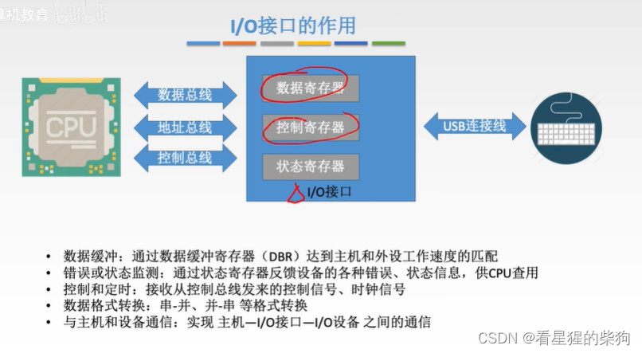
# IO 接口的详细结构
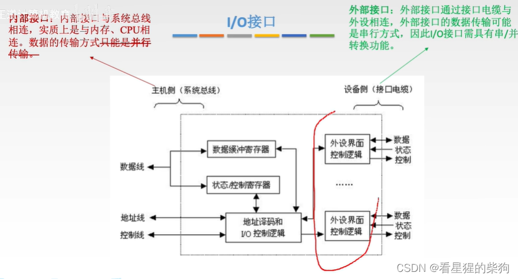  一个 IO 接口有时可以连接多个外设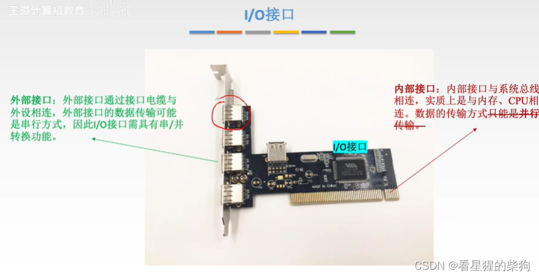
由于中断类型不同，中断类型号也需要通过数据线传送
地址线除了用来指明 IO 端口之外，有时还可以指明设备号，但这两者需要分两次传送
要操作的设备可以通过发送设备号来确定，也可以让每个设备对应一组寄存器，这样直接操作这些寄存器就是在操作该设备
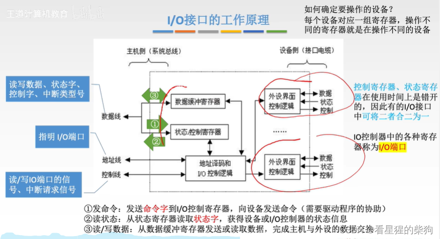
# 接口与端口
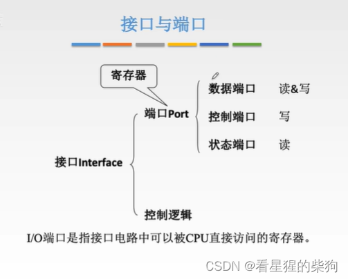
# 统一编址与独立编址
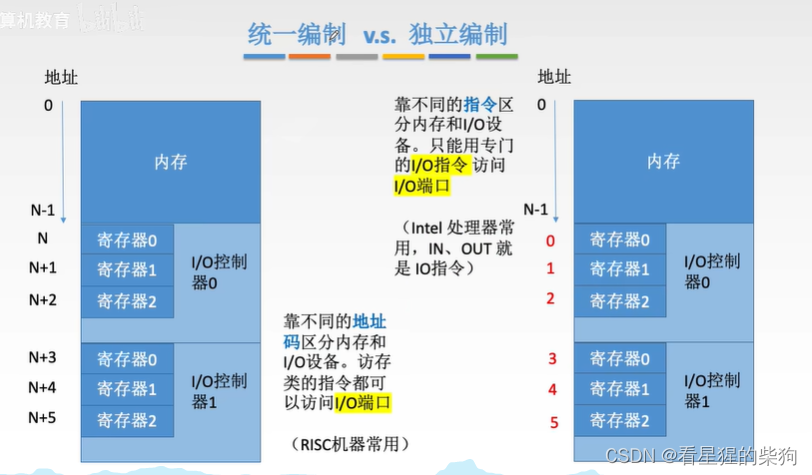
采用统一编址时，用主存空间来存放原本存放在 IO 端口中的内容。IO 端口的地址可以自由分布在内存地址之间
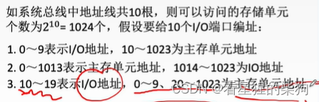

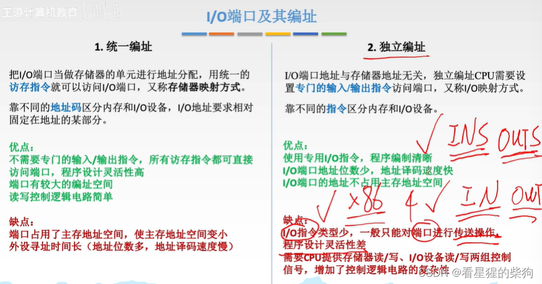
# IO 接口的类型
USB 是串行接口
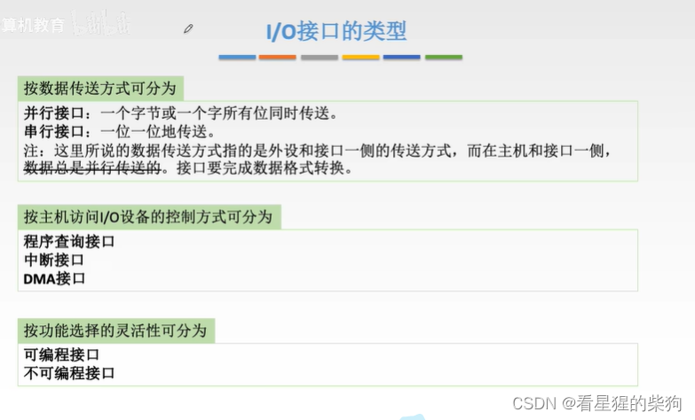
# 总结
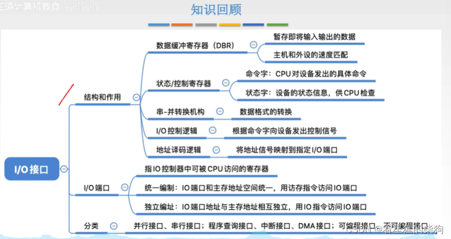

