
# 概述
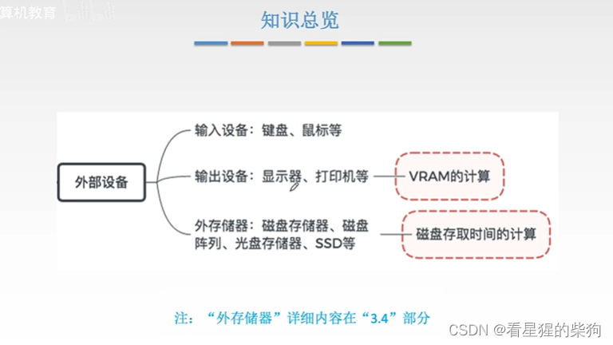
# 外部设备
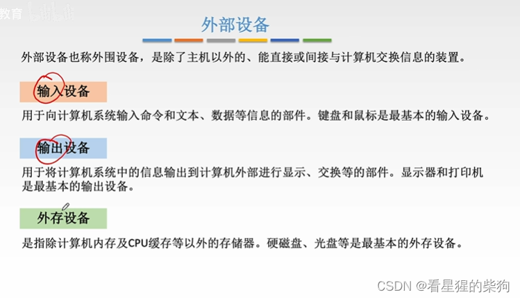
## 输入设备
键盘按键产生电信号，再被翻译成主机能够接收的编码
光电鼠标使用光传感器
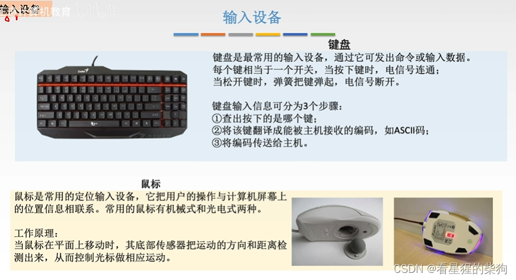
## 输出设备
## 显示器
分辨率中，第一个数是宽，第二个数是高
灰度级：位值不同，对应像素的颜色就不同
灰度位数：每个像素对应的位数
显存：存放下一帧要在显示器上显示的图像信息

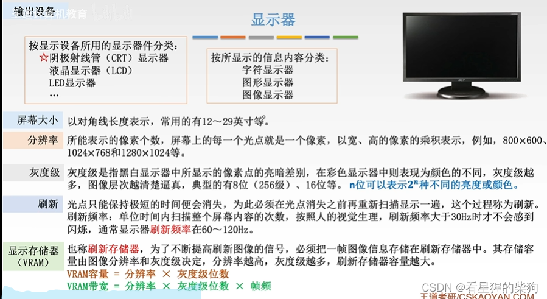
帧缓冲深度就是每个像素对应的位数
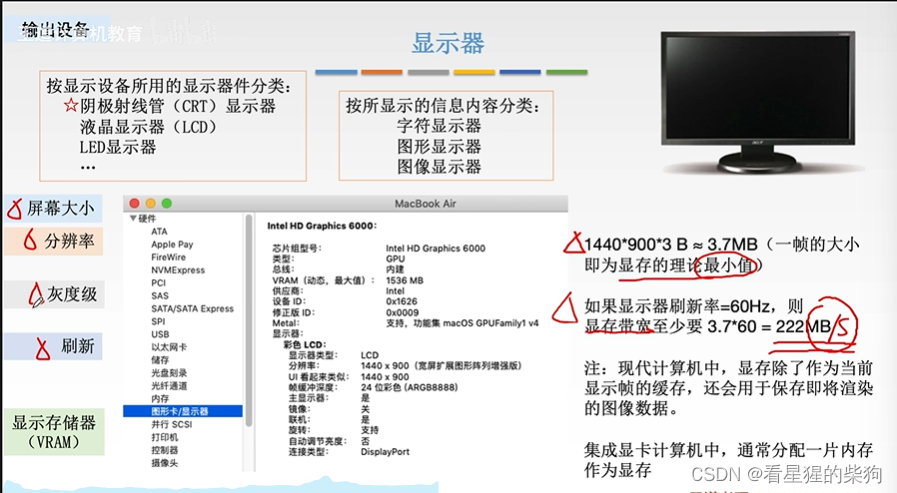
## 按显示器件分类的显示器
LCD 相比 CRT 优势大得多
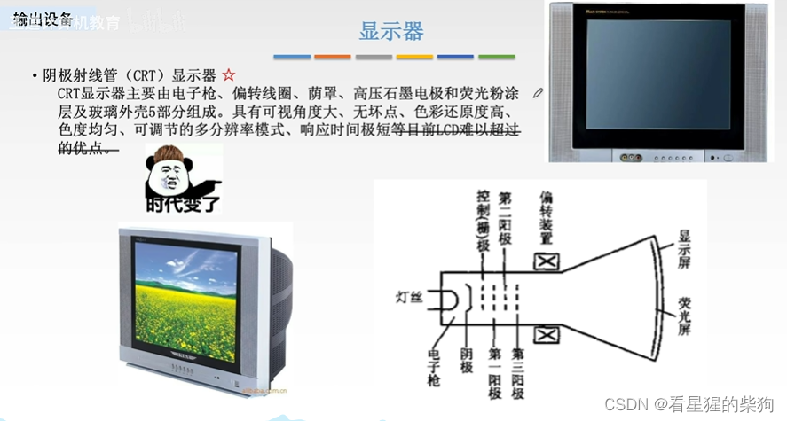
液晶显示器和发光二极管显示器的显示原理不同
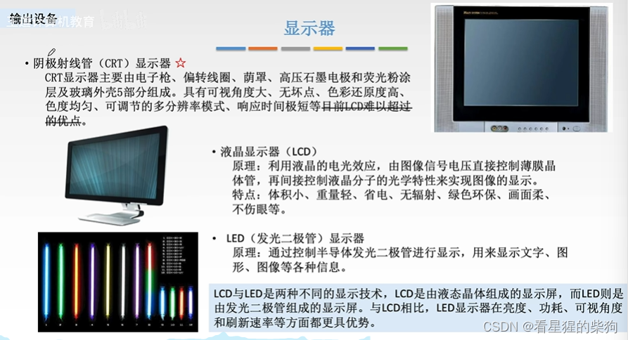
## 按显示信息分类的显示器
1 表示亮，0 表示暗
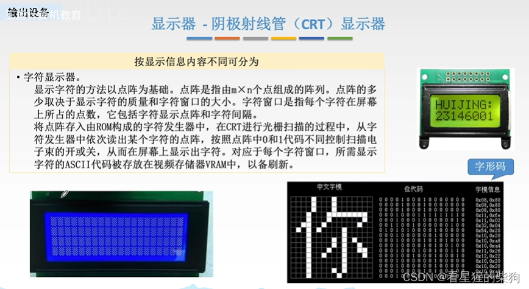
### 字符显示器
字符的 ASCII 码被写入显存
在阴极射线管控制器的控制下，显存中的 ASCII 码被逐个以电信号的形式送到字符发生器
然后字符发生器根据 ASCII 码和 CRT 控制器的信号信息找到对应字形点阵的存储单元，输出字形点阵
最后通过阴极射线将字形点阵显示出来

对于 LCD 和 LED 显示器，只是像素的显示方式不同（不像 CRT 那样使用电子束）
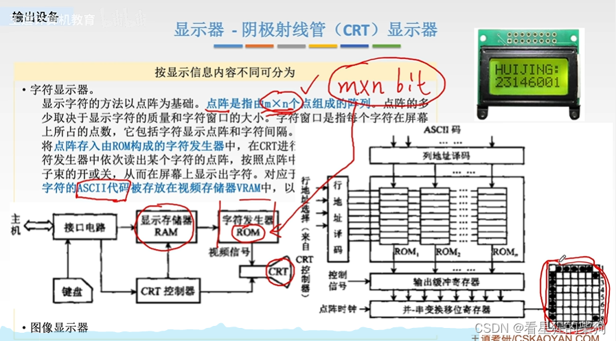
### 图像显示器和图形显示器
图形显示器：显示图形，更加专业
图像显示器：电脑、手机之类的
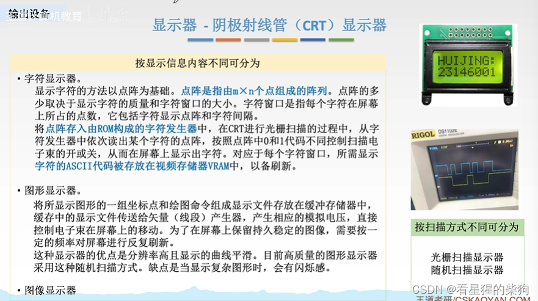
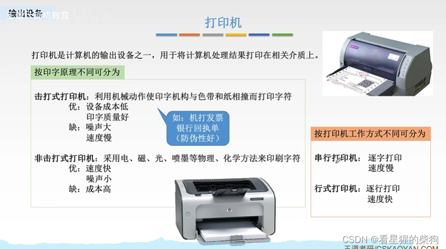
击打式打印机就是针式打印机
大多数打印机是激光打印机
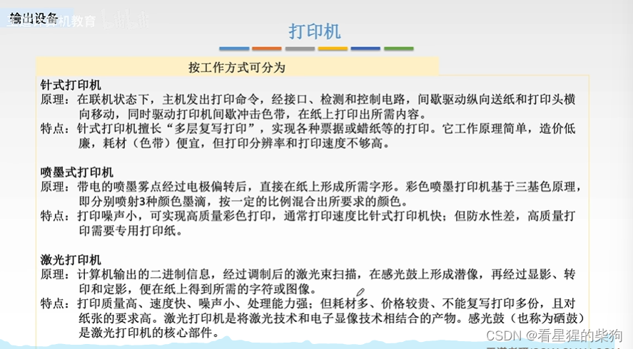
# 总结
重点关注字符显示器和显示参数的计算
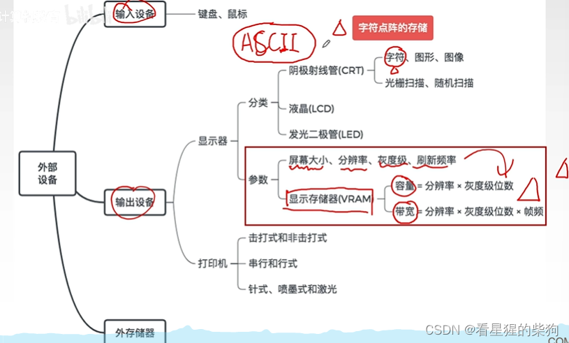

