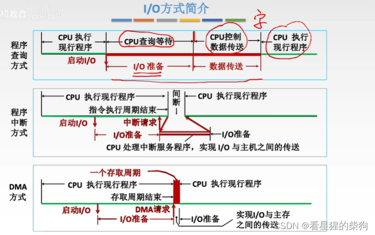
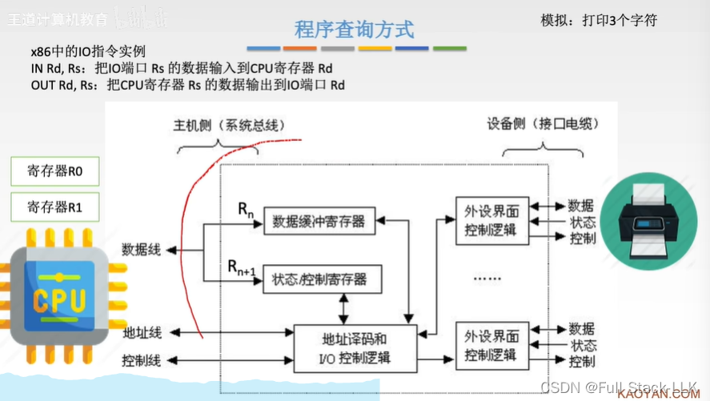
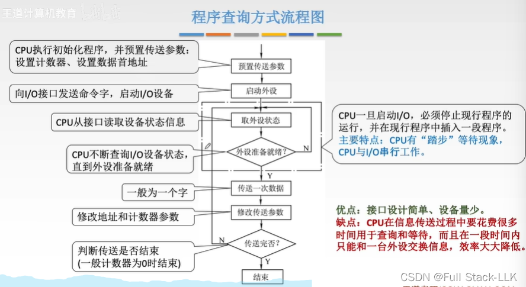
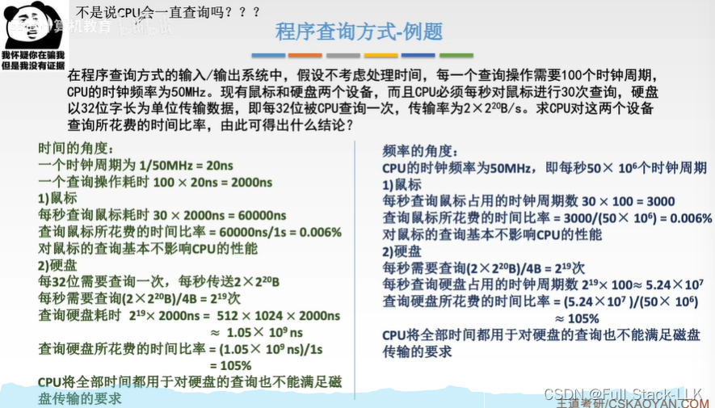
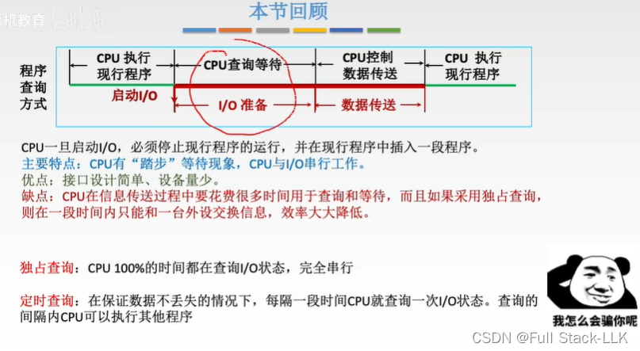


# 概述
# IO 方式介绍
每输出一个字，状态即视为完成，CPU 取走数据寄存器中的内容

# 程序查询方式

这里模拟打印三个字符

假设三个字符在主存中。CPU 先从主存中读取一个字符到 CPU 的寄存器中——这是一次主存读操作。

CPU 向打印机发出打印命令字。首先由打印机驱动程序处理，把打印命令字放入 CPU 的寄存器；然后通过 OUT 指令把命令字送到 IO 端口的控制寄存器（OUT 指令先通过地址线送出要写入的 IO 端口，再通过控制线送出写操作，最后命令字通过数据线传送到控制寄存器）

随后 IO 控制逻辑部件把控制寄存器中的命令信号传给外设接口控制逻辑，由它通过控制线向打印机发出相应的控制信号

打印机收到命令后启动。工作完成后，通过状态线向 IO 接口报告完成。IO 控制逻辑部件把该状态信号放入状态寄存器 Rn+1。（该寄存器之前存放的是命令字，但命令字已经送到 IO 控制逻辑并处理完毕，不再需要，所以现在存放状态信号也没问题。）

OUT 指令把打印命令字送入控制寄存器后，CPU 不断检查状态寄存器是否变成了完成信号（即反复使用 IN 指令，通过数据线把状态寄存器的内容输入到 CPU 的寄存器中，由 CPU 检查该寄存器的值是否为完成信号）

检查到完成信号后，CPU 通过地址线指明本次操作的对象是数据缓冲寄存器，通过控制线指明这是写操作，同时把存放在寄存器中的待打印字符传到数据线上。待打印字符就成功写入数据缓冲寄存器

数据缓冲寄存器中的数据随后传给 IO 控制逻辑，再传给外设接口控制逻辑，再通过数据线传给打印机，同时通过控制线也发出相应的控制信号。

打印完成后，打印机通过状态线向 IO 接口报告完成信号，接口再把完成信号传给状态寄存器

CPU 检测到打印机已经完成工作后，把第二个待打印字符写入数据缓冲寄存器；流程与打印第一个字符相同

最后一个字符打印完成后，打印机向接口发送完成信号，接口再传给状态寄存器。同时，CPU 内部有一个计数器，用来记录是否已经打印了规定的字符数。当发现全部打印完毕，且最后一次打印信号已经完成时，CPU 向打印机发出停止命令字（当然也要先经过驱动程序）并写入控制寄存器

IO 控制逻辑（IO 接口）随后把这个停止控制信号发送给外设接口控制逻辑，再通过控制总线发送给打印机，打印机便停止工作

# 程序查询方式流程图
传递参数：计数器需要计数到多少才算传输完成，以及要传输的数据
CPU 与 IO 设备串行工作，即二者的工作相互依赖

# 程序查询方式 - 例题
慢速 IO 设备在程序查询方式下对 CPU 影响很小
快速 IO 设备在程序查询方式下对 CPU 影响很大
CPU 实际上可以采用定时查询（查询不占用全部时间，查询与程序执行交替进行）或独占查询

# 总结
下图中，上面的程序查询方式就是独占查询方式


