
# 概述
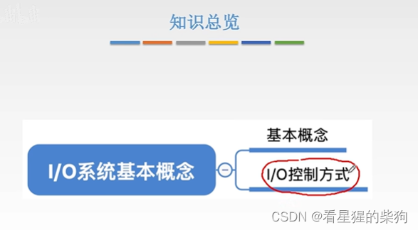
# 现代计算机的结构
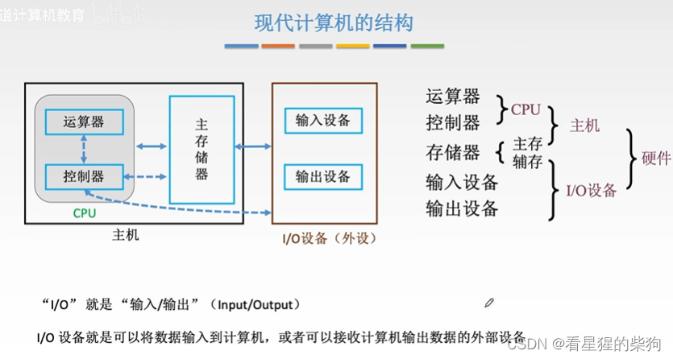
# 常见的 IO 设备
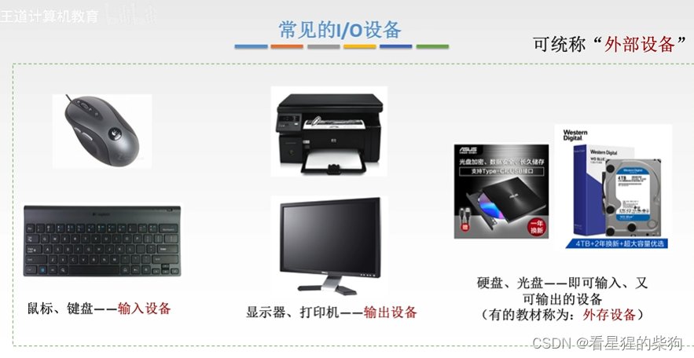
# 主机如何与 IO 设备交互

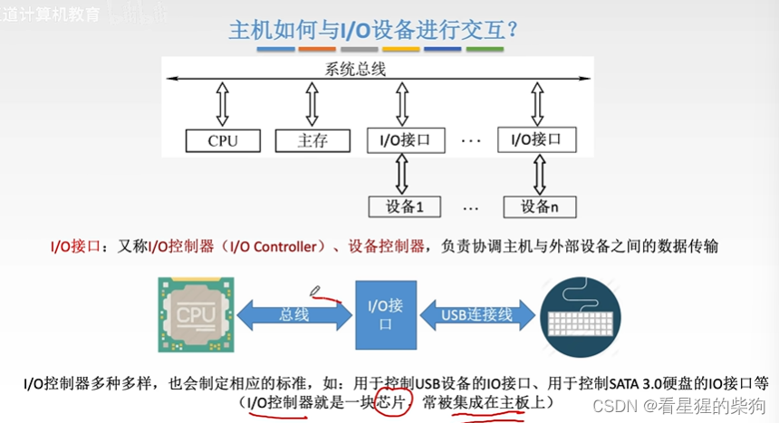
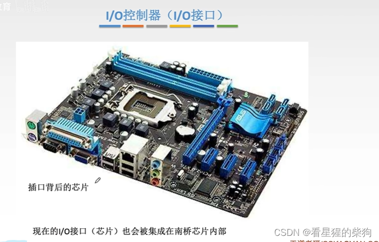
# IO 控制方式简介

 数据寄存器：存放主机要输出给外设的数据，或外设要输入给主机的数据
 控制寄存器：存放外设要执行什么动作
 状态寄存器：外设的状态

 CPU 先通过控制总线向 IO 接口发出读命令，同时可以用地址总线指明要从哪个设备读；地址总线还可以指明从该设备读出的数据要放到哪个寄存器中
 
## 程序查询方式
 这里 CPU 必须一直轮询，不能做其他事情
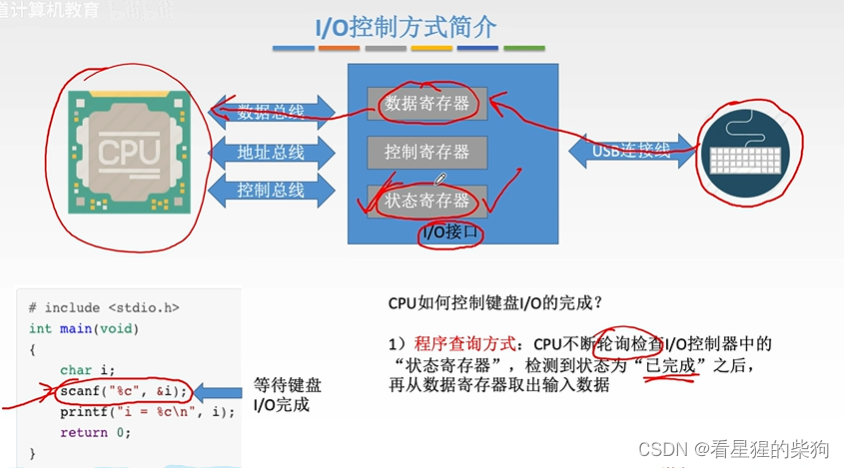
## 程序中断方式
这里 CPU 去做其他事情，输入完成后再根据中断信号从 IO 接口的数据寄存器中取数据
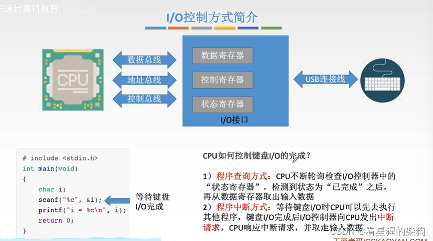
这两种 IO 控制方式在 IO 输入后的数据流向是
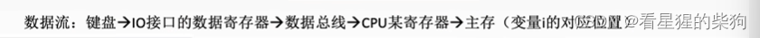
CPU 在每个指令执行周期结束时检查是否有中断请求到来
这里的中断服务程序把 IO 接口数据寄存器中的数据传入 CPU
中断处理完后，恢复执行之前正在运行的程序
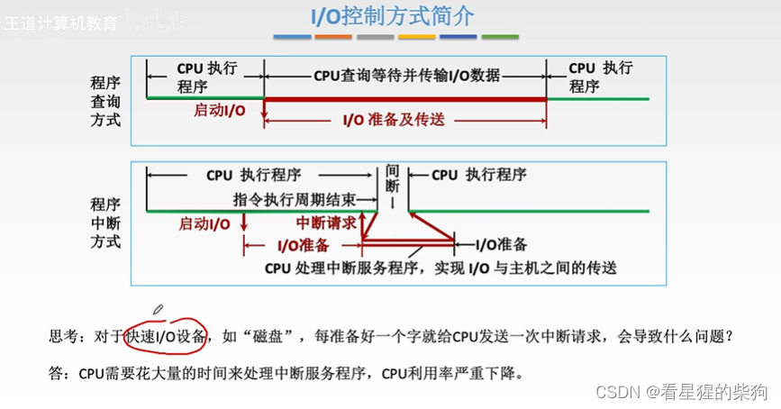
## DMA 控制方式
DMA 接口也是一种 IO 接口，只是它所控制的外部设备比较特殊
 
 DMA 控制器每次从磁盘读一个字的数据，存放到主存的对应位置。只有当一整块数据传输完成后，DMA 控制器才会向 CPU 发出中断请求，表示你交给它的工作已经完成
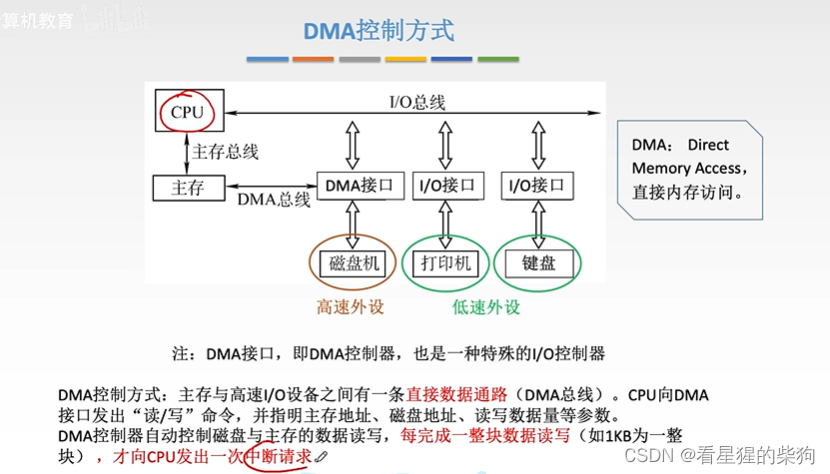当设备为 DMA 控制器准备好一个字时，DMA 控制器发出 DMA 请求。DMA 控制器占用一个存取周期把一个字的数据写入内存；如果此时 CPU 也要访问主存，就必须等 DMA 控制器访问完主存

与程序中断方式每传送一个字都要发出中断请求并运行中断处理程序相比，DMA 控制方式只需发出一个 DMA 请求并占用一个存取周期——而且只有在整块数据传送完后才发出 DMA 中断请求
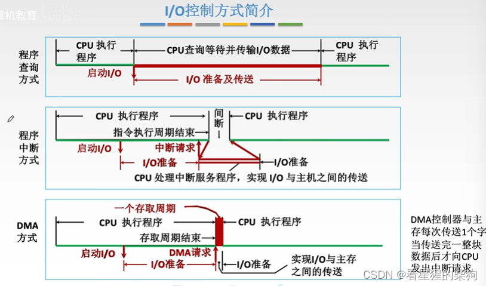
## 通道控制方式
这里由通道来管理各种 IO 设备
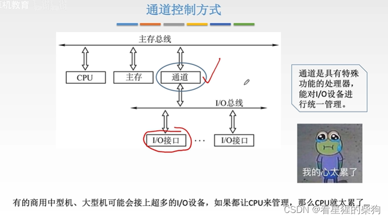
例如，如果 IO 设备的任务是通过 IO 设备读入数据，那么通过通道控制，IO 设备输入的数据最终被传送到内存中的某个位置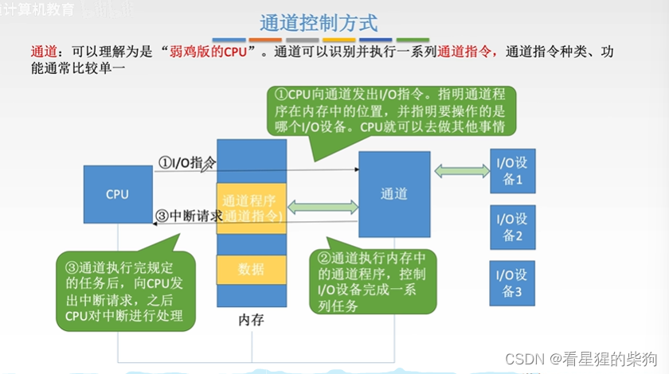
# IO 系统的基本组成
主机如何通过 IO 接口控制 IO 设备，就是 IO 控制方式
CPU 必须执行 IO 指令才能产生相应的 IO 操作，例如通道通过执行通道指令开始工作
设备驱动程序让 CPU 知道该设备的 IO 指令是什么
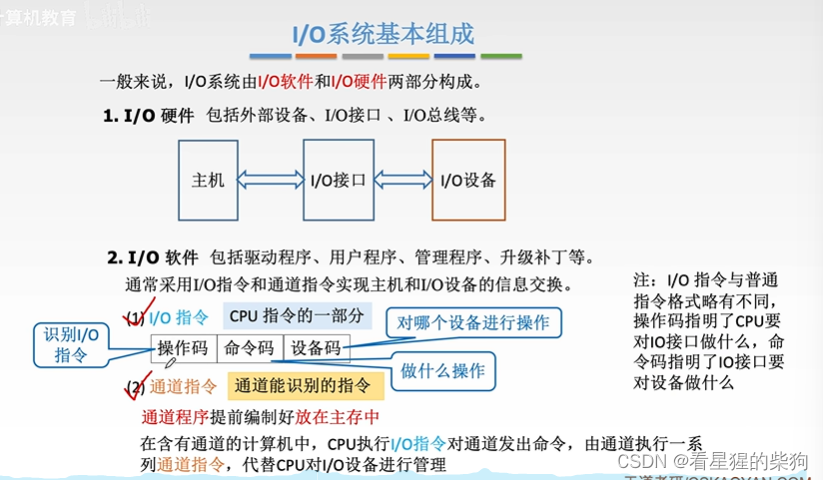
# 小结
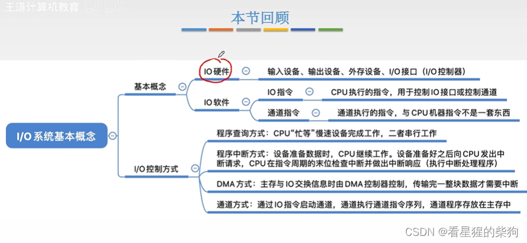

