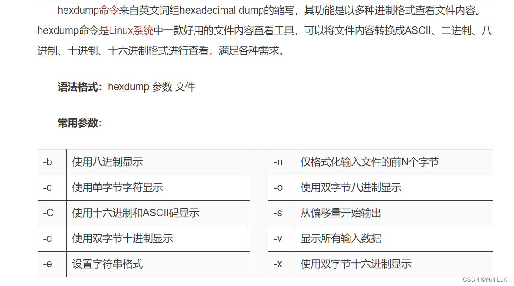
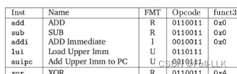
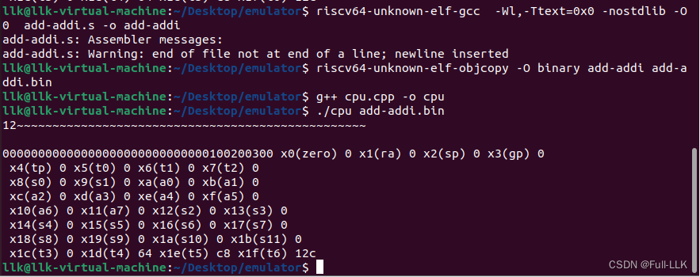
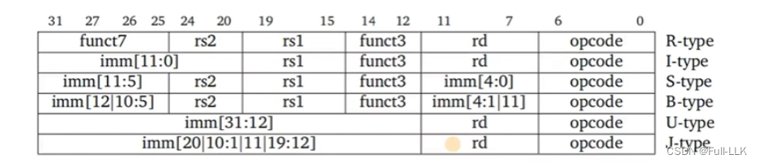
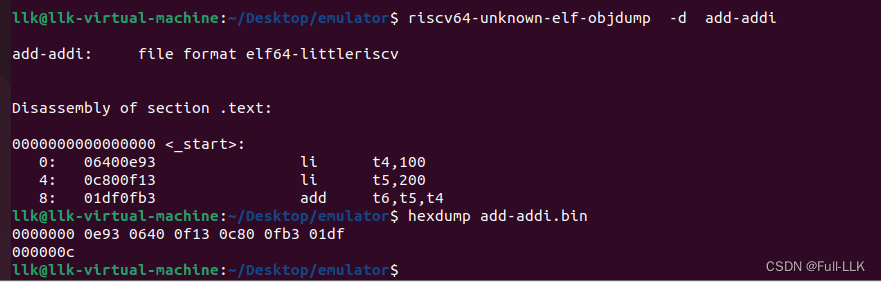


# uint64_t
uint64_t 是 C/C++ 中的一种无符号整数类型，表示 64 位无符号整数。在计算机中，无符号整数以二进制补码形式存储，所以它的取值范围是 0 到 2^64-1（即 18446744073709551615）。

uint64_t 的全称是 unsigned int 64-bit。

在 C 语言中，uint64_t 是通过 typedef 定义的别名，表示无符号 64 位整数类型。这种命名方式是一种标准化的表示方法，其中 "u" 代表无符号（unsigned），"int" 代表整数，"64" 表示这是一个 64 位的整数类型。使用这些标准数据类型别名可以提高代码的可读性和可维护性，因为它们清楚地表明了数据类型的大小和属性。例如，uint8_t、uint16_t、uint32_t 和 uint64_t 分别表示 8 位、16 位、32 位和 64 位无符号整数类型。

这些数据类型都定义在 C99 标准中。它们不是新的数据类型，而是现有数据类型的别名。这样做的好处是，即使这些类型在不同平台上的大小可能不同，使用这些标准别名也能保证代码的一致性和可移植性。

# std
std 是 C++ 标准库的命名空间。

在 C++ 编程语言中，std 是一个特殊的命名空间，包含了 C++ 标准库的所有函数、类和其他模板。这个命名空间的存在是为了把标准库中的函数和对象与用户自定义的或其他库中的区分开来。使用 std 命名空间可以避免名称冲突，并提供一种组织代码的方式。下面是关于 std 命名空间的一些要点：

标准库函数和对象：例如用于输出的 std::cout、用于输入的 std::cin，以及各种数据结构和算法如 std::vector 和 std::sort，都定义在 std 命名空间中。
用法：使用标准库中的任何函数或对象时，通常需要加上 std:: 前缀，表示它来自 std 命名空间。例如 std::cout << "Hello, World!" 中的 std:: 就是必要的限定符。
简化用法：为了避免每次都写 std::，可以在代码中写上 using namespace std;，告诉编译器在后续代码中使用 std 命名空间，这样就不需要反复写 std:: 了。不过在某些情况下这可能导致命名冲突，所以需要谨慎使用。
# std::array
std::array 是一种固定大小的数组容器，提供了许多内置数组所没有的功能，同时保持了与原生数组相同的随机访问能力和效率。下面是 std::array 的一些主要用法：

初始化：可以在声明时直接初始化 std::array，也可以使用列表初始化。例如：

std::array<int, 5> arr1 = {1, 2, 3, 4, 5};
std::array<int, 5> arr2{6, 7, 8, 9, 10};
- 访问元素：可以像原生数组一样，通过下标运算符 [] 访问或修改 std::array 中的元素。

- 获取大小：std::array 提供了 size() 成员函数，返回数组的大小（元素个数）。

- 获取数据指针：可以使用 data() 成员函数获取指向第一个元素的指针，这在需要以 C 风格数组的形式传递数据时非常有用。

- 迭代器支持：std::array 支持随机访问迭代器，所以可以用迭代器遍历数组中的元素。

- 不能动态改变：由于 std::array 的大小是固定的，它不支持添加或删除元素，也不能改变其大小。

- 自动推导数组大小：在 C++17 及以后的版本中，可以利用类模板实参推导特性简化 std::array 的声明，例如 std::array arr = {1,2,3,4,5,6};。但要注意，使用这种推导方式时不能只提供元素类型而让编译器推导数组长度。

总的来说，std::array 是一种安全的容器，结合了原生数组的优点和更多的功能。在需要固定大小数组并希望获得更多安全性和便利性的场景下，它是一个不错的选择。
# CPU 和 CU
CPU（中央处理器）和 CU（控制单元）都是计算机中的核心部件，二者在功能上有所不同。具体如下：

CPU：它是计算机的大脑，负责执行程序指令和处理数据。它由多个部件组成，包括算术逻辑单元（ALU）、控制单元（CU）、寄存器等。CPU 内部通过复杂的电路完成各种计算和逻辑运算，同时还负责处理与内存及输入/输出设备之间的数据交换。
CU：它是 CPU 内部的一个部件，全称是控制单元（Control Unit）。CU 的主要功能是发出各种控制命令或微指令，控制整个计算机系统（包括 CPU 内部各部件）的工作。CU 协调各部件的工作，确保程序能够按照预定的流程顺利执行。

# 类
在 C++ 中，public 和 class 是两个用于定义类成员访问权限的关键字。

class：用于定义类，类表示一种抽象数据类型，可以包含数据成员（属性）和成员函数（方法）。类的定义通常包括类名、类的属性和方法等。例如：

```cpp
class MyClass {
    // 类的属性和方法
};
```
public：用于指定类成员的访问权限为公有，即这些成员可以从类的外部直接访问。在类定义中，用 public 关键字修饰的成员可以被其他代码直接访问和操作。例如：
```cpp
class MyClass {
    public:
        int x; // 公共属性
        void myFunction(); // 公共方法
};
```

    
在上面的例子中，x 是公有属性，可以从类外部直接访问和修改；myFunction() 是公有方法，同样可以从类外部直接调用。

注意，在 C++ 中，如果没有显式指定访问权限，类成员默认是 private 的，只能在类内部访问和操作。如果需要在类外部访问类成员，就需要用 public 关键字来声明。
# 构造函数
C++ 中的构造函数是一种特殊的成员函数，在创建对象时自动调用。构造函数的名字与类名相同，没有返回值类型，可以带参数。构造函数的主要作用是初始化对象。

下面是一个简单的 C++ 构造函数示例：

```cpp
#include <iostream>
using namespace std;

class MyClass {
public:
    // 构造函数
    MyClass() {
        cout << "构造函数被调用" << endl;
    }
};

int main() {
    MyClass obj; // 创建对象，自动调用构造函数
    return 0;
}

```
    
在这个例子中，我们定义了一个名为 MyClass 的类，并在其中定义了一个构造函数。当我们在 main 函数中创建 MyClass 的对象 obj 时，构造函数会被自动调用并输出“构造函数被调用”。
# size_t
size_t 是 C++ 中的一种无符号整数类型，通常用于表示对象的大小或数组的长度。它的定义取决于具体的编译器和操作系统，但通常足够大，能够表示任何可能的对象大小。在 32 位系统上，size_t 通常是 32 位；而在 64 位系统上，size_t 通常是 64 位。
# static_cast
static_cast 是 C++ 中的类型转换运算符，用于把表达式从一种类型转换为另一种类型。它主要用于基本数据类型之间的转换，例如 int 转 float、double 转 int 等。
# std::ifstream
std::ifstream 是 C++ 标准库中用于从文件读取数据的类。它继承自 std::istream 类，提供了一些成员函数和运算符，可以方便地从文件中读取文本或二进制数据。

使用 std::ifstream 打开文件时，需要指定文件名和打开模式。文件名可以是相对路径也可以是绝对路径，打开模式则决定了文件的访问方式。常见的打开模式包括：

std::ios::in：以只读模式打开文件；
std::ios::out：以写模式打开文件；
std::ios::binary：以二进制模式打开文件；
std::ios::ate：打开文件后立即定位到文件末尾；
std::ios::app：以追加模式打开文件。


#  riscv64-unknown-elf-objcopy -O binary add-addi add-addi.bin
这条命令的作用是把名为 "add-addi" 的 ELF 格式文件转换为二进制格式，并把结果保存为 "add-addi.bin"。

详细解释如下：

- "riscv64-unknown-elf-objcopy" 是一个处理目标文件的工具，可以把文件从一种格式转换为另一种格式。
- "-O binary" 选项表示要把输入文件转换为二进制格式。
- "add-addi" 是要转换的输入文件名。
- "add-addi.bin" 是转换后的输出文件名。

# riscv64-unknown-elf-gcc -Wl,-Ttext=0x0 -nostdlib -o add-addi add-addi.s
这条命令的作用是使用 RISC-V 64 位编译器把汇编文件 "add-addi.s" 编译成可执行文件 "add-addi"。

详细解释如下：

- "riscv64-unknown-elf-gcc" 是一个用于编译和链接程序的工具，是面向 RISC-V 架构的交叉编译器。
- "-Wl,-Ttext=0x0" 选项指定程序的起始地址为 0x0。
- "-nostdlib" 选项表示不链接标准库。
- "-o add-addi" 选项指定输出文件名为 "add-addi"。
- "add-addi.s" 是要编译的汇编源文件名。
 
# -wl
-Wl 是一个常用的编译器选项，用于把命令行参数传递给链接器。在 GCC 编译器中，-Wl 后面通常跟着链接器选项，这些选项会影响链接过程以及生成的可执行文件。

例如，-Wl,-Ttext=0x0 是通过 -Wl 传递的链接器选项，其中 -Ttext=0x0 是链接器的一个特定选项，告诉链接器把程序文本段（通常包含程序的代码）的起始地址设为 0x0。

其他常见的 -Wl 选项包括：

- -Wl,--start-group 和 -Wl,--end-group：这两个选项用于指定链接时一组输入文件的顺序，确保这些文件按指定顺序链接。
- -Wl,-Map：该选项告诉链接器生成一个映射文件，描述输入目标与可执行文件之间的映射关系。
- Wl,-rpath：该选项用于设置运行时库的搜索路径。

使用 -Wl 选项时，通常需要确保链接器能够理解并支持你传入的选项。不同的目标平台和操作系统可能有不同的链接器选项。

# std::hex、std::setw() 和 std::setfill() 的用法

std::hex、std::setw() 和 std::setfill() 是 C++ 标准库中用于格式化输出的流操纵符。

std::hex：以十六进制形式显示后续输出的数据。它通常与 std::cout 一起使用，例如：
       

```c
#include <iostream>

int main() {
    int num = 255;
    std::cout << std::hex << num<<123; // 输出 "ff7b"
    return 0;
}
```

    
std::setw()：设置下一个输出字段的宽度。它通常与 std::left 或 std::right 一起使用来指定对齐方式，如果不指定对齐方式，默认是右对齐。例如：

```c
#include <iostream>

int main() {
    int num = 42;
    std::cout << std::setw(5) << num; // 输出 "   42"
    return 0;
}
```

    
std::setfill()：设置填充字符。它通常与 std::setw() 一起使用，当输出字段短于指定宽度时，用指定的字符进行填充。例如：
        


```c
#include <iostream>

int main() {
    int num = 42;
    std::cout << std::setw(5) << std::setfill('0') << num; // 输出 "00042"
    return 0;
}
```
# hexdump

# add 和 addi 的 RISC-V 编码

在 RISC-V 中，指令编码格式分为几种类型，其中 addi 指令采用 I 型格式，而 add 指令采用 R 型格式。每种指令类型的机器码都是 32 位宽，每一位都有特定的作用。

addi（Add Immediate）指令的 I 型格式：RISC-V 的 I 型指令格式如下：

```c
┌───────┬───────┬───────┬─────────────┬───────┬───────┐
│ funct7 │  rs2  │  rs1  │    funct3   │   rd  │ opcode│
├───────┼───────┼───────┼─────────────┼───────┼───────┤
│    立即数 (12 bits)    │   rs1 (5 bits)  │  funct3 |   rd (5 bits)   │ opcode (7 bits) │
└────────────────────────┴─────────────┴────────┴─────────────┘ 
```

 
opcode（7 位）：操作码，addi 的操作码是 0010011。
rd（5 位）：目的寄存器的编号。
funct3（3 位）：功能码，addi 的功能码是 000。
rs1（5 位）：源寄存器 1 的编号。
立即数（12 位）：要加上的立即数，它是有符号的，执行时会自动符号扩展到 32 位或更多位。
例如，对于指令 addi x5, x10, 15，其二进制编码可能如下所示（只显示与操作相关的二进制位，不包括具体的立即数值和寄存器编号）：

```c
00000000000011110110000010010011
```

 
add（Add）指令的 R 型格式：RISC-V 的 R 型指令格式如下：

```c
┌───────┬───────┬───────┬─────────────┬───────┬───────┐
│ funct7 │  rs2  │  rs1  │    funct3   │   rd  │ opcode│
├───────┼───────┼───────┼─────────────┼───────┼───────┤
│ funct7 (7 bits)│ rs2 (5 bits)│ rs1 (5 bits)│ funct3 (3 bits)│rd (5 bits)│opcode (7 bits)│
└───────┴───────┴───────┴─────────────┴───────┴───────┘
```

 
opcode（7 位）：操作码，add 的操作码是 0110011。
rd（5 位）：目的寄存器的编号。
funct3（3 位）：功能码，add 的功能码是 000。
rs1（5 位）：源寄存器 1 的编号。
rs2（5 位）：源寄存器 2 的编号。
funct7（7 位）：对于 add，该字段为 0000000。
例如，对于指令 add x5, x10, x20，其二进制编码可能如下所示（只显示与操作相关的二进制位）：

```c
00000001010010100000010110110011
```

 
# 简单的 CPU 工作流程

在现代计算机体系结构中，尤其是遵循冯·诺依曼结构的计算机系统中，程序的执行可以分解为若干个连续的阶段，这些阶段共同构成了 CPU 的指令周期。这些阶段包括取指（IF）、译码（ID）、执行（EX）、访存（MEM）和写回（WB）。这个过程循环进行，每个阶段完成特定的任务，以确保计算机程序顺利执行。

```c

+--------+   +--------+   +--------+   +--------+   +--------+
| 取指IF  |-->| 解码ID |-->| 执行EX  |-->| 访存MEM |-->| 写回WB |
+--------+   +--------+   +--------+   +--------+   +--------+
```

在这张图中，每一行代表 CPU 中的一条指令随时间经过不同的处理阶段。每个方框代表流水线的一个阶段，箭头表示指令从一个阶段流向下一个阶段。这种设计使得在任一时钟周期内最多可以有五条指令处于不同的执行阶段，大大提高了 CPU 的效率和性能。

- 取指 IF：从内存中读取指令。
CPU 使用程序计数器（PC）所指向的地址从内存中读取指令。读取后，PC 被更新为下一条指令的地址，为下一个周期做准备。
- 译码 ID：解析指令并准备所需的操作数。
指令译码器（ID）解析取到的指令，确定要执行的操作和操作数。这可能涉及从指令中提取立即数、计算地址、确定寄存器编号等。
- 执行 EX：进行计算或其他操作。
执行阶段根据译码阶段的结果，执行相应的算术逻辑运算（ALU 运算）、分支判断或其他操作。这一阶段可能需要用到 ALU（算术逻辑单元）。
- 访存 MEM：进行内存访问，如数据的加载或存储。
如果指令需要读内存（如 load 操作）或向内存写数据（如 store 操作），就在这一阶段完成。这一步是可选的，因为并非所有指令都需要访问内存。
- 写回 WB：把执行结果写回寄存器。

把执行阶段的结果，或访存阶段从内存中读取的数据，写回到指定的寄存器。这一步确保指令的执行结果可以被后续指令使用。
这五个阶段共同构成了一条指令完整的执行周期，是现代 CPU 设计的基础。通过把指令执行分解为这些阶段，计算机能够高效有序地运行程序。每个阶段由 CPU 的不同部分负责处理，使得计算机在任一时刻都能执行多条指令的不同阶段。这种设计是流水线处理的基础，大大提高了 CPU 的执行效率。


# 实现过程
创建 add-addi.s 并写入以下内容

```bash
.global _start
_start:
    addi x29, x0, 100
    addi x30, x0, 200
    add x31, x30, x29
```

在汇编语言中，.global _start 和 _start: 这两条语句定义了程序的入口点。

- .global _start：这条伪指令告诉链接器，_start 标签是一个全局符号，可以被程序的其他部分或其他链接文件访问。更重要的是，它把 _start 标记为程序的入口点，也就是程序开始执行的位置。这对操作系统（OS）至关重要，因为当程序被加载到内存中执行时，操作系统需要知道从哪里开始执行程序。

- _start:：这是一个标签，程序的入口点紧跟在它后面。写在这个位置的指令将是程序执行的第一批指令。在裸机环境或操作系统内核开发中，_start 是执行流的起点，没有标准库或运行时环境的初始化过程。

总之，.global _start 和 _start: 共同定义了程序从哪里开始执行，为操作系统运行程序提供了一个明确的起点。如果不写的话会报错。

这段代码是用 RISC-V 汇编语言编写的，它执行一个非常简单的任务：计算两个值的和并保存结果。具体来说，这段代码做了以下几件事：

- 把数字 100 存入寄存器 x29。
- 把数字 200 存入寄存器 x30。
- 把寄存器 x29 和 x30 中的值相加，并把结果存入寄存器 x31。

总之，这段代码只是计算了 5 和 37 的和，然后把结果 42 存入寄存器 x31。

把汇编转换成二进制文件：

addi 指令可能会被优化成 li 指令；这时可以关闭编译器优化，再特意设置一些特定的值，使其不发生优化。

# 字节码
**操作码位于低地址**



```c
        uint32_t code=static_cast<uint32_t>(recv_dram_addr[pc])
            |static_cast<uint32_t>(recv_dram_addr[pc+1]<<8)
            |static_cast<uint32_t>(recv_dram_addr[pc+2]<<16)
            |static_cast<uint32_t>(recv_dram_addr[pc+3]<<24);
            
        uint32_t opcode=(code)&0x7f;
        uint32_t rd=(code>>7)&0x1f;
        uint32_t funct3=(code>>12)&0x3;
        uint32_t rs1=(code>>15)&0x1f;
        uint32_t rs2=(code>>20)&0x1f;
        uint32_t funct7=(code>>25)&0x7f;
        uint32_t imm=(code>>20)&0xfff;
```
# cpu.cpp

```c
#include<bits/stdc++.h>

class DRAM
{   
    public:

    std::vector<uint8_t>code;

    public:
    
    DRAM(std::vector<uint8_t> paranment)
    {
        code=paranment;
    }
    
};

class CPU    //CPU 从存储器中读取指令，解析指令，然后执行指令
{
    std::array<uint64_t,32> registers={0};
    
    uint64_t pc;
    
    uint32_t ir;

    std::vector<uint8_t> recv_dram_addr;

    public:
    CPU(std::vector<uint8_t>positon)
    {
        pc=0;
        ir=0;
        recv_dram_addr=positon;
    }

    uint32_t get_code()
    {
        
        uint32_t code=static_cast<uint32_t>(recv_dram_addr[pc])
            |static_cast<uint32_t>(recv_dram_addr[pc+1]<<8)
            |static_cast<uint32_t>(recv_dram_addr[pc+2]<<16)
            |static_cast<uint32_t>(recv_dram_addr[pc+3]<<24);
        pc=pc+4;
        return code; //little-endian
    } 
    
    void decode_execute(uint32_t code)
    {
        uint32_t opcode=(code)&0x7f;
        uint32_t rd=(code>>7)&0x1f;
        uint32_t funct3=(code>>12)&0x3;
        uint32_t rs1=(code>>15)&0x1f;
        uint32_t rs2=(code>>20)&0x1f;
        uint32_t funct7=(code>>25)&0x7f;
        uint32_t imm=(code>>20)&0xfff;

        switch(opcode)
        {
            case 0x33: //add
            {
                registers[rd]=registers[rs1]+registers[rs2];
                break;
            }
            case 0x13: //addi
            {
                registers[rd]=registers[rs1]+imm;
                break;
            }
            default:
            {
                std::cout<<"invalid opcode";
                break;
            }
        }
    }

    const std::array<std::string,32>registers_name=
    {
        "zero", "ra", "sp", "gp", "tp", "t0", "t1", "t2",
        "s0", "s1", "a0", "a1", "a2", "a3", "a4", "a5",
        "a6", "a7", "s2", "s3", "s4", "s5", "s6", "s7",
        "s8", "s9", "s10", "s11", "t3", "t4", "t5", "t6",
    };
    
    void show_registers()
    {
        for(size_t i=0;i<32;i++)
        {
            std::cout<<registers[i];
        }
        
        for(size_t i=0;i<32;i+=4)
        {   
            std::cout<<std::hex
            <<" x"<<std::setw(1)<<std::setfill('0')<<i<<"("<<registers_name[i]<<") "<<registers[i]
            <<" x"<<std::setw(1)<<std::setfill('0')<<i+1<<"("<<registers_name[i+1]<<") "<<registers[i+1]
            <<" x"<<std::setw(1)<<std::setfill('0')<<i+2<<"("<<registers_name[i+2]<<") "<<registers[i+2]
            <<" x"<<std::setw(1)<<std::setfill('0')<<i+3<<"("<<registers_name[i+3]<<") "<<registers[i+3]
            <<std::endl;
        }
    }

    void run()
    {
        while(pc<recv_dram_addr.size())
        {
            uint32_t code=get_code();
            decode_execute(code);
        }
    }

};

int main(int argc,char* argv[])
{
    if(argc!=2)
    {
        std::cout<<"please use like \n"<<"./nowfilename <filename>";
        return 0;
    }

    std::ifstream file(argv[1],std::ios::binary);

    std::vector<uint8_t> code(std::istreambuf_iterator<char>(file), {});
    std::cout<<code.size();
    DRAM dram(code);

    CPU cpu(dram.code);
    
    if(!file)
    {
        std::cout<<"can't open "<<argv[1]<<std::endl;
        return 0;
    }

    cpu.run();

    std::cout<<std::setw(50)<<std::setfill('~')<<"\n"<<std::endl;
    cpu.show_registers();
    
    return 0;
}
```

