
# Cgroups 
它用于限制一组进程使用的资源（如 CPU、内存、存储、网络等）

# mount

设备的存储结构就是一个文件系统，挂载就是把它与计算机上的某个目录结构关联起来，也就是一种映射
卸载会解除这种映射，同时把修改应用到原设备存储的内容上

mount 命令在 Linux 和类 Unix 系统中用于将文件系统挂载到指定的挂载点（目录）。通过挂载，文件系统中的文件和目录就可以在指定的挂载点下访问。

mount 命令的基本语法如下：

```bash
mount [options] <device> <mount_point>
```

 
其中，<device> 参数指定要挂载的设备或分区，可以是硬盘、分区、磁盘镜像等。<mount_point> 参数指定将设备挂载到的目录。

mount 命令的一些常用选项包括：- -t <type>：指定文件系统类型，可以是 ext4、ntfs、xfs 等。- -o <options>：指定挂载选项，如读写权限、权限控制等。- -r：以只读模式挂载设备，禁止写操作。- -o remount：重新挂载已挂载的设备，允许修改挂载选项。

例如，如果要把 /dev/sdb1 设备挂载到 /mnt 目录，可以使用以下命令：

```bash
mount /dev/sdb1 /mnt
```

 
mount 命令可以查看系统当前挂载的文件系统信息，使用 mount 命令会显示当前挂载点与设备的对应关系。
文件系统：
# cgroup 文件系统中的相关组件

- cgroups：就是文件夹，包含当前 cgroup 的一些配置文件（以文件形式）和子 cgroup 的文件夹
- subsystem：与系统相关，负责管理操作系统的不同功能；进一步说，是这些功能对应的进程；再进一步，是被管理进程所使用的资源。对应 cgroups 中各个 cgroup 的进程的资源限制（以文件形式指定）
- hierarchy：由 cgroups 组成的树状组织目录结构

# ubuntu22.04 上的演示

由于版本不同，文件系统已由原来的 cgroup 升级为 cgroup2
以前的 task 文件现在对应 cgroup.procs

```bash
llk@llk-virtual-machine:~$ mkdir cgroup-test
llk@llk-virtual-machine:~$ sudo mount -t cgroup2  name=cgroup-test  ./cgroup-test

```
文件是当前 cgroup 的配置文件，文件夹是子 cgroup
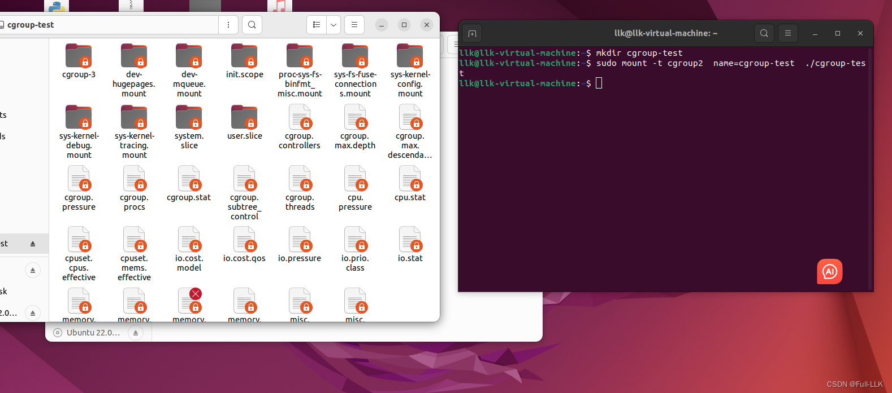
子 group 会继承父 group 的一部分
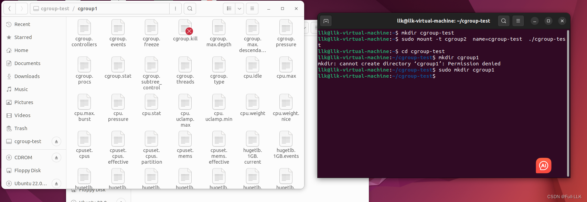
此时当前进程的 cgroup 层级变为 /，表示它位于 cgroup 文件系统的根节点，因为它的进程号被写入了根 cgroup
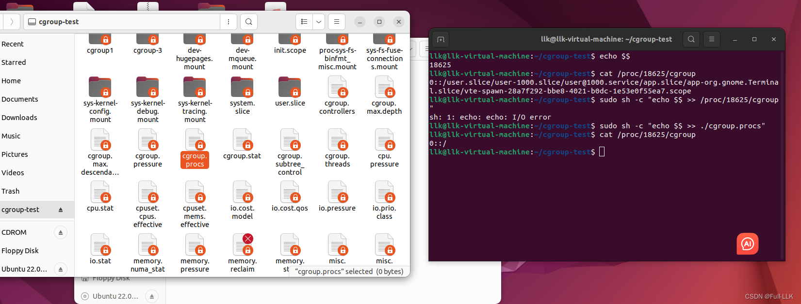
可以看到挂载后，对原文件系统的修改生效了
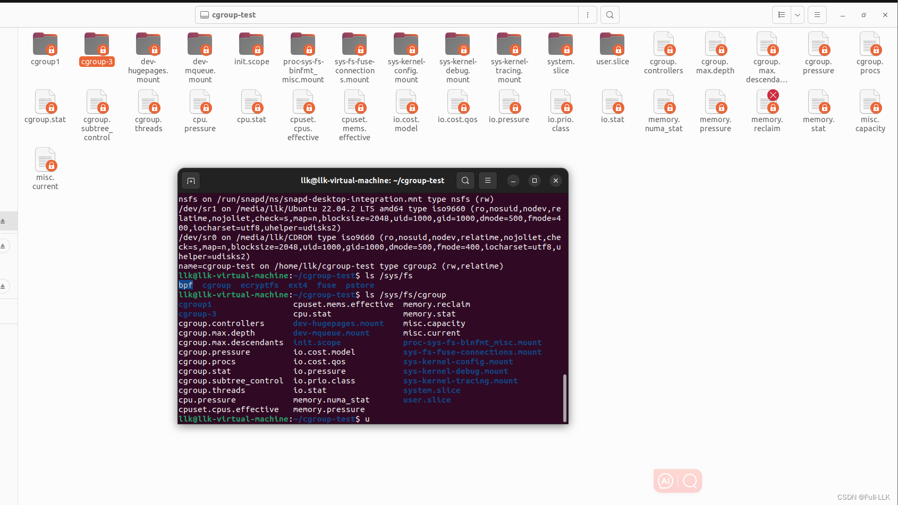

# 使用 Cgroup 的示例

```bash
llk@llk-virtual-machine:~/cgroup-test$ echo $$
18807
```

```c
cat /proc/18807/cgroup # 会显示当前进程的cgroup所在cgroup文件系统中的位置
```

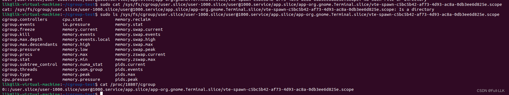
在 ubuntu22.04 中，cgroup 对当前进程设置的内存限制在 memory.max 中，查看显示为 max，表示不限制
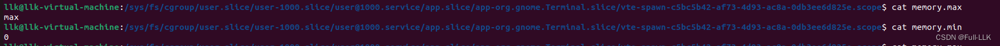
修改 memory.max 后运行 stress 与不修改直接运行 stress 的区别
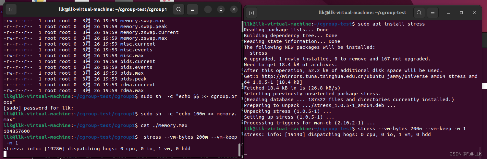


注意内存使用百分比的变化
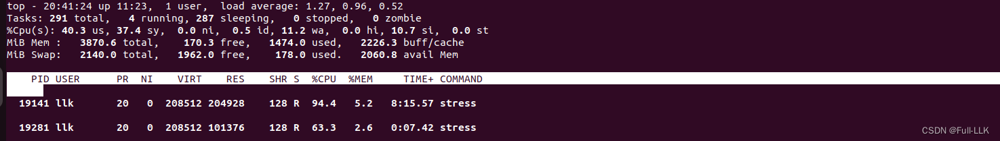
# Docker 使用 cgroups
对镜像执行 docker run 会启动一个容器，并为该容器分配一个 cgroup

> 在 Ubuntu 22.04 中，Docker 容器的 cgroup 位于 /sys/fs/cgroup 目录下的 system.slice 目录中。每个容器都会在 system.slice 目录下创建一个对应的目录，目录名类似 docker-<container_id>.scope

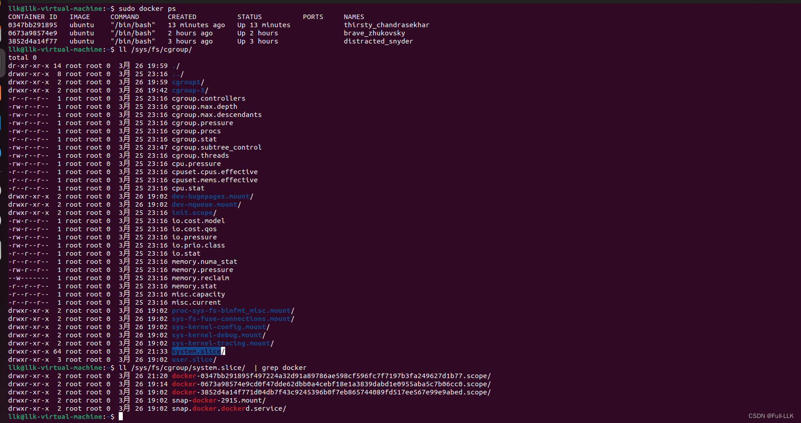
cgroup 相关的配置文件
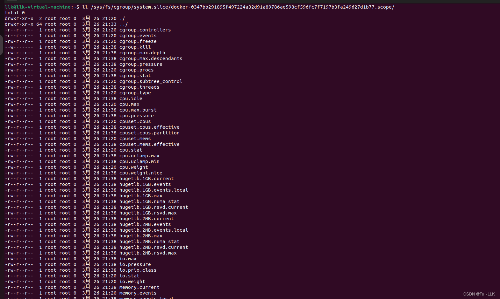
# Go 代码

- /proc/self/exe 是一个特殊路径，指向当前正在运行的可执行文件。而 os.Args[0] 是程序的第一个命令行参数，即程序自身的路径。
- 


```go
package main

import (
	"os/exec"
	"os"
	"syscall"
	"io/ioutil"
	"fmt"
	"strconv"
	"path"
	"bufio"
)

const process_cgroup_root_path="/sys/fs/cgroup/"

func main(){  
	if os.Args[0]=="/proc/self/exe"{  //检查是否是fork出来的新go程序进程
	cmd:=exec.Command("/proc/self/exe")
	fmt.Println("args[0]",os.Args[0])
	fmt.Println("/proc/self/exe",cmd)
	fmt.Println()
	cmd=exec.Command("sh","-c","stress --vm-bytes 200m --vm-keep -m 1")
	cmd.SysProcAttr = &syscall.SysProcAttr{}
	cmd.Stdin = os.Stdin 
	cmd.Stdout = os.Stdout 
	cmd.Stderr = os.Stderr 
	bufio.NewReader(os.Stdin).ReadString('\n') //等待回车再继续往下进行，防止cgroup还没有修改完就开始执行stress了
	if err:=cmd.Run(); err!= nil{ 
	 fmt.Println(err)
	  os.Exit(1)
	}
	fmt.Println("finish")
	}

	cmd:= exec.Command ("/proc/self/exe") 	
	cmd.SysProcAttr = &syscall.SysProcAttr{ 
		Cloneflags: syscall.CLONE_NEWIPC|syscall.CLONE_NEWPID|syscall.CLONE_NEWUTS|syscall.CLONE_NEWNS|syscall.CLONE_NEWUSER|syscall.CLONE_NEWUSER|syscall.CLONE_NEWNET,}
	cmd.Stdin = os.Stdin
	cmd.Stdout = os.Stdout 
	cmd.Stderr = os.Stderr
	if err:= cmd.Start( ); err !=nil { 
		fmt.Println ("error", err) 
		os.Exit(1) 
	} else { 
		
		pid:=cmd.Process.Pid  
		fmt.Println("fork process pid ",pid)
		os.Mkdir(path.Join(process_cgroup_root_path,"cgroup-test"),0755)
		fmt.Println("success mkdir")
		ioutil.WriteFile(path.Join(process_cgroup_root_path, "cgroup-test","cgroup.procs"),[]byte(strconv.Itoa(cmd.Process.Pid)), 0755)
		ioutil.WriteFile(path.Join(process_cgroup_root_path,"cgroup-test","memory.max"),[]byte(strconv.Itoa(100 * 1024 * 1024)), 0755)  //注意往memory.max写只能写数字
		fmt.Println("change finished ")
		cmd.Process.Wait()  //等待start()结束，防止go程序结束
		}
}

```
# 结果
运行到等待回车的地方，此时查看，发现都已修改成功
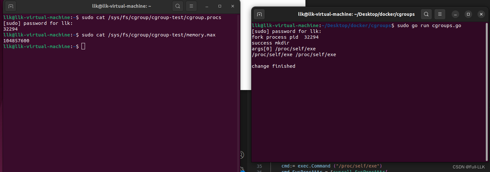
按下回车后，发现 stress 的内存资源已被限制
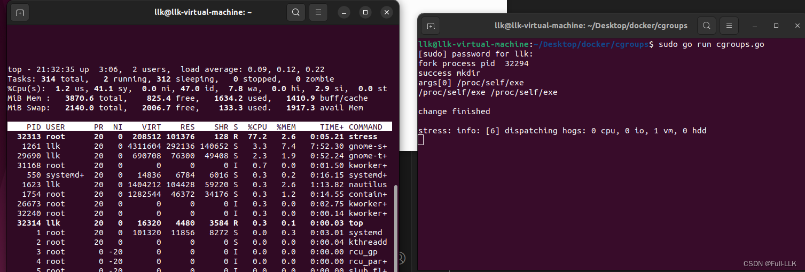

