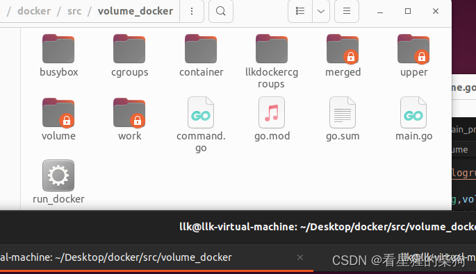
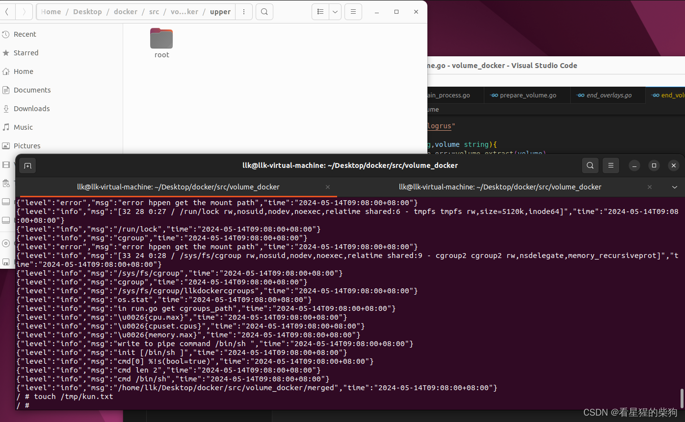
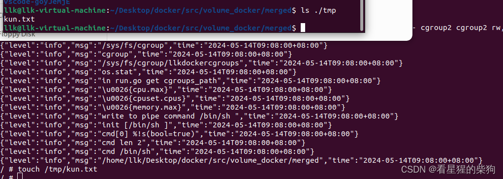
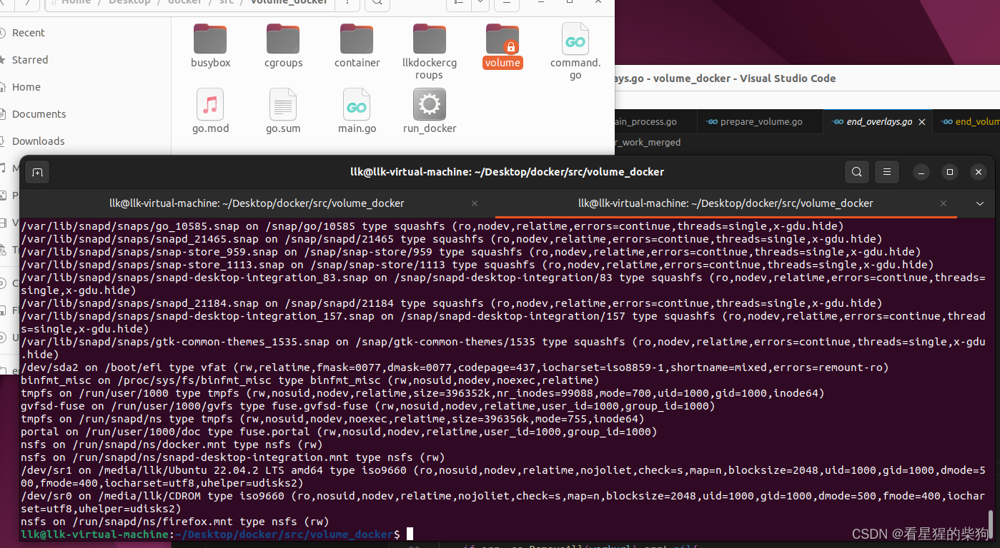
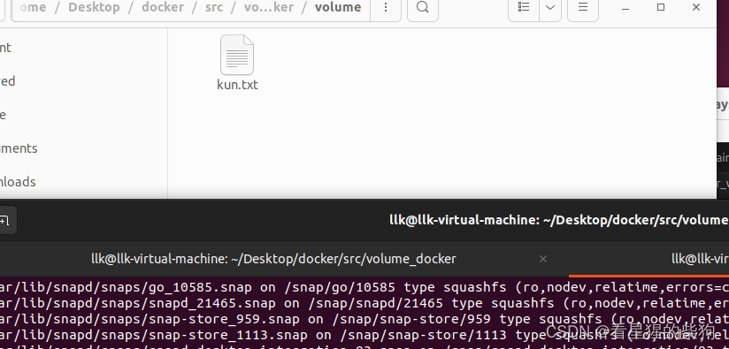
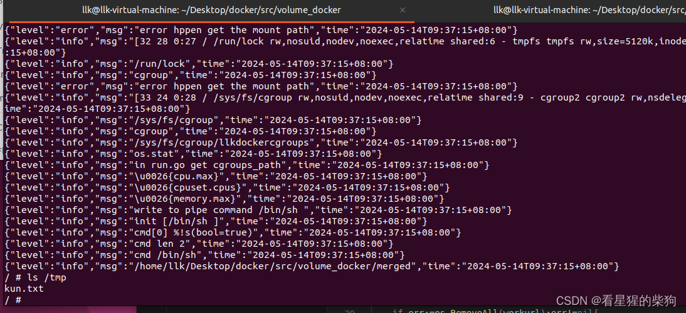


# umount <挂载点>
在 Linux 中，如果你用 `mount -o bind` 命令创建了一个 bind mount，可以用 `umount` 命令卸载（分离）该挂载点。`umount` 命令用于卸载文件系统或挂载点。

下面是卸载 bind mount 的基本语法：

```bash
umount <挂载点>
```

- `umount`：这是命令本身，用于执行卸载操作。注意 `umount` 的拼写中没有字母 `n`，不过在某些系统上 `unmount` 也可以作为别名使用。
- `<挂载点>`：这是要卸载的挂载点路径。对于 bind mount，就是你之前用 `mount -o bind` 命令挂载的目录。

例如，如果你之前创建了一个 bind mount：

```bash
mount -o bind /host/directory/ /container/directory/
```

可以用下面的命令卸载这个挂载点：

```bash
umount /container/directory/
```

执行这条命令后，`/container/directory/` 将不再是挂载点，容器也将无法再访问宿主机上的 `/host/directory/` 目录。

在某些情况下，如果你试图卸载一个正在使用中的挂载点，`umount` 命令可能会返回错误，提示设备忙。要解决这个问题，可以用 `fuser` 命令找到并终止正在使用该挂载点的进程，或者用 `lsof` 命令列出打开的文件和挂载点。

在 Go 中，如果需要卸载挂载点，可以使用 `syscall` 包中的 `Syscall` 函数来调用底层的 `umount` 系统调用，但一般不建议这样做，因为它涉及直接的系统调用，可能会降低代码的可移植性。通常，卸载挂载点是在命令行中手动完成的，或者在容器化环境中通过容器运行时的命令完成。
# `os.Mkdir` 
在 Go 中，`os.Mkdir` 函数用于创建一个新目录。如果你试图用 `os.Mkdir` 创建一个已经存在的目录，该函数会返回一个错误。这个错误通常是 `syscall.EEXIST`，它是 `os` 包中表示文件已存在的常量。

下面是对你的代码片段的详细解释：

```go
if err := os.Mkdir(containervolume_inhost, 0777); err != nil {
    log.Infof("mkdir hostvolume error: %v", err)
}
```

- `os.Mkdir(containervolume_inhost, 0777)`：这一行尝试创建一个名为 `containervolume_inhost` 的新目录，并把它的权限设置为 `0777`，这是一种非常开放的权限设置，允许所有用户读、写和执行。
- `err != nil`：这是一个条件检查，判断 `os.Mkdir` 函数是否返回了非 nil 的错误值。如果返回了错误，`err` 就不会是 `nil`。
- `log.Infof("mkdir hostvolume error: %v", err)`：如果 `os.Mkdir` 返回了错误，这段代码会记录一条包含错误信息的 info 级别日志。`%v` 是一个格式化动词，以默认格式打印错误信息。

如果 `containervolume_inhost` 目录已经存在，`os.Mkdir` 会返回错误，你的代码会捕获并记录这个错误。但是，这段代码并没有提供任何处理目录已存在情况的逻辑，只是记录了错误。

为了更好地处理这种情况，可以添加额外的逻辑来检查目录是否已经存在，而不是仅仅依赖错误处理。例如：

```go
if _, err := os.Stat(containervolume_inhost); os.IsNotExist(err) {
    // 目录不存在，创建目录
    if err := os.Mkdir(containervolume_inhost, 0777); err != nil {
        log.Infof("mkdir hostvolume error: %v", err)
    }
} else {
    // 目录已经存在
    log.Infof("Directory %s already exists", containervolume_inhost)
}
```

在这段修改后的代码中，我们先用 `os.Stat` 函数检查目录是否存在。如果目录不存在，再尝试创建它。如果目录已经存在，就记录一条说明目录已存在的日志，而不是尝试创建它。这样可以避免不必要的错误日志。
# mount -o bind <源目录> <目标目录>
在 Linux 中，`mount` 命令用于挂载文件系统，而 `-o bind` 选项用于创建 bind mount。下面是这条命令语法的解释：

```bash
mount -o bind <源目录> <目标目录>
```

- `mount`：这是命令本身，用于执行挂载操作。
- `-o`：这是 `mount` 命令的一个选项，用于指定挂载选项。`-o` 后面跟着以逗号分隔的挂载选项列表。
- `bind`：这是跟在 `-o` 后面的一个挂载选项，表示要创建 bind mount。bind mount 允许你把一个目录的内容挂载到另一个位置，而不改变原目录的内容。
- `<源目录>`：这是要挂载的源目录路径。在 bind mount 中，该目录的内容会被镜像到目标目录。
- `<目标目录>`：这是挂载点的路径，即源目录的内容将被挂载到的位置。

例如，命令 `mount -o bind /host/directory/ /container/directory/` 解释如下：

- `/host/directory/`：这是宿主机上的源目录路径，包含你想在容器内访问的文件和目录。
- `/container/directory/`：这是容器内的目标目录路径，宿主机的源目录将挂载到这里。

执行这条命令后，容器内的 `/container/directory/` 目录将直接映射到宿主机的 `/host/directory/` 目录。这意味着在容器内对 `/container/directory/` 目录所做的任何更改都会反映到宿主机的 `/host/directory/` 目录中，反之亦然。

bind mount 在容器化环境中非常有用，因为它允许容器访问宿主机的文件系统，这有助于共享配置文件、日志文件或数据文件。但要注意，bind mount 可能带来安全风险，因为容器能够访问宿主机的文件系统，所以应谨慎使用，确保只有经过授权的容器才能访问敏感的宿主机目录。

在 Docker 中，可以通过 `-v` 或 `--volume` 选项实现 bind mount，例如：

```bash
docker run -v /host/directory/:/container/directory/ ...
```

这条命令的效果与 `mount -o bind` 命令类似，只不过它是在 Docker 容器启动时自动执行的。

# 当 `overlayfs` 中包含 bind mount 挂载点时的卸载
当你试图卸载一个包含用 mount --bind 创建的 bind mount 挂载点的 OverlayFS 文件系统时，可能会遇到卸载失败的问题。这主要是因为 Linux 内核为了防止数据损坏或一致性问题，不允许直接卸载包含活动挂载点的文件系统。

# 在 merged 层修改 bind mount 挂载点对 upper 层的影响
对 /merged/tmp 的修改（实际访问的是 /volume 的内容，因为它被 bind mount 到那里）理论上不会直接影响 OverlayFS 定义的 upper 层。这是因为 bind mount 为原始的 /volume 目录创建了一个新的、独立的访问点，在文件系统层次上“遮住”了 OverlayFS 原有的 lower 和 upper 结构。
#  `fmt.Errorf` 
`fmt.Errorf` 函数返回一个 `error` 类型的值。在 Go 中，`error` 是一个内置的接口类型，定义如下：

```go
type error interface {
    Error() string
}
```

这个接口只有一个方法 `Error()`，它返回一个字符串，通常是描述错误的文本。`fmt.Errorf` 函数使用类似 `fmt.Printf` 的格式化字符串创建一个新的错误值并返回。

在你的例子中：

```go
err := fmt.Errorf("invalid volume [%s], must split by `:`", volume)
```

这里创建了一个新的错误值并赋给变量 `err`。这个错误值描述了一个无效的 volume，指出 volume 应该用冒号 `:` 分隔。如果把这个错误值传给一个期望 `error` 类型参数的函数或方法，就可以把它传进去。

例如，可以在函数中返回这个错误值：

```go
func validateVolume(volume string) error {
    parts := strings.Split(volume, ":")
    if len(parts) != 2 {
        return fmt.Errorf("invalid volume [%s], must split by `:`", volume)
    }
    // 继续处理...
    return nil
}
```

在这个例子中，`validateVolume` 函数检查传入的 volume 是否被冒号正确地分成两部分。如果得到的切片长度不是 2，函数就返回一个错误值。如果一切正常，函数返回 `nil` 表示没有错误。
# 实现目标
- 启动容器时，用 -v 参数指定一个 volume，使指定位置的文件数据的修改在容器退出后仍保留在宿主机上
- 对需要保留修改的文件使用 bind mount，使宿主机上和容器内的文件保持同步

# 流程
1. 实现 -v 命令
- 这里的“volume”指的是容器化技术（如 Docker）中使用的卷的概念。
2. -v 命令执行 bind mount 操作来同步文件
 - 在 Docker 中，-v 或 --volume 选项用于把宿主机目录挂载到容器中，或者创建一个命名卷。
4. 退出时，先卸载同步文件的挂载点，再卸载 overlayfs，最后删除；删除的仍然是 overlayfs，因为 overlayfs 包含了这些挂载点


# 代码
[https://github.com/FULLK/llkdocker/tree/main/volume_docker](https://github.com/FULLK/llkdocker/tree/main/volume_docker)
- 挂载操作在子进程（容器）开始运行之前实现
- 先挂载 overlayfs，再 bind mount 数据卷，使宿主机上的 volume 同步到 merged 中容器数据卷的位置

- 此时如果在容器内、在与宿主机绑定的容器数据卷中创建一个文件
- 注意，因为是先挂载 overlayfs、之后才做 bind mount，此时 bind mount 挂载点已经不属于 overlayfs 了，所以在 bind mount 内部做的修改不会经过 overlayfs 机制（如果 bind mount 挂载点在 lower 层，由于它是 bind mount，实际上相当于没有挂载进 overlayfs，所以 overlayfs 机制对该挂载点不生效；就好像 lower 层的 bind mount 挂载点变了而 upper 层没变，merged 的 bind mount 挂载点也变了）




- 卸载操作在子进程结束之后实现
- 此时要先卸载 bind mount 挂载点，因为 bind mount 挂载点在 overlayfs 内部；如果先卸载 overlayfs，会发现里面还有挂载点，卸载就会失败
- 退出后查看宿主机上的挂载点，发现已成功卸载

- bind mount 的内容也保留在了宿主机上

- 重新启动容器，此时得益于 bind mount，容器内数据卷的内容被保留下来并生效


