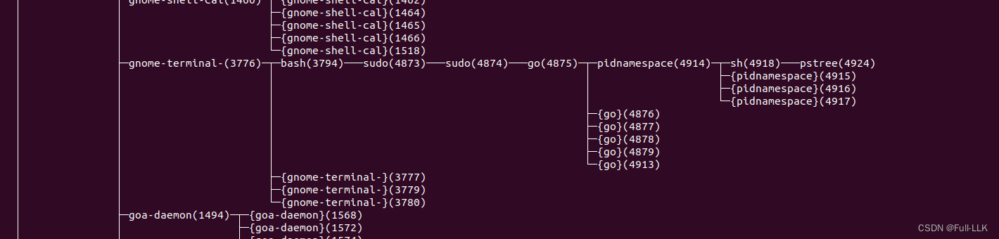
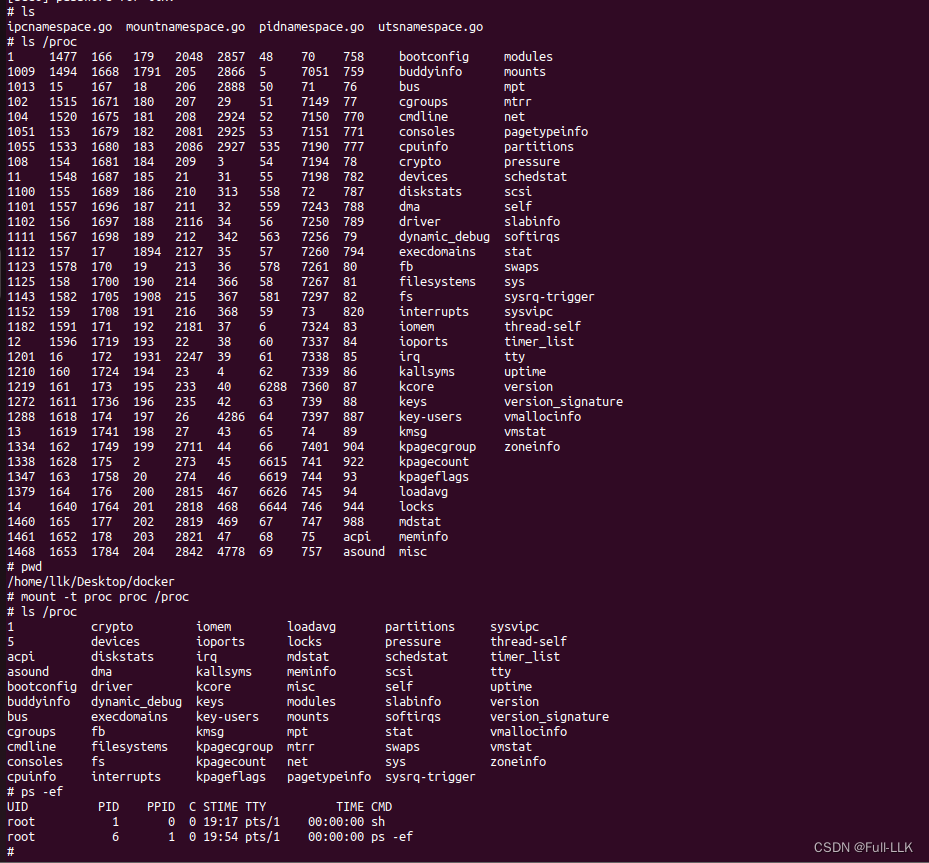


# PID namespace
每个 namespace 都有自己独立的 PID 空间；也就是说，每个 namespace 中的进程 ID 都从 1 开始分配。



新创建进程的内部进程 ID 为 1
# 代码

```python
package main
import (
	"log"
	"os/exec"
	"os"
	"syscall"
)
func main(){
	cmd:=exec.Command("sh")
	cmd.SysProcAttr=&syscall.SysProcAttr{
		Cloneflags: syscall.CLONE_NEWUTS|syscall.CLONE_NEWIPC|syscall.CLONE_NEWPID,}
	cmd.Stdin=os.Stdin
	cmd.Stdout=os.Stdout
	cmd.Stderr=os.Stderr
	if err:=cmd.Run();err!=nil{
		log.Fatal(err)
	}
}
```
# mountnamespace
NEWNS（New Namespace 的缩写）
mount namespace 是 Linux 系统中的一个概念，是 Linux namespace 的一种。namespace 是 Linux 内核的一项特性，可以隔离系统的某些部分（如进程、网络、用户 ID、文件系统等），使 namespace 内的进程看起来就像处在一个独立的系统中。

mount namespace 用于隔离文件系统挂载点。每个 mount namespace 都有自己的一组挂载点，这些挂载点对其他 mount namespace 不可见。这意味着在一个 mount namespace 中挂载或卸载文件系统，不会影响其他 mount namespace。

举个例子，想象你在一栋大楼里（大楼就像一个 Linux 系统），每个人都有自己的房间（每个房间就像一个 mount namespace）。在你的房间里，你可以挂上自己喜欢的画（就像在你的 mount namespace 中挂载文件系统），也可以随时更换或取下这些画（就像在你的 mount namespace 中卸载文件系统）。但是，你在自己房间里挂的画，其他人在他们的房间里是看不到的（这就是 mount namespace 的隔离特性）。同样，你也看不到别人在他们房间里挂的画。

这个特性在很多场景下都非常有用，比如创建容器（如 Docker）时。每个容器都有自己的 mount namespace，因此可以拥有自己的文件系统，而不会影响宿主机或其他容器。

proc 是 Linux 中一种特殊的文件系统，也称为 procfs 或 proc 文件系统。它不像传统文件系统那样存储在硬盘上，而是存在于内存中。proc 文件系统是 Linux 内核的一部分，它为用户空间程序提供了访问内核空间数据的接口。

proc 文件系统通常挂载在 /proc 目录下。在这个目录下可以看到许多文件和目录，它们都是由内核实时生成的，反映了系统的当前状态。例如：

/proc/[pid]：每个正在运行的进程都有一个对应的目录，其中 pid 是进程 ID。在这个目录中可以找到关于该进程的很多信息，如内存使用情况、打开的文件、运行状态等。
/proc/meminfo：这个文件包含系统内存使用情况的信息。
/proc/cpuinfo：这个文件包含 CPU 的信息。

```bash
mount -t proc proc /proc
```

这条命令用于在 Linux 系统中挂载 proc 文件系统。我们来一步步拆解这条命令：

- mount：这是用于挂载文件系统的命令。
- -t proc：指定要挂载的文件系统类型，这里是 proc。
- proc：这是要挂载的文件系统的设备或文件；对于 proc 文件系统，这个参数通常也是 proc。
- /proc：这是挂载点，即挂载后访问该文件系统的路径。
- proc 文件系统是一个伪文件系统，是内核向用户空间程序提供系统信息的一种方式。它包含大量信息，比如进程信息（每个进程在 /proc 下都有一个以其 PID 命名的目录）、内存信息、硬件配置等。

执行 mount -t proc proc /proc 命令后，就可以通过访问 /proc 目录获取这些信息。例如，可以读取 /proc/cpuinfo 文件获取 CPU 信息，或者读取 /proc/meminfo 文件获取内存信息。

# 通俗理解
首先，可以把 mount 命令看作一种“连接”或“插入”操作。就像你有一台电视和一台游戏机，想玩游戏时，需要把游戏机插到电视上，这样才能在电视上玩游戏。在这个例子中，mount 命令就像把游戏机插到电视上的操作。

然后，-t proc 告诉 mount 命令我们插入的是哪种类型的“游戏机”；在这个例子中，是 proc 类型的文件系统。

接着，proc 就是我们要插入的“游戏机”；在这个例子中，就是 proc 文件系统。

最后，/proc 是我们插入“游戏机”的电视接口，也就是挂载点。

所以命令 mount -t proc proc /proc 的意思就是把 proc 文件系统（游戏机）插到 /proc 目录（电视接口）上。

那么 proc 文件系统是什么呢？它其实是一种特殊的文件系统，不像硬盘或光盘那样存储真正的文件，而是提供了一种访问系统信息的方式。你可以把它想象成一台“神奇的游戏机”：一旦插到电视上，你就能在电视上看到各种系统信息，比如 CPU 状态、内存使用情况等。

例如，你可以读取 /proc/cpuinfo（在电视上选择“CPU 信息”菜单）来查看 CPU 信息，或者读取 /proc/meminfo（在电视上选择“内存信息”菜单）来查看内存信息。


>在命令 mount -t proc proc /proc 中，-t proc 指定了我们要挂载的文件系统类型，这里是 proc。可以把 -t proc 理解为我们在告诉 mount 命令：“我们要挂载的文件系统是 proc 类型的。”
后面的 proc 是一个特殊的设备名，代表 proc 文件系统本身。因为 proc 文件系统是一个虚拟文件系统，它没有像硬盘或光盘那样的物理设备，所以这里的设备名也是 proc。
所以命令 mount -t proc proc /proc 的意思是：“挂载一个类型为 proc、设备名为 proc 的文件系统，并把它挂载到 /proc 目录上。”


> proc 是一种特殊的文件系统，它是 Linux 内核的一部分，存在于内存中，不像 ext4 或 xfs 这样的传统文件系统那样存储在硬盘上。它没有具体的物理位置。
proc 文件系统提供了一个接口，让用户空间程序可以访问内核空间的数据。当你查看 /proc 目录时，看到的所有文件和信息都是由内核实时生成的。例如，/proc/[pid] 目录包含 pid 对应进程的信息，/proc/meminfo 文件包含内存使用情况的信息，等等。
因此，当我们说“把 proc 文件系统挂载到 /proc 目录”时，实际上是在创建一个接口，让我们可以通过访问 /proc 目录来获取内核信息。


# 代码

```go
package main

import (
	"os/exec"
	"os"
	"syscall"
	"log"
)

func main(){
	cmd:=exec.Command("sh")
	cmd.SysProcAttr=&syscall.SysProcAttr{
		Cloneflags: syscall.CLONE_NEWIPC|syscall.CLONE_NEWPID|syscall.CLONE_NEWUTS|syscall.CLONE_NEWNS,}
	cmd.Stdin=os.Stdin
	cmd.Stdout=os.Stdout
	cmd.Stderr=os.Stderr

	if err:=cmd.Run();err!=nil{
		log.Fatal(err)
	}
}
```

