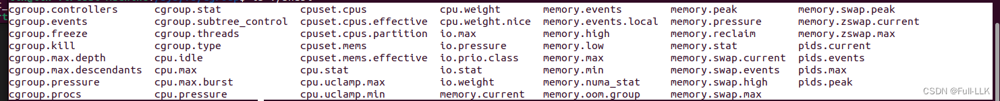
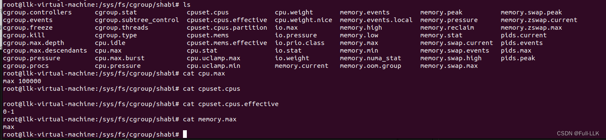
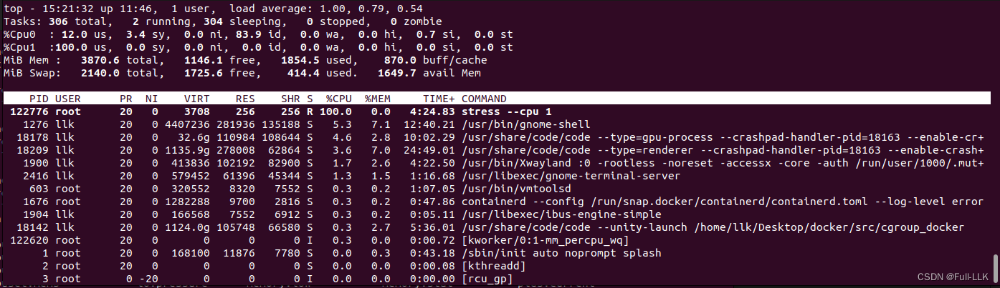
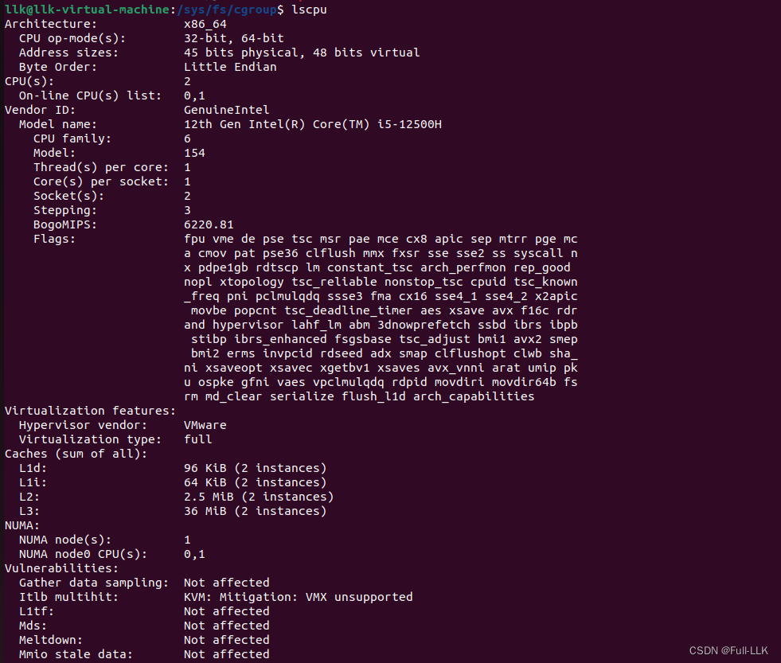
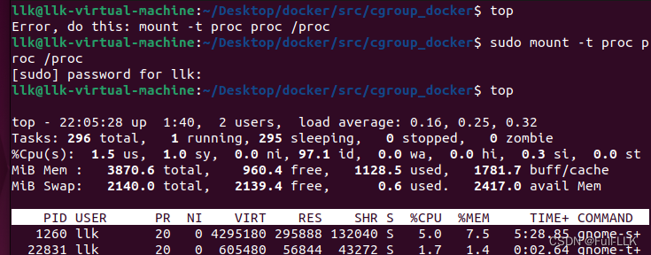
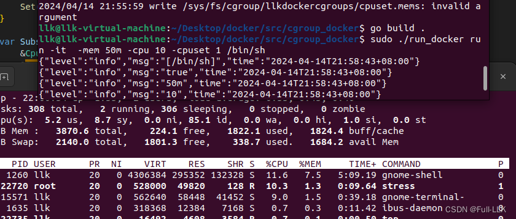
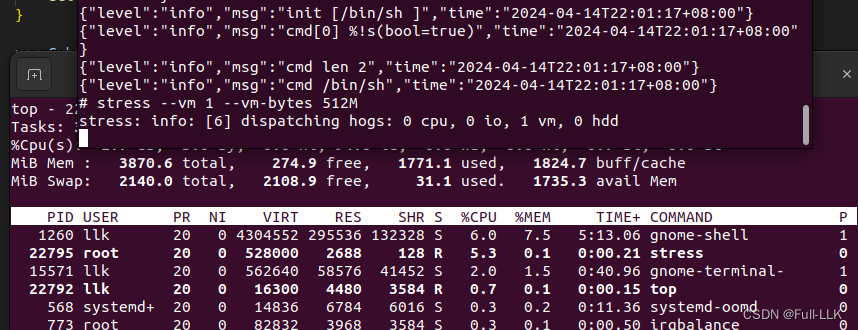



#  目的
启动容器时，通过 `-mem`、`-cpu` 等命令行 flag 参数实现对容器 CPU 和内存资源的限制。

#   导入包的导出规则
在 Go 中，导入包的结构体和接口内部的字段与方法同样遵循导出规则：

1. 结构体：
   - 结构体中公开（导出）的字段必须以大写字母开头。公开字段可以在包外被访问和修改。
   - 结构体的方法（无论接收者是什么）要公开，也必须以大写字母开头，这样才能在包外被调用。

```go
// 在 mypackage 包中
package mypackage

type ExportedStruct struct {
    PublicField string // 可以在其他包中访问
    privateField string // 不能在其他包中访问
}

func (s ExportedStruct) PublicMethod() {} // 可以在其他包中调用
func (s ExportedStruct) privateMethod() {} // 不能在其他包中调用
```

2. 接口：
   - 接口内的所有方法都是公开的，因为接口本身就是定义一组方法签名的契约。接口本身及其方法都必须以大写字母开头，才能在包外可见和使用。

```go
// 在 mypackage 包中
package mypackage

type ExportedInterface interface {
    PublicMethod() // 可以在其他包中实现和调用
}
```

总结：无论是结构体还是接口，其公开的字段和方法都必须以大写字母开头，才能在其他包中正常使用。对于接口，由于接口本身就是方法的集合，接口内的所有方法都自动被视为公开的。

# 当前进程的挂载信息

`/proc/self/mountinfo` 是 Linux 中的一个虚拟文件，位于 `/proc` 文件系统中。这个文件提供了系统当前挂载点的详细信息，尤其是当前进程（`self`）可见的挂载点信息。

每一行都是对一个挂载点的详细描述，包括：

1. 挂载 ID（在系统内所有挂载中唯一标识该挂载点的 ID）。
2. 父挂载 ID（父挂载的 ID（对于 rootfs 则是自身的 ID））。
3. 主设备号和次设备号（被挂载设备的主次设备号）。
4. 挂载点路径（挂载点的路径名）。
5. 根目录设备 ID（根目录 ID）。
6. 挂载选项（挂载文件系统时使用的选项）。
7. 文件系统类型（文件系统类型）。
8. 挂载源（文件系统从哪里挂载而来，例如设备路径或 NFS 服务器/共享）。
9. 特殊挂载标志（该挂载特有的附加标志）。

通过读取 `/proc/self/mountinfo` 文件，可以详细了解当前进程可见的文件系统挂载情况，这对系统管理和故障排查非常有用。例如，如果想查看某个挂载目录的文件系统类型、挂载源、挂载选项等，就可以查阅这个文件的内容。
 
#  defer
在 Go 中，`defer f.Close()` 是一条用于保证文件或资源在函数执行完毕前一定会被关闭的语句。这里的 `f` 是一个实现了 `io.Closer` 接口的对象，通常是文件句柄或其他需要关闭的资源对象。`Close` 方法用于关闭资源并释放系统资源。

Go 中的 `defer` 关键字用于延迟函数的执行，也就是说，该函数会在外层函数执行完毕之前被调用（无论是正常返回还是通过 `panic` 异常退出）。`defer` 语句的执行顺序是 LIFO（后进先出），即最后 defer 的函数会先于其他 defer 的函数执行。

例如：

```go
func processFile(filename string) error {
    file, err := os.Open(filename)
    if err != nil {
        return err
    }
    defer file.Close() // 当函数返回时，file.Close()会被调用，确保文件最终会被关闭

    // 对文件进行读写操作...

    return nil // 或者返回其他错误
}
```

在上面的代码中，无论 `processFile` 函数是否执行成功，也无论函数以何种方式结束（正常返回或返回错误），`file.Close()` 都会在函数返回前被调用，确保文件资源被正确释放。

# `for scanner.Scan()`
在 Go 中，`bufio.NewScanner(f)` 会创建一个新的扫描器（Scanner），可以从给定的输入流（这里是 `f`）中逐行读取数据。`f` 应该是一个实现了 `io.Reader` 接口的对象，例如文件、网络连接或类似的数据流。

接下来的 `for scanner.Scan()` 是一个循环，会一直执行，直到扫描器没有更多的行可读：

- `scanner.Scan()` 是一个方法调用，尝试从输入流中读取下一行数据。如果成功读取一行，它返回 `true`，并把读到的数据存放在 `scanner.Text()` 或 `scanner.Bytes()` 等方法可以访问的地方。
- 如果 `scanner.Scan()` 到达流的末尾，或者在读取过程中遇到错误，它返回 `false`，错误可以通过 `scanner.Err()` 检查。

循环体是处理每一行数据的地方，例如：

```go
f, err := os.Open("example.txt")
if err != nil {
    // 处理错误
}
defer f.Close()

scanner := bufio.NewScanner(f)
for scanner.Scan() {
    line := scanner.Text() // 获取当前行的内容
    // 对line进行处理，如打印、解析或存入数据库等操作
    fmt.Println(line)
}

if err := scanner.Err(); err != nil {
    // 在循环结束后检查是否有读取错误
    fmt.Fprintln(os.Stderr, "Reading standard input:", err)
}
```

这样，`for scanner.Scan()` 循环就完成了从输入流中逐行读取数据并进行处理的过程。


#  判断字符串包含
在 Go 中，要判断一个字符串（子串）是否存在于另一个字符串中，可以使用 `strings.Contains` 函数。下面是一个示例：

```go
package main

import (
	"fmt"
	"strings"
)

func main() {
	// 主字符串
	mainStr := "Hello, world! This is a test string."

	// 要查找的子字符串
	subStr := "test"

	// 判断子字符串是否存在于主字符串中
	isFound := strings.Contains(mainStr, subStr)

	if isFound {
		fmt.Printf("Substring '%s' found in the main string.\n", subStr)
	} else {
		fmt.Printf("Substring '%s' not found in the main string.\n", subStr)
	}
}
```

在上面的代码中，`strings.Contains(mainStr, subStr)` 返回一个布尔值：如果 `subStr` 存在于 `mainStr` 中，返回 `true`，否则返回 `false`。

# 新建 cgroup 的默认文件



- cgroup.controllers：显示当前 cgroup 使用的控制器。
- cgroup.events：显示与 cgroup 相关的事件。
- cgroup.freeze：用于冻结或解冻 cgroup。
- cgroup.kill：用于杀死 cgroup 中的所有进程。
- cgroup.max.depth：显示 cgroup 的最大深度。
- cgroup.max.descendants：显示 cgroup 的最大后代数量。
- cgroup.pressure：显示 cgroup 的压力状态。
- cgroup.procs：显示属于该 cgroup 的进程列表。
- cgroup.stat：显示 cgroup 的统计信息。
- cgroup.subtree_control：用于控制 cgroup 的子树。
- cgroup.threads：显示属于该 cgroup 的线程数。
- cgroup.type：显示 cgroup 的类型。

接下来是与 CPU 和内存资源控制相关的文件：

- cpuset.cpus：显示 cpuset 分配的 CPU 列表。
- cpuset.cpus.effective：显示 cpuset 分配的、实际生效的 CPU 列表。
- cpuset.cpus.partition：显示 cpuset 的 CPU 分区。
- cpuset.mems：显示 cpuset 分配的内存节点列表。
- cpuset.mems.effective：显示 cpuset 分配的、实际生效的内存节点列表。
- cpu.idle：显示 CPU 处于空闲状态的时间。
- cpu.max：显示可用的最大 CPU 带宽。
- cpu.stat：显示 CPU 统计信息。
- cpu.pressure：显示 CPU 压力状态。
- cpu.max.burst：显示 CPU 最大突发限制。
- cpu.uclamp.max：显示 CPU 利用率钳位的最大值。
- cpu.uclamp.min：显示 CPU 利用率钳位的最小值。
- cpu.weight：显示 CPU 权重。
- cpu.weight.nice：显示 CPU 权重的“nice”值。
- io.max：显示 I/O 最大限制。
- io.pressure：显示 I/O 压力状态。
- io.prio.class：显示 I/O 优先级类别。
- io.stat：显示 I/O 统计信息。

接下来是与内存资源控制相关的文件：

- memory.events：显示内存事件的统计信息。
- memory.peak：显示内存使用峰值。
- memory.swap.peak：显示交换空间使用峰值。
- memory.events.local：显示本地内存事件的统计信息。
- memory.pressure：显示内存压力状态。
- memory.reclaim：显示内存回收行为。
- memory.zswap.current：显示 zswap 的当前状态。
- memory.high：显示内存高水位阈值。
- memory.low：显示内存低水位阈值。
- memory.max：显示最大内存限制。
- memory.min：显示最小内存限制。
- memory.numa_stat：显示 NUMA 节点的内存统计信息。
- memory.oom.group：显示内存的 OOM 组信息。
- memory.swap.current：显示交换空间的当前状态。
- memory.swap.events：显示交换空间事件的统计信息。
- memory.swap.high：显示交换空间高水位阈值。
- memory.swap.max：显示最大交换空间限制。
- memory.swap.events：显示交换空间事件的统计信息。

最后是与进程控制相关的文件：

- pids.current：显示当前进程数。
- pids.events：显示与进程相关的事件。
- pids.max：显示最大进程数限制。
- pids.peak：显示进程数峰值。
# CPU 相关配置
下面用一些例子来说明 cpu.cfs_period_us、cpu.cfs_quota_us 和 cpu.shares 之间的关系，以及它们如何协同控制 CPU 资源分配：

假设我们有一个系统，CPU 时间可以分配给不同的控制组（cgroup）：

1. **cpu.shares 示例**：
   - 假设我们有两个 cgroup“A”和“B”，希望“A”获得的 CPU 时间是“B”的两倍。
   - 我们把“A”的 cpu.shares 设为 1024，“B”的 cpu.shares 设为 512。
   - 这种情况下，cgroup“A”获得的 CPU 时间将是 cgroup“B”的两倍。如果“A”和“B”都在积极使用 CPU，“A”将获得 2/3 的 CPU 时间，“B”获得 1/3。

2. **cpu.cfs_period_us 和 cpu.cfs_quota_us 示例**：
   - 现在，我们用 cpu.cfs_period_us 和 cpu.cfs_quota_us 进行更细粒度的控制。
   - 假设我们有一个 cgroup“C”，希望限制它在 1 秒内只能使用 500 毫秒的 CPU 时间。
   - 我们把“C”的 cpu.cfs_period_us 设为 1,000,000（代表 1 秒），cpu.cfs_quota_us 设为 500,000（代表 500 毫秒）。
   - 这种情况下，“C”中的进程在 1 秒的周期内只能获得 500 毫秒的 CPU 时间。一旦达到配额，它们在该周期的剩余时间内将被限流。

3. **组合使用 cpu.shares、cpu.cfs_period_us 和 cpu.cfs_quota_us**：
   - 现在把这三个设置组合起来。
   - 假设我们有两个 cgroup“D”和“E”，希望“D”获得的 CPU 时间是“E”的三倍，但同时又希望限制“D”在 2 秒内只能使用 1 秒的 CPU 时间。
   - 我们把“D”的 cpu.shares 设为 1536，“E”的 cpu.shares 设为 512。
   - 对于“D”，把 cpu.cfs_period_us 设为 2,000,000（2 秒），cpu.cfs_quota_us 设为 1,000,000（1 秒）。
   - 对于“E”，把 cpu.cfs_period_us 设为 2,000,000（2 秒），cpu.cfs_quota_us 设为 2,000,000（2 秒）。

   - 这种情况下，“D”获得的 CPU 时间是“E”的三倍，但受到 1 秒 CPU 时间配额的限制。一旦“D”达到 1 秒的配额，它在当前周期的剩余时间内将被限流。


# Ubuntu 22.04 上的 CPU 相关配置



1. `cpuset.cpus`：
这个文件显示当前 cgroup 可以使用的 CPU 列表。如果该文件为空，表示当前 cgroup 可以使用所有 CPU 资源。

2. `cpuset.cpus.effective`：
这个文件显示当前 cgroup 实际可以使用的 CPU 列表。这个列表可能比 `cpuset.cpus` 更精确，因为它考虑了父 cgroup 的 CPU 分配。

> 在 cgroup 体系中，每个 cgroup 都可以设置自己的 CPU 分配策略。创建子 cgroup 时，它会继承父 cgroup 的 CPU 分配策略。
cpuset.cpus 文件表示当前 cgroup 可以使用的 CPU 列表。但这个列表可能并不完全准确，因为它没有考虑父 cgroup 的 CPU 分配。
而 cpuset.cpus.effective 文件考虑了父 cgroup 的 CPU 分配，所以它显示的 CPU 列表更精确。它实际上是根据当前 cgroup 及其父 cgroup 的 CPU 分配策略计算出来的。
例如，如果父 cgroup 只允许使用 CPU 0 和 CPU 1，那么即使子 cgroup 可以使用所有 CPU，cpuset.cpus.effective 也只会显示 CPU 0 和 CPU 1。

- `cpuset.cpus` 为空，表示当前 cgroup 可以使用所有 CPU 资源。
- `cpuset.cpus.effective` 显示 `0-1`，表示当前 cgroup 实际可以使用 CPU 0 和 CPU 1。

这意味着即使当前 cgroup 可以使用所有 CPU 资源，由于父 cgroup 的限制，它实际上也只能使用 CPU 0 和 CPU 1。

通过查看这两个文件，可以了解当前 cgroup 的 CPU 使用情况，并根据需要进行调整。如果需要更改 CPU 分配，可以修改这些文件的内容。

3. cpu.max
CPU 使用率由前一个值与后一个值的比值决定；max 表示最大，即百分之百。
4. memory.max
	max 表示最大。

# top
可以使用 `top` 命令查看进程的 CPU 使用情况。具体步骤如下：

1. 运行 `top` 命令：

```
top
```

2. 按 `1` 键切换到 CPU 信息视图。这时可以看到每个 CPU 核心的使用情况。

3. 要查看进程使用的 CPU 信息，按 `c` 键切换到命令行显示模式。这样就能看到每个进程使用的 CPU 核心。


# 注意
如果父 cgroup 的 `cpuset.cpus.effective` 设置小于子 cgroup 的 `cpuset.cpus.effective` 设置，那么子 cgroup 中的进程实际上只能使用父 cgroup 允许的 CPU 范围。

具体来说：

1. 当父 cgroup 的 `cpuset.cpus.effective` 设置为某个范围（例如 `0-1`）时，所有子 cgroup 都会继承这个 CPU 范围。

2. 即使子 cgroup 把 `cpuset.cpus` 设置为更大的范围（例如 `0-3`），实际可用的 CPU 范围仍然受限于父 cgroup 的 `cpuset.cpus.effective`（即 `0-1`）。

3. 子 cgroup 的进程只能使用父 cgroup 允许的 CPU 范围，即使子 cgroup 自身的设置允许使用更多的 CPU。

4. 如果父 cgroup 的 `cpuset.cpus.effective` 被修改，子 cgroup 的可用 CPU 范围也会相应更新。


另外，最初 `/sys/fs/cgroup` 下没有 `cpuset.cpus`，只有 `cpuset.cpus.effective`，但当前所有可用的 CPU 都包含在 `cpuset.cpus.effective` 中。之后新建的 cgroup 同时拥有 `cpuset.cpus` 和 `cpuset.cpus.effective`，并且在父 cgroup 的 `cpuset.cpus.effective` 允许范围与 `cpuset.cpu` 的双重约束下，`cpuset.cpus.effective` 会自动变化（当 `cpuset.cpus` 改变时）。


# 查看可以使用的 CPU
要查看当前可用的 CPU 编号，可以使用以下方法：


1. 使用 `lscpu` 命令：

```
lscpu
```

该命令会显示系统中 CPU 的详细信息，包括 CPU 数量和 CPU 编号。

2. 使用 `cat /proc/cpuinfo` 命令：

```
cat /proc/cpuinfo
```

该命令会输出系统中所有 CPU 的详细信息，包括 CPU 编号。


# 注意
我发现运行一次之后，第二次运行会失败。原因是挂载的文件系统 /proc 没有卸载；把它卸载掉，或者重新挂载到当前的 /proc 即可。
# 踩坑
context.Args()：所有 flag 识别完之后，剩下的都属于 Args()
context.Bool()：只要有 -it 就生效，不会占用后面的参数
context.String()：会占用后面的参数，把它当作该 flag 对应的字符串

#  启动后查看 top
由于启动后 /proc 文件系统被挂载到了运行的位置，在本地使用 top 就不行了；这时把它挂载回来即可。

# 显示进程使用的 CPU 编号
要查看当前进程正在使用哪个 CPU，可以使用 `top` 命令中的一些额外选项。

步骤如下：

1. 首先确保 `/proc` 文件系统已正确挂载；如果没有挂载，可以用以下命令挂载：

   ```
   sudo mount -t proc proc /proc
   ```

2. 运行 `top` 命令，按 `1` 键查看每个 CPU 的使用情况。

3. 要查看进程使用的具体 CPU 核心，按 `f` 键进入配置模式，然后选中 `%CPU` 和 `P` 两个字段。

   - `%CPU` 显示进程使用的 CPU 百分比
   - `P` 显示进程使用的 CPU 编号

4. 按 `d` 键设置刷新频率，然后按 `Enter` 确认。

5. 现在 `top` 界面就会显示每个进程使用的具体 CPU 编号。


# 代码

[https://github.com/FULLK/llkdocker/tree/main/cgroup_docker](https://github.com/FULLK/llkdocker/tree/main/cgroup_docker)

# 结果



