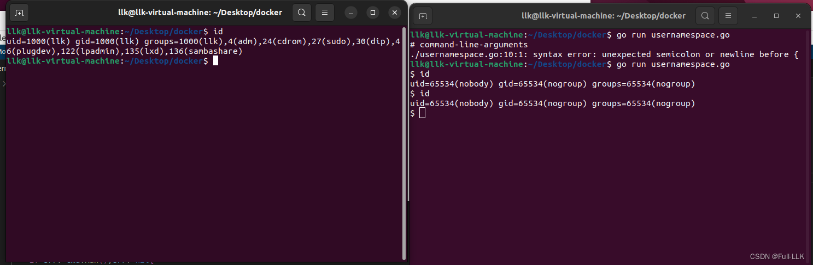
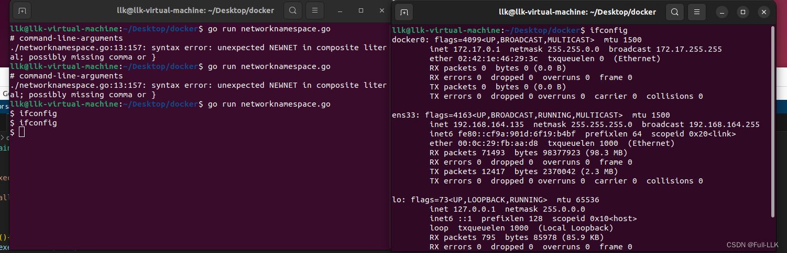


# USER Namespace
即进程运行在新的 namespace 中，该 namespace 中的 User ID 和 Group ID 在 namespace 内外可以不同，因此用户可以在 namespace 中是 root，而在宿主机上不是 root

只需在 Cloneflags 中加上 syscall.CLONE_NEWUSER 即可

# 代码

```go
package main

import (
	"os/exec"
	"os"
	"syscall"
	"log"
)

func main(){
	cmd:=exec.Command("sh")
	cmd.SysProcAttr=&syscall.SysProcAttr{
		Cloneflags: syscall.CLONE_NEWIPC|syscall.CLONE_NEWPID|syscall.CLONE_NEWUTS|syscall.CLONE_NEWNS|syscall.CLONE_NEWUSER,}
	cmd.Stdin=os.Stdin
	cmd.Stdout=os.Stdout
	cmd.Stderr=os.Stderr

	if err:=cmd.Run();err!=nil{
		log.Fatal(err)
	}
}
```
#  NETWORK Namespace

Network Namespace 是用来隔离网络设备、IP 地址、端口等网络资源的 namespace

即进程在 namespace 中拥有独立的（虚拟）网络设备。而且在宿主机上搭建网桥后，就能很方便地实现容器之间的通信，不同容器上的应用也可以使用相同的端口

只需在 Cloneflags 中加上 syscall.CLONE_ NEWNET 即可

我发现 network namespace 中的进程没有网络设备（可能默认就没有，需要进行相关初始化），而宿主机仍然有网络设备

# 代码块

```go
package main

import (
	"os/exec"
	"os"
	"syscall"
	"log"
)

func main(){
	cmd:=exec.Command("sh")
	cmd.SysProcAttr=&syscall.SysProcAttr{
		Cloneflags: syscall.CLONE_NEWIPC|syscall.CLONE_NEWPID|syscall.CLONE_NEWUTS|syscall.CLONE_NEWNS|syscall.CLONE_NEWUSER|syscall.CLONE_NEWUSER|syscall.CLONE_NEWNET,}
	cmd.Stdin=os.Stdin
	cmd.Stdout=os.Stdout
	cmd.Stderr=os.Stderr

	if err:=cmd.Run();err!=nil{
		log.Fatal(err)
	}
}
```

