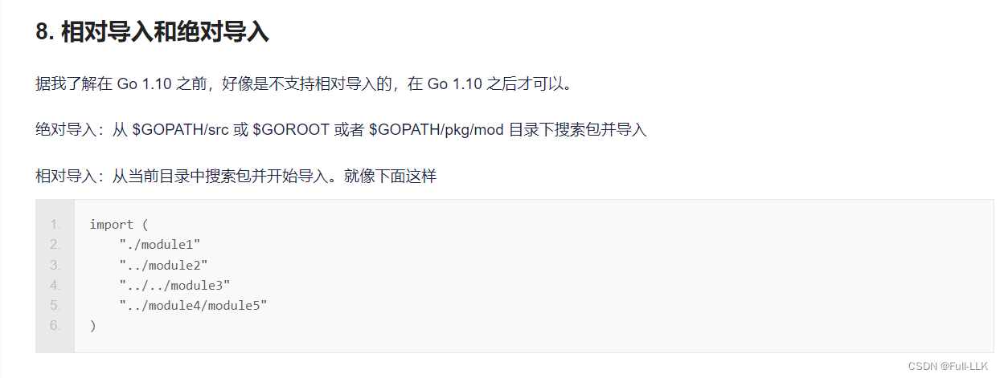
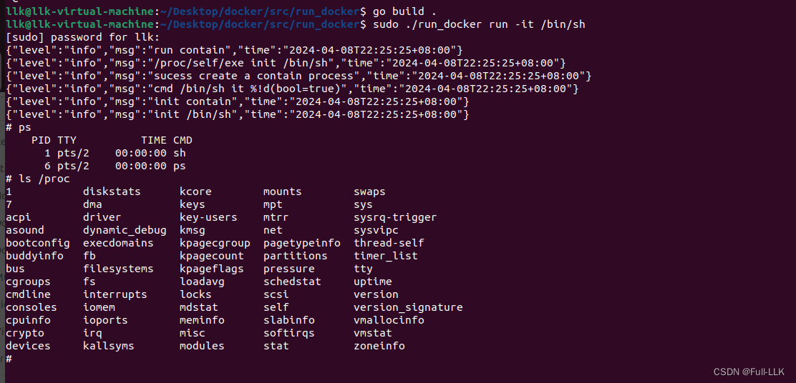
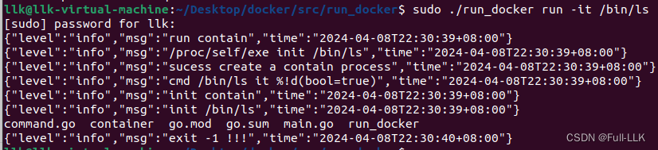
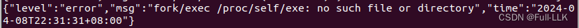



#  log "github.com/sirupsen/logrus"
log "github.com/sirupsen/logrus"：导入 github.com/sirupsen/logrus 包并将其重命名为 log

#  `args...` 

假设我们有一个切片 `myArgs := []string{"arg1", "arg2", "arg3"}`，想把这个切片作为参数传给 `exec.Command()` 函数。

如果直接把 `myArgs` 作为参数传入，`exec.Command()` 函数会把整个切片当作一个参数：

```go
cmd := exec.Command("/path/to/executable", myArgs)
```

这相当于执行命令 `/path/to/executable ["arg1" "arg2" "arg3"]`。

但如果使用 `args...` 语法，切片中的每个元素都可以作为独立参数传给 `exec.Command()` 函数：

```go
cmd := exec.Command("/path/to/executable", myArgs...)
```

这相当于执行命令 `/path/to/executable "arg1" "arg2" "arg3"`。

`args...` 语法会把 `myArgs` 切片中的每个元素作为独立参数传给 `exec.Command()` 函数。这种方式更灵活，可以方便地把任意长度的参数列表传给外部命令。

另一个例子是：

```go
args := []string{"-flag1", "value1", "-flag2", "value2"}
cmd := exec.Command("/path/to/executable", args...)
```

这会把 `args` 切片的全部 6 个元素作为独立参数传给 `/path/to/executable` 命令。

总之，`args...` 语法可以把切片展开为多个独立参数，传给接受多个参数的函数，这在处理命令行参数时非常有用。

# go module
[三种包管理方式参考链接](https://www.cnblogs.com/pass-ion/p/16527005.html)

[go get 下载的第三方包在哪里](https://blog.csdn.net/qq_24433609/article/details/127325302)

在 GOMODULE 模式下，go get 命令会把依赖包下载到 $GOPATH/pkg/mod 目录

**go module 包管理方式（推荐）**

`GO111MODULE` 是一个用来控制 Go Modules 行为的环境变量。Go 1.11 之后，Go 引入了 Go Modules 来管理依赖和版本控制。`GO111MODULE` 环境变量可以设置为以下值：

1. `GO111MODULE=on`：启用 Go Modules 的模式。设置为 `on` 时，Go 将使用 Go Modules 管理依赖，不再依赖 GOPATH。

2. `GO111MODULE=off`：禁用 Go Modules 的模式。设置为 `off` 时，Go 将使用传统的 GOPATH 模式管理依赖。

3. `GO111MODULE=auto`：自动模式。在自动模式下，Go 根据当前目录是否包含 go.mod 文件来决定是否启用 Go Modules。如果项目根目录下存在 go.mod 文件，就启用 Go Modules；否则使用 GOPATH 模式。

因此，当设置 `GO111MODULE=''`（即空字符串）时，表示没有显式设置 GO111MODULE 环境变量，Go 会按自动模式决定是否启用 Go Modules，具体行为取决于当前项目的目录结构以及是否存在 go.mod 文件。


```bash
go mod tidy:检测该文件夹目录下所有引入的依赖,写入 go.mod 文件。删除错误或者不使用的modules，下载没download的package（下载到$GOPATH/pkg/mod）

```

# 导入第三方包失败

```bash
go env -w GOPROXY=https://goproxy.cn,direct
```
然后再试一次

# package 与 go import
[go 包导入详解](https://blog.51cto.com/ghostwritten/5345281#7__81)




[golang 中使用同一目录下的文件，简单介绍 golang 中 package 的用法](https://www.jianshu.com/p/c78fb21d07d6)

在 golang 中，一个目录就是一个包。包级别的 func、type、变量和常量可以被该包下所有文件中的代码随意访问，不需要首字母大写。
要引用当前目录下其他子目录中的文件，可以导入该文件所在文件夹的相对位置，或导入 当前目录/子目录 中的包


[Go 语言中包的详解](https://m.jb51.net/article/255681.htm)

包分为两种：一种是 main 函数包（可执行文件），另一种是库函数包
可执行程序的包编译后生成可执行文件；静态库的包编译后生成以 .a 为后缀的文件（位于 $GOPATH/pkg/），它本身不能运行，只能被可执行程序的包引用。

可执行程序的包必须以 main 作为包名；静态库的包名没有这个要求

**main 包与其他库是静态链接的，因此生成的可执行文件没有外部依赖。**

#  go build . 与 go run 
go build . 编译当前目录下的所有文件，生成一个可执行程序
go run 编译并运行单个程序；这种情况下，如果多个 package 为 main 的程序相互依赖，对其中一个执行 go run 会报错，因为它用到了另一个 package 为 main 的程序


# cli 库
[Go 每日一库之 cli](https://darjun.github.io/2020/06/22/godailylib/cli/)

# `log.SetFormatter(&log.JSONFormatter{})` 


假设我们有一个记录一些基本信息的简单 Go 程序：

```go
package main

import (
    "log"
)

func main() {
    // 设置日志输出格式为 JSON 格式
    log.SetFormatter(&log.JSONFormatter{})

    // 记录一些日志信息
    log.Println("This is an informational message")
    log.Printf("User %s logged in", "John Doe")
    log.Fatalf("Failed to connect to database: %s", "connection refused")
}
```

在这个例子中，我们首先用 `log.SetFormatter(&log.JSONFormatter{})` 把日志输出格式设置为 JSON。

然后，分别用 `log.Println()`、`log.Printf()` 和 `log.Fatalf()` 记录三条不同级别的日志。

运行这个程序时，日志输出将是 JSON 格式，类似下面这样：

```json
{"level":"info","msg":"This is an informational message","time":"2024-04-07T12:34:56Z"}
{"level":"info","msg":"User John Doe logged in","time":"2024-04-07T12:34:56Z"}
{"level":"error","msg":"Failed to connect to database: connection refused","time":"2024-04-07T12:34:56Z"}
```

与默认的文本格式相比，JSON 格式的日志输出包含更多元数据，例如日志级别（`level`）、消息内容（`msg`）和时间戳（`time`）。这种结构化的日志格式更便于后续处理和分析，尤其是在需要由机器解析日志的场景中。

总之，`log.SetFormatter(&log.JSONFormatter{})` 是一个非常实用的方法，可以帮助我们在 Go 程序中更好地管理和处理日志信息。
# error 与 nil 的关系
`error` 类型与 `nil` 的关系如下：

- `error` 类型是 Go 中用来表示错误状态的接口。实现了 `Error()` 方法的值称为 `error` 值，即使它没有实现任何具体行为。
- `nil` 是 Go 中的一个特殊值，表示空值或不存在的值；对于 `error` 类型的值，`nil` 表示没有发生错误。

在函数返回值中，当函数正确执行、没有遇到错误时，我们通常用 `nil` 来表示。例如：

```go
func someFunction() error {
    // 函数执行成功，没有错误
    return nil
}
```

当函数执行过程中遇到错误时，我们返回一个非 `nil` 的 `error` 值，例如：

```go
func someFunction() error {
    // 函数执行失败，返回一个错误
    return errors.New("Some error occurred.")
}
```

所以 `error` 类型与 `nil` 的关系是：`nil` 表示 `error` 值处于无错误状态，非 `nil` 的 `error` 表示存在错误。函数返回时，如果 `error` 值为 `nil`，说明函数执行成功；否则说明发生了错误。

#   cmd.Wait() 与 cmd.Start()
err 变量在调用 cmd.Wait() 方法后获得返回值。调用 cmd.Start() 时，该方法会启动命令并在后台执行。如果启动命令时发生错误（例如命令不存在、权限不足等），cmd.Start() 会立即返回一个非 nil 的错误值。

cmd.Wait() 方法的作用是等待命令执行结束。命令结束时，该方法返回。返回值有两种含义：

如果命令成功结束，err 为 nil。
如果命令执行过程中发生任何错误（例如命令被信号终止、超时等），err 会包含相应的错误信息。
因此，在你的代码片段中，err = cmd.Wait() 这一行会阻塞，直到外部命令执行完毕，然后返回一个表示命令执行结果（成功或失败以及退出状态）的错误值。

#  args...
在 Go 中，`os/exec` 包提供了执行外部命令的能力。这里的代码片段用于创建一个可执行命令的实例。

`args := []string{"init", cmd}` 定义了一个字符串切片，存放要执行的命令及其参数。在这个例子中：

- `"init"`：是一个命令参数，表示要执行的子命令是 "init"。
- `cmd`：是一个变量，通常表示另一个命令参数。它的具体值取决于程序上下文中的赋值。

接着，`command := exec.Command("/proc/self/exe", args...)` 这一行用于创建一个新的 `*Cmd` 结构体实例，它表示一条待执行的命令。

`"/proc/self/exe"` 是一个特殊路径，在 Linux 系统中指向当前正在运行的可执行文件。换句话说，这实际上是要执行一个与当前进程相同的新进程，并传入参数 `args`。

`args...` 是 Go 的可变参数语法，它把字符串切片 `args` 展开为多个单独的参数传给 `exec.Command` 函数。

所以整条语句的作用是：根据给定的参数列表 `args`，执行一个与当前进程相同的新命令行程序，其中第一个参数是 "init"，第二个参数是变量 `cmd` 的值。

# context.Args().Get(0)
在 Go 中，这段代码基于第三方命令行工具库（如 `urfave/cli` 或 `cobra`）定义了一个命令行命令 `init` 的结构体。在这些库中，`cli.Context` 对象包含从命令行输入中解析出的全部信息。

`context.Args().Get(0)` 这一行用于在用户调用 `init` 命令并附带一个或多个额外参数时，获取命令行上紧跟在命令名 `init` 之后的第一个参数。

例如，假设用户在命令行执行以下命令：

```sh
./myapp init mycontainer
```

在上面的代码片段中，`context.Args().Get(0)` 会返回字符串 `"mycontainer"`。这是因为 `context.Args()` 返回一个包含所有非命令名参数的字符串切片，下标为 0 的元素就是第一个参数。

不过，从这段代码的具体上下文来看，开发者似乎并没有真正使用 `cmd` 变量（它保存着第一个参数的值），而是直接调用 `contain.init()` 方法来初始化容器。如果本意是用第一个参数来定制初始化行为，那么应该在调用 `contain.init()` 时使用 `cmd` 变量。
# syscall.Exec 与 os/exec.Command
在 Go 中，`syscall.Exec` 和 `os/exec.Command` 都用于执行外部程序，但它们在用途和机制上有显著区别：

1. **syscall.Exec**：
   - `syscall.Exec` 是一个底层系统调用，它直接在当前进程中替换当前程序的映像和数据，以执行新程序。
   - `syscall.Exec` 执行成功后，原程序的内存空间、文件描述符等资源由新程序接管；原程序不会恢复执行，因为它已被完全替换。
   - 通常用于想要彻底转换当前进程上下文且不再返回的情况。

2. **os/exec.Command**：
   - `os/exec.Command` 提供了更高层、更易用的 API 来执行外部程序，它不会替换当前进程的内容。
   - `exec.Command` 创建并返回一个 `*Cmd` 结构体；调用其 `Run()` 方法即可执行外部程序，执行完成后，当前 Go 程序继续执行后续代码。
   - 可以通过 `Output()`、`CombinedOutput()` 等方法获取子进程的输出，还可以控制子进程的标准输入、输出和错误流。
   - 如果需要在同一个进程中连续执行多个外部命令，或者需要处理子进程的输出，`os/exec` 库非常合适。

简而言之，`syscall.Exec` 更像是进程自身的变身，而 `os/exec.Command` 是在当前进程中启动一个新的子进程来执行任务，并允许对子进程进行更多控制和通信。

# `syscall.Exec` 
在 Go 中，当程序执行到 `syscall.Exec` 函数时，会发生以下事情：

1. **替换当前进程**：
   `syscall.Exec` 函数负责执行新程序，同时替换当前进程的映像和内存空间。这意味着当前正在执行的 Go 程序的所有代码和数据都会被新程序替换，没有机会再回到原 Go 程序的执行流程。

2. **资源继承**：
   新程序继承当前进程的 PID（进程 ID）、已打开的文件描述符以及其他与进程相关的资源。这意味着新程序可以从原进程接管控制权，例如继续监听同一组网络端口或读写已打开的文件。

3. **程序执行**：
   `syscall.Exec` 函数接受一系列参数，包括要执行的程序路径、命令行参数和环境变量。新程序会按指定方式执行，就像是由 shell 或其他启动器直接启动的一样。

4. **永不返回**：
   一旦 `syscall.Exec` 成功执行新程序，原 Go 程序的代码将不再执行，`syscall.Exec` 函数本身也不会返回——因为它已经不再是该进程的一部分。如果 `syscall.Exec` 失败（例如找不到要执行的程序或权限问题），它会返回一个错误，但这种情况下的“返回”实际上是当前进程内的应急错误处理逻辑，而不是原 Go 程序的逻辑继续执行。

5. **使用场景**：
   `syscall.Exec` 通常用于服务程序升级、执行子进程并替换自身以进入不同的执行环境，或者原程序不需要继续运行的场景。相比之下，如果想在当前进程中启动子进程并与之交互，或在子进程结束后继续执行，就应该使用 `os/exec` 包中的 `Command`、`Run` 等方法。


- `syscall.Exec(command, argv, os.Environ())` 的作用是：

  - `command`：要执行的新程序的路径或可执行文件名。
  - `argv`：一个字符串切片，包含传给新程序的命令行参数。在这个例子中只有一个参数 `command`，但实际上可以有多个，例如 `argv := []string{command, arg1, arg2, ...}`。
  - `os.Environ()`：该函数以 `key=value` 格式的字符串切片返回当前进程的环境变量列表。在 `syscall.Exec` 中，这个参数被传给新程序，使其继承当前进程的环境变量。

# mountflags


1. **syscall.MS_NOEXEC**：
   设置该标志后，挂载的文件系统上的任何文件都不能被执行，即使是可执行文件。这是一项重要的安全措施，可以防止恶意或意外地执行存放在特定文件系统分区上的程序。例如，在仅用于存储数据的分区上启用此选项可以增强安全性，确保潜在的恶意脚本或程序无法运行。

2. **syscall.MS_NOSUID**：
   使用该标志挂载文件系统时，系统会忽略文件上 Set-User-ID（SUID）和 Set-Group-ID（SGID）位的作用。在 Linux 中，SUID 和 SGID 权限通常允许用户在执行文件时临时获得文件所有者的权限或所属组的权限。禁用 SUID 和 SGID 意味着无论文件有什么特殊权限设置，进程在执行该文件时都不会继承文件所有者的用户 ID 或组 ID，从而限制权限滥用可能带来的安全风险。

3. **syscall.MS_NODEV**：
   使用该标志挂载文件系统时，系统不允许任何设备特殊文件在该文件系统上起作用。设备文件是用来访问硬件设备（如硬盘、终端、打印机等）的接口。禁止设备文件意味着无法在该挂载点上创建或访问设备节点，这对于防止未经授权的设备访问、增强隔离环境的安全性非常有用，例如在沙箱环境中或在安全要求较高的文件系统分区上。
# syscall.Mount
`syscall.Mount` 是 Go 标准库 `syscall` 包提供的一个函数，用于直接调用操作系统的系统调用来执行文件系统挂载操作。在 Linux 环境下，该函数对应 Linux 内核提供的 `mount(2)` 系统调用接口。

函数签名大致如下（不同 Go 版本可能有所不同）：

```go
func Mount(source string, target string, fstype string, flags int, data string) error
```

参数含义：

- `source`：要挂载的文件系统源，可以是设备名（如 `/dev/sda1`）、网络共享路径或其他形式；对于 `proc` 这样的虚拟文件系统，它是一个标识字符串。

- `target`：挂载点，即目标挂载路径，通常是一个已存在的目录。

- `fstype`：文件系统类型的名称，例如 `ext4`、`ntfs`，或上面提到的 `proc` 这类特殊文件系统类型。

- `flags`：挂载标志，由多个标志位组成的整数值，例如 `syscall.MS_NOEXEC | syscall.MS_NOSUID | syscall.MS_NODEV`；这些标志位控制挂载行为的不同属性。

- `data`：可选的额外挂载选项，通常是一个字符串，其格式取决于所使用的文件系统类型；对某些文件系统来说，它可能包含挂载选项列表或其他特定信息；对于不需要额外数据的文件系统，可以传入空字符串 `""`。

函数执行的结果是成功或失败；如果失败，会返回一个错误对象。

在给出的例子中：

```go
syscall.Mount("proc", "/proc", "proc", uintptr(defaultMountFlags), "")
```

这会把 Linux 的虚拟文件系统 `/proc` 挂载到 `/proc` 目录，并使用 `defaultMountFlags` 中定义的一系列与安全相关的挂载标志。

# 请注意，只有包中首字母大写的函数（公有函数）才能被其他包调用。首字母小写的函数（私有函数）只能在包内使用
#  代码
[https://github.com/FULLK/llkdocker/tree/main/run_docker](https://github.com/FULLK/llkdocker/tree/main/run_docker)

# 最终效果




# 问题
发现只能运行一次，下一次就会出现这种情况：
待解决

