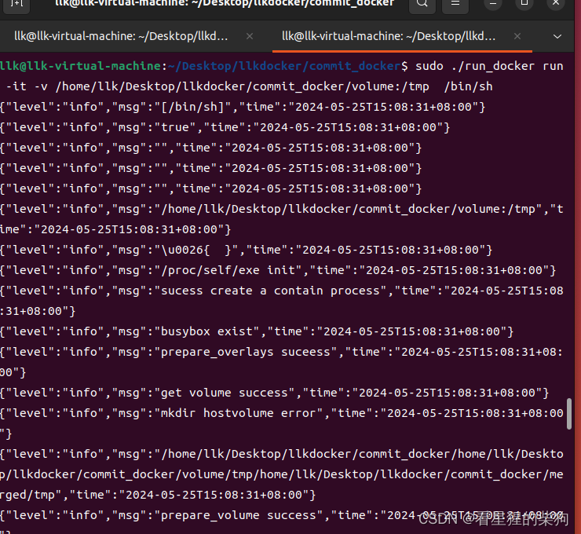
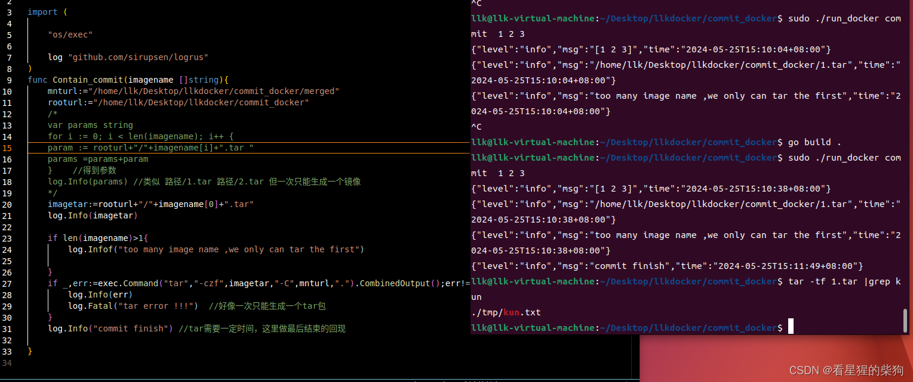



# 目标
pivot_root 将工作目录切换到 /merged 之后，通过 docker commit 保存此时工作目录的文件系统，用 tar 包把这个文件系统打包成一个 tar 文件
命令类似 ` ./mydocker commit myimage`，然后会在当前目录下得到 myimage.tar

# 注意
- commit 操作是在另一个终端中执行的，也就是说容器已经启动并正在运行。此时在另一个终端执行 commit 操作，不需要再挂载或再启动子进程——直接设定一个存放东西的位置即可，而不是像之前那样在联合挂载之后获取具体的工作目录地址

#  exec.Command

```python
exec.Command("tar", "-czf", imageTar, "-C", mntPath, ".").CombinedOutput()
```

这段代码使用 Go 标准库 `os/exec` 来执行一条外部命令——具体来说，是调用 `tar` 命令来创建一个压缩归档文件。下面逐部分解释：

- `exec.Command`：这是 Go 中用来创建并运行外部命令的对象。它接受可变数量的字符串参数，第一个参数是命令名，后面的参数是传给该命令的选项和参数。

- `"tar"`：这是命令本身。`tar` 是一个用于创建、读取、更新和管理归档文件的工具。

- `"-czf"`：这些是传给 `tar` 命令的选项。
  - `-c` 表示创建一个新的归档文件。也就是用 tar 命令把当前目录中的一系列文件和目录打包成一个归档文件（通常以 .tar 结尾）。这个过程不会压缩文件，只是把它们收集到一个归档文件中，便于管理和传输。
  - `-z` 表示在创建归档文件时进行 gzip 压缩。与 `-c` 结合使用，会创建 `.tar.gz` 格式的压缩归档文件。
  - `-f` 后面跟归档文件的名称。注意，由于 `-f` 后面需要直接跟文件名，在参数列表中，`imageTar` 变量将作为这个选项的值。

- `imageTar`：这是一个变量，表示要创建的归档文件的名称（包含路径）。例如，如果 `imageTar` 的值是 `/path/to/image.tar.gz`，那么这个归档文件会在指定路径下创建，并命名为 `image.tar.gz`。

- `"-C"`：这个选项告诉 `tar` 在执行操作之前先切换到指定目录。这里指定的目录由后面的参数决定。

- `mntPath`：这也是一个变量，表示一个目录路径。与 `-C` 选项结合，它指定了 `tar` 在执行操作前应切换到的目录。例如，如果 `mntPath` 的值是 `/mnt/mydir`，那么在执行打包操作之前会先进入该目录。

- `"."`：这是一个点字符，表示当前目录。在 `tar` 命令的语境中，它表示打包当前目录下的所有内容。由于之前已经用 `-C` 指定了目录，这里的“当前目录”就是 `mntPath` 所指向的目录。

- `.CombinedOutput()`：这个方法执行上面构造好的命令，并捕获其标准输出和标准错误的合并输出。返回的是一个字节切片，包含命令执行后的输出文本。这在调试或需要处理命令输出的场景中非常有用。

综上，这段代码的作用是：在 Go 程序中执行一条命令，使用 `tar` 工具把 `mntPath` 目录下的所有内容打包成一个 gzip 压缩的归档文件，保存在 `imageTar` 变量指定的路径和文件名下。


# tar

- `tar`：tape archive（磁带归档）的缩写，是一个用于创建、解压和查看 tarball（.tar 文件）的工具。
- `-t` 选项：表示列出 tar 文件中的内容。对一个 .tar 文件使用 `-t` 选项时，tar 命令会输出该归档文件中所有文件和目录的列表，但不会解压或提取它们。
- `-f` 选项：后面跟要操作的 tar 文件名。`-f` 是 file 的缩写，用于指定要处理的归档文件。

所以，当你运行 `tar -tf somefile.tar` 命令时，它会列出 `somefile.tar` 归档中的所有文件和目录结构，每行一项，但不会展开或解压该归档文件的实际内容。这对于在不真正解压的情况下快速查看 tar 文件包含哪些内容非常有用。
#  代码
[https://github.com/FULLK/llkdocker/tree/main/commit_docker](https://github.com/FULLK/llkdocker/tree/main/commit_docker)
添加一个命令
```go
func main(){
	//定义相关命令
	app:=cli.NewApp()
	app.Name="llkdocker"
	app.Usage="my simple docker -llkdocker "
	app.Commands=[]cli.Command{
		runcommand,
		initcommand,
		commitcommand,
	}//Commands 属性是一个 []cli.Command 类型的切片

	app.Before=func(context *cli.Context)error{

	log.SetFormatter(&log.JSONFormatter{})
	log.SetOutput(os.Stdout)
	return nil
	} //在处理命令参数之前先进行的函数

	if err:=app.Run(os.Args);err!=nil{
		log.Fatal(err)
	}
}
```

检查参数个数，最后执行相应的操作
```go
var commitcommand = cli.Command{
	Name:  "commit",
	Usage: "commit  image",
	Action: func(context *cli.Context)error {
		args := context.Args()//commit后参数的作为这里
		if len(args)<1 {
			log.Fatal("missing the image name you want to save ")
		}

		log.Info(args)
		contain.Contain_commit(args)
		return nil
	},
}
```

这里要注意，tar 打包好像最终只能生成一个 tar 文件
```go
func Contain_commit(imagename []string){
	mnturl:="/home/llk/Desktop/llkdocker/commit_docker/merged"
	rooturl:="/home/llk/Desktop/llkdocker/commit_docker"
	/*
	var params string
	for i := 0; i < len(imagename); i++ {
	param := rooturl+"/"+imagename[i]+".tar "
	params =params+param   
	}	 //得到参数
	log.Info(params) //类似 路径/1.tar 路径/2.tar 但一次只能生成一个镜像
	*/
	imagetar:=rooturl+"/"+imagename[0]+".tar"
	log.Info(imagetar)

	if len(imagename)>1{
		log.Infof("too many image name ,we only can tar the first")

	}
	if _,err:=exec.Command("tar","-czf",imagetar,"-C",mnturl,".").CombinedOutput();err!=nil{
		log.Info(err)
		log.Fatal("tar error !!!")  //好像一次只能生成一个tar包 
	}
	log.Info("commit finish") //tar需要一定时间，这里做最后结束的回现

}

```


# 结果
先在一个终端中启动

然后再开一个终端执行 commit


